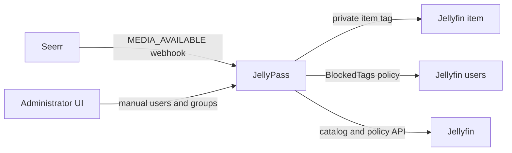

# JellyPass

[](https://github.com/nicklongmore86/jellypass/actions/workflows/ci.yaml)
[](LICENSE)
[](https://github.com/nicklongmore86/jellypass/pkgs/container/jellypass)

**Private media access for shared Jellyfin servers.**

JellyPass connects Seerr requests to Jellyfin's native tag-based access
policies. When requested media becomes available, JellyPass keeps it visible to
the requester and blocks it for other non-administrator users. It also provides
an administrator UI for retroactive access assignment, reusable household
groups, and household-specific Jellyfin hostnames.

JellyPass is independent, community-maintained software. It is not affiliated
with or endorsed by Jellyfin, Seerr, or Jellyseerr.

> [!CAUTION]
> JellyPass changes Jellyfin item tags and complete user-policy documents. Test
> with non-critical users and media first, keep a backup of the state file, and
> retain a separate Jellyfin administrator recovery path.

## What it does

- Converts Seerr `MEDIA_AVAILABLE` webhooks into durable access grants.
- Protects movies, complete series, and locally associated trailers.
- Preserves unrelated Jellyfin tags and blocked tags.
- Lets administrators assign users or reusable groups to existing library
  items, individually or in batches of up to 500.
- Reconciles tags and policies after transient failures or user changes.
- Maintains a searchable Jellyfin catalog without automatically making every
  catalog item private.
- Provides household URLs whose login picker exposes only that household's
  public users, signs passwordless members in with one tap, and preserves the
  password prompt for everyone else.
- Proxies household media requests, byte ranges, HLS requests, and WebSockets.
- Lets household members add a title another household requested to their own
  library, without learning who requested it.
- Exposes health and Prometheus metrics endpoints.

JellyPass does **not** replace Jellyfin authentication, manage downloads, or
decide whether a Seerr request should be approved. Seerr remains the
request and acquisition authority; Jellyfin remains the playback authorization
authority.

## How access enforcement works



For each protected title, JellyPass:

1. Creates one stable tag derived from the Jellyfin item ID, such as
   `jfa:private:8f...`.
2. Adds that tag to the movie or series and its known local trailers.
3. Adds the tag to `BlockedTags` for every non-administrator Jellyfin user except
   the request owner, manually assigned users, and members of assigned groups.
   A request grant is assigned to the requester's household automatically (see
   [Household-scoped request grants](#household-scoped-request-grants)).
4. Persists the desired grant in `grants.json` and periodically reconciles it.

Administrator accounts are never blocked. Existing, unmanaged media remains
public to users whose normal Jellyfin policy allows it.

### Catalog items are not grants

The **Library** tab is an inventory of movies and series discovered during a
Jellyfin catalog sync. The **Grants** tab contains only titles that JellyPass is
actively protecting.

A newly downloaded or newly scanned item does not become a grant merely because
it appears in the catalog. A grant is created by one of these events:

- JellyPass receives Seerr's `MEDIA_AVAILABLE` webhook for a request.
- The optional request backfill finds an available request created after
  `REQUEST_BACKFILL_SINCE` that the webhook missed.
- An administrator assigns access from the Library tab or API.

Library upgrades, replacements, manual downloads, and titles that Seerr
already considered available before JellyPass was installed may not produce a
new webhook. Assign those items from the Library tab if they should be private.

### Household-scoped request grants

When a request produces a grant, whether through the webhook or the request
backfill, JellyPass records the requester and also assigns every group
(household) the requester belongs to at that moment. Everyone in the
requester's household can see the title; members of other households cannot.

- A requester who belongs to no group gets a user-only grant, as before.
- A requester who belongs to several groups shares the title with all of them.
- Groups and users already on the grant, including ones an administrator
  assigned manually, are always kept; requests only add groups.
- Revoking a request does not remove the households it added, so the title
  stays visible to those households instead of becoming public. To make it
  public, clear the grant's groups (UI or `PUT /v1/grants/{itemId}/groups`).
  The title becomes public only once no other requests or manual users remain
  on the grant.
- Joining a household later does not change older grants. Add the group to
  those grants, or add the user to a household that is already assigned.
- A member of another household can add the title to their own library with
  [Add to my library](#add-to-my-library), which adds their households to the
  grant.

## Requirements

- Jellyfin 10.11 or newer.
- Seerr with webhook support and Jellyfin-linked users. See
  [Configure Seerr](#configure-seerr).
- A Jellyfin administrator API key.
- Docker with Compose v2 for the recommended installation, or Node.js 22+ and
  pnpm for a source installation.
- A persistent, private location for `grants.json`.

Seerr lookup is optional only if every webhook includes the Jellyfin media and
user IDs and recent-request cards, the request backfill, and Seerr user import
are not needed.

## Quick start with Docker Compose

Create a directory and download the public deployment files:

```sh
mkdir jellypass && cd jellypass
curl -LO https://raw.githubusercontent.com/nicklongmore86/jellypass/main/compose.yaml
curl -Lo .env https://raw.githubusercontent.com/nicklongmore86/jellypass/main/.env.example
mkdir -m 700 data
```

Edit `.env` and replace every placeholder. Generate two different secrets, for
example:

```sh
openssl rand -hex 32
openssl rand -hex 32
```

Start JellyPass:

```sh
docker compose up -d
docker compose ps
curl http://127.0.0.1:8787/health
```

The default Compose file binds JellyPass only to `127.0.0.1:8787`. Keep that
default when a reverse proxy runs on the same machine. Change the published
address deliberately if Seerr or a reverse proxy must reach it over a
private network.

The container image is published from `main` as `latest` and from release tags
as semantic-version tags. For predictable production upgrades, set
`JELLYPASS_IMAGE` in `.env` to a versioned image such as:

```dotenv
JELLYPASS_IMAGE=ghcr.io/nicklongmore86/jellypass:2.1.1
```

Each release is published as a semantic-version image tag, such as `2.1.1`,
plus floating `2.1` and `2` tags that move to the newest release in that minor
or major line; see [CHANGELOG.md](CHANGELOG.md) for what each one contains. `latest` is rebuilt on
every push to `main` and may include unreleased changes, so use it, or build
from source, only to test ahead of a release.

### Build locally instead

Clone the repository, create `.env`, and use the source-build example:

```sh
git clone https://github.com/nicklongmore86/jellypass.git
cd jellypass
cp .env.example .env
# Edit .env.
docker compose -f compose.example.yaml up --build -d
```

## Configuration

JellyPass reads configuration from environment variables at startup.

| Variable | Required | Default | Description |
| --- | --- | --- | --- |
| `JELLYFIN_URL` | Yes | — | Base URL reachable from JellyPass, without a trailing slash. |
| `JELLYFIN_API_KEY` | Yes | — | Jellyfin administrator API key used for catalog, tag, and policy operations. |
| `WEBHOOK_TOKEN` | Yes | — | Secret accepted by `/webhooks/seerr`. Use a long random value. |
| `ADMIN_TOKEN` | Recommended | `WEBHOOK_TOKEN` | Separate bearer token for administrative APIs and metrics. |
| `SEERR_URL` | Conditional | — | Seerr base URL reachable from JellyPass. Configure with `SEERR_API_KEY`. |
| `SEERR_API_KEY` | Conditional | — | Seerr API key. Configure with `SEERR_URL`. |
| `STATE_FILE` | No | `./data/grants.json` | Durable state-file path. The container uses `/app/data/grants.json`. |
| `HOST` | No | `0.0.0.0` | HTTP listen address inside the process/container. |
| `PORT` | No | `8787` | HTTP listen port. |
| `RECONCILE_INTERVAL_SECONDS` | No | `300` | Retry/reconciliation interval; `0` disables scheduling. Maximum `86400`. |
| `CATALOG_SYNC_INTERVAL_SECONDS` | No | `3600` | Jellyfin catalog refresh interval; `0` disables scheduling. Maximum `604800`. |
| `HOUSEHOLD_DOMAIN` | No | — | Enables household hostnames below this DNS domain. |
| `HOUSEHOLD_HOST_PREFIX` | No | `jelly-` | Prefix placed before each DNS-safe group ID. |
| `REQUEST_BACKFILL_SINCE` | No | — | `YYYY-MM-DD` (UTC midnight) or an ISO 8601 date-time with `Z` or an offset, such as `2026-10-15T08:00:00+02:00`. Impossible dates are rejected. Requests created before it are never imported by the backfill. |
| `REQUEST_BACKFILL_ENABLED` | No | `true` when `REQUEST_BACKFILL_SINCE` is set, otherwise `false` | Grants available Seerr requests that the webhook missed. Requires Seerr configuration and `REQUEST_BACKFILL_SINCE`. |
| `WS_IDLE_TIMEOUT_MS` | No | `300000` | Closes a proxied household WebSocket after this many milliseconds with no bytes in either direction; `0` disables. Jellyfin drops sockets after 60 s without a client KeepAlive (clients send one every 30 s), so values at or below `60000` log a startup warning. Maximum `86400000`. |
| `WS_UPSTREAM_IDLE_TIMEOUT_MS` | No | `180000` | Closes a proxied household WebSocket after this many milliseconds with no bytes from Jellyfin, even while the client keeps sending; `0` disables. Jellyfin answers every client KeepAlive and pings quiet sockets, so a healthy server is never silent for much more than 60 s; values at or below `60000` log a startup warning. Maximum `86400000`. |
| `LOG_LEVEL` | No | `info` | One of `debug`, `info`, `warn`, `error` (case-insensitive; aliases such as `trace`/`verbose`, `information`, and `warning` are accepted). Only `debug` changes output today: it also logs routine client disconnects (`ECONNRESET`, `EPIPE`, aborted streams, keepalive timeouts) and idle WebSocket closes on the household proxy. `info`, `warn`, and `error` are accepted but behave identically. Jellyfin-side resets and other unexpected proxy errors are always logged as warnings. An unrecognised value logs a startup warning and falls back to `info`. |
| `TRUSTED_PROXIES` | No | — | Comma-separated IP addresses and CIDR ranges (IPv4 or IPv6) of reverse proxies in front of JellyPass, such as `192.0.2.10, 2001:db8::/64`. When the connecting peer is listed, JellyPass reads the client address from `X-Forwarded-For` for login rate limits; otherwise it uses the peer and ignores the header. Empty trusts no proxy. An invalid entry stops startup. See [Running behind a reverse proxy](#running-behind-a-reverse-proxy). |
| `JELLYPASS_IMAGE` | Compose only | `ghcr.io/nicklongmore86/jellypass:latest` | Container tag used by `compose.yaml`. |
| `JELLYPASS_ENV_FILE` | Compose only | `.env` | Alternate environment-file path used by either Compose file. |

`SEERR_URL` and `SEERR_API_KEY` must be set together. `ADMIN_TOKEN` falls back
to `WEBHOOK_TOKEN` for backward compatibility, but using different values limits
the impact of a leaked webhook URL or notification configuration.

### Request backfill

The `MEDIA_AVAILABLE` webhook is the fast path, but some Seerr releases fail to
deliver it or do not expose webhook settings at all. With the request backfill
enabled, JellyPass runs it once about five seconds after startup and then before
every reconciliation cycle (`RECONCILE_INTERVAL_SECONDS`; with `0` it runs only
at startup). It pages `GET /api/v1/request` and records each request that:

- was created at or after `REQUEST_BACKFILL_SINCE`,
- was approved or completed in Seerr (pending, declined and failed requests
  are skipped, even when the media is available through another request),
- has media that is available or partially available,
- has a Jellyfin media ID and a requester linked to an existing Jellyfin user,
- targets a Jellyfin item that still exists, and
- has not already been recorded by a webhook or an earlier backfill run.

If the item has no grant, the request creates a household-scoped one. If the
item already has a grant that came from other requests, for example another
household requesting a different season, the request is added to it along with
the requester's households. Nothing already on the grant is removed. Items with
a manual-only grant (no requests) are left exactly as the administrator set
them.

For 4K requests, the backfill uses the 4K availability status and
`jellyfinMediaId4k` only. A 4K request without a 4K item is skipped rather than
falling back to the HD item, so it cannot privatize an HD title that was public
before the cutoff. The webhook applies the same rule: a 4K request whose 4K item
Seerr does not know yet is rejected as an error and not recorded, so the backfill
grants it once the 4K item exists (when the request backfill is enabled).

The cutoff exists so that titles that were already public before JellyPass
managed them stay public. Set it to the date you start relying on JellyPass,
never to an early date that would make a whole back catalogue private.

The backfill is idempotent. Every request recorded on a grant is remembered,
including requests on grants that existed before this feature (seeded when the
state file loads), so a grant an administrator later revokes or clears is not
recreated. Each request is counted as exactly one outcome:

- **granted** (`jfa_request_backfill_total{result="granted"}`): the grant was
  stored and applied to Jellyfin.
- **error** (`{result="error"}`): the lookup failed, or the grant was stored but
  could not be applied yet. Such a grant stays in an error state and the regular
  reconciliation retries it; it is not also counted as granted.
- **skipped** (not exported): not approved, not available, before the cutoff,
  already recorded, unresolvable, or the Jellyfin item was deleted. A deleted
  item is logged once at `debug`, not as an error on every cycle.

A failure on one request never stops the rest of the run.

### Network addresses

Container-local `localhost` refers to the JellyPass container itself. Use a
shared Docker network and service names such as `http://jellyfin:8096`, a private
LAN address, or `host.docker.internal` where your Docker setup supports it.

JellyPass must be able to reach Jellyfin and, when configured, Seerr. Those
services need to reach JellyPass only as follows:

- Seerr needs `/webhooks/seerr`.
- Administrators need `/admin/` and the administrative API.
- Household clients need the full household origin.

### Running behind a reverse proxy

Behind a reverse proxy every request reaches JellyPass from the proxy's
address. Set `TRUSTED_PROXIES` to that address (or its subnet) so the household
and administrator login rate limits apply per client instead of putting every
client behind the proxy in one bucket:

```dotenv
TRUSTED_PROXIES=192.0.2.10
```

JellyPass walks `X-Forwarded-For` from right to left, skips trusted proxies, and
uses the first address that is not trusted. A request from an address that is
not listed is attributed to that address, and its `X-Forwarded-For` is ignored,
so clients cannot choose their own address. List only proxies you control, and
make sure they append to `X-Forwarded-For` rather than pass through whatever
the client sent.

Addresses are compared in canonical form: IPv4-mapped IPv6 addresses (such as
`::ffff:192.0.2.1`, in any spelling) count as the IPv4 address, IPv6 is compared
regardless of case or zero compression, and IPv6 zone IDs (`%eth0`) are
ignored. A `TRUSTED_PROXIES` entry must not include a port or brackets.
`X-Forwarded-For` entries may carry a port (`192.0.2.1:4711`,
`[2001:db8::1]:4711`). An entry that is not a valid address or has an invalid
port ends the walk at the trusted proxy that wrote it, so that request is
attributed to the proxy.

#### Chains of proxies and CDNs

Every hop between the client and JellyPass must be accounted for. JellyPass
stops at the first address it does not trust, so with a CDN in front of your
reverse proxy (for example Cloudflare → reverse proxy → JellyPass) the
reverse proxy's peer is a CDN edge server. Pick one of these, and configure
Jellyfin's known proxies to match (see [Forwarding to Jellyfin](#forwarding-to-jellyfin)):

- **The reverse proxy restores the real client address.** It uses the CDN's
  client-address header and published address ranges (for nginx, the
  `real_ip` module with `set_real_ip_from` for each CDN range and
  `real_ip_header CF-Connecting-IP`), so the `X-Forwarded-For` it sends ends
  with the real client. `TRUSTED_PROXIES` lists the reverse proxy, and
  Jellyfin's known proxies list JellyPass and the reverse proxy.
- **JellyPass and Jellyfin walk past the CDN.** The reverse proxy appends the
  CDN edge address to `X-Forwarded-For` as usual. `TRUSTED_PROXIES` lists the
  reverse proxy and the CDN's published address ranges, and Jellyfin's known
  proxies list JellyPass, the reverse proxy, and the same CDN ranges. Keep
  both lists current when the CDN publishes changes.

Otherwise every client is attributed to a CDN edge address: the per-client
login limits are shared again, and Jellyfin sees the CDN as the client.

#### Login lockouts are best-effort

The household and administrator login limits each track at most 10,000 client
addresses and evict the oldest first. A flood of logins from that many
genuinely distinct source addresses, such as an attacker with a routed IPv6
range, can therefore evict an active lockout before its five minutes are up.
A spoofed `X-Forwarded-For` cannot do this: from an untrusted peer it is
ignored, and every request counts against the peer's own address.

#### Forwarding to Jellyfin

The household gateway forwards to Jellyfin like any other proxy hop: it appends
the address it received the request from to `X-Forwarded-For`, keeping existing
entries, and sets `X-Forwarded-Proto` when it is missing. For Jellyfin to log
and apply its own policies to the real client address, add every hop that it
must walk past to Jellyfin's known proxies
(**Dashboard → Networking → Known proxies**): JellyPass and the reverse proxy
in front of it and, if `TRUSTED_PROXIES` also lists CDN ranges instead of the
reverse proxy restoring the client address, those CDN ranges too (see
[Chains of proxies and CDNs](#chains-of-proxies-and-cdns)).

JellyPass also sets `X-Real-IP` to the client address it resolved, but only
when the request does not already carry one. An existing `X-Real-IP` is passed
through unchanged, even from an untrusted client, and Jellyfin does not read
`X-Real-IP`, so do not rely on it downstream. Use `X-Forwarded-For`.

## Configure Seerr

Seerr is the successor to Jellyseerr and Overseerr, which merged into one
project. Existing Jellyseerr installations keep working: JellyPass uses the
same webhook agent and the same `/api/v1` endpoints (`/api/v1/request`,
`/api/v1/user/import-from-jellyfin`, `/api/v1/movie/{id}`, `/api/v1/tv/{id}`)
with an `X-Api-Key` header, which Jellyseerr and Seerr both provide, so no
settings change when you upgrade from Jellyseerr to Seerr. Overseerr on its own
supports only Plex, so it cannot link requests to Jellyfin users and does not
work with JellyPass.

The requesting Seerr account must be imported from or linked to Jellyfin.
A local-only account without a Jellyfin user ID cannot receive a Jellyfin grant.

In **Settings → Notifications → Webhook**:

1. Enable the webhook agent.
2. Select only **Request Available**.
3. Set the URL to `http://jellypass:8787/webhooks/seerr` for a shared Docker
   network, adjusting the host for your installation.
4. Set the authorization header to `Bearer YOUR_WEBHOOK_TOKEN` when the
   Seerr version supports it.
5. Use the payload below.

```json
{
  "notificationType": "{{notification_type}}",
  "event": "{{event}}",
  "media": {
    "jellyfinMediaId": "{{media_jellyfinMediaId}}",
    "mediaType": "{{media_type}}"
  },
  "request": {
    "id": "{{request_id}}",
    "requestedBy": {
      "jellyfinUserId": "{{requestedBy_jellyfinUserId}}",
      "username": "{{requestedBy_username}}"
    }
  }
}
```

JellyPass trusts the payload's media and user IDs only when both are present
and `event` identifies an HD request. Seerr sends `Movie Request Now Available`
or `Series Request Now Available` when a request becomes available, and `Movie
Now Available` or `Series Now Available` when a request is approved for media
that is already available. For a 4K request the same texts start with `4K `.
Seerr fills `{{media_jellyfinMediaId}}` with the HD item even for a 4K request,
and no template variable carries the 4K item. So when `event` names a 4K
request, or the payload has no recognizable `event`, JellyPass asks Seerr for
the request and grants the 4K item. Without `SEERR_URL` and `SEERR_API_KEY`,
JellyPass can only use the payload IDs, so it does so only for a recognized HD
`event`. A 4K event, or a payload whose `event` is missing, empty, unfilled
(`{{event}}`) or unrecognized, is rejected with `502` and counted as an error
rather than granted on what may be the HD item. A payload without both Jellyfin
IDs still returns `400` ("missing Jellyfin IDs"). A repeated webhook for a
request JellyPass has already handled skips this check, because it only
reapplies the recorded grant or is ignored (see below). Keep
`"event": "{{event}}"` in the payload when Seerr lookup is not configured.

Seerr may deliver the same webhook more than once. A request is handled once
its grant has been stored, and a handled request is never granted again. If a
grant still records the request, a repeated webhook only reapplies that grant
as it stands, so household groups an administrator removed stay removed. If an
administrator revoked the request, the webhook returns `202` with
`{"status":"ignored"}` and counts as `jfa_webhooks_total{result="ignored"}`. A
webhook that failed before its grant was stored, for example because Seerr was
unreachable, is handled normally when it is retried.

Some Jellyseerr releases do not expose Jellyfin IDs as webhook template
variables. When `SEERR_URL` and `SEERR_API_KEY` are configured, this smaller
payload is sufficient because JellyPass resolves the request through the API:

```json
{
  "notificationType": "{{notification_type}}",
  "request": { "id": "{{request_id}}" }
}
```

If the notification UI cannot add an authorization header, append
`?token=YOUR_WEBHOOK_TOKEN` to the webhook URL. Query strings can appear in
proxy logs, browser history, and diagnostics, so keep this route private and
prefer the bearer header whenever possible.

After configuration, use Seerr's test function if available. Every event
other than `MEDIA_AVAILABLE`, including Seerr's `TEST_NOTIFICATION`, returns
`202` with `{"status":"ignored"}` once the token is accepted, even though Seerr
sends an empty request ID for test events. The `notificationType` itself must
still be a real value made of uppercase letters and underscores; an unfilled
`{{notification_type}}` returns `400` and is counted as invalid. A `202` therefore proves only that
JellyPass is reachable and the token is correct, not that the payload works:
`MEDIA_AVAILABLE` events are validated strictly, and a missing, empty, or
unfilled `{{...}}` ID returns `400` and is counted as
`jfa_webhooks_total{result="invalid"}`.

> [!WARNING]
> Enter the payload in Seerr's own webhook form and let Seerr save it. Seerr
> stores `jsonPayload` in its own encoding; a value hand-written into
> `settings.json` (for example, base64 of the raw JSON) is not decoded the way
> Seerr expects, and webhooks then arrive malformed or not at all. Check
> `jfa_last_webhook_received_timestamp_seconds` and
> `jfa_webhooks_total{result="invalid"}` in `/metrics` after a test, and enable
> the [request backfill](#request-backfill) so a broken webhook is not fatal.

## Administrator UI

Open `http://127.0.0.1:8787/admin/` or the protected HTTPS URL exposed by your
reverse proxy. Sign in with an enabled Jellyfin administrator account.

JellyPass sends credentials directly to Jellyfin, immediately closes the
temporary Jellyfin session, and stores only an in-memory JellyPass session for
12 hours. Restarting JellyPass signs browser sessions out.

The UI contains four views:

- **Dashboard** — grant counts, synchronization health, and up to 12 recent
  Seerr requests linked to the synchronized catalog.
- **Library** — catalog search, filters, sorting, pagination, and bulk access
  assignment for up to 500 selected items.
- **Grants** — active automated and manual grants, owners, groups, sync status,
  dry-run plans, and revocation.
- **Groups** — reusable audiences, household URLs, and optional Jellyfin user
  creation/import.

Run a catalog sync after first installation. Assigning access from the Library
tab creates a manual grant; catalog synchronization alone does not.

## Household Jellyfin URLs

Access groups can also act as households. With:

```dotenv
HOUSEHOLD_DOMAIN=example.com
HOUSEHOLD_HOST_PREFIX=jelly-
```

the group ID `farmhouse` receives the URL
`https://jelly-farmhouse.example.com`. On that hostname, JellyPass filters
Jellyfin's public-user response to the group's members and proxies supported
Jellyfin HTTP, streaming, byte-range, HLS, and WebSocket traffic.

Deployment requirements:

- Point each hostname, or a suitable wildcard DNS record, at the reverse proxy.
- Use a TLS certificate covering each hostname; `*.example.com` covers the
  single-label format above.
- Preserve the original `Host` header.
- Forward WebSocket upgrades and byte-range requests.
- Avoid proxy buffering for large media responses.
- Do not expose the JellyPass listener directly to untrusted clients.
- Set `TRUSTED_PROXIES` to the proxy and add JellyPass to Jellyfin's known
  proxies; see [Running behind a reverse proxy](#running-behind-a-reverse-proxy).
- Keep a separate normal Jellyfin administrator/recovery origin.

Unknown household hostnames fail closed with `404`. Group IDs used as household
IDs must contain lowercase letters, numbers, and hyphens and be no longer than
63 characters.

### Add to my library

Seerr hides **Request** for a movie that is already available and rejects a
duplicate request while it downloads, so a second household cannot get a movie
another household requested through Seerr. Household records exist for
privacy, not control: any household may watch a title another household has,
but must never learn who requested it or which household holds it.

With Seerr configured (`SEERR_URL` and `SEERR_API_KEY`), every household
hostname serves a small page at `/jellypass/add`, for example
`https://jelly-farmhouse.example.com/jellypass/add`. A member who is signed in
to Jellyfin on that hostname pastes a Seerr or TMDB link to a movie or series
(or a bare TMDB ID) and selects **Add to my library**. Share the link with
households. The page reuses the Jellyfin web client's sign-in on the same
hostname and has no sign-in of its own.

JellyPass looks the title up in Seerr, takes the HD Jellyfin item Seerr has
linked to it (4K items are never joined) and, when that item has a grant that
came from at least one request, adds the caller's households to it. A caller in
no household is added as a user instead. It applies the change to Jellyfin in
the background, normally within seconds.

- **Nothing is removed**, and manual-only grants (no requests) are left exactly
  as an administrator set them, the same rule as the request backfill. Public
  titles need no join.
- **Administrator removals stick.** A household an administrator took off a
  grant (in the grant's groups, the manual-access dialog, or bulk access) is
  remembered in the grant's `removedGroupIds`, and every user that change, or
  revoking a request, took access from (a removed manual user, the requester,
  each member of a removed household with no other access) in
  `removedUserIds`. A join never adds a marked household, and a marked user's
  own joins change nothing at all, whichever household they belong to later
  and even once they belong to none. A caller's unmarked households are still
  added. A mark is personal: it does not stop another, unmarked member of the
  caller's household from joining that household, which then includes the
  marked user; remove the household itself to prevent that. Assigning a
  household again clears its mark, and assigning a user as a manual user, or
  adding a household they belong to, clears theirs; deleting a group clears
  its own mark from every grant but not its former members'. Changing a
  household's membership marks nobody. A new Seerr request still adds its
  requester's households as before.
- **Joins are audited.** Each join that changed a grant is recorded in the
  grant's `joins` (user, households added, whether the user was added, time),
  visible only to administrators through `GET /v1/grants`, and logged as
  `household library join`.
- **The answer never tells what happened.** Once the caller is signed in and
  the input is valid, the response is always `202 {"status":"accepted"}`, sent
  at once, before the title is looked up: the Seerr lookup, the join and
  applying it to Jellyfin all run in the background afterwards, so neither the
  answer nor how long it takes depends on whether the title was joined,
  already visible, public, held by another household, manual-only, not in the
  library, or could not be looked up. Requester IDs, household names, counts, timestamps and item IDs
  are never returned. The caller can only tell whether the title appears in
  their library afterwards. Details are logged server-side
  (`library join changed nothing` and similar at `LOG_LEVEL=debug`).
- **Identity comes from Jellyfin only.** `POST /jellypass/add` takes
  `{"mediaType": "movie" | "tv", "tmdbId": <number>}` and the caller's Jellyfin
  token in the usual `Authorization` header; JellyPass checks it with
  Jellyfin's `GET /Users/Me`, exactly as it does for protected media, and
  ignores any user ID in the body. A missing, invalid or disabled user's token
  gets `401`, malformed input `400`, and administrators (who see everything
  already) change nothing.
- **Rate limited.** Each client address (after `TRUSTED_PROXIES`) may call it
  30 times in 10 minutes, signed in or not; further calls get `429`. Each
  user may start 10 joins in 10 minutes, and all users together 200; a signed-in,
  valid call past either budget gets the same `202` but its join is not
  started, so try again later. These budgets count calls and are never given
  back when a join finishes, so whether a call is started depends only on how
  many calls were made and when, not on any title; they also bound the joins
  waiting on Seerr or Jellyfin to 200 started per 10 minutes. A join that
  would change nothing (public, already visible, manual-only, missing) is
  decided without waiting behind other writes.
  During shutdown it answers `503`; joins already running are stopped before
  their next step and given the usual grace period, and a join that was saved
  but not yet applied to Jellyfin is applied after restart.
- `jfa_library_joins_total{result="joined"|"unchanged"|"error"|"dropped"}`
  counts calls. `unchanged` deliberately covers every no-op reason, `dropped`
  counts calls not started because a budget was used up, and no label names a
  title.

Without Seerr, `/jellypass/` paths are proxied to Jellyfin like any other.

Filtering the login picker is a privacy and usability boundary, not
authentication. Users still authenticate with Jellyfin, and Jellyfin policies
remain authoritative. Quick Connect and legacy-login restrictions are described
in [the household access design](docs/household-access.md).

## Operations

### Health and logs

```sh
curl http://127.0.0.1:8787/health
docker compose logs --tail=100 jellypass
```

`/health` reports process liveness. It does not guarantee that Jellyfin or
Seerr is reachable; use the UI synchronization status and logs for that.

### Administrative API examples

All examples except health require `Authorization: Bearer $ADMIN_TOKEN`.

```sh
# Inspect grants.
curl -H "Authorization: Bearer $ADMIN_TOKEN" \
  http://127.0.0.1:8787/v1/grants

# Preview reconciliation without changing Jellyfin.
curl -X POST -H "Authorization: Bearer $ADMIN_TOKEN" \
  'http://127.0.0.1:8787/v1/reconcile?dryRun=true'

# Reapply desired tags and policies.
curl -X POST -H "Authorization: Bearer $ADMIN_TOKEN" \
  http://127.0.0.1:8787/v1/reconcile

# Prometheus metrics.
curl -H "Authorization: Bearer $ADMIN_TOKEN" \
  http://127.0.0.1:8787/metrics
```

### Backup and restore

The state file is the only JellyPass application data that must persist. It
contains grants, access groups, synchronization status, Jellyfin user
IDs, and a catalog containing media names and IDs. Protect it as private data.

For a consistent filesystem backup:

```sh
docker compose stop jellypass
cp -p data/grants.json data/grants.json.backup
docker compose start jellypass
```

Also back up Jellyfin independently. JellyPass can reconcile its desired state,
but it is not a backup of Jellyfin users, metadata, or policies.

To restore, stop JellyPass, replace `data/grants.json` with the backup, ensure
the container user can read and write it, start JellyPass, preview a global
reconciliation, and then apply it.

### Upgrade

For the prebuilt image:

```sh
docker compose pull
docker compose up -d
curl http://127.0.0.1:8787/health
```

Back up the state file first. Read the [changelog](CHANGELOG.md) before
changing between versioned tags. Upgrading from 1.1.0 to 2.0.0 is a breaking
upgrade; follow [Upgrading from 1.1.0](CHANGELOG.md#upgrading-from-110) in the
2.0.0 notes. Upgrading from 2.0.0 to 2.1.0 does not change the state file;
check [Upgrading from 2.0.0](CHANGELOG.md#upgrading-from-200) in the 2.1.0
notes if Seerr lookup is not configured or JellyPass runs behind a reverse
proxy. Upgrading from 2.1.0 to 2.1.1 changes neither the state file nor any
setting. Rolling back from a version with **Add to my library** to 2.1.1
drops the join audit history and administrator removal marks from every grant
2.1.1 rewrites, so removed households and users could join those grants again
after upgrading once more; see the changelog. Upgrades can migrate the state file to a newer schema that older
versions cannot read, so rolling back requires the backup taken before the
upgrade. Pinning `JELLYPASS_IMAGE` makes rollback explicit:

```sh
JELLYPASS_IMAGE=ghcr.io/nicklongmore86/jellypass:PREVIOUS_VERSION docker compose up -d
```

For a source build, fast-forward the repository and rebuild:

```sh
git pull --ff-only
docker compose -f compose.example.yaml up --build -d
```

## Troubleshooting

### A new download appears in Library but not Grants

This is expected when no grant-creating event occurred. Common causes are:

- The file was downloaded manually or outside Seerr.
- It replaced or upgraded media Seerr already considered available.
- The request became available before JellyPass or its webhook was configured.
- The Seerr account is not linked to a Jellyfin user.
- The webhook is disabled, uses the wrong event type, cannot reach JellyPass, or
  has the wrong token.

Catalog sync does not backfill grants from historical requests. The
[request backfill](#request-backfill) picks up requests the webhook missed, but
only those created at or after `REQUEST_BACKFILL_SINCE`. Assign anything older from
Library for immediate protection.

### Webhooks never arrive

If `jfa_last_webhook_received_timestamp_seconds` is absent from `/metrics`, no
authenticated webhook has reached JellyPass since it started. If
`jfa_webhooks_total{result="invalid"}` grows, webhooks arrive but their body is
malformed; re-save the payload through Seerr's webhook form. If
`jfa_webhooks_total{result="error"}` grows, the body was valid but JellyPass
could not resolve, store or apply the grant; the error is logged. In any case,
`jfa_request_backfill_total{result="granted"}` shows requests the backfill
applied instead, and `{result="error"}` counts requests it could not process.

### Webhook returns `401`

The bearer header or `token` query value does not exactly match
`WEBHOOK_TOKEN`. Confirm that whitespace was not copied into either value.

### Webhook reports missing Jellyfin IDs

Configure `SEERR_URL` and `SEERR_API_KEY` and use the request-ID-only payload.
Also confirm that the requester was imported from Jellyfin.

### Library is empty or stale

Check Jellyfin reachability and API-key privileges, then run **Sync library** in
the UI. Confirm that `CATALOG_SYNC_INTERVAL_SECONDS` is not `0` if automatic
refreshes are expected.

### A household hostname returns `404`

Confirm the group exists, its ID is DNS-safe, `HOUSEHOLD_DOMAIN` and
`HOUSEHOLD_HOST_PREFIX` match the hostname, and the reverse proxy preserves the
original `Host` header.

### Changes do not reach every user

Open Grants, preview reconciliation, inspect the reported changes, and apply
them. Check logs for a failed Jellyfin policy update. Adding a new Jellyfin user
requires reconciliation so existing private tags are added to that user's
blocked-tag policy.

## API reference

| Method | Path | Purpose |
| --- | --- | --- |
| `GET` | `/health` | Public process liveness. |
| `POST` | `/webhooks/seerr` | Authenticated Seerr availability webhook. |
| `GET` | `/v1/grants` | List grants and synchronization state. |
| `GET` | `/v1/grants/{itemId}/plan` | Preview changes for one grant. |
| `DELETE` | `/v1/grants/{itemId}/requests/{requestId}` | Revoke one request owner; supports `?dryRun=true`. |
| `PUT` | `/v1/grants/{itemId}/groups` | Replace assigned groups; supports `?dryRun=true`. |
| `PUT` | `/v1/grants/{itemId}/manual` | Set manual users/groups; supports `?dryRun=true`. |
| `GET` | `/v1/groups` | List groups and generated household URLs. |
| `PUT` | `/v1/groups/{groupId}` | Create or replace a group. |
| `DELETE` | `/v1/groups/{groupId}` | Delete a group and reconcile affected grants. |
| `GET` | `/v1/users` | List Jellyfin users. |
| `POST` | `/v1/users` | Create a non-administrator Jellyfin user and assign a group. |
| `PUT` | `/v1/users/{userId}/sign-in` | Mark a non-administrator user passwordless (`{"passwordless": true}`) for one-tap household sign-in. |
| `GET` | `/v1/requests/recent` | List recent Seerr requests linked to the catalog. |
| `GET` | `/v1/requests/poster` | Authenticated Seerr poster proxy. |
| `GET` | `/v1/library` | Read the synchronized catalog. |
| `POST` | `/v1/library/sync` | Refresh the catalog from Jellyfin. |
| `GET` | `/v1/library/search?q=...` | Search Jellyfin directly. |
| `GET` | `/v1/library/poster?itemId=...` | Authenticated Jellyfin poster proxy. |
| `PUT` | `/v1/library/access` | Assign one audience to up to 500 items; supports `?dryRun=true`. |
| `POST` | `/v1/reconcile` | Reconcile all grants; supports `?dryRun=true`. |
| `GET` | `/metrics` | Prometheus metrics. |

On household hostnames, with Seerr configured:

| Method | Path | Purpose |
| --- | --- | --- |
| `GET` | `/jellypass/add` | The [Add to my library](#add-to-my-library) page. |
| `POST` | `/jellypass/add` | Add a title to the signed-in Jellyfin user's library; always `202` once authenticated and valid. |

Administrative routes accept `ADMIN_TOKEN` bearer authentication or a valid
administrator browser session. Request bodies are limited to 64 KiB.

## Security and privacy

- Keep Jellyfin and Seerr API keys out of Git, logs, screenshots, and
  support requests.
- Use different random webhook and administrator tokens.
- Put browser, household, and remote webhook traffic behind TLS.
- Expose only the routes each network needs; the admin bearer token grants full
  administrative API access.
- Preserve `Host` only through a reverse proxy you control. Household routing
  relies on the HTTP host authority.
- Restrict state-file and backup permissions; they contain media names and
  Jellyfin user identifiers.
- Maintain a separate Jellyfin administrator recovery origin.
- Review [SECURITY.md](SECURITY.md) and report vulnerabilities privately through
  GitHub Security Advisories.

JellyPass stores no Jellyfin passwords, supplied new-user passwords, Jellyfin
access tokens, or Seerr API responses containing credentials. Browser
sessions are held in memory and disappear on restart.

## Limitations

- Jellyfin exposes no transaction spanning item tags and multiple user policies.
  A partial failure can temporarily leave an item visible until reconciliation
  succeeds.
- There is a small fail-open window between Jellyfin discovering media and
  JellyPass processing the availability webhook.
- Series access applies to the complete series, not individual seasons.
- Direct filesystem, DLNA, administrator, and other out-of-band access is
  outside JellyPass's scope.
- Seerr does not currently emit a deletion event containing everything
  JellyPass needs for automatic revocation; use the UI or API.
- Concurrent policy edits in another administrator interface can race with a
  JellyPass update. Reconciliation restores JellyPass-owned blocked tags.
- Seerr requests created before `REQUEST_BACKFILL_SINCE`, or all of them
  when the backfill is disabled, are not automatically imported as grants.
- Household profile filtering is not passwordless SSO. See
  [docs/household-access.md](docs/household-access.md) for the design boundary.

## Development

```sh
corepack enable
pnpm install --frozen-lockfile
pnpm check
pnpm test
pnpm build
```

The runtime uses only Node.js standard-library modules. TypeScript and Node type
definitions are development dependencies.

CI performs type checking, unit and HTTP integration tests, a production
container build, and an integration test against Jellyfin 10.11.3. To run the
real-Jellyfin test locally, start an equivalent fresh Jellyfin container with
`test/fixtures` mounted at `/media`, then run:

```sh
JELLYFIN_REAL_URL=http://127.0.0.1:18096 pnpm test:real
```

See [CONTRIBUTING.md](CONTRIBUTING.md) before opening a pull request.

## Releases and free distribution

JellyPass is free and open-source software under the [MIT License](LICENSE). You
may use, copy, modify, and redistribute it subject to that license.

Every push to `main` publishes a multi-architecture `latest` container to GitHub
Container Registry. A tag such as `v0.3.0` publishes `0.3.0`, `0.3`, `0`, and
`latest` container tags and creates a GitHub Release with generated notes.
Images target `linux/amd64` and `linux/arm64`.

Maintainers must make the GHCR package public after its first publication:
**GitHub profile → Packages → jellypass → Package settings → Change visibility
→ Public**. Public GHCR images can then be pulled without authentication.

## License

[MIT](LICENSE) © 2026 JellyPass contributors.
