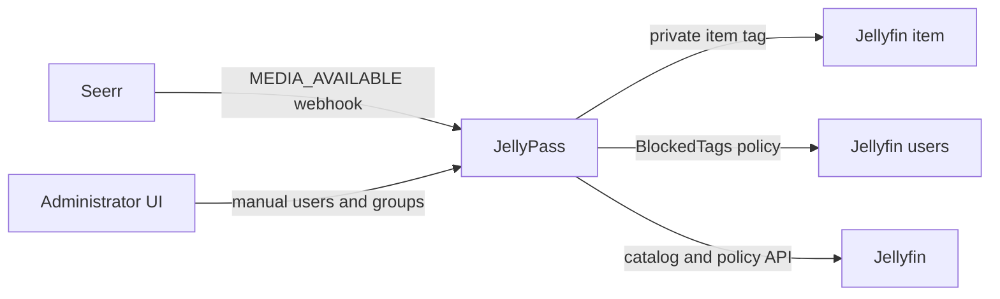

# JellyPass

[](https://github.com/nicklongmore86/jellypass/actions/workflows/ci.yaml)
[](LICENSE)
[](https://github.com/nicklongmore86/jellypass/pkgs/container/jellypass)

**Private media access for shared Jellyfin servers.**

JellyPass connects Seerr requests to Jellyfin's native tag-based access
policies. When requested media becomes available, JellyPass keeps it visible to
the requester and blocks it for other non-administrator users. It also provides
an administrator UI for retroactive access assignment, reusable household
groups, and household-specific Jellyfin hostnames.

JellyPass is independent, community-maintained software. It is not affiliated
with or endorsed by Jellyfin, Seerr, or Jellyseerr.

> [!CAUTION]
> JellyPass changes Jellyfin item tags and complete user-policy documents. Test
> with non-critical users and media first, keep a backup of the state file, and
> retain a separate Jellyfin administrator recovery path.

## What it does

- Converts Seerr `MEDIA_AVAILABLE` webhooks into durable access grants.
- Protects movies, complete series, and locally associated trailers.
- Preserves unrelated Jellyfin tags and blocked tags.
- Lets administrators assign users or reusable groups to existing library
  items, individually or in batches of up to 500.
- Reconciles tags and policies after transient failures or user changes.
- Maintains a searchable Jellyfin catalog without automatically making every
  catalog item private.
- Provides household URLs whose login picker exposes only that household's
  public users, signs passwordless members in with one tap, and preserves the
  password prompt for everyone else.
- Proxies household media requests, byte ranges, HLS requests, and WebSockets.
- Lets household members add a title another household requested to their own
  library, without learning who requested it.
- Exposes health and Prometheus metrics endpoints.

JellyPass does **not** replace Jellyfin authentication, manage downloads, or
decide whether a Seerr request should be approved. Seerr remains the
request and acquisition authority; Jellyfin remains the playback authorization
authority.

## How access enforcement works



For each protected title, JellyPass:

1. Creates one stable tag derived from the Jellyfin item ID, such as
   `jfa:private:8f...`.
2. Adds that tag to the movie or series and its known local trailers.
3. Adds the tag to `BlockedTags` for every non-administrator Jellyfin user except
   the request owner, manually assigned users, and members of assigned groups.
   A request grant is assigned to the requester's household automatically (see
   [Household-scoped request grants](#household-scoped-request-grants)).
4. Persists the desired grant in `grants.json` and periodically reconciles it.

Administrator accounts are never blocked. Existing, unmanaged media remains
public to users whose normal Jellyfin policy allows it.

### Catalog items are not grants

The **Library** tab is an inventory of movies and series discovered during a
Jellyfin catalog sync. The **Grants** tab contains only titles that JellyPass is
actively protecting.

A newly downloaded or newly scanned item does not become a grant merely because
it appears in the catalog. A grant is created by one of these events:

- JellyPass receives Seerr's `MEDIA_AVAILABLE` webhook for a request.
- The optional request backfill finds an available request created after
  `REQUEST_BACKFILL_SINCE` that the webhook missed.
- An administrator assigns access from the Library tab or API.

Library upgrades, replacements, manual downloads, and titles that Seerr
already considered available before JellyPass was installed may not produce a
new webhook. Assign those items from the Library tab if they should be private.

### Household-scoped request grants

When a request produces a grant, whether through the webhook or the request
backfill, JellyPass records the requester and also assigns every group
(household) the requester belongs to at that moment. Everyone in the
requester's household can see the title; members of other households cannot.

- A requester who belongs to no group gets a user-only grant, as before.
- A requester who belongs to several groups shares the title with all of them.
- Groups and users already on the grant, including ones an administrator
  assigned manually, are always kept; requests only add groups.
- Revoking a request does not remove the households it added, so the title
  stays visible to those households instead of becoming public. To make it
  public, clear the grant's groups (UI or `PUT /v1/grants/{itemId}/groups`).
  The title becomes public only once no other requests or manual users remain
  on the grant.
- Joining a household later does not change older grants. Add the group to
  those grants, or add the user to a household that is already assigned.
- A member of another household can add the title to their own library with
  [Add to my library](#add-to-my-library), which adds their households to the
  grant.

## Requirements

- Jellyfin 10.11 or newer.
- Seerr with webhook support and Jellyfin-linked users. See
  [Configure Seerr](#configure-seerr).
- A Jellyfin administrator API key.
- Docker with Compose v2 for the recommended installation, or Node.js 22+ and
  pnpm for a source installation.
- A persistent, private location for `grants.json`.

Seerr lookup is optional only if every webhook includes the Jellyfin media and
user IDs and recent-request cards, the request backfill, and Seerr user import
are not needed.

## Quick start with Docker Compose

Create a directory and download the public deployment files:

```sh
mkdir jellypass && cd jellypass
curl -LO https://raw.githubusercontent.com/nicklongmore86/jellypass/main/compose.yaml
curl -Lo .env https://raw.githubusercontent.com/nicklongmore86/jellypass/main/.env.example
mkdir -m 700 data
```

Edit `.env` and replace every placeholder. Generate two different secrets, for
example:

```sh
openssl rand -hex 32
openssl rand -hex 32
```

Start JellyPass:

```sh
docker compose up -d
docker compose ps
curl http://127.0.0.1:8787/health
```

The default Compose file binds JellyPass only to `127.0.0.1:8787`. Keep that
default when a reverse proxy runs on the same machine. Change the published
address deliberately if Seerr or a reverse proxy must reach it over a
private network.

The container image is published from `main` as `latest` and from release tags
as semantic-version tags. For predictable production upgrades, set
`JELLYPASS_IMAGE` in `.env` to a versioned image such as:

```dotenv
JELLYPASS_IMAGE=ghcr.io/nicklongmore86/jellypass:3.2.3
```

Each release is published as a semantic-version image tag, such as `3.2.3`,
plus floating `3.2` and `3` tags that move to the newest release in that minor
or major line; see [CHANGELOG.md](CHANGELOG.md) for what each one contains. `latest` is rebuilt on
every push to `main` and may include unreleased changes, so use it, or build
from source, only to test ahead of a release.

### Build locally instead

Clone the repository, create `.env`, and use the source-build example:

```sh
git clone https://github.com/nicklongmore86/jellypass.git
cd jellypass
cp .env.example .env
# Edit .env.
docker compose -f compose.example.yaml up --build -d
```

## Configuration

JellyPass reads configuration from environment variables at startup.

| Variable | Required | Default | Description |
| --- | --- | --- | --- |
| `JELLYFIN_URL` | Yes | — | Base URL reachable from JellyPass, without a trailing slash. |
| `JELLYFIN_API_KEY` | Yes | — | Jellyfin administrator API key used for catalog, tag, and policy operations. |
| `WEBHOOK_TOKEN` | Yes | — | Secret accepted by `/webhooks/seerr`. Use a long random value. |
| `ADMIN_TOKEN` | Recommended | `WEBHOOK_TOKEN` | Separate bearer token for administrative APIs and metrics. |
| `SEERR_URL` | Conditional | — | Seerr base URL reachable from JellyPass. Configure with `SEERR_API_KEY`. |
| `SEERR_API_KEY` | Conditional | — | Seerr API key. Configure with `SEERR_URL`. |
| `TMDB_API_KEY` | Conditional | — | TMDB API key (v3, 32 hexadecimal characters) or API read access token (v4) the [household app API](#household-app-api) reads search, discover and title details with, straight from TMDB. Required when `HOUSEHOLD_APP_ENABLED` is true. Get one from your TMDB account's API settings. Startup stops if it is malformed or TMDB refuses it; it is never logged. See [docs/app-design.md](docs/app-design.md#catalogue-source). |
| `STATE_FILE` | No | `./data/grants.json` | Durable state-file path. The container uses `/app/data/grants.json`. |
| `HOST` | No | `0.0.0.0` | HTTP listen address inside the process/container. |
| `PORT` | No | `8787` | HTTP listen port. |
| `RECONCILE_INTERVAL_SECONDS` | No | `300` | Retry/reconciliation interval; `0` disables scheduling. Maximum `86400`. |
| `CATALOG_SYNC_INTERVAL_SECONDS` | No | `3600` | Jellyfin catalog refresh interval; `0` disables scheduling. Maximum `604800`. |
| `HOUSEHOLD_DOMAIN` | No | — | Enables household hostnames below this DNS domain. |
| `HOUSEHOLD_HOST_PREFIX` | No | `jelly-` | Prefix placed before each DNS-safe group ID. |
| `HOUSEHOLD_APP_ENABLED` | No | `false` | Serves the [household app API](#household-app-api) (titles, "Get this" and the household's requests) at `/jellypass/app/v1/*`, and the [app](#household-app-pwa) at `/jellypass/app/`, on household hostnames. Requires `HOUSEHOLD_DOMAIN`, Seerr configuration and `TMDB_API_KEY`; startup stops if any is missing. While `false`, those paths answer `404` and are never proxied to Jellyfin. |
| `REQUEST_BACKFILL_SINCE` | No | — | `YYYY-MM-DD` (UTC midnight) or an ISO 8601 date-time with `Z` or an offset, such as `2026-10-15T08:00:00+02:00`. Impossible dates are rejected. Requests created before it are never imported by the backfill. |
| `REQUEST_BACKFILL_ENABLED` | No | `true` when `REQUEST_BACKFILL_SINCE` is set, otherwise `false` | Grants available Seerr requests that the webhook missed. Requires Seerr configuration and `REQUEST_BACKFILL_SINCE`. |
| `WS_IDLE_TIMEOUT_MS` | No | `300000` | Closes a proxied household WebSocket after this many milliseconds with no bytes in either direction; `0` disables. Jellyfin drops sockets after 60 s without a client KeepAlive (clients send one every 30 s), so values at or below `60000` log a startup warning. Maximum `86400000`. |
| `WS_UPSTREAM_IDLE_TIMEOUT_MS` | No | `180000` | Closes a proxied household WebSocket after this many milliseconds with no bytes from Jellyfin, even while the client keeps sending; `0` disables. Jellyfin answers every client KeepAlive and pings quiet sockets, so a healthy server is never silent for much more than 60 s; values at or below `60000` log a startup warning. Maximum `86400000`. |
| `LOG_LEVEL` | No | `info` | One of `debug`, `info`, `warn`, `error` (case-insensitive; aliases such as `trace`/`verbose`, `information`, and `warning` are accepted). Only `debug` changes output today: it also logs routine client disconnects (`ECONNRESET`, `EPIPE`, aborted streams, keepalive timeouts) and idle WebSocket closes on the household proxy. `info`, `warn`, and `error` are accepted but behave identically. Jellyfin-side resets and other unexpected proxy errors are always logged as warnings. An unrecognised value logs a startup warning and falls back to `info`. |
| `TRUSTED_PROXIES` | No | — | Comma-separated IP addresses and CIDR ranges (IPv4 or IPv6) of reverse proxies in front of JellyPass, such as `192.0.2.10, 2001:db8::/64`. When the connecting peer is listed, JellyPass reads the client address from `X-Forwarded-For` for login rate limits; otherwise it uses the peer and ignores the header. Empty trusts no proxy. An invalid entry stops startup. See [Running behind a reverse proxy](#running-behind-a-reverse-proxy). |
| `JELLYPASS_IMAGE` | Compose only | `ghcr.io/nicklongmore86/jellypass:latest` | Container tag used by `compose.yaml`. |
| `JELLYPASS_ENV_FILE` | Compose only | `.env` | Alternate environment-file path used by either Compose file. |

`SEERR_URL` and `SEERR_API_KEY` must be set together. `ADMIN_TOKEN` falls back
to `WEBHOOK_TOKEN` for backward compatibility, but using different values limits
the impact of a leaked webhook URL or notification configuration.

### Request backfill

The `MEDIA_AVAILABLE` webhook is the fast path, but some Seerr releases fail to
deliver it or do not expose webhook settings at all. With the request backfill
enabled, JellyPass runs it once about five seconds after startup and then before
every reconciliation cycle (`RECONCILE_INTERVAL_SECONDS`; with `0` it runs only
at startup). It pages `GET /api/v1/request` and records each request that:

- was created at or after `REQUEST_BACKFILL_SINCE`,
- was approved or completed in Seerr (pending, declined and failed requests
  are skipped, even when the media is available through another request),
- has media that is available or partially available,
- has a Jellyfin media ID and a requester linked to an existing Jellyfin user,
- targets a Jellyfin item that still exists, and
- has not already been recorded by a webhook or an earlier backfill run.

If the item has no grant, the request creates a household-scoped one. If the
item already has a grant that came from other requests, for example another
household requesting a different season, the request is added to it along with
the requester's households. Nothing already on the grant is removed. Items with
a manual-only grant (no requests) are left exactly as the administrator set
them.

For 4K requests, the backfill uses the 4K availability status and
`jellyfinMediaId4k` only. A 4K request without a 4K item is skipped rather than
falling back to the HD item, so it cannot privatize an HD title that was public
before the cutoff. The webhook applies the same rule: a 4K request whose 4K item
Seerr does not know yet is rejected as an error and not recorded, so the backfill
grants it once the 4K item exists (when the request backfill is enabled).

The cutoff exists so that titles that were already public before JellyPass
managed them stay public. Set it to the date you start relying on JellyPass,
never to an early date that would make a whole back catalogue private.

The backfill is idempotent. Every request recorded on a grant is remembered,
including requests on grants that existed before this feature (seeded when the
state file loads), so a grant an administrator later revokes or clears is not
recreated. Each request is counted as exactly one outcome:

- **granted** (`jfa_request_backfill_total{result="granted"}`): the grant was
  stored and applied to Jellyfin.
- **error** (`{result="error"}`): the lookup failed, or the grant was stored but
  could not be applied yet. Such a grant stays in an error state and the regular
  reconciliation retries it; it is not also counted as granted.
- **skipped** (not exported): not approved, not available, before the cutoff,
  already recorded, unresolvable, or the Jellyfin item was deleted. A deleted
  item is logged once at `debug`, not as an error on every cycle.

A failure on one request never stops the rest of the run.

### Network addresses

Container-local `localhost` refers to the JellyPass container itself. Use a
shared Docker network and service names such as `http://jellyfin:8096`, a private
LAN address, or `host.docker.internal` where your Docker setup supports it.

JellyPass must be able to reach Jellyfin and, when configured, Seerr. Those
services need to reach JellyPass only as follows:

- Seerr needs `/webhooks/seerr`.
- Administrators need `/admin/` and the administrative API.
- Household clients need the full household origin.

### Running behind a reverse proxy

Behind a reverse proxy every request reaches JellyPass from the proxy's
address. Set `TRUSTED_PROXIES` to that address (or its subnet) so the household
and administrator login rate limits apply per client instead of putting every
client behind the proxy in one bucket:

```dotenv
TRUSTED_PROXIES=192.0.2.10
```

JellyPass walks `X-Forwarded-For` from right to left, skips trusted proxies, and
uses the first address that is not trusted. A request from an address that is
not listed is attributed to that address, and its `X-Forwarded-For` is ignored,
so clients cannot choose their own address. List only proxies you control, and
make sure they append to `X-Forwarded-For` rather than pass through whatever
the client sent.

Addresses are compared in canonical form: IPv4-mapped IPv6 addresses (such as
`::ffff:192.0.2.1`, in any spelling) count as the IPv4 address, IPv6 is compared
regardless of case or zero compression, and IPv6 zone IDs (`%eth0`) are
ignored. A `TRUSTED_PROXIES` entry must not include a port or brackets.
`X-Forwarded-For` entries may carry a port (`192.0.2.1:4711`,
`[2001:db8::1]:4711`). An entry that is not a valid address or has an invalid
port ends the walk at the trusted proxy that wrote it, so that request is
attributed to the proxy.

#### Chains of proxies and CDNs

Every hop between the client and JellyPass must be accounted for. JellyPass
stops at the first address it does not trust, so with a CDN in front of your
reverse proxy (for example Cloudflare → reverse proxy → JellyPass) the
reverse proxy's peer is a CDN edge server. Pick one of these, and configure
Jellyfin's known proxies to match (see [Forwarding to Jellyfin](#forwarding-to-jellyfin)):

- **The reverse proxy restores the real client address.** It uses the CDN's
  client-address header and published address ranges (for nginx, the
  `real_ip` module with `set_real_ip_from` for each CDN range and
  `real_ip_header CF-Connecting-IP`), so the `X-Forwarded-For` it sends ends
  with the real client. `TRUSTED_PROXIES` lists the reverse proxy, and
  Jellyfin's known proxies list JellyPass and the reverse proxy.
- **JellyPass and Jellyfin walk past the CDN.** The reverse proxy appends the
  CDN edge address to `X-Forwarded-For` as usual. `TRUSTED_PROXIES` lists the
  reverse proxy and the CDN's published address ranges, and Jellyfin's known
  proxies list JellyPass, the reverse proxy, and the same CDN ranges. Keep
  both lists current when the CDN publishes changes.

Otherwise every client is attributed to a CDN edge address: the per-client
login limits are shared again, and Jellyfin sees the CDN as the client.

#### Login lockouts are best-effort

The household and administrator login limits each track at most 10,000 client
addresses and evict the oldest first. A flood of logins from that many
genuinely distinct source addresses, such as an attacker with a routed IPv6
range, can therefore evict an active lockout before its five minutes are up.
A spoofed `X-Forwarded-For` cannot do this: from an untrusted peer it is
ignored, and every request counts against the peer's own address.

#### Forwarding to Jellyfin

The household gateway forwards to Jellyfin like any other proxy hop: it appends
the address it received the request from to `X-Forwarded-For`, keeping existing
entries, and sets `X-Forwarded-Proto` when it is missing. For Jellyfin to log
and apply its own policies to the real client address, add every hop that it
must walk past to Jellyfin's known proxies
(**Dashboard → Networking → Known proxies**): JellyPass and the reverse proxy
in front of it and, if `TRUSTED_PROXIES` also lists CDN ranges instead of the
reverse proxy restoring the client address, those CDN ranges too (see
[Chains of proxies and CDNs](#chains-of-proxies-and-cdns)).

JellyPass also sets `X-Real-IP` to the client address it resolved, but only
when the request does not already carry one. An existing `X-Real-IP` is passed
through unchanged, even from an untrusted client, and Jellyfin does not read
`X-Real-IP`, so do not rely on it downstream. Use `X-Forwarded-For`.

## Configure Seerr

Seerr is the successor to Jellyseerr and Overseerr, which merged into one
project. Existing Jellyseerr installations keep working: JellyPass uses the
same webhook agent and the same `/api/v1` endpoints (`/api/v1/request`,
`/api/v1/user/import-from-jellyfin`, `/api/v1/movie/{id}`, `/api/v1/tv/{id}`)
with an `X-Api-Key` header, which Jellyseerr and Seerr both provide, so no
settings change when you upgrade from Jellyseerr to Seerr. Overseerr on its own
supports only Plex, so it cannot link requests to Jellyfin users and does not
work with JellyPass.

The requesting Seerr account must be imported from or linked to Jellyfin.
A local-only account without a Jellyfin user ID cannot receive a Jellyfin grant.

In **Settings → Notifications → Webhook**:

1. Enable the webhook agent.
2. Select only **Request Available**.
3. Set the URL to `http://jellypass:8787/webhooks/seerr` for a shared Docker
   network, adjusting the host for your installation.
4. Set the authorization header to `Bearer YOUR_WEBHOOK_TOKEN` when the
   Seerr version supports it.
5. Use the payload below.

```json
{
  "notificationType": "{{notification_type}}",
  "event": "{{event}}",
  "media": {
    "jellyfinMediaId": "{{media_jellyfinMediaId}}",
    "mediaType": "{{media_type}}"
  },
  "request": {
    "id": "{{request_id}}",
    "requestedBy": {
      "jellyfinUserId": "{{requestedBy_jellyfinUserId}}",
      "username": "{{requestedBy_username}}"
    }
  }
}
```

JellyPass trusts the payload's media and user IDs only when both are present
and `event` identifies an HD request. Seerr sends `Movie Request Now Available`
or `Series Request Now Available` when a request becomes available, and `Movie
Now Available` or `Series Now Available` when a request is approved for media
that is already available. For a 4K request the same texts start with `4K `.
Seerr fills `{{media_jellyfinMediaId}}` with the HD item even for a 4K request,
and no template variable carries the 4K item. So when `event` names a 4K
request, or the payload has no recognizable `event`, JellyPass asks Seerr for
the request and grants the 4K item. Without `SEERR_URL` and `SEERR_API_KEY`,
JellyPass can only use the payload IDs, so it does so only for a recognized HD
`event`. A 4K event, or a payload whose `event` is missing, empty, unfilled
(`{{event}}`) or unrecognized, is rejected with `502` and counted as an error
rather than granted on what may be the HD item. A payload without both Jellyfin
IDs still returns `400` ("missing Jellyfin IDs"). A repeated webhook for a
request JellyPass has already handled skips this check, because it only
reapplies the recorded grant or is ignored (see below). Keep
`"event": "{{event}}"` in the payload when Seerr lookup is not configured.

Seerr may deliver the same webhook more than once. A request is handled once
its grant has been stored, and a handled request is never granted again. If a
grant still records the request, a repeated webhook only reapplies that grant
as it stands, so household groups an administrator removed stay removed. If an
administrator revoked the request, the webhook returns `202` with
`{"status":"ignored"}` and counts as `jfa_webhooks_total{result="ignored"}`. A
webhook that failed before its grant was stored, for example because Seerr was
unreachable, is handled normally when it is retried.

Some Jellyseerr releases do not expose Jellyfin IDs as webhook template
variables. When `SEERR_URL` and `SEERR_API_KEY` are configured, this smaller
payload is sufficient because JellyPass resolves the request through the API:

```json
{
  "notificationType": "{{notification_type}}",
  "request": { "id": "{{request_id}}" }
}
```

If the notification UI cannot add an authorization header, append
`?token=YOUR_WEBHOOK_TOKEN` to the webhook URL. Query strings can appear in
proxy logs, browser history, and diagnostics, so keep this route private and
prefer the bearer header whenever possible.

After configuration, use Seerr's test function if available. Every event
other than `MEDIA_AVAILABLE`, including Seerr's `TEST_NOTIFICATION`, returns
`202` with `{"status":"ignored"}` once the token is accepted, even though Seerr
sends an empty request ID for test events. The `notificationType` itself must
still be a real value made of uppercase letters and underscores; an unfilled
`{{notification_type}}` returns `400` and is counted as invalid. A `202` therefore proves only that
JellyPass is reachable and the token is correct, not that the payload works:
`MEDIA_AVAILABLE` events are validated strictly, and a missing, empty, or
unfilled `{{...}}` ID returns `400` and is counted as
`jfa_webhooks_total{result="invalid"}`.

> [!WARNING]
> Enter the payload in Seerr's own webhook form and let Seerr save it. Seerr
> stores `jsonPayload` in its own encoding; a value hand-written into
> `settings.json` (for example, base64 of the raw JSON) is not decoded the way
> Seerr expects, and webhooks then arrive malformed or not at all. Check
> `jfa_last_webhook_received_timestamp_seconds` and
> `jfa_webhooks_total{result="invalid"}` in `/metrics` after a test, and enable
> the [request backfill](#request-backfill) so a broken webhook is not fatal.

## Administrator UI

Open `http://127.0.0.1:8787/admin/` or the protected HTTPS URL exposed by your
reverse proxy. Sign in with an enabled Jellyfin administrator account.

JellyPass sends credentials directly to Jellyfin, immediately closes the
temporary Jellyfin session, and stores only an in-memory JellyPass session for
12 hours. Restarting JellyPass signs browser sessions out. Every five minutes
the session's administrator is read again from Jellyfin, so deleting, demoting
or disabling them ends their session within five minutes.

Every refused sign-in gets the same `401 invalid_credentials` answer after at
least one second. The exception is the rate limit, a fixed
`429 too_many_login_attempts` after the same second, reached per client address
(eight failures in five minutes) or per name from one address (ten in 15
minutes). Both count whether or not the account exists and are keyed by the
caller's address, so a `429` reveals no account and only the address that
caused it sees it. Failures for a name from anywhere never lock it out: past
five in 15 minutes its sign-ins wait longer (up to five seconds) before
Jellyfin is asked, and the right password still signs in.

Browser-session requests that change anything must come from the admin page
itself (`Sec-Fetch-Site: same-origin`, or an `Origin` naming the admin host),
and request bodies must be `Content-Type: application/json`. One from anywhere
else is `403 cross_origin_request_refused`, before the session is checked. The
admin host is read from `Host` only, never `X-Forwarded-Host`, so a reverse
proxy in front of the admin URL must pass the browser's `Host` on unchanged
(Nginx Proxy Manager does). Proxies that pass a client's own `X-Forwarded-Host` through
cannot widen the accepted origins, but you may also overwrite that header at
the proxy (in Nginx, `proxy_set_header X-Forwarded-Host $host;`). Scripts
should use `ADMIN_TOKEN` as a bearer token instead of a session cookie; bearer
requests are not origin-checked. Over HTTPS the session cookie is
`__Host-jellypass_session`; on plain HTTP it is `jellypass_session`.

The UI contains four views:

- **Dashboard** — grant counts, synchronization health, and up to 12 recent
  Seerr requests linked to the synchronized catalog.
- **Library** — catalog search, filters, sorting, pagination, and bulk access
  assignment for up to 500 selected items.
- **Grants** — active automated and manual grants, owners, groups, sync status,
  dry-run plans, revocation, and **Move** (remap a grant to another Jellyfin
  item; see [A re-imported title is public](#a-re-imported-title-is-public-or-a-grant-is-orphaned)).
- **Groups** — reusable audiences, household URLs, and optional Jellyfin user
  creation/import.

Run a catalog sync after first installation. Assigning access from the Library
tab creates a manual grant; catalog synchronization alone does not.

## Household Jellyfin URLs

Access groups can also act as households. With:

```dotenv
HOUSEHOLD_DOMAIN=example.com
HOUSEHOLD_HOST_PREFIX=jelly-
```

the group ID `farmhouse` receives the URL
`https://jelly-farmhouse.example.com`. On that hostname, JellyPass filters
Jellyfin's public-user response to the group's members and proxies supported
Jellyfin HTTP, streaming, byte-range, HLS, and WebSocket traffic.

Deployment requirements:

- Point each hostname, or a suitable wildcard DNS record, at the reverse proxy.
- Use a TLS certificate covering each hostname; `*.example.com` covers the
  single-label format above.
- Preserve the original `Host` header.
- Forward WebSocket upgrades and byte-range requests.
- Avoid proxy buffering for large media responses.
- Do not expose the JellyPass listener directly to untrusted clients.
- Set `TRUSTED_PROXIES` to the proxy and add JellyPass to Jellyfin's known
  proxies; see [Running behind a reverse proxy](#running-behind-a-reverse-proxy).
- Keep a separate normal Jellyfin administrator/recovery origin.

Signing in on a household hostname (`POST /Users/AuthenticateByName`, from
Jellyfin web, the [household app](#household-app-pwa) or any Jellyfin client)
works only for that household's members, hidden ones included (they use
Jellyfin web's **Manual Login** and type their name). A malformed sign-in (no
`Authorization` client fields, or no string `Username` and `Pw`) is refused
with `400`, every other failure with a fixed `401` (`invalid_credentials`) or,
when Jellyfin's user list cannot be read, `502`, each no sooner than one
second after the attempt, so no answer tells a member's name from anyone
else's. The exception is the sign-in rate limit: `429`
(`too_many_login_attempts`) still answers at once. See [the household access design](docs/household-access.md).

Quick Connect is never offered on a household hostname, whatever Jellyfin's
own setting: it signs in whoever authorizes the code, without the membership
check above. `GET /QuickConnect/Enabled` answers `false`, and every other
Quick Connect call (`/QuickConnect/Initiate`, `/QuickConnect/Connect`,
`/QuickConnect/Authorize`, `/Users/AuthenticateWithQuickConnect`, and any
other path under `/QuickConnect`) a fixed `403`
(`household_quick_connect_disabled`). The
[Streamyfin](https://github.com/streamyfin/jellyfin-plugin-streamyfin)
plugin's routes (`/Streamyfin` and below), which would hand its settings,
Seerr's API key among them, to any signed-in user, answer a fixed `404`
(`not_found`), and so do the
[Jellyfin Enhanced](https://github.com/n00bcodr/Jellyfin-Enhanced) plugin's
Seerr routes (`/JellyfinEnhanced/jellyseerr`, `/JellyfinEnhanced/arr` and
`/JellyfinEnhanced/proxy` and below, and its Seerr search and genre lists),
which would show members other households' requests and let them request in
Seerr past the household app's checks; the plugin's other features keep
working. All of these are answered by JellyPass alike for anyone, never reach
Jellyfin (WebSocket upgrades included), are never cached (`Cache-Control:
no-store`), and are matched as Jellyfin routes them: in any case,
percent-encoded or not, with trailing slashes, and under Jellyfin's legacy
`/emby` and `/mediabrowser` prefixes.

Every other decision a household hostname makes about a path is made the same
way, on the route Jellyfin takes it to rather than on its spelling: the sign-in
check above, the household's `/Users/Public` list and login styles, refused
password recovery, sign-out, the per-item check, and JellyPass's own
`/jellypass/...` paths. Sign-in by user ID (Jellyfin's obsolete
`POST /Users/{id}/Authenticate`, which no Jellyfin client uses) is offered to no
one: every such call, a member's included, counts against the sign-in limit and
gets the same delayed `401` (`invalid_credentials`) as a refused sign-in by name,
without asking Jellyfin.

The per-item check covers every route that names an item: anything under
`/Videos/{id}`, `/Audio/{id}` or `/Items/{id}` (streams, HLS playlists and
segments, subtitles, attachments, trickplay, playback info, downloads and any
route Jellyfin adds there later), the user-data, played, favourite and playing
routes, `/MediaSegments/{id}`, `/Shows/{id}/...`, and the `InstantMix` and
`Similar` routes of an item, together with any `itemId` query parameter on
them. Before any of them reaches Jellyfin, Jellyfin is asked, with the caller's
own credentials, whether the caller may see the item; if not, the answer is a
fixed `404` (`item_not_found`). Item images are the one exception: Jellyfin
serves them to anyone and clients load them without credentials. Jellyfin's
live TV routes for its own transcoder (`/LiveTv/LiveRecordings/...`,
`/LiveTv/LiveStreamFiles/...`) answer `404` on household hostnames.

No request on a household hostname may name a user other than the caller:
every user ID in the path (`/Users/{id}/...`, `/Sessions/{id}/User/{id}`) or
the query (`userId`, `controllableByUserId`, `controllingUserId`, in any case
and every copy) must be the caller's own, or the answer is the same fixed `404`
(`item_not_found`), administrators included. Jellyfin itself trusts some of
these for the caller. A household member's picture is the one exception, since
the profile picker loads it without credentials. The user in
`/Playlists/{id}/Users/{id}` is not checked: it is who a playlist is shared
with, and Jellyfin checks the caller's own rights there, so those sharing
routes are relayed unchanged. Jellyfin 10.11.3 itself fails a first share by
path (`500`) and keeps a share removed by path (`204`); sharing through the
playlist body works.

A path Jellyfin might read otherwise than JellyPass (an encoded slash or
backslash, a `.` or `..` segment, a backslash, invalid percent-encoding, a
control or non-ASCII character, one legacy prefix after another, or
percent-encoding that would change which check applies if decoded once more) is
answered a fixed `400` (`invalid_request`, `Cache-Control: no-store`) and never
reaches Jellyfin. A name that is itself percent-encoded, such as
`/Artists/100%2520%20Real`, is sent on as usual.

Unknown household hostnames fail closed with `404`. Group IDs used as household
IDs must contain lowercase letters, numbers, and hyphens and be no longer than
63 characters.

### Add to my library

Seerr hides **Request** for a movie that is already available and rejects a
duplicate request while it downloads, so a second household cannot get a movie
another household requested through Seerr. Household records exist for
privacy, not control: any household may watch a title another household has,
but must never learn who requested it or which household holds it.

With Seerr configured (`SEERR_URL` and `SEERR_API_KEY`), every household
hostname serves a small page at `/jellypass/add`, for example
`https://jelly-farmhouse.example.com/jellypass/add`. A member who is signed in
to Jellyfin on that hostname pastes a Seerr or TMDB link to a movie or series
(or a bare TMDB ID) and selects **Add to my library**. Share the link with
households. The page reuses the Jellyfin web client's sign-in on the same
hostname and has no sign-in of its own.

JellyPass looks the title up in Seerr, takes the HD Jellyfin item Seerr has
linked to it (4K items are never joined) and, when that item has a grant that
came from at least one request, adds the caller's households to it. A caller in
no household is added as a user instead. It applies the change to Jellyfin in
the background, normally within seconds.

- **Nothing is removed**, and manual-only grants (no requests) are left exactly
  as an administrator set them, the same rule as the request backfill. Public
  titles need no join.
- **Administrator removals stick.** A household an administrator took off a
  grant (in the grant's groups, the manual-access dialog, or bulk access) is
  remembered for that item, and so is every user that change, or revoking a
  request, took access from (a removed manual user, the requester, each member
  of a removed household with no other access). Both are kept in the state
  file's per-item removal record (`removedAccess`), shown as `removed`
  (`groupIds`, `userIds`) on the grant in `GET /v1/grants`; grant moves use the
  same record (see
  [A re-imported title is public](#a-re-imported-title-is-public-or-a-grant-is-orphaned)),
  and the marks follow a grant moved to a re-imported item. A join never adds a marked household, and a marked user's
  own joins change nothing at all, whichever household they belong to later
  and even once they belong to none. A caller's unmarked households are still
  added. A mark is personal: it does not stop another, unmarked member of the
  caller's household from joining that household, which then includes the
  marked user; remove the household itself to prevent that. Assigning a
  household again clears its mark, and assigning a user as a manual user, or
  adding a household they belong to, clears theirs; deleting a group clears
  its own mark from every item but not its former members'. Changing a
  household's membership marks nobody. A new Seerr request still adds its
  requester's households as before. Joins never touch a grant left behind on a
  deleted item (orphaned, or split by a move) while it waits for an
  administrator.
- **Joins are audited.** Each join that changed a grant is recorded in the
  grant's `joins` (user, households added, whether the user was added, time),
  visible only to administrators through `GET /v1/grants`, and logged as
  `household library join`.
- **The answer never tells what happened.** Once the caller is signed in and
  the input is valid, the response is always `202 {"status":"accepted"}`, sent
  at once, before the title is looked up: the Seerr lookup, the join and
  applying it to Jellyfin all run in the background afterwards, so neither the
  answer nor how long it takes depends on whether the title was joined,
  already visible, public, held by another household, manual-only, not in the
  library, or could not be looked up. Requester IDs, household names, counts, timestamps and item IDs
  are never returned. The caller can only tell whether the title appears in
  their library afterwards. Details are logged server-side
  (`library join changed nothing` and similar at `LOG_LEVEL=debug`).
- **Identity comes from Jellyfin only.** `POST /jellypass/add` takes
  `{"mediaType": "movie" | "tv", "tmdbId": <number>}` and the caller's Jellyfin
  token in the usual `Authorization` header; JellyPass checks it with
  Jellyfin's `GET /Users/Me`, exactly as it does for protected media, and
  ignores any user ID in the body. A missing, invalid or disabled user's token
  gets `401`, malformed input `400`, and administrators (who see everything
  already) change nothing.
- **Rate limited.** Each client address (after `TRUSTED_PROXIES`) may call it
  30 times in 10 minutes, signed in or not; further calls get `429`. Each
  user may start 10 joins in 10 minutes, and all users together 200; a signed-in,
  valid call past either budget gets the same `202` but its join is not
  started, so try again later. A call past a user's own budget does not use up
  the shared one. These budgets count calls and are never given back when a
  join finishes, so whether a call is started depends only on how many calls
  were made and when, not on any title. They are submission-rate limits over
  fixed 10-minute windows, each starting at the first call counted in it: at
  most 200 joins are started per window, but this is not a bound on joins in
  flight, since joins still waiting on Seerr or Jellyfin from one window add
  to those started in the next. A join that
  would change nothing (public, already visible, manual-only, missing) is
  decided without waiting behind other writes.
  During shutdown it answers `503`; joins already running are stopped before
  their next step and given the usual grace period, and a join that was saved
  but not yet applied to Jellyfin is applied after restart.
- `jfa_library_joins_total{result="joined"|"unchanged"|"error"|"dropped"}`
  counts calls. `unchanged` deliberately covers every no-op reason, `dropped`
  counts calls not started because a budget was used up, and no label names a
  title.

### Household app API

The backend of the household app (a PWA first; see
[docs/app-design.md](docs/app-design.md)). It is **off by default**: set
`HOUSEHOLD_APP_ENABLED=true` together with
`HOUSEHOLD_DOMAIN`, `SEERR_URL`, `SEERR_API_KEY` and `TMDB_API_KEY`.
These are JSON endpoints under `/jellypass/app/v1` on each household hostname,
and nowhere else (on the administrator host they do not exist). The
[app](#household-app-pwa) that uses them is served next to them.

| Method | Path | Answer |
| --- | --- | --- |
| `GET` | `/jellypass/app/v1/me` | `{"name", "household", "apiVersion"}`: the caller's Jellyfin display name and household name, and the revision of the `v1` API the server speaks (an integer, `1` today; it goes up by one with each release that adds a field or endpoint, and never down). `v1` only ever gains fields and endpoints: a breaking change would be `/jellypass/app/v2`. |
| `GET` | `/jellypass/app/v1/search?q=...&page=N` | A page of title cards. `q` is 1 to 100 characters; `page` 1 to 500, default 1. |
| `GET` | `/jellypass/app/v1/discover/{list}?page=N` | A page of title cards; `list` is `trending`, `trending-movies`, `trending-tv`, `popular-movies`, `popular-tv`, `new-movies` (films that opened in US theatres in the last 60 days), `upcoming` (upcoming movies), `upcoming-tv` (upcoming series), `top-movies` or `top-tv` (TMDB's top rated). |
| `GET` | `/jellypass/app/v1/discover/sources` | The streaming services (networks) and studios the app offers, with their TMDB logos; no TMDB call. |
| `GET` | `/jellypass/app/v1/discover/network/{id}?page=N` | A page of a service's popular series. Only the eight listed services (Netflix, Disney+, Apple TV, Prime Video, HBO Max, Hulu, Paramount+, Peacock); any other ID is `400`. |
| `GET` | `/jellypass/app/v1/discover/network/{id}/films?page=N` | A page of the films the service streams **in the US**, from TMDB's where-to-watch data (JustWatch). |
| `GET` | `/jellypass/app/v1/discover/network/{id}/all?page=N` | The service's series and films mixed (film, series, …): Home's "Popular on" rows. |
| `GET` | `/jellypass/app/v1/discover/studio/{id}?page=N` | A page of a listed studio's popular movies. |
| `GET` | `/jellypass/app/v1/movie/{tmdbId}` | One movie. |
| `GET` | `/jellypass/app/v1/tv/{tmdbId}` | One series, with its seasons. |
| `GET` | `/jellypass/app/v1/tv/{tmdbId}/season/{n}` | One season, with its episodes. |
| `POST` | `/jellypass/app/v1/movie/{tmdbId}/get` | ["Get this"](#get-this) for a movie (empty body or `{}`): always `202 {"status":"accepted"}`. |
| `POST` | `/jellypass/app/v1/tv/{tmdbId}/get` | "Get this" for seasons of a series, `{"seasons": [1, 2]}` (1 to 100 seasons from 1 to 999): always `202 {"status":"accepted"}`. |
| `GET` | `/jellypass/app/v1/requests` | The household's own titles from "Get this", with a coarse status: `{"results": [{"id", "mediaType", "tmdbId", "status", "seasons", "byYou"}]}`. |

The machine-readable contract is [docs/app-api/v1.openapi.json](docs/app-api/v1.openapi.json)
(OpenAPI 3.1). Native clients follow
[the native-client contract](docs/app-design.md#native-clients-contract).

- **Sign-in is Jellyfin's.** Send the member's Jellyfin token as Jellyfin web
  does (`Authorization: MediaBrowser Token="..."`, `X-Emby-Token`, or
  `api_key`). JellyPass checks it with Jellyfin's `GET /Users/Me` and trusts
  the answer for at most 5 minutes, but a sign-out through any household host
  (`POST /Sessions/Logout`) forgets that token at once, whatever Jellyfin
  answers, and does not cache it again while the sign-out is at Jellyfin
  (until Jellyfin answers, fails or 15 seconds pass, even if the client
  leaves) or for a minute after, so its next call is refused once Jellyfin
  has revoked it. At most 8 sign-outs per client, 32 per household and 512 in
  all are sent to Jellyfin at once (past that one is answered 503); the minute
  after is kept for at most 10 sign-outs per client and 30 per household a
  minute, except for tokens JellyPass verified and sign-outs Jellyfin did not
  answer, which always have it. A sign-out never affects any token it does not
  carry. A token revoked outside JellyPass (a device deleted in Jellyfin's
  dashboard, or a sign-out sent straight to
  Jellyfin) can still be accepted for the rest of those 5 minutes. The caller must be an enabled member of
  the household whose hostname they called; household membership is checked on
  every call. A missing, invalid or disabled token and a member of another
  household all get the same `401 {"error":"unauthorized"}`.
- **Cards** are `{"mediaType", "tmdbId", "title", "year", "overview",
  "posterUrl", "backdropUrl", "rating", "state", "play"}`; a page is
  `{"page", "nextPage", "results"}`, where `nextPage` is `null` unless TMDB
  returned a full page. A movie adds `"genres"` and `"runtime"`, a series also
  `"seasons"` (`{"seasonNumber", "name", "episodeCount", "state"}`), and a
  season is `{"tmdbId", "seasonNumber", "name", "overview", "episodes",
  "state"}`. Missing values are `null` (or `""` for text). Images are TMDB URLs
  built from an allowlisted file name (posters at `w342`, backdrops at `w780`; the app also draws a backdrop at `w1280`,
  the same file, for sharper screens).
- **`state`** is the household's own view of the title, decided in this order:
  `in_library` (the caller's own Jellyfin view has it, whatever their Seerr
  permissions; only then is `play` set, to `{"itemId", "url"}` with
  `https://<household host>/web/#/details?id=<itemId>`), `unavailable` (an
  administrator blocklisted it in Seerr, or the caller may not request this
  media type in Seerr, which includes a caller Seerr has no user for and a
  caller Seerr gives a request quota: see [Get this](#get-this)),
  `requested` (someone in this household asked for it with "Get this" and it
  is still pending or approved), and otherwise `get_this`. Seasons are
  `in_library` when the caller's own Jellyfin view has their episodes,
  otherwise `unavailable`, `requested` or `get_this` the same way; a series is
  `requested` while any season is. Nothing depends on what another household
  holds, has requested or is waiting on: a title another household holds looks
  exactly like one nobody has. Seerr requests made outside the app are never
  `requested` anywhere: Seerr does not record which household a request was
  for, and who belongs to which household now cannot say, so only the
  household's own "Get this" records count, and they stay with the household
  whose hostname was used whatever membership does later.
- **Nothing else** is ever returned: no requester, request or media IDs, Seerr
  status, Jellyfin item IDs other than the caller's own playable one, totals or
  timestamps. Every answer has `Cache-Control: no-store`.
- **Fixed errors:** `400 {"error":"invalid_request"}`, `401
  {"error":"unauthorized"}`, `404 {"error":"not_found"}` (unknown path, or a
  title TMDB does not know), `429 {"error":"too_many_requests"}` and `502
  {"error":"unavailable"}` (Jellyfin, Seerr or TMDB failed; details are
  logged, never returned); on a household address no household has,
  `404 {"error":"household_not_found"}` before any token is checked.
- **Rate limited.** 300 calls per client address (after `TRUSTED_PROXIES`)
  and 200 per signed-in user in each 5-minute window, and 60 per household
  (its own members' calls only) in each 10 seconds; all answer the same
  `429`, as does a call when its household already has 20 TMDB calls
  waiting.
- `jfa_app_requests_total{endpoint, outcome}` counts answers, by endpoint
  (`me`, `search`, `discover`, `movie`, `tv`, `season`, `get`, `requests`,
  `unknown`) and outcome (`ok`, `unauthorized`, `rate_limited`, `invalid`,
  `not_found`, `unavailable`); no label names a title.

#### Get this

"Get this" asks for a title for the caller's household, the same way whatever
the title's situation, and answers `202 {"status":"accepted"}` at once, before
anything about the caller or the title is looked up. What happens next runs in
the background and is never part of any answer:

- **Already playable for the caller**, blocklisted, or already asked for by the
  household: nothing.
- **Jellyfin already has it** (JellyPass looks it up with its own key first,
  by TMDB ID, by the item Seerr links to the title and, when neither finds it,
  by the title's name and year, so an item without TMDB metadata counts too;
  a different title of the same name and year held that way makes the call a
  join or nothing rather than a request): the household joins the title's grant by the same rules as
  [Add to my library](#add-to-my-library): only a grant made from a request,
  never a manual-only one, and never if an administrator removed the household
  or the caller. **A title Jellyfin has is never requested in Seerr**, so a
  late request can no longer make a public title private or undo an
  administrator's removal. Only the household whose hostname was used joins,
  not the caller's other households.
- **Someone already requested it** (pending or approved in Seerr): the
  household's interest is recorded, and the household joins the grant when the
  title becomes available (webhook or request backfill), by the same rules.
- **Otherwise**: a real HD Seerr request is made **as the caller** (their own
  Seerr user, confirmed before the call; only the title and seasons are sent,
  never another user, server, profile, folder, tags or 4K). JellyPass first
  writes a request intent to its state file, then confirms the caller's Seerr
  user, then reads Jellyfin again as the last step before the request is
  sent; a title that arrived meanwhile is joined instead. Until the request is
  recorded and Jellyfin has been read once more after Seerr answered, no
  webhook or backfill grants any request for that title (a webhook is
  acknowledged and kept, and granted afterwards), also across a restart. A
  title that arrived while the request was being made, or whose check could
  not be read within 30 minutes, is granted as a join, never as a new private
  grant.

A series is decided season by season, so one call can join the seasons
Jellyfin has, follow the seasons someone requested and request the rest. New
seasons of a series Jellyfin already has are requested, but their grant
follows the join rules: a public series stays public, and the household joins
a series held through someone's request. A series is `ready` once every season
asked for has episodes in Jellyfin; until then each season shows its own
status.

**Quotas are not supported in this version.** "Get this" is not offered to a
caller Seerr gives a request quota (a movie or series limit above 0, their own
or Seerr's default, used or not): every title they cannot play shows as
`unavailable` ("Can't request"), the same for every title, and a "Get this"
from them gets the same `202` and does nothing. They can still request through
Seerr. Before any branch, in the background, JellyPass reads the caller's own
Seerr request permission and quota; a caller without permission for the media
type, with a quota, or whose Seerr user or quota could not be read gets the
same `202` and nothing runs. Calls are also limited to 10 per user, 30 per
client address and 30 per household in each 10 minutes (`429`), on top of the
limits above.

**`GET /requests`** lists the household's own "Get this" titles, newest first
(at most 200), from JellyPass's records only: `status` is `requested`
(Requested), `ready` (Ready to watch, and only for a caller whose own Jellyfin
view has the title or season: anyone else in the household, kept from it by a
library, a parental limit or a blocked tag, sees `requested`) or `failed` (We
couldn't get this: declined or failed), with each season's status for a series; `byYou` says
whether the caller asked (otherwise someone else in the household); `id` is
opaque. No requester names, Seerr IDs, counts or dates. Statuses are brought
up to date by each scheduled reconciliation (`RECONCILE_INTERVAL_SECONDS`) and
when a grant is created. There are no notifications.

`jfa_app_get_this_total{result="accepted"|"ineligible"|"error"}` and
`jfa_app_get_this_branches_total{branch}` count calls and what their
background work did; no label names a title. The gauges
`jfa_app_safety_markers{kind}`, `jfa_app_request_intents{status}` and
`jfa_app_deferred_webhooks` count what "Get this" still protects or has in
flight, and the admin-only `GET /v1/app/outstanding` lists it (counts by kind,
oldest age, TMDB IDs and households, `clear` once all are 0); household hosts
never serve it. The app's "Get this" button is
described under [Household app (PWA)](#household-app-pwa). See
["Get this" as implemented](docs/app-design.md#get-this-as-implemented-step-2a)
for every rule, the leak channels and what remains.

Which films a streaming service has is **US availability only**: the same
fixed region for every household, not a setting (TMDB's where-to-watch data,
from JustWatch, credited in the app). Outside the US a service's films may not
match what it offers there; its series are not region-specific.

Each call reads titles straight from TMDB with `TMDB_API_KEY` (in English;
each household reuses an answer for up to 10 minutes), never from Seerr, so
other households' Seerr records cannot change an answer, its size or its
timing. From Seerr it reads only the administrator blocklist with the admin key
(reused for up to a minute) and the caller's own permissions as the caller;
no one's requests are read. The caller's library comes from Jellyfin with the
caller's own token (reused for up to a minute), so Jellyfin's blocked tags,
library access and parental limits apply. Expect a handful of local Seerr
calls per answer. Each household has its own caches, never emptied for
another's; with the app enabled, JellyPass supports at most 100 households
(creating another is refused with `400`; with the app off there is no limit).
If you enable the app with more than 100 groups, they all still load (startup
logs a warning) and can be changed or deleted, but no new group can be created
until there are fewer than 100, and the app caches nothing for any household
while there are more than 100. Cache limits count entries, not
bytes (up to 500 TMDB answers per household, each read up to 4 MiB but
usually tens of kilobytes), so memory grows with the households actually
browsing; see
[One cache per household](docs/app-design.md#one-cache-per-household).

All households share `TMDB_API_KEY`, and so TMDB's rate limit (about 40
requests a second). JellyPass starts at most 20 TMDB calls a second (10 at
once), never has more than 10 unanswered at once (abandoning any after 15
seconds), and lets households take turns, so one household's burst cannot use
up another's share; if TMDB still answers `429`, nothing is sent until its
`Retry-After` has passed and the call is retried once. Busy households can
still make each other wait briefly for their turn, and a TMDB outage, slowdown
or rate limit affects every household alike. Use a TMDB key for JellyPass alone. See
[Shared upstreams](docs/app-design.md#shared-upstreams).

Do not give household members Seerr's `MANAGE_BLOCKLIST` permission (Seerr
does not by default): every blocklist entry makes the title `unavailable` in
every household.

This product uses TMDB and the TMDB APIs but is not endorsed, certified, or
otherwise approved by [TMDB](https://www.themoviedb.org/). Titles, overviews
and images come from TMDB. The app shows this notice with TMDB's logo on its
About screen, as TMDB's API terms require.

Without Seerr, `/jellypass/add` paths are proxied to Jellyfin like any other.
`/jellypass/app` paths never are: without the app they answer `404`.

### Household app (PWA)

With `HOUSEHOLD_APP_ENABLED=true`, each household hostname also serves the
app itself at `https://jelly-<household>.<HOUSEHOLD_DOMAIN>/jellypass/app/`: an
installable web app (a PWA) to browse what is in the household's Jellyfin
library and find more to watch. It shows each title's state (`Ready to watch`
with a **Play** button, `Available to get`, `Requested` or `Can't request`) and offers
**Get this** where a title can be asked for; the confirmation is the same
sentence whatever happens afterwards. A title the household asked for that
failed shows `We couldn't get this` with no button and the line "Ask your
JellyPass admin to try again.", because the API does not ask again while the
failed record stands. Nothing about it
exists on the administrator host, or on household hosts while the app is
switched off (those answer the same fixed `404`).

- **Needs:** the same settings as the API above. `TMDB_API_KEY` is a v3 API key
  or v4 read access token from your TMDB account's API settings (free for
  non-commercial use; read TMDB's [API terms](https://www.themoviedb.org/api-terms-of-use)).
  Nothing else to configure: the app's files are built into the image.
- **Signing in** is Jellyfin's, done inside the app. Signed out, the app shows
  the household's profile picker (the same list Jellyfin's own picker shows on
  this address, which the gateway already limits to the household's members):
  tap a profile, then enter its Jellyfin password, or just tap if the member is
  marked passwordless in JellyPass. **Sign in with a different name** (where the
  picker starts when it lists nobody) is how a hidden member, whom Jellyfin
  leaves off the picker, signs in by typing their name. It makes the calls Jellyfin web makes, through
  the household gateway, so household scoping and the sign-in rate limit apply
  exactly as they do on `/web/`; wrong password, too many attempts and
  "unavailable" each have one fixed message and never show Jellyfin's text.
  There is no redirect to Jellyfin web and nothing to paste afterwards. The
  sign-in is stored where Jellyfin web keeps its own (`jellyfin_credentials` in
  the browser's storage for this address), so **the app and Jellyfin web share
  one session**: **Play** opens Jellyfin web already signed in, and signing in on
  `/web/` signs the app in. The only other thing the app stores is a random
  device ID of its own. **Sign out** (in the Account tab's member card) revokes the session at
  Jellyfin and clears it from the browser, so it **also signs Jellyfin web out**
  on that address (they are one session). The app API forgets the token as
  the sign-out passes through, so it is refused at once there too. **Open Jellyfin to sign in** stays under the picker as a
  fallback.
- **iPhone and iPad:** an app added to the Home Screen has storage apart from
  Safari's, so signing in in Safari does not sign the installed app in. Sign in
  inside the installed app: its picker stores the session in the app's own
  storage, and Jellyfin web (also inside the installed app, whose scope is the
  whole household address) finds it there.
- **Screens:** Home (Trending, Popular movies, Popular series and Upcoming
  movies as scrolling rows), Search (as you type, with **Load more**), a movie
  page, a series page with its seasons (each with its own state) and a season
  page with its episodes (**Get this** on each title or season that can be
  asked for, with a season picker on a series page), **My requests** (the
  household's requests and their status, per season for a series), and About
  & credits (TMDB's logo and notice).
- **Install on iPhone or iPad:** open the app address in Safari, tap **Share**,
  then **Add to Home Screen**. **Android (Chrome):** menu, **Install app** (or
  **Add to Home screen**). Desktop Chrome and Edge: the install icon in the
  address bar. It opens full screen with JellyPass's icon. As we understand it
  (not yet tested on a device), an iPhone or iPad keeps the icon the app was
  added with; if a new icon doesn't appear after an update, remove the app
  from the Home Screen and add it again. **Tested on a real
  iPhone:** Back, swipe-back and the restored position, including each Home
  row's. **Not yet verified on a real phone:** the install, the in-app
  sign-in, and the 2.5.0 look (the glass blur, the safe areas under the status
  bar and above the tab bar, swiping Home's hero, the new icon) and 2.6.0's
  rows (lazy loading, the Studios strip, network and studio pages) have been
  tested only in a simulated browser and against a real Jellyfin, and 2.7.0's
  additions (the All | Movies | TV switch, the backdrop cards, the service
  films and tabs, the focus scrolling) only in a simulated browser, so expect
  to check them on a device before relying on them.
- **Offline and privacy:** a service worker keeps only the app's own static
  files (page, styles, scripts, icons, TMDB logo), as one complete set per
  release (replaced as a whole when the app is updated), so the app opens when
  the network is slow or down. It never touches `/jellypass/app/v1/*` or anything
  else: no titles, states or household data are ever cached, and without a
  network the app says so.
- **Page security:** the files are served with a strict
  `Content-Security-Policy` (own origin only, plus `https://image.tmdb.org` for
  posters and backdrops; no inline script or style, no framing, no forms),
  `nosniff`, `Referrer-Policy: no-referrer`, a `Permissions-Policy` that turns off camera, microphone, location, payment, USB/serial/HID/Bluetooth, motion and other sensors, and the like and
  cross-origin isolation headers. The files are the same for everyone and carry
  no user data; the app fetches everything else from the API after loading.
  See **CDN caching** below for how long each file may be kept.
- **CDN caching (Cloudflare and others):** every file the page loads except the
  page itself and `sw.js` is served under a name carrying a hash of its content
  (`app.<hash>.css`, `js/main.<hash>.js`, the manifest, icons and logo too), and
  the page names exactly those files, so a CDN or browser can keep them for good
  (`Cache-Control: public, max-age=31536000, immutable`) and two releases can
  never be mixed. An old or unknown hash is not a file: it is answered like any
  other unknown app path, by the app API, so it gets `401
  {"error":"unauthorized"}` without a Jellyfin token (as when the browser
  itself loads a file, which sends none) and `404 {"error":"not_found"}` only
  with a valid one, both `no-store`. The page, the `/jellypass/app` redirect
  and `sw.js` keep their addresses, so they are sent with
  `Cache-Control: no-store` plus `CDN-Cache-Control: no-store` and
  `Cloudflare-CDN-Cache-Control: no-store`, and no `ETag`. Per Cloudflare's documentation `no-store` is never cached at its
  edge, `Cloudflare-CDN-Cache-Control` / `CDN-Cache-Control` are the headers it
  reads for its own cache (the former is not forwarded to browsers), and its
  Browser Cache TTL setting only rewrites `Cache-Control` on responses it caches.
  An earlier release sent `no-cache` with an `ETag`, which Cloudflare rewrote to
  `max-age=14400` on the `.css`/`.js` files, so a browser could run old and new
  files together for up to four hours after an update. After upgrading, purge
  the CDN cache once for `/jellypass/app/*` if you have cached it before; no
  rule is needed afterwards. The page registers the worker with
  `updateViaCache: 'none'`, so browsers check `sw.js` on the network.

Filtering the login picker is a privacy and usability boundary, not
authentication. Users still authenticate with Jellyfin, and Jellyfin policies
remain authoritative. Quick Connect and legacy-login restrictions are described
in [the household access design](docs/household-access.md).

## Operations

### Health and logs

```sh
curl http://127.0.0.1:8787/health
docker compose logs --tail=100 jellypass
```

`/health` reports process liveness. It does not guarantee that Jellyfin or
Seerr is reachable; use the UI synchronization status and logs for that.

### Administrative API examples

All examples except health require `Authorization: Bearer $ADMIN_TOKEN`.

```sh
# Inspect grants.
curl -H "Authorization: Bearer $ADMIN_TOKEN" \
  http://127.0.0.1:8787/v1/grants

# What household app "Get this" still protects or has in flight (check before a rollback).
curl -H "Authorization: Bearer $ADMIN_TOKEN" \
  http://127.0.0.1:8787/v1/app/outstanding

# Preview reconciliation without changing Jellyfin.
curl -X POST -H "Authorization: Bearer $ADMIN_TOKEN" \
  'http://127.0.0.1:8787/v1/reconcile?dryRun=true'

# Reapply desired tags and policies.
curl -X POST -H "Authorization: Bearer $ADMIN_TOKEN" \
  http://127.0.0.1:8787/v1/reconcile

# Prometheus metrics.
curl -H "Authorization: Bearer $ADMIN_TOKEN" \
  http://127.0.0.1:8787/metrics
```

### Backup and restore

The state file is the only JellyPass application data that must persist. It
contains grants, access groups, synchronization status, Jellyfin user
IDs, and a catalog containing media names and IDs. Protect it as private data.

For a consistent filesystem backup:

```sh
docker compose stop jellypass
cp -p data/grants.json data/grants.json.backup
docker compose start jellypass
```

Also back up Jellyfin independently. JellyPass can reconcile its desired state,
but it is not a backup of Jellyfin users, metadata, or policies.

To restore, stop JellyPass, replace `data/grants.json` with the backup, ensure
the container user can read and write it, start JellyPass, preview a global
reconciliation, and then apply it.

### Upgrade

For the prebuilt image:

```sh
docker compose pull
docker compose up -d
curl http://127.0.0.1:8787/health
```

Back up the state file first. Read the [changelog](CHANGELOG.md) before
changing between versioned tags. Upgrading from 1.1.0 to 2.0.0 is a breaking
upgrade; follow [Upgrading from 1.1.0](CHANGELOG.md#upgrading-from-110) in the
2.0.0 notes. Upgrading from 2.0.0 to 2.1.0 does not change the state file;
check [Upgrading from 2.0.0](CHANGELOG.md#upgrading-from-200) in the 2.1.0
notes if Seerr lookup is not configured or JellyPass runs behind a reverse
proxy. Upgrading from 2.1.0 to 2.1.1 changes neither the state file nor any
setting. Upgrading from 2.1.1 to 2.2.0 changes no setting and keeps the state
file at schema v7, adding new records to it; see
[Upgrading from 2.1.1](CHANGELOG.md#upgrading-from-211). Upgrading from 2.2.0
to 2.2.1 changes neither the state file nor any setting. Upgrading from 2.2.1
to 2.3.0 keeps the state file at schema v7, adds optional settings for the
household app (off by default), which limits households to 100 while it is
enabled; see [Upgrading from 2.2.1](CHANGELOG.md#upgrading-from-221).
Rolling back from 2.3.0 to 2.2.1 needs no state-file change. Upgrading from
2.3.0 to 2.4.0 changes no setting, changes how sign-in on household hostnames
answers, and needs one CDN purge of `/jellypass/app/*`; see
[Upgrading from 2.3.0](CHANGELOG.md#upgrading-from-230). It keeps the state
file at schema v7, and the household app's "Get this" adds `appRequests`,
`appIdKey`, `appRequestIntents`, `deferredWebhooks`, `appSafetyTombstones`,
`householdEpochs` and `nextHouseholdEpoch`; 2.3.0 and 2.2.1 load and keep them
without reading them (see
[Rolling back to 2.3.0](CHANGELOG.md#rolling-back-to-230)).
Upgrading from 2.4.0 to 2.4.1 changes neither the state file nor any setting.
Upgrading from 2.4.1 to 2.5.0 changes neither the state file nor any setting,
and needs no CDN purge; with the household app enabled, it changes how some
failed sign-outs on household hostnames answer (see the 2.5.0 notes).
Upgrading from 2.5.0 to 2.6.0 changes neither the state file nor any setting,
and needs no CDN purge.
Upgrading from 2.6.0 to 2.7.0 changes neither the state file nor any setting,
and needs no CDN purge.
Upgrading from 2.7.0 to 3.0.0 changes neither the state file nor any setting,
but every administrator signs in again, and admin API clients may need changes
(a matching `Origin` for session-cookie scripts, JSON request bodies, `Host`
passed unchanged by the proxy); see the 3.0.0 notes.
Upgrading from 3.0.0 to 3.0.1 changes neither the state file nor any setting;
admin requests to routes that read no body are now `415` if they carry a
non-JSON body; see the 3.0.1 notes.
Upgrading from 3.0.1 to 3.1.0 changes neither the state file nor any setting,
and needs no CDN purge; only the household app's look changes; see the 3.1.0
notes.
Upgrading from 3.1.0 to 3.1.1 changes neither the state file nor any setting;
administrators sign in again after the restart; see the 3.1.1 notes.
Upgrading from 3.1.1 to 3.2.0 changes neither the state file nor any setting,
and is strongly recommended: it closes household-hostname security issues.
Household hostnames refuse more requests (Quick Connect, oddly encoded paths,
any user but the caller), embedded subtitle fonts no longer load there, and
some household requests wait for one more check with Jellyfin; see the 3.2.0
notes.
Upgrading from 3.2.0 to 3.2.1 changes neither the state file nor any setting,
and needs no CDN purge; only the household app changes; see the 3.2.1 notes.
Upgrading from 3.2.1 to 3.2.2 changes neither the state file nor any setting,
and needs no CDN purge; only the household app changes; see the 3.2.2 notes.
Upgrading from 3.2.2 to 3.2.3 changes neither the state file nor any setting,
and needs no CDN purge; only the household app changes; see the 3.2.3 notes.
Drain before rolling back to 2.3.x or 2.2.1: stop new "Get this" calls, wait
until no request intents or deferred webhooks are left (at most 30 minutes plus
one reconciliation interval, or restart JellyPass to reconcile at once), then
check the admin-only `GET /v1/app/outstanding` and roll back only once it
answers `"clear": true`. Requests an outstanding safety marker
(`appSafetyTombstones`) covers are granted as ordinary requests while rolled
back, and a marker is not limited to 30 days: one naming a request not handled
yet (pending, declined or never available) lasts until it is, up to 400 days;
see
[Store, bounds and rollback](docs/app-design.md#get-this-as-implemented-step-2a). Rolling back from
2.2.0 to 2.1.1, 2.1.0 or 2.0.0 keeps the state file readable, but those
versions retry grants marked `orphaned` (see
[A re-imported title is public](#a-re-imported-title-is-public-or-a-grant-is-orphaned))
and count them in `jfa_sync_errors`, drop a grant's join audit history and
`remap` note whenever they rewrite it, keep administrator removal records
without enforcing them, and their request backfill grants unapproved requests
again. Remap or revoke orphaned grants first, and see
[Rolling back to 2.1.1](CHANGELOG.md#rolling-back-to-211). Upgrades can migrate the state file to a newer schema that older
versions cannot read, so rolling back requires the backup taken before the
upgrade. Pinning `JELLYPASS_IMAGE` makes rollback explicit:

```sh
JELLYPASS_IMAGE=ghcr.io/nicklongmore86/jellypass:PREVIOUS_VERSION docker compose up -d
```

For a source build, fast-forward the repository and rebuild:

```sh
git pull --ff-only
docker compose -f compose.example.yaml up --build -d
```

## Troubleshooting

### A new download appears in Library but not Grants

This is expected when no grant-creating event occurred. Common causes are:

- The file was downloaded manually or outside Seerr.
- It replaced or upgraded media Seerr already considered available.
- The request became available before JellyPass or its webhook was configured.
- The Seerr account is not linked to a Jellyfin user.
- The webhook is disabled, uses the wrong event type, cannot reach JellyPass, or
  has the wrong token.

Catalog sync does not backfill grants from historical requests. The
[request backfill](#request-backfill) picks up requests the webhook missed, but
only those created at or after `REQUEST_BACKFILL_SINCE`. Assign anything older from
Library for immediate protection.

### Webhooks never arrive

If `jfa_last_webhook_received_timestamp_seconds` is absent from `/metrics`, no
authenticated webhook has reached JellyPass since it started. If
`jfa_webhooks_total{result="invalid"}` grows, webhooks arrive but their body is
malformed; re-save the payload through Seerr's webhook form. If
`jfa_webhooks_total{result="error"}` grows, the body was valid but JellyPass
could not resolve, store or apply the grant; the error is logged. In any case,
`jfa_request_backfill_total{result="granted"}` shows requests the backfill
applied instead, and `{result="error"}` counts requests it could not process.

### Webhook returns `401`

The bearer header or `token` query value does not exactly match
`WEBHOOK_TOKEN`. Confirm that whitespace was not copied into either value.

### Webhook reports missing Jellyfin IDs

Configure `SEERR_URL` and `SEERR_API_KEY` and use the request-ID-only payload.
Also confirm that the requester was imported from Jellyfin.

### Library is empty or stale

Check Jellyfin reachability and API-key privileges, then run **Sync library** in
the UI. Confirm that `CATALOG_SYNC_INTERVAL_SECONDS` is not `0` if automatic
refreshes are expected.

### A household hostname returns `404`

Confirm the group exists, its ID is DNS-safe, `HOUSEHOLD_DOMAIN` and
`HOUSEHOLD_HOST_PREFIX` match the hostname, and the reverse proxy preserves the
original `Host` header.

### A re-imported title is public or a grant is orphaned

When Jellyfin deletes and re-imports a title, the new copy gets a new item ID
and the grant still points at the old one. Reconciliation recovers on its own:
when Jellyfin answers `404` for a grant's item, JellyPass asks Seerr which item
each of the grant's requests now resolves to (the 4K item for a 4K request and
the HD item for an HD request, never the other) and moves the grant there,
merging into any grant already on the new item, including a manual one, so
nobody loses access. Who moves where follows one rule, so nobody gains access
to an item they did not have:

- **Every request resolves to the same item** (the usual re-import): the whole
  grant moves there, manual users and groups included. This applies only when
  the original grant moves in one go: a grant left over from an earlier partial
  move records that (`remap.splitTo` in `GET /v1/grants`), and later recoveries
  move only its newly resolved requests and their requesters' households, so
  its manual users and groups stay orphaned until you assign them yourself.
- **Requests resolve to several items:** each item gets only its own requests
  and those requesters' households (the groups a webhook would assign, limited
  to groups the grant already had). Manual users and groups that cannot be
  attributed to one of them stay on the old grant, marked `orphaned`.
- **A request resolves to no existing item:** it is never assigned to another
  item; it stays on the old grant, marked `orphaned`, with any manual users and
  groups (they are not attributable either).

The new grants are stored and applied first; only then is the old grant
removed (or reduced to what stays, orphaned) and the deleted item's tag removed
from user policies, so a restart partway through converges on the next run. If
the old item exists in Jellyfin again by then, nothing is removed: the old grant
is kept intact with its restrictions, shown with a `source reappeared` status in
Grants (`remap.sourceReappeared` in `GET /v1/grants`), logged as
`grant source reappeared` and counted as `result="source_reappeared"`; the new
grants stay applied. Revoke whichever grant is no longer needed.
Requests stay handled, so the backfill does not import them again.

Until a move finishes (for example when applying the new item failed), a
request can be on both the old and the new grant. Revoking it in **Requests**
revokes it from that item only, and is remembered: no later recovery or
**Move** adds that request to that item again, so a copy left on the old
grant cannot restore it (the copy is dropped instead). A new Seerr request for
the title has its own ID and is granted as usual. Seerr re-sending
`MEDIA_AVAILABLE` for the request triggers the same recovery. Only a definite
`404` counts as deleted: network failures and `5xx` responses from Jellyfin or
Seerr are retried with the usual backoff.

Removing a manual user or a group works like revoking a request. Removing one
from an item (in **Grants**, a bulk change, `PUT /v1/grants/{itemId}/manual`
or `PUT /v1/grants/{itemId}/groups`) is remembered for that item only, in the
same per-item removal record household library joins use (`removedAccess` in
the state file, `removed` in `GET /v1/grants`; see
[Add to my library](#add-to-my-library)), together with each user the change
took access from: no later recovery or **Move**, previews included, adds that
user or group to that item again, so a copy left on the old grant cannot
restore it. Removing one from the old grant does not take it off the new one.
Assigning the user or group to the item again as an administrator (or adding a
household the user belongs to) clears the record, and deleting a group clears
it everywhere.

When a grant moves to another item, what an administrator removed from the old
item follows it: its removal marks and revoked requests are recorded for the
new item too, so nobody removed before the move can add themselves back with
**Add to my library**, and no later move restores them. Marks only restrict:
they never give anyone access. A user, group or request the new item's grant
already had on its own (for example from an unfinished earlier move) keeps its
access there. The old grant's library joins (an audit trail) move with the
households they added.

If no request resolves to an existing item (Seerr still names the deleted item,
the request was deleted, the grant is manual-only, or Seerr lookup is not
configured), or part of a grant stays behind as above, it is marked `orphaned`: it is kept, logged once as
`grant orphaned`, shown with an `orphaned` status in Grants and
`sync.state: "orphaned"` in `GET /v1/grants`, and counted by the
`jfa_orphaned_grants` gauge rather than `jfa_sync_errors`. Scheduled
reconciliation no longer retries it; a full reconcile (`POST /v1/reconcile`)
tries again. Move it yourself with **Move** in Grants, or:

```sh
# Preview, then apply. The target item must exist; the old one must be gone.
curl -fsS -X POST -H "Authorization: Bearer $ADMIN_TOKEN" -H 'Content-Type: application/json' \
  -d '{"toItemId":"NEW_ITEM_ID"}' 'http://127.0.0.1:8787/v1/grants/OLD_ITEM_ID/remap?dryRun=true'
curl -fsS -X POST -H "Authorization: Bearer $ADMIN_TOKEN" -H 'Content-Type: application/json' \
  -d '{"toItemId":"NEW_ITEM_ID"}' http://127.0.0.1:8787/v1/grants/OLD_ITEM_ID/remap
```

A move merges the grant's whole audience into the target, as an explicit
administrator decision. It is refused with `409` if the old item still exists
in Jellyfin (`code: "source_item_exists"`): moving its grant would make it
visible to every household, so revoke it explicitly instead. It is also refused
with `409` if Seerr says a request is for the other quality's item of the title
(a 4K request onto the HD item or the reverse, `code: "quality_mismatch"`). The
old grant is removed only after the target has been applied; if applying fails,
it is kept and the move can be repeated. If the old item reappears meanwhile,
the target stays applied, the old grant is kept as above, and the move answers
`409` (`code: "source_reappeared"`). `jfa_grant_remaps_total` counts moves
(`result="remapped"`), new orphans (`result="orphaned"`) and reappeared source
items (`result="source_reappeared"`) by `trigger`
(`auto` or `admin`).

### Changes do not reach every user

Open Grants, preview reconciliation, inspect the reported changes, and apply
them. Check logs for a failed Jellyfin policy update. Adding a new Jellyfin user
requires reconciliation so existing private tags are added to that user's
blocked-tag policy.

## API reference

| Method | Path | Purpose |
| --- | --- | --- |
| `GET` | `/health` | Public process liveness. |
| `POST` | `/webhooks/seerr` | Authenticated Seerr availability webhook. |
| `GET` | `/v1/app/outstanding` | What household app "Get this" still protects or has in flight: safety markers, request intents and deferred webhooks, with `"clear": true` once all are 0. Check it before rolling back. |
| `GET` | `/v1/grants` | List grants and synchronization state. |
| `GET` | `/v1/grants/{itemId}/plan` | Preview changes for one grant. |
| `DELETE` | `/v1/grants/{itemId}/requests/{requestId}` | Revoke one request owner; supports `?dryRun=true`. |
| `PUT` | `/v1/grants/{itemId}/groups` | Replace assigned groups; supports `?dryRun=true`. |
| `PUT` | `/v1/grants/{itemId}/manual` | Set manual users/groups; supports `?dryRun=true`. |
| `POST` | `/v1/grants/{itemId}/remap` | Move a grant to another Jellyfin item (`{"toItemId": "..."}`), merging with any grant already there; supports `?dryRun=true`. |
| `GET` | `/v1/groups` | List groups and generated household URLs. |
| `PUT` | `/v1/groups/{groupId}` | Create or replace a group. With the household app enabled, creating a 101st is refused with `400`. |
| `DELETE` | `/v1/groups/{groupId}` | Delete a group and reconcile affected grants. |
| `GET` | `/v1/users` | List Jellyfin users. |
| `POST` | `/v1/users` | Create a non-administrator Jellyfin user and assign a group. |
| `PUT` | `/v1/users/{userId}/sign-in` | Mark a non-administrator user passwordless (`{"passwordless": true}`) for one-tap household sign-in. |
| `GET` | `/v1/requests/recent` | List recent Seerr requests linked to the catalog. |
| `GET` | `/v1/requests/poster` | Authenticated Seerr poster proxy. |
| `GET` | `/v1/library` | Read the synchronized catalog. |
| `POST` | `/v1/library/sync` | Refresh the catalog from Jellyfin. |
| `GET` | `/v1/library/search?q=...` | Search Jellyfin directly. |
| `GET` | `/v1/library/poster?itemId=...` | Authenticated Jellyfin poster proxy. |
| `PUT` | `/v1/library/access` | Assign one audience to up to 500 items; supports `?dryRun=true`. |
| `POST` | `/v1/reconcile` | Reconcile all grants; supports `?dryRun=true`. |
| `GET` | `/metrics` | Prometheus metrics. |

On household hostnames, with Seerr configured:

| Method | Path | Purpose |
| --- | --- | --- |
| `GET` | `/jellypass/add` | The [Add to my library](#add-to-my-library) page. |
| `POST` | `/jellypass/add` | Add a title to the signed-in Jellyfin user's library; always `202` once authenticated and valid. |

With `HOUSEHOLD_APP_ENABLED=true`, household hostnames also serve the
[household app API](#household-app-api) under `/jellypass/app/v1/`.

Administrative routes accept `ADMIN_TOKEN` bearer authentication or a valid
administrator browser session. Request bodies are limited to 64 KiB and must be
`Content-Type: application/json` (`415` otherwise). A state-changing request
made with the browser session, and every `POST /auth/login`, must come from the
admin origin (`403 cross_origin_request_refused` otherwise). The Seerr webhook
uses its own token and is not origin- or type-checked.

## Security and privacy

- Keep Jellyfin, Seerr and TMDB API keys out of Git, logs, screenshots, and
  support requests.
- Use different random webhook and administrator tokens.
- Put browser, household, and remote webhook traffic behind TLS.
- Expose only the routes each network needs; the admin bearer token grants full
  administrative API access.
- **The admin URL is not gated by default.** Anyone who can reach `/admin/` can
  try to sign in with a Jellyfin administrator's name and password, and the
  administrative API answers anyone holding `ADMIN_TOKEN`. JellyPass limits
  sign-in attempts, but put the admin host behind an identity-aware gate such as
  Cloudflare Access, a VPN, or an IP allowlist at the proxy, or keep it on the
  LAN only. Give it a host of its own, not a household host or Seerr's.
- Preserve `Host` only through a reverse proxy you control. Household routing
  relies on the HTTP host authority.
- Restrict state-file and backup permissions; they contain media names and
  Jellyfin user identifiers.
- Maintain a separate Jellyfin administrator recovery origin.
- Review [SECURITY.md](SECURITY.md) and report vulnerabilities privately through
  GitHub Security Advisories.

JellyPass stores no Jellyfin passwords, supplied new-user passwords, Jellyfin
access tokens, or Seerr API responses containing credentials. Browser
sessions are held in memory and disappear on restart.

## Limitations

- Jellyfin exposes no transaction spanning item tags and multiple user policies.
  A partial failure can temporarily leave an item visible until reconciliation
  succeeds.
- There is a small fail-open window between Jellyfin discovering media and
  JellyPass processing the availability webhook.
- Series access applies to the complete series, not individual seasons.
- Direct filesystem, DLNA, administrator, and other out-of-band access is
  outside JellyPass's scope.
- Seerr does not currently emit a deletion event containing everything
  JellyPass needs for automatic revocation; use the UI or API.
- Concurrent policy edits in another administrator interface can race with a
  JellyPass update. Reconciliation restores JellyPass-owned blocked tags.
- Seerr requests created before `REQUEST_BACKFILL_SINCE`, or all of them
  when the backfill is disabled, are not automatically imported as grants.
- Household profile filtering is not passwordless SSO. See
  [docs/household-access.md](docs/household-access.md) for the design boundary.

## Development

```sh
corepack enable
pnpm install --frozen-lockfile
pnpm check
pnpm test
pnpm build
```

The runtime uses only Node.js standard-library modules. TypeScript and Node type
definitions are development dependencies.

CI performs type checking, unit and HTTP integration tests, a production
container build, an integration test against Jellyfin 10.11.3, and one against
Seerr 3.5.1 (`pnpm test:seerr`, which starts its own container). To run the
real-Jellyfin test locally, start an equivalent fresh Jellyfin container with
`test/fixtures` mounted at `/media`, then run:

```sh
JELLYFIN_REAL_URL=http://127.0.0.1:18096 pnpm test:real
```

See [CONTRIBUTING.md](CONTRIBUTING.md) before opening a pull request.

## Releases and free distribution

JellyPass is free and open-source software under the [MIT License](LICENSE). You
may use, copy, modify, and redistribute it subject to that license.

Every push to `main` publishes a multi-architecture `latest` container to GitHub
Container Registry. A tag such as `v0.3.0` publishes `0.3.0`, `0.3`, `0`, and
`latest` container tags and creates a GitHub Release with generated notes.
Images target `linux/amd64` and `linux/arm64`.

Maintainers must make the GHCR package public after its first publication:
**GitHub profile → Packages → jellypass → Package settings → Change visibility
→ Public**. Public GHCR images can then be pulled without authentication.

## License

[MIT](LICENSE) © 2026 JellyPass contributors.
