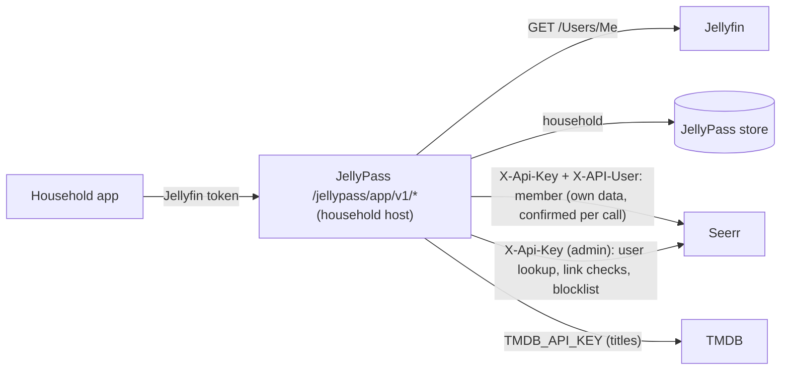

# Household app: design

## Status

Step 2a of 4 ("Get this" API). Step 0 added the acting-user Seerr client (`SeerrMemberClient` in `src/seerr.ts`), the
Jellyfin-to-Seerr user map (`SeerrUserMap` in `src/seerr-users.ts`), recorded-shape Seerr fixtures with canaries, and a
real-Seerr test. Step 1a serves the read-only app API (`HouseholdApp` in `src/app-api.ts`, see "App API (step 1a)"):
who the caller is, search, discover, and movie, series and season details, each title with its household state. Titles
come from TMDB (`TmdbClient` in `src/tmdb.ts`, `TMDB_API_KEY`; see "Catalogue source"), which replaced step 0's Seerr
catalogue client and its `SEERR_CATALOGUE_USER_ID` before either was released. The app API is off unless
`HOUSEHOLD_APP_ENABLED` is true. Step 1b serves the read-only PWA over it at `/jellypass/app/` (see "App page (step
1b)"); it has no "Get this" button yet. Step 2a serves "Get this" itself, `POST /jellypass/app/v1/{movie|tv}/:tmdbId/get`,
the household's attribution records that are the only source of `requested`, and `GET /jellypass/app/v1/requests` (see
'"Get this" as implemented (step 2a)'); the PWA's button and request screens are step 2b. This document is the contract
the later steps are built and reviewed against.

## Goal

JellyPass becomes the backend of a household web app (a PWA first; native apps later, using the same API) served on
each `jelly-<household>` host. It replaces the Seerr website for regular users: once the app is ready (step 4), the
Seerr website is for administrators only.

Household records are about privacy, not control. The app never shows one household what another has, has asked
for, or is waiting on.

## Architecture

- The app API lives under `/jellypass/app/v1/*` on household hosts only, next to the existing household gateway.
- JellyPass calls Seerr and TMDB server-side. The app never talks to either and never receives one of their objects.
- Responses are built by **allowlist shaping**: each DTO field is copied from a TMDB or Jellyfin field chosen for it,
  and anything not chosen is never read into the response. Upstream objects are never relayed, filtered or stripped.

## Identity chain

Identity comes only from Jellyfin, never from anything the client says about itself.

1. The app sends the user's Jellyfin access token to the household host.
2. JellyPass verifies it with Jellyfin's `GET /Users/Me` (as the household gateway does today) and caches the answer
   for at most 5 minutes, keyed by a hash of the token. A disabled user is rejected. A Jellyfin that cannot be reached,
   or answers 5xx, fails the call (`unavailable`) rather than signing the caller out.
3. The household comes from the JellyPass store, and the caller must be a member of the household whose host they
   called. Anyone not in that household is refused.
4. The caller's own Seerr data (requests, quota, watchlist) is read and written through `SeerrUserMap.member(id)`, a
   `SeerrMemberClient` that holds the caller's **Jellyfin** user, never a Seerr user. Before every call it confirms
   which Seerr user Seerr links to that Jellyfin user (see "Stale mappings"), and sends that user in `X-API-User`.
5. Titles (search, discover, details) are read from TMDB with JellyPass's own key, never from Seerr and never as the
   caller (see "Catalogue source").

### Stale mappings

An administrator can relink a Seerr user to another Jellyfin user, or delete it, at any time; a mapping remembered
from before would then act as someone else, or as nobody. Jellyfin IDs are compared normalized (32 lowercase hex
digits, dashes removed), whatever format Seerr or Jellyfin gives them in.

- **There is no way to keep a Seerr user to act as.** `SeerrClient` no longer makes a client fixed to a Seerr user
  (`asUser` is gone) and `SeerrUserMap` hands out none (`clientFor` and `verifiedClientFor` are gone);
  `test/types/seerr-user-client.ts` checks both. A `SeerrMemberClient` holds a Jellyfin user and may be kept for as
  long as the caller likes.
- **Every member call is confirmed immediately before it is sent.** Inside each call, the client takes a candidate
  Seerr user from `SeerrUserMap` (cached for 1 minute, at most 1000 entries, least recently used forgotten first;
  failed lookups are not cached; concurrent lookups share one call; found with the admin key and
  `GET /api/v1/user/jellyfin/:jellyfinUserId`, used only if Seerr's `jellyfinUserId` matches), asks Seerr with the
  admin key and `GET /api/v1/user/:id` whether that Seerr user is still linked to the caller, and only then sends the
  call. Nothing is awaited between the confirmation and the send. A mismatch, or a deleted Seerr user, forgets the
  candidate and tries once more with a fresh lookup; a second failure fails closed (`SeerrUnmappedUserError`).
- **Invalidation reaches calls in flight.** `invalidate(jellyfinUserId)` forgets one caller and `clear()` everyone;
  a call whose confirmation was in flight when either ran is confirmed again before it is sent. A lookup in flight
  answers only the callers already waiting on it: it never fills the cache and is never joined afterwards. The check
  compares a per-user version taken before the confirmation with one taken after; versions come from one counter that
  only grows, and a stamp forgotten by `clear()` or by eviction (at most 1000 are kept) becomes the floor every
  unstamped user reads as, so a user's version never goes down and grows on each of their invalidations: an
  evicted stamp can never make an invalidated call look unchanged.
- A 401, 403 or 404 from Seerr on a member call forgets that caller's mapping.
- The candidate source cannot widen this: `SeerrMemberClient` confirms whatever its resolver proposes, so even a
  forged resolver can only make a call fail closed.

The cost is one admin call (a local `GET /api/v1/user/:id`) per member call. What remains: confirmation and call are
two requests, so a relink landing between them is not caught; that window is one round trip, the call acts as the user
Seerr confirmed a moment before, and it never spans a cache lifetime or a kept client.

### Catalogue source

Titles come from TMDB, not Seerr. Seerr's title answers (search, discover, movie, series) carry each title's Seerr
media record, `mediaInfo`, with every household's requests, watchlist entries, issues and download state in it.
JellyPass never returned any of it, but it still had to receive it: Codex measured, end to end through JellyPass, that
1 MB of other households' records on a title slowed household A's answers from 5.1 to 8.4 ms (median), and that 4.3 MB
of them turned A's answer into a `502` (the 4 MiB cap on Seerr bodies). Neither a size cap nor a faster parser closes
that: the records have to stay off the path. Seerr also shapes those answers with the acting user's region, language
and watchlist (step 0's reason for a dedicated catalogue user).

So `TmdbClient` (`src/tmdb.ts`) reads TMDB's v3 API directly, with JellyPass's own credential:

- **Endpoints**, one method each, no pass-through: `GET /3/search/multi` (`include_adult=false`);
  `GET /3/trending/all/day` (trending); `GET /3/discover/movie` and `GET /3/discover/tv` by `popularity.desc`
  (popular movies and series); `GET /3/discover/movie` by `popularity.desc` with `primary_release_date.gte` today in
  UTC (upcoming); `GET /3/movie/:id`; `GET /3/tv/:id`; `GET /3/tv/:id/season/:n`. The discover lists are built the way
  Seerr 3.5.1 builds its own (`server/routes/discover.ts` and `server/api/themoviedb`), so the lists match what
  members saw in Seerr, minus per-user region and language.
- **The same for everyone.** Every call carries `language=en-US` and nothing about the caller: no region, no user, no
  household, no Jellyfin session. TMDB knows nothing of JellyPass's households or Seerr's records, so nothing another
  household holds, asked for or waits on can change what TMDB returns, how large it is or how long it takes.
- **The credential.** `TMDB_API_KEY` is a v3 API key (32 hexadecimal characters, sent as `api_key`) or a v4 API read
  access token (sent as `Authorization: Bearer`). It is required when `HOUSEHOLD_APP_ENABLED` is true; a malformed
  value stops startup without being quoted; JellyPass checks it with `GET /3/authentication` at startup and stops if
  TMDB refuses it (`401` or `403`), and only logs a warning if TMDB cannot be reached (the app answers `unavailable`
  until it can). The key lives in a module-private `WeakMap`, never on the client object, and is never logged: errors
  carry the route template and status only (`TMDB GET /3/movie/:id returned 404`), and a failed `fetch` (whose own
  message would quote the URL, and with it a v3 key) is reported as `TMDB GET <route> failed`.
- **Guards**, as for Seerr: redirects are never followed (the key would go with them), bodies are read up to 4 MiB,
  counted in bytes, and errors never carry TMDB's body. A title TMDB does not know (`404`) is `not_found`; any other
  failure is `unavailable`.
- **Cache.** Each answer is kept for 10 minutes, keyed only by the request's own parameters (endpoint, query, page,
  TMDB ID, season). Each household has its own partition of at most 500 answers (least recently used forgotten first),
  so whether household A's answer comes from the cache never depends on what household B looked at, and B's volume
  never evicts A's entries (see "One cache per household"). Concurrent calls for the same key in one household share
  one TMDB call; a failed call is not kept.
- **Images** are TMDB's own `poster_path` and `backdrop_path` through the existing allowlisted image URLs
  (`https://image.tmdb.org/t/p/{w342,w780}` plus a file name matching `^/[A-Za-z0-9_-]{1,100}\.(jpg|jpeg|png|webp)$`).
- **Attribution.** TMDB's API terms require attribution: the README carries TMDB's notice ("This product uses the TMDB
  API but is not endorsed or certified by TMDB"). Step 1b's About & credits screen shows TMDB's
  notice (the wording on TMDB's API terms page: "This product uses TMDB and the TMDB APIs but is not endorsed,
  certified, or otherwise approved by TMDB.") with TMDB's logo, bundled locally and unmodified (the primary short blue
  logo from TMDB's Logos & Attribution page), and a link to themoviedb.org. The logo is shown small, on that screen
  only, so it is less prominent than JellyPass's own name, as the terms require.
- **Rate limit.** All households share one TMDB credential, so one TMDB rate limit. TMDB calls go through a fair
  dispatcher kept well under it, with a turn for each household (see "Shared upstreams").

From Seerr the app now reads only two things, none of which carries another household's records:

- **The blocklist**, `GET /api/v1/blocklist` with the admin key (Seerr's API key runs as its owner, who has
  `MANAGE_BLOCKLIST`), 100 entries per page, at most 50 pages (the newest 5000 entries), reused by each household for a
  minute (again one partition per household). The blocklist is kept by administrators (`MANAGE_BLOCKLIST`, which
  household members do not have) and is the same for every household. Seerr 3.5.1 (`server/routes/blocklist.ts`)
  joins only the administrator who added an entry (`leftJoinAndSelect('blocklist.user')`), never its media record or
  any request, so its size and timing depend only on the blocklist itself; the real-Seerr test checks the keys of a
  real entry. Only each entry's `mediaType` and `tmdbId` are read. Seerr's media `status` is no longer read at all.
  **Never grant `MANAGE_BLOCKLIST` to household members** (Seerr's default user permissions do not include it): every
  household sees every blocklist entry as `unavailable`, so a member who could blocklist titles could change what
  other households see, and learn nothing they could not already, but still act across households.
- **The caller's own request permission**, as the caller (see "Per-title states").

No one's Seerr requests are read (see "Requested and households").

### Unmapped users

A Jellyfin user Seerr has no confirmed user for may request nothing, so every title they cannot already play is
`unavailable`: the app decides this from a member call, `SeerrMemberClient.ownUser()` (`GET /api/v1/auth/me` as the
caller), which fails with `SeerrUnmappedUserError` for them. Nothing falls back to the admin client, and the map does
not import users: Seerr users are still created by the existing admin import (`importToJellyseerr` when a user is
created).

### The `X-API-User` hazard

Seerr 3.5.1 runs a call carrying its API key as the user named in `X-API-User`, but a **missing or empty**
`X-API-User` runs it as the owner, user 1 (`server/middleware/auth.ts`, `checkUser`). An unknown ID is refused (403).
So the clients make a missing user impossible:

- `SeerrUserId` is a branded number. Only `seerrUserId(value)` makes one, and it throws unless `value` is a positive
  safe integer; a plain number does not type-check as one.
- `SeerrMemberClient` acts only as a Seerr user Seerr has just confirmed. It is made from a real `SeerrClient`, whose
  connection details are private to `src/seerr.ts`.
- Every call builds `X-API-User` from a `SeerrUserId`, re-checking it, so it is always a non-empty decimal string.
- Paths that name a user (`/user/:id/requests`, `/user/:id/quota`) always use the confirmed acting user's ID.
- `createRequest` sends only `mediaType`, `mediaId`, `seasons` and `is4k: false`: never `userId` (which would let a
  manager request for someone else) or server, profile or folder overrides.
- Redirects are never followed: a 3xx is a failure, so the key and acting user never go anywhere else.
- Errors carry the status and the route template (`Seerr GET /api/v1/tv/:id returned 404`), never Seerr's body or the
  IDs asked for.
- Bodies are read up to 4 MiB, counted in bytes as they stream in; reading stops as soon as a body passes the limit.

`SeerrClient` stays the admin-key client. It never sends `X-API-User`, and it is used only for JellyPass's own
administrative work (webhook and backfill lookups, recent-request cards, user import, and the user lookups and checks
above) and for the administrator blocklist, which is the same for every household; never to read anything that belongs
to a member. Its household-app calls, `findUserByJellyfinId`, `jellyfinUserIdOf` and `blocklist`, have the same
redirect, error and size guards as the acting-user calls; its older methods keep their existing behaviour.

## Per-title states

Each title the app shows has exactly one household state, decided in this order:

| State | Meaning | What the app gets |
|---|---|---|
| `in_library` | Playable by the caller in Jellyfin through their household. Decided first: it needs no request permission. | The only state with a Jellyfin item ID and a Play link to the household host. |
| `unavailable` | Not playable by the caller, and blocklisted or the caller may not request it (including an unmapped caller, and since step 2a a caller with a Seerr request quota: see "Quotas"). | Title only, no actions ("Can't request"). |
| `requested` | This household has a request for it, or has registered interest, by its own active attribution record (step 2a). | Coarse status. |
| `get_this` | Everything else: not in Seerr, held privately by another household, downloading for someone else, requested by someone else. | A "Get this" action. |

A title another household holds is indistinguishable from one nobody has.

Every state is decided by one function, `titleState` in `src/app-api.ts`, in this order: `in_library`, then
`unavailable`, then `requested` (since step 2a: the household's own active "Get this" record names the title, from
`HouseholdRequests.activeKeys`; see "Requested and households"), then `get_this`. `in_library` comes first because it comes from the
caller's own Jellyfin view: playing an item the caller can already see needs no Seerr request permission, and it says
nothing about another household. `unavailable` covers only titles the caller cannot play. The inputs depend on nothing
another household does, and are all read for each answer:

- **Library**: the movies and series the caller's own Jellyfin view holds, by TMDB ID, from one paged
  `GET /Items?userId=<caller>&hasTmdbId=true&fields=ProviderIds` made with the caller's own token, so Jellyfin applies
  their blocked tags, library access and parental limits. Seerr's `jellyfinMediaId` is never used. It is reused for up
  to a minute per caller (one lookup per results page or less).
- **Blocklist**: Seerr's administrator blocklist (see "Catalogue source"), the same for every household. A movie and a
  series with the same TMDB ID are different titles.
- **Eligibility**: the caller's own Seerr user and quota, read as them (`ownUser()` and, since step 2a, `quota()`).
  The caller may request movies with Seerr's `ADMIN`, `REQUEST` or `REQUEST_MOVIE` permission and series with `ADMIN`,
  `REQUEST` or `REQUEST_TV` (Seerr 3.5.1 `MediaRequest.request`), and nothing at all when Seerr gives them a request
  quota (see "Quotas"). A title the caller cannot play is `unavailable` when it is blocklisted, when the caller has no
  such permission or has a quota, or when Seerr has no user for them.

A series' seasons are `in_library` when the caller's view has episodes of them
(`GET /Shows/:id/Episodes?userId=<caller>&isMissing=false`, read only when the series is `in_library`); otherwise
`unavailable` when the series could not be requested (blocklisted, no permission, or a quota), otherwise `requested` when the
household's own active record names the season, otherwise `get_this`. A series is `requested` while any of its seasons
is. So a caller
without series permission sees the seasons they have as `in_library` and the rest as `unavailable`.

**Ready is never optimistic.** A title (or season) the household's own record says is ready is `in_library` only for a
caller whose own view has it (above); for anyone else in the household (another library, a parental limit, a blocked
tag) it stays `requested`, never `get_this`, and `GET /requests` shows it `requested` too (see '"Get this" as
implemented (step 2a)'). Both are decided from the household's own records and the caller's own view only.

### Requested and households

Seerr records who made a request, not which household it was for, and a Jellyfin user can belong to several
households (administrators often do). Neither who asked nor which households they belong to **now** can say which
household a past request was for. Codex's repros: Bob, in Farmhouse and Mill, makes a pending request for Mill; when
Alice in Farmhouse saw it as `requested`, it leaked Mill's request; when only members of one household counted, removing
Bob from Mill made Alice see the same old Mill request as `requested`. Moving a member between households, or a shared
member becoming exclusive, re-attributed their old requests the same way.

So **no Seerr request** is ever shown as `requested`: a title nobody in the household asked for through the app, nobody
can play and nobody blocklisted is `get_this`, in every household, whoever asked for it in Seerr and whatever the
households' membership is or was. No one's Seerr requests are listed (no `GET /user/:id/requests` call is made), so
neither the answers nor the calls made reflect anyone's request history. "Get this" handles a title already requested
(see "Get this").

**The attribution record: the only source of `requested` (step 2a).** "Get this" writes, in the JellyPass store,
`{seerrRequestId, householdId, jellyfinUserId, mediaType, tmdbId, seasons, createdAt}` whenever it creates a Seerr
request or records the household's interest in a title already requested; `householdId` is the household whose host the
call was made on. A title is `requested` for a household only when that household has such a record for it (whoever in
the household made it) and the request it names is still active (pending or approved, HD). Records are never derived
from membership: membership changes never create, move or re-attribute them (a member who leaves keeps nothing; the
household keeps its record), and requests made outside the app (no record) are never `requested` anywhere. A record is
never shown to another household.

Refinements made while implementing (see '"Get this" as implemented (step 2a)'):

- The record is written once the background branch has run, not before the answer: the answer must not wait for
  anything about the title, and until the branch has run there is no Seerr request (or interest) to name.
- Each record also carries its **status** (`pending`, `completed`, `failed`, `declined`, `deleted`), so `requested`
  and `GET /requests` are answered from JellyPass's records alone, never from Seerr during an answer. The status is
  brought up to date in the background (by the scheduled reconciliation, and when the title's grant is created) by
  reading the one Seerr request the record names, by ID, **with the admin key** rather than as its requester: the
  requester may since have been relinked or unmapped in Seerr, and the read names exactly one request JellyPass made
  or followed, never a list of anyone's.
- A record names the request it follows only when one exists: an interest recorded because Seerr refused a request as
  already requested, but listed no active request to follow, waits for the title's grant instead.

## App API (step 1a)

Served by `HouseholdApp` (`src/app-api.ts`) through the household gateway, only on household hosts and only with
`HOUSEHOLD_APP_ENABLED=true` (which requires `HOUSEHOLD_DOMAIN`, Seerr and `TMDB_API_KEY`). Without it, every
`/jellypass/app` path answers a fixed `404 {"error":"not_found"}` on household hosts and is never proxied to Jellyfin.
On the administrator host the paths do not exist (the admin API's own `401`/`404`).

| Endpoint | Answer |
|---|---|
| `GET /jellypass/app/v1/me` | `{name, household}` (no Seerr call) |
| `GET /jellypass/app/v1/search?q=&page=` | `Page` (`q` 1 to 100 characters, `page` 1 to 500) |
| `GET /jellypass/app/v1/discover/{trending,popular-movies,popular-tv,upcoming}?page=` | `Page` (`upcoming` is upcoming movies) |
| `GET /jellypass/app/v1/movie/:tmdbId` | `Movie` |
| `GET /jellypass/app/v1/tv/:tmdbId` | `Series` |
| `GET /jellypass/app/v1/tv/:tmdbId/season/:n` | `Season` |

DTOs (every key always present; missing values `null`, or `""` for text):

- `Card`: `mediaType`, `tmdbId`, `title`, `year`, `overview`, `posterUrl`, `backdropUrl`, `rating` (TMDB vote average,
  `null` when 0), `state`, `play` (`{itemId, url}` only for `in_library`, the URL
  `https://<household host>/web/#/details?id=<itemId>`). Images are `https://image.tmdb.org/t/p/{w342,w780}` plus a
  path matching `^/[A-Za-z0-9_-]{1,100}\.(jpg|jpeg|png|webp)$`.
- `Page`: `page`, `nextPage` (`page + 1` only when TMDB returned a full page of 20 results, up to 500), `results`
  (cards for movies and series; people and collections dropped).
- `Movie`: the card's keys plus `genres` (names) and `runtime` (minutes). `Series`: also `seasons`
  (`{seasonNumber, name, episodeCount, state}`), with `runtime` the first episode run time.
- `Season`: `tmdbId`, `seasonNumber`, `name`, `overview`, `episodes` (`{episodeNumber, name, overview}`), `state`.

Every DTO is built by copying named TMDB fields (`title`/`name`, `release_date`/`first_air_date`, `overview`,
`poster_path`, `backdrop_path`, `vote_average`, `genres[].name`, `runtime`, `episode_run_time[0]`,
`seasons[].{season_number,name,episode_count}`, `episodes[].{episode_number,name,overview}`), each type-checked and
length-capped, through an own-property reader; no TMDB, Seerr or Jellyfin object is spread, relayed or stripped.

Errors are fixed and the same for every endpoint and title: `400 invalid_request`, `401 unauthorized` (missing,
invalid or disabled token, or a caller from another household, all identical), `404 not_found` (unknown path, or a
title TMDB does not know), `429 too_many_requests`, `502 unavailable` (Jellyfin, Seerr or TMDB failed; logged with the
route and status only). Every answer has `Cache-Control: no-store`, `X-Content-Type-Options:
nosniff` and `Referrer-Policy: no-referrer`.

Budgets: 300 calls per client address and 200 per user in each 5-minute window, and 60 per household (its members
together) in each 10-second window (fixed windows, `AttemptCounter`). The address budget is counted before any
credential is checked; the household budget only for the household's own members, so no one else can use it up. All
answer the same `429`, which is also the answer when the household already has 20 TMDB calls waiting (see "Shared
upstreams"). Metrics: `jfa_app_requests_total{endpoint, outcome}`, with no title label.

### One cache per household

Each household that exists has its own caches: verified tokens (its own members' only, at most 100), library views (at
most 50 members'), TMDB answers (at most 500) and the blocklist. They are created the first time the household is
served and dropped only once the household is deleted (when the next household's are created); no household's caches
are ever dropped, or shrunk, for another's. Within a household the least recently used entry goes first. A token that
is not a member's is checked with Jellyfin on every call and never kept, so outsiders cannot crowd members' out.

With the app enabled (`HOUSEHOLD_APP_ENABLED=true`), JellyPass supports **at most 100 households**: the store refuses
to create another (`groups must be at most 100`; `400` from the admin API), and changing an existing one is always
allowed. With the app off the store has no limit, as in 2.2.1, so the limit never changes the admin API of a
deployment that does not use the app. Enabling the app with a state file of more than 100 groups (valid with the app
off, and under earlier versions) loads it unchanged and logs a warning at startup rather than refusing to start: every
existing group can still be changed and deleted and keeps working for access, but no new group can be created until
there are fewer than 100, and while there are more than 100 the app caches nothing for any household, the same for
all whichever was served first, rather than caching for some (every app call then goes to TMDB, Jellyfin and Seerr).

The cache bounds are **entry counts, not bytes**: at most 100 households, each with at most 100 verified tokens, 50
library views, 500 TMDB answers and one blocklist. Each entry's size depends on what upstream sent. A TMDB answer is
the parsed JSON of a body read up to 4 MiB, so the hard worst case for TMDB answers alone is 100 × 500 × 4 MiB (about
200 GiB of bodies, more once parsed), reached only if TMDB sent bodies of that size, which it does not for these
endpoints; its answers are usually a few to a few tens of kilobytes (a season with many episodes more), on the order of
1 GB with every household holding 500 answers at once. A library view holds one entry per title in the member's
Jellyfin view, and the blocklist at most 5000. Memory therefore grows with the number of households actively browsing;
size the host for the households served, not for the limit.

### Shared upstreams

Every household shares one TMDB credential, so one TMDB rate limit (TMDB documents about 40 requests a second). Codex
simulated a 40-calls-a-second TMDB: household B sending 40 different searches at once used it up, and household A's
next search answered `502`. TMDB calls now go through `FairDispatcher` (`src/fair-dispatcher.ts`):

- **Under TMDB's limit.** At most 20 calls start a second, at most 10 at once (a token bucket), so at most 30 in any
  second, for all households together.
- **At most 10 in flight.** At most 10 TMDB calls are ever unanswered at once: while 10 are, no call starts, however
  many tokens have built up meanwhile, and the next household in turn starts its oldest call as soon as one of them
  settles (answered, failed, timed out or abandoned). A call is abandoned after 15 seconds (its request is aborted and
  its place freed then, whatever TMDB does), so a hung TMDB call never holds a place for longer. (Codex's repro: 30
  never-answered calls from three households left 30 in flight after 1.1 seconds; now 10 in flight and 20 waiting.)
  A place is reused as soon as JellyPass abandons a call; TMDB may see the old connection close a moment later.
- **A turn for each household.** Each household has its own queue, and the queues take turns: whenever a call may
  start, the next household in turn with a call waiting starts its oldest. However many calls B has waiting, A's next
  call waits for at most one call of each other household with calls waiting; every household with calls waiting gets
  at least 20 ÷ (households waiting) calls a second.
- **Bounded queues.** A household holds at most 20 waiting calls (more are refused at once with the fixed `429`), and
  a call waits at most 10 seconds to start, for a token or for a place in flight (then `502 unavailable`); both bounds
  hold while every place is taken. A household's first call waits for at most one start of each other household with
  calls waiting, so at most 99 starts with 100 households, and is never refused because of another household; only its
  own volume is refused. Calls start at 20 a second, or at 10 ÷ TMDB's answer time a second when TMDB is slower than
  half a second, whichever is fewer. So while TMDB answers within half a second, a first call waits at most 5 seconds;
  if TMDB slows down while many households are busy, the wait grows with TMDB's answer time and can reach the 10-second
  limit (with 100 busy households and TMDB taking over a second, or with every place held by calls TMDB never answers,
  until they are abandoned). That is TMDB's slowness, the same for every household, not another household's volume
  beyond its turn. The 10-second burst budget above limits each household before it reaches the queue.
- **TMDB's `429`.** If TMDB still answers `429` (another program using the same key, or a lower limit than documented),
  no TMDB call starts until its `Retry-After` has passed (1 second when it gives none, at most 60), the bucket starts
  again from empty, and the refused call is retried once, first in its household's queue: the household whose call met
  the limit is not charged for everyone's load. A call is never retried more than once, and fails at once if the wait
  would outlast its 10 seconds. A retry is queued like a new call, so only when its household's queue holds fewer than
  20 and all queues together fewer than their total: when either is full, the call fails at once instead, with the
  same `502 unavailable` as a call that cannot be retried. So the queue bounds hold whatever TMDB answers. (Codex's
  repro: with one household's 10 calls in flight and 20 waiting, TMDB refusing all 10 used to leave 30 waiting; now
  20, and the 10 fail.)

What remains shared, honestly: TMDB's capacity is one resource. While households are busy at the same time, a call
waits for its turn, so A's latency rises with how many other households have calls waiting (never with what they asked
for, and by at most one call each); and when TMDB itself is down, slow, rate-limits the key, or asks for a long wait,
every household sees the same delays and `502`s (while TMDB holds every place in flight, calls start only as places
free, and a call can wait out its 10 seconds). Neither says which titles another household looked at or holds. Use a TMDB
key for JellyPass alone.

## App page (step 1b)

The read-only PWA is served by the household gateway at `/jellypass/app/`, on household hosts only and only with
`HOUSEHOLD_APP_ENABLED=true`. With the app off, on the administrator host, and on a host for no household, every
`/jellypass/app` path answers what it did before: a fixed `404` on household hosts, and the admin API's own answer
elsewhere; the files are never proxied to Jellyfin.

- **Source and build.** Plain TypeScript, HTML and CSS: no framework and no bundler. The client (`app/src/*.ts`) is
  compiled by `tsc` alone (`tsconfig.app.json`: DOM libraries, ES modules) to `dist/app/js`, and `scripts/build-app.mjs`
  writes the served files (`app/static`: page, stylesheet, manifest, service worker, icons, TMDB logo, and the compiled
  client from `dist/app-js`) to `dist/app`, **content-hashing every file but the page and the worker** (see "Fingerprinted
  files"). The
  server reads `dist/app` once at startup (`src/app-assets.ts`) and refuses to start the app if it is missing. The
  Dockerfile builds it with the rest. `scripts/make-app-icons.py` regenerates the PNG icons (Pillow; the PNGs are
  committed). The only new dependency is `linkedom`, a dev dependency, for DOM-level tests.
- **Routing.** One page, with screens chosen by the URL hash (`#/`, `#/search?q=`, `#/movie/:id`, `#/tv/:id`,
  `#/tv/:id/season/:n`, `#/about`), so the server needs no fallback route and a deep link is just the page.
- **Sign-in.** The page sits on the household host next to the proxied Jellyfin web client, so it signs in the way
  Jellyfin web does, through the household gateway, and keeps the result where Jellyfin web keeps its own.
  *Flow:* with no token (or a `401` from the API) the app shows a profile picker built from `GET /Users/Public`, which
  the gateway already narrows to the household's members and adjusts for passwordless members (`HasPassword: false`).
  A tap on a passwordless member, or a password for the others, is `POST /Users/AuthenticateByName` with
  `{"Username", "Pw"}` and `Authorization: MediaBrowser Client="JellyPass", Device="<iPhone|iPad|Android|Mac|...>",
  DeviceId="<random, own>", Version="1.0"`. There is no new backend and no bypass: that path is the gateway's existing
  household-scoped, rate-limited login (20 attempts per client in five minutes, successful or not; a name outside the
  household is refused before Jellyfin is asked). If a one-tap member has since gained a password the app falls
  through to the password step. Failures are fixed text: `401`/`403` "That didn't work", `429` "Too many attempts",
  anything else "Can't sign in right now", no network "Check your connection", storage refused "Can't keep your
  sign-in on this device". The password field is emptied as it is read and the password exists only in that one request
  body: never a URL, the page, a log or storage. *Storage choice:* the app writes Jellyfin web 10.11's own
  `jellyfin_credentials` entry (checked against the 10.11.3 web bundle: `Servers[]` with the required `Id` (the
  `ServerId` of the login answer), `ManualAddress` (the page's origin), `LastConnectionMode: 2` (manual),
  `DateLastAccessed`, `UserId`, `AccessToken`), merged into what is there: other entries and fields are kept, and an
  older entry for the same address under another server ID is replaced so the app and Jellyfin web cannot pick
  different sessions. Both then read one session, which is what makes **Play** and `/web/` stay signed in. The risk of
  writing another program's format is accepted because the format is what the app already read, has the one required
  field (`Id`) and is read back after writing (a failed write is reported, never assumed); the app still reads Jellyfin
  web's entry written by anyone, so a change to the format shows up as the picker appearing, not as a broken app.
  Beyond that it stores one random device ID (`jellypass_device_id`), deliberately not Jellyfin web's `_deviceId2`, so
  Jellyfin never treats the app's sign-in as a re-login of the web client's device. *Sign-out* (header button) calls
  `POST /Sessions/Logout` with the token (best effort, five seconds), then removes `UserId` and `AccessToken` from the
  server entries, as Jellyfin web's own sign-out does. As the session is shared, **it signs Jellyfin web out too**; the
  app API's five-minute trust in a verified token (`APP_SESSION_TTL_MS`) is unchanged, so the app API can accept a
  just-revoked token for that long. The service worker never handles `/Users/*`, `/Sessions/*` or any non-allowlisted path,
  so no credential or sign-in answer is cached. A `storage` event, the page being shown again or opened again follows a
  sign-in or sign-out made elsewhere. The CSP is unchanged (`connect-src 'self'`, no inline script). **Open Jellyfin to
  sign in** (`/web/`) remains a secondary link. The manifest's `scope` is `/` (its `start_url` is the app), not
  `/jellypass/app/`: an installed iOS web app keeps its storage apart from Safari's, and a link out of its scope opens
  in an in-app Safari view, so a Jellyfin sign-in made there would never reach the app. With the in-app sign-in the
  installed app no longer depends on that, but within scope Jellyfin web and **Play** still stay in the installed app
  and share its storage. Only the service worker is limited to `/jellypass/app/`. `GET /me` provides the name and
  household shown in the header. **Unverified on a real iPhone**: install and sign-in have only been exercised in a
  simulated browser and against a real Jellyfin 10.11.3.
- **Screens.** Home (four rows of 20 titles, each row loaded and failing on its own), Search (debounced 300 ms, one call
  per pause, previous calls aborted, **Load more** by the API's `nextPage`, query kept in the address), movie page,
  series page with a seasons list (each season's state) and a season page with its episodes, About & credits.
- **States.** Shown exactly as the DTO says, coarsely: `in_library` is "In your library" with a **Play** button (only
  when `play.url` is exactly the household host's own `/web/#/details?id=<itemId>`), `get_this` is "Available to request
  soon" (informational: there is no request button until step 2, and the wording says nothing about other households),
  `unavailable` is "Can't request", and `requested` (answered since step 2a) is "Requested". Nothing is shown that is not
  a DTO field.
- **Rendering.** Every string is a fixed one or a DTO field set with `textContent`; no HTML is ever parsed (no
  `innerHTML`). Image URLs are re-checked against the allowlisted TMDB pattern before use. Errors are three fixed
  states, plus offline: `401` the sign-in picker (above), `429` "Too many requests", `502` "Can't load this right now", and
  a `404` "Not found"; none shows upstream text.
- **Headers.** Every app file: `Content-Security-Policy: default-src 'none'; script-src 'self'; style-src 'self';
  img-src 'self' https://image.tmdb.org; connect-src 'self'; manifest-src 'self'; worker-src 'self'; base-uri 'none';
  form-action 'none'; frame-ancestors 'none'`; `X-Content-Type-Options: nosniff`; `Referrer-Policy: no-referrer`;
  `X-Frame-Options: DENY`; `Cross-Origin-Opener-Policy` and `Cross-Origin-Resource-Policy: same-origin`; a
  `Permissions-Policy` denying the powerful features the app does not use (camera, microphone, geolocation, payment,
  usb, serial, hid, bluetooth, midi, display capture, motion and other sensors, screen wake lock, WebAuthn get, XR and
  `interest-cohort`; the list is `APP_PERMISSIONS_POLICY`, tested). `Cache-Control: public, max-age=31536000, immutable` (with an `ETag`, 304 on match) for every
  fingerprinted file; `no-store` (plus `CDN-Cache-Control` and `Cloudflare-CDN-Cache-Control: no-store`, no `ETag`) for the page, the
  `/jellypass/app` redirect and `sw.js`. The HTML is identical for every caller and carries no user data (tested); it is
  `no-store` because its address is fixed, not because it is private. The API stays `no-store`.
- **Fingerprinted files.** `scripts/build-app.mjs` names each file `<name>.<12 hex digits of sha256(content)>.<ext>`
  and rewrites every reference, quoted and exact: the page's `href`/`src`, module imports (`./api.js`), the manifest's
  icons and the logo path in `render.ts`. A file's hash is taken after its references are rewritten, so it changes when
  anything it names changes (a module's name follows its imports; the build orders modules by import and stops on a
  cycle). Only modules reachable from `main.js` are built. CSS may not use `url()`/`@import` and the build stops if it
  does; after rewriting, the build also fails if any quoted source name survives or an import reaches no file. The TMDB
  logo is copied byte for byte. **Why:** a CDN that keeps files by extension (Cloudflare) rewrote `no-cache` + `ETag` to
  `max-age=14400` on `.css`/`.js` (and stripped the page's ETag), so a browser could run a mix of old and new files for
  four hours; with fingerprints a page can only load files its own release names. **What Cloudflare honours** (its cache
  documentation, checked): `Cache-Control: no-store` is never cached at the edge; `Cloudflare-CDN-Cache-Control` (not
  forwarded) and `CDN-Cache-Control` steer only the CDN's own cache and leave `Cache-Control` as sent; the Browser Cache
  TTL setting rewrites `Cache-Control` toward browsers on what it caches. So the page and worker send all three
  `no-store` headers. Unknown or old fingerprints, and the unfingerprinted names, are unknown app paths.
- **Service worker** (`sw.js`, registered by absolute URL `/jellypass/app/sw.js` with scope `/jellypass/app/` and `updateViaCache: 'none'`, so the browser checks the worker on the network whatever a cache says). The app's files are served only at their exact lower-case paths (the gateway matches the rest of the app's paths case-insensitively, so `/JELLYPASS/APP/` is an unknown app path, answered like any other, not the page), so there is one address and one registration. It precaches and serves only the app's own static files (the
  exact list, filled into `sw.js` by the build from the fingerprinted files it wrote, which a test compares with the files served), network first, falling back to its copy when
  the network fails. The copy is one release: each install fills a cache of its own, named for a hash of the precached files and of the unstamped worker (computed by
  `scripts/build-app.mjs` and written into `sw.js`, so any changed file, or a worker-only change, is a new release) plus a random id for that install; the
  whole set is installed or none of it, a failed install deletes only its own cache (never one another worker may be serving from), offline answers come from any complete cache of the worker's own release, nothing is added afterwards, and
  activation deletes the caches of other releases, so what runs offline is always one complete release. (A complete precache does not make every page load one coherent release: network first can mix newer network files with older cached ones during intermittent connectivity.) Requests are
  answered from an exact allowlist: anything under `/jellypass/app/v1/`, other origins (TMDB images), non-`GET`
  requests and every other path is not handled by the worker at all, so it is never cached or answered offline (tested
  by running the worker against a fake browser, including odd spellings of API addresses).
- **Accessibility and layout.** Semantic landmarks (header, main, labelled nav), a skip link (which only moves focus to the content and does not change the route), a labelled search field,
  focus moved to each screen's heading, polite status announcements, scrollable rows reachable by keyboard, `:focus-visible`
  outlines, 44 px touch targets, text and badge colours checked at WCAG AA contrast by a test, `prefers-reduced-motion`,
  safe-area insets and `viewport-fit=cover` for notched phones, and posters and backdrops with size attributes and an
  aspect-ratio frame so nothing shifts as images load (posters below the fold load lazily).
- **Not in this step:** a link from Jellyfin web back to the app (the sign-in page could carry one through the branding
  configuration the gateway already rewrites), a check on a real iPhone of the install and sign-in flow, any request action ("Get this", step 2), the user's own requests, the Seerr cut-over (step 4),
  notifications, Quick Connect in the app's picker (the gateway reports it disabled on household hosts), and profile pictures.

### Leak channels in step 1a

| Channel | How step 1a closes it |
|---|---|
| Fields | Allowlist DTOs only (above), copied from TMDB, which holds no household data. Canary tests run every endpoint over the canary-laden TMDB and Seerr fixtures in every test world and pass status, headers and body to `assertNoCanaries`. |
| Counts | No count is returned; a page holds exactly the titles returned. |
| Paging | `nextPage` comes from the number of results TMDB returned; `total_pages` and `total_results` are never read. |
| Error text | Fixed bodies; TMDB, Seerr and Jellyfin errors are logged by route and status. |
| Status codes | Fixed per outcome; nothing about another household changes an outcome. Seerr title answers, whose size other households' records set (Codex: +4.3 MB made a `502`), are no longer read. |
| Sequential IDs | Only TMDB IDs, and the caller's own playable Jellyfin item ID. |
| Item IDs | Only from the caller's own Jellyfin view, and only for `in_library`. |
| Requests | Seerr does not record which household a request was for, and membership now cannot say, so no Seerr request is read or shown in step 1; step 2's attribution records are the only source of `requested` (see "Requested and households"). Tested across membership changes: a shared member leaving a household (Codex's repro), a move between households, shared to exclusive and exclusive to shared. |
| Timing | Titles come from TMDB, which has no household data, so other households' Seerr records cannot change their size or latency (tested with 5 MB of them). The calls made are the same whatever other households hold or asked for, including a shared member's request history (tested). Per-answer work is bounded: one TMDB read (cached per household), one blocklist read per household per minute (at most 50 pages, set by administrators), one permission read, a cached library read, one episode read for a series in the caller's library. Every cache is one per household, never evicted for another (see "One cache per household"), so another household's browsing never decides whether A's answer is cached (tested with 1,000 other households attempted). Residuals: TMDB's own CDN may answer a URL faster after anyone (on any TMDB client) asked for it; that is outside JellyPass, shared with the whole internet, and says nothing about households. A TMDB call waits for its household's turn, so while other households are busy A's latency rises by at most one call start per busy household, and when all 10 places in flight are taken it waits for one to free (see "Shared upstreams"): it reflects that others are active, or that TMDB is slow, never what they asked for. |
| Caching | `Cache-Control: no-store` on every answer. |
| Volume | Per-address, per-user and per-household budgets with one `429`. |
| Shared upstreams | TMDB calls take turns per household under a global rate kept well below TMDB's (see "Shared upstreams"): another household's burst cannot use up A's share or change A's status (Codex's repro: A stays `200`). Residual: a TMDB outage or rate limit on the key affects every household alike. |
| Identity, Preferences | Titles from TMDB with no user at all; member data only through `SeerrUserMap.member()`, each call confirmed (tested on every endpoint). |
| Quota, Late requests | Not reachable: step 1a makes no requests. |

## "Get this" (step 2)

"Get this" always answers the same way, at once, whatever the title's real situation; the work happens in the
background, as the existing household "Add to my library" does:

- held by another household: the household joins the existing grant, as library joins do today;
- already requested or downloading for someone else: the household's interest is recorded, so it is granted when the
  title becomes available;
- otherwise: a real HD Seerr request is made as the caller (`SeerrMemberClient`).

The answer never depends on which of these happened, on Seerr's result, or on timing.

### Quotas (not supported in v1)

Only the request branch would meet Seerr's quota, so a caller with a quota could tell the branches apart: "Get this"
would work for a title another household holds and not for one nobody has. An earlier draft of step 2a closed this by
counting every join and interest as a "virtual request" against the caller's Seerr quota, exactly as Seerr would count
their own. It was dropped before release: the accounting (holds while calls ran, a ledger of pruned records, windows,
frees on decline and on media deletion) was large, and every part of it was a way to get the count wrong.

**The rule in v1: "Get this" is not offered to any caller who has a Seerr request quota.** A caller has one when
Seerr's `GET /api/v1/user/:id/quota`, read as them, reports a movie or series `limit` above 0: their own limit or
Seerr's default (Seerr reports 0 for a caller who bypasses quotas). For such a caller:

- every title they cannot play is `unavailable` ("Can't request"), whatever the title and its media type: the state
  is decided from their own Seerr settings only (`getThisEligibility` in `src/app-api.ts`), never from the title or
  another household, so it is the same for every title, as for a caller without request permission;
- a "Get this" from them answers the same fixed `202` and nothing runs: no title is read, nothing is joined, recorded
  or requested (decided in the background, before any branch, from the same two reads).

They still request through Seerr directly, as before. Nothing is counted on JellyPass's side for anyone. A caller
without a quota is eligible whenever they have Seerr's request permission for the media type.

Residual: none between households. A quota an administrator gives a caller while one of their calls runs does not stop
that call (its eligibility was read when it started); a request it makes is still checked by Seerr against the quota.

### Late requests (closed by design)

History: PR #30 tried to fix this in the webhook; it was closed in favour of closing the hole through the app.

**The hole.** Seerr 3.5.x accepts `POST /api/v1/request` for a title that is already available. For a user with
auto-approve, JellyPass's webhook and backfill then treat that late request as a genuine one, which can make a
public title private, re-add access an administrator removed, or extend a manual-only grant.

**Why not classify after the fact.** Telling a late request from a genuine one afterwards needs to know whether the
title was in Jellyfin when the request was made, and nothing proves that. Jellyfin's `DateCreated` is the file's
modification time (so a genuine request whose downloaded file is dated before the request looks late and stays
public). A periodic availability journal cannot prove absence at request time either: there are gaps between
observations, deletions and re-downloads, HD/4K inferred from `MediaSourceCount`, item IDs that change without a
TMDB link, and TV file counts that do not show episode coverage.

**The rules that close it.**

- "Get this" **must never** create a Seerr request for a title Jellyfin already has. Jellyfin's own answer is a
  decision input, checked before branching: a title Jellyfin has goes to the join branch, never the request branch.
- The app API offers no other request path.
- Step 4 (the Seerr website restricted to administrators) is **required**, not optional: it is what closes the hole
  for direct use of Seerr. Until step 4, the risk remains for users who send requests to Seerr's API or website
  directly.

Step 2a implements the first two rules (see '"Get this" as implemented (step 2a)'):

- **"Jellyfin has it"** is read with JellyPass's key before any branch is chosen: items with the title's TMDB ID, the
  items Seerr's media record links to the title, and, when there are neither, items that plausibly are the title by
  name (and year, for a movie), so a title Jellyfin holds without TMDB metadata or a Seerr link is joined, never
  requested.
- **The request branch's last steps**, in this order: a **request intent** is written to the state file (atomically,
  and awaited); the caller's Seerr user is confirmed; Jellyfin is read again, and that read is the **last step awaited
  before the request is sent**: nothing else is awaited between its answer and the request leaving. A title (or
  season) that arrived since the first read is joined instead.
- **Durable first, checked.** Immediately before the request leaves (nothing awaited in between), the store is asked
  whether the state file on disk holds the intent (`GrantStore.isAppRequestIntentDurable`: written and renamed into
  place, not merely in memory). "Durable" here means the atomic replacement completed, not that it survives a power
  loss: the write-and-rename does not fsync the file or its directory, so an OS crash or power cut just after the rename
  can still lose it (a documented leftover; a process crash cannot). If not, nothing is sent and the intent is dropped (`request_unsaved`): a change that
  stopped awaiting the intent's write sends nothing rather than a request a crash would leave unprotected. Every app
  test runs under the same invariant from the other side: the fake Seerr reads the state file when a request arrives
  and fails the test unless an intent for its title is there.
- **What is left is exactly the request's own round trip to Seerr** (at most its 15-second timeout, typically tens of
  milliseconds): a title arriving in Jellyfin then still reaches Seerr's request endpoint. Its grant is closed too.
  While any intent names a title, no webhook or backfill grants a request for that title, whoever made it: a webhook is
  acknowledged (`202`) and kept (deferred), the backfill skips the request and tries again on its next run. When Seerr
  answers, Jellyfin is read once more (the **settle-time read**): if the title (or one of the seasons asked for) is
  there, it may have arrived during the round trip and the request's record is marked `present-at-settle`, so its grant
  follows the library join rules; if it is not, the request is genuine. Only then is the intent removed, in the same
  write that records the request, and the deferred webhooks are granted, each by its record's rule (see "When a grant
  is created").
- **Never a private grant by default.** A settle-time read that fails leaves the intent (`settling`): the request's
  webhooks stay deferred, the read is tried again on each refresh, and if it has not succeeded 30 minutes after the
  intent was written the record is marked `unverified` and its grant follows the join rules. A request whose answer
  never came, or came as a 5xx (Seerr may have made it), leaves the intent (`submitting`) to be reconciled.
- **Restarts.** Intents are in the state file, so a request JellyPass was making when it stopped is found on startup
  (and by every refresh): its webhook is deferred, and the intent is reconciled against Seerr's own requests for the
  title: the caller's HD requests made no earlier than the intent (allowing five minutes for Seerr's clock) that no
  record names. Exactly one, not declined, for the household the call was made for: recorded for the household and
  settled as above (the title there now: `present-at-settle`, since nothing tells when it arrived). Anything else
  (several, a declined one, a household replaced meanwhile, none two minutes after the intent was written, or Seerr or
  Jellyfin unreadable for 30 minutes) is never guessed: the intent gives way to a **safety tombstone** (below).

So a title that arrives in that window gets, at worst, a redundant Seerr request (and download), never a private
grant. A title that arrives after the settle-time read was not there when the request was made: the request is genuine.

### Safety tombstones

The rule: **ambiguity resolves to the join rules (the title stays public), never to a private grant.** Records are
display and attribution; the grant decisions "Get this" makes are kept apart from them, as safety tombstones
(`GrantState.appSafetyTombstones`, `AppSafetyTombstone` in `src/types.ts`), so pruning, detaching or losing a record
never loosens one.

- **Per request** (`requestIds`): a request "Get this" made whose grant follows the join rules (`present-at-settle`,
  `existing-series`, `unverified`). Written in the same write that marks its record.
- **Per member and title** (`jellyfinUserId`, `since`): an intent whose request could not be told apart: none found
  in time (a request Seerr makes late, say after a delay of minutes, is still covered), several or a declined one
  found, a household replaced meanwhile, or Seerr or Jellyfin unreadable for 30 minutes. It covers every request for the
  title by that member, or whose requester cannot be read, made no earlier than five minutes before the intent (or
  whose creation time cannot be read), whichever household asks; its candidates are named in `requestIds` too. The
  member's requests "Get this" records as genuine are exempt (those recorded when it was made, and any the app makes
  and settles as genuine later): a later "Get this" by the same member is granted as usual. Nothing is recorded for the
  household: attribution is never guessed. A recovery that does find exactly one request still writes one, exempting
  that request, in case the one found is not the one the intent made.

At grant time (a webhook, a deferred webhook replayed, the backfill), `AccessService` decides each request once:
**defer** (an intent names its title, or a member-wide tombstone exists and the request's title, requester or creation
time cannot be read from Seerr), **join** (a record's `joinOnGrant` or a tombstone covers it) or **grant** (as any
request). Seerr is read only while there are intents or member-wide tombstones. A tombstone is kept for 30 days, and
after that while any of its `requestIds` is not handled yet (a handled request is never granted again), at most 400
days; never pruned by count.

**An intent never holds up another member's grant for long.** While a `submitting` intent names a title, every request
for it is deferred; if the intent cannot be reconciled within 30 minutes (the settle deadline), it gives way to a
member-wide tombstone and the deferred webhooks are granted: another member's (another household's) as a genuine grant,
the intent's member's by the join rules.

**Replay order.** Deferred webhooks are granted genuine ones first, then those that follow the join rules, so a join
finds the grant it joins whatever order they arrived in. And a record whose grant follows the join rules (or an
interest) that finds no grant to join (the title was public) is never `completed` against the public title: it stays
`pending` (its seasons `ready` in `GET /requests` for a caller who can play them), awaiting a grant
(`AppRequestRecord.awaitingGrant`): it joins the grant created for its item (by a webhook or the backfill), or the
next refresh finds one, for 30 days, after which it is `completed`.

**Households replaced.** Each household's epoch is kept in the state file (`householdEpochs`, `nextHouseholdEpoch`) and
on each intent and record made for it; deleting the household drops its epoch, so one created again under the same ID
has another. An intent recovered after its household was replaced gives no household its request (a tombstone keeps
the join rules), and a record whose epoch is not its household's is treated as detached.

### "Get this" as implemented (step 2a)

Served by `HouseholdApp` (`src/app-api.ts`) and `HouseholdRequests` (`src/household-requests.ts`), on household hosts
only, with `HOUSEHOLD_APP_ENABLED=true`. There is no app button yet (step 2b).

| Endpoint | Answer |
|---|---|
| `POST /jellypass/app/v1/movie/:tmdbId/get` (empty body or `{}`) | Always `202 {"status":"accepted"}` once the caller and input are valid |
| `POST /jellypass/app/v1/tv/:tmdbId/get` with `{"seasons":[n, ...]}` | The same `202`; 1 to 100 distinct seasons from 1 to 999 (specials cannot be requested) |
| `GET /jellypass/app/v1/requests` | `{results: [{id, mediaType, tmdbId, status, seasons, byYou}]}` (below) |

**The answer depends only on the call.** In order: the address, user and household app budgets and the session and
household check (as for every app endpoint); input validation (fixed `400`); the "Get this" submission budgets, 10 per
user, 30 per client address and 30 per household in each 10-minute window (fixed windows, counted for every valid call
and never given back; each counted only if the one before admitted the call, so a call refused for the caller's own
volume never uses up the address's or the household's; fixed `429`); then the call is started as background work
(`BackgroundTasks`, so shutdown aborts and waits for it) and the fixed `202` is sent. Nothing about the caller's
eligibility or the title is read before the answer, and no endpoint ever waits on that work: its headers and body are
byte-for-byte the same whatever the title's situation and whether or not the caller is eligible. A call made once
shutdown has begun answers the fixed `502`.

**In the background, eligibility first:** the caller's own Seerr user (`ownUser()`) and quota (`quota()`), read as
them in parallel. They are eligible with Seerr's `ADMIN`, `REQUEST` or `REQUEST_MOVIE`/`REQUEST_TV` permission and no
quota at all (see "Quotas"). If not, or if Seerr cannot answer (counted as `error`, logged), nothing runs. There is no
per-user lock: it serialized quota reads with the caller's requests so each unit was counted once, and nothing is
counted any more. One title's calls take turns (below), so two calls never race to request the same title, and Seerr
checks each request it is sent on its own.

**Branches**, in the background, serialized per title (one title's calls take turns, whichever household made them):

1. **Blocklisted** (the administrators' blocklist, the same for every household): nothing.
2. **The caller can already see it.** Read now with the caller's own credentials: a movie in their view, or seasons
   their view has episodes of, and seasons (or the movie) **their household already asked for** and is still waiting
   on (an active or failed record, or a request intent not yet resolved): nothing for those.
3. Otherwise both decision inputs are read, always both, so a failure of either stops every branch alike (nothing is
   recorded): **Seerr** with the admin key (`SeerrClient.titleRequests`: the title's media record, the Jellyfin items
   it links, its names and year, and each request's ID, status, quality, seasons, requester and creation time, read up
   to 64 MiB because every household's records are on it, and parsed in a bounded worker thread so its size never
   holds up the event loop; never part of an answer), then **Jellyfin** with JellyPass's key, three lookups at once:
   every movie or series item with that TMDB ID (`JellyfinClient.findItemsByTmdbId`), **the items Seerr's media record
   links** (`jellyfinMediaId` and `jellyfinMediaId4k`, by ID, `JellyfinClient.existingItems`), and **items by name**
   (`JellyfinClient.findItemsByName`, used only when the other two find nothing), and for a series the seasons they
   have episodes of. A title Seerr cannot find on TMDB is refused (nothing).
   - **By name** is conservative, so a title Jellyfin has is never requested: every item Jellyfin's search finds for
     one of the title's names (TMDB's title and original title, or a series' name and original name) is paged through,
     at most 2,000 a name (`MAX_NAME_SEARCH_ITEMS`). An item with another TMDB ID is another title and never matches;
     an item without one matches when its name or original name equals or contains one of the title's names once
     case, accents and punctuation are ignored (it cannot be ruled out), and, for a movie, its production year (when
     it has one) is within a year of the release. **A search with more items than are read counts as present** (the
     title may be among those not read): no request, and a request in flight is settled `present-at-settle`. **False
     positives are accepted:** a different title whose name contains this one's (and of the same year) that Jellyfin
     holds without TMDB metadata makes the caller's "Get this" a join (of that item's grant, if it has one, by the usual
     rules) or nothing, never a request; they can still request the title through Seerr.
4. Each season asked for (or the movie) goes to exactly one branch:
   - **Jellyfin has it** (an HD item: never the one Seerr links as 4K; an item Seerr does not link counts as HD, so a
     title Jellyfin has is never requested): the **join branch**. The household whose host was used, never the
     caller's other households, joins the item's grant through the library join rules (`AccessService.joinHousehold`,
     `GrantStore.joinGrant`: only an active grant with a request; an administrator's removal of the household or of
     the caller sticks; manual-only grants, items without a grant and orphaned grants are left alone). Joined, or
     already on the grant: a `join` record, `completed`. Refused: nothing recorded. **Never a Seerr request.**
   - **Seerr has an active (pending or approved) HD request covering it**: the **interest branch**, an `interest`
     record naming that request, `pending`. If the request is the caller's own (made outside the app), it is
     recorded as the household's `request` record instead.
   - Otherwise: the **request branch**, one real HD Seerr request as the caller for all such seasons, and a `request`
     record naming it, `pending`, with `checkedAt`. Its last steps (see "Late requests"): the intent is written
     (`GrantStore.addAppRequestIntent`); the caller's Seerr user is confirmed (`SeerrMemberClient.confirmRequester`,
     which confirms the link with Seerr as before every member call and returns a sender for one request that sends
     nothing if the member's mapping was invalidated since); Jellyfin is read again (the three lookups above); the
     request is sent right after, with only `mediaType`, `mediaId`, `seasons` and `is4k: false`. Seasons (or the
     movie) that arrived since the first read go to the join branch instead (`request_late`). A `409` (someone
     requested it meanwhile), a `202` without a request (every season was requested meanwhile) or a request covering
     only some of the seasons falls back to the interest branch for the rest, following the request Seerr now lists
     (any not declined), or none. A `403` or another refusal (permission or quota changed meanwhile, the caller
     unlinked) records nothing and removes the intent; no answer, or a 5xx, keeps it to be reconciled
     (`request_uncertain`). A request for a series Jellyfin already has (new seasons) is marked `existing-series`; a
     request whose title (or one of its seasons) Jellyfin has at the settle-time read is marked `present-at-settle`;
     one whose settle-time read did not succeed in time is marked `unverified`.
5. The call's records are written together, with its intent's resolution, no sooner than 2 seconds after the call was
   accepted (so how soon the title shows as `requested` does not tell the request branch, which makes more calls,
   from the interest branch while they finish within that time). A household deleted while the call ran, or deleted
   and created again under the same ID, never gets them: each household has an epoch (`GrantStore.householdEpoch`,
   kept in the state file, see "Safety tombstones"), taken when the call is accepted and written on its intent and
   records; the store adds records whose epoch is no longer the household's detached, and `joinHousehold` joins
   nothing for it. Once shutdown begins, a branch stops
   before its next step and records only what it did: a Seerr request already made, or a join already stored, is still
   recorded; an intent left behind is reconciled after restart.

**Records** (`GrantState.appRequests`, `AppRequestRecord` in `src/types.ts`), one per branch and call:
`{householdId, jellyfinUserId, mediaType, tmdbId, seasons, createdAt, updatedAt, branch, status, seerrRequestId?,
seerrMediaId?, itemIds?, readySeasons?, joinOnGrant?, checkedAt?, detached?, householdEpoch?, awaitingGrant?}` by a random ID that never leaves
JellyPass. Each is the doc's attribution record: the only source of `requested`, and of the readiness `GET /requests`
shows. `requested` and `GET /requests` read only them, through a per-household index, so their work depends on the
household's own records only.

**Request intents** (`GrantState.appRequestIntents`, `AppRequestIntent`): `{householdId, jellyfinUserId, mediaType,
tmdbId, seasons, observedAbsentAt, createdAt, status, seerrRequestId?, householdEpoch?}`, `status` `submitting` (written before the
request is sent; Seerr's answer not recorded) or `settling` (the request is recorded, its settle-time read did not
succeed yet). `observedAbsentAt` is when Jellyfin was read without the title for the read the branch was chosen on;
the record's `checkedAt` is the last read before the request was sent. Intents are never shown and never make a title
`requested` (that would tell the request branch from the interest branch by timing). Webhooks deferred for an intent
are kept with what granting them reads (`GrantState.deferredWebhooks`, at most 1,000, the oldest left to the backfill).

`HouseholdRequests.refresh` runs at startup and with every scheduled reconciliation (after the request backfill):
it reconciles the intents no running call holds (above), then brings records up to date, reading each `pending` or
`failed` request or interest record's Seerr request at most every 10 minutes (a record whose grant was settled and
that waits for seasons reads Jellyfin's episodes instead), and each `completed` record's media record, **in every
branch**, at most every 6 hours, at most 50 reads a run, those read longest ago first. A request or interest follows
its Seerr request (pending or approved, declined, failed, completed); one whose request was deleted is `deleted` if
the title's media record went with it (not listed, as Seerr no longer lists it), and an interest whose request alone
was deleted is `failed` and waits for any grant of the title; a completed record of any branch is `deleted` once the
title's media record is. Last, it grants the webhooks deferred for intents that are resolved now.

**Readiness, season by season.** A series record is `completed` only once Jellyfin (read with JellyPass's key) has
episodes of every season it covers; until then it stays `pending` with `readySeasons`, those seasons show `ready` in
`GET /requests` and leave the seasons the household is waiting on, and the refresh reads it again
until every season is there. A movie is ready with its item. Ready is read with JellyPass's key, but **shown** per
caller: a ready movie or season shows `ready` in `GET /requests`, and `in_library` in the title state, only to a
caller whose own Jellyfin view has it (the view the title pages use: their library, reused for up to a minute, and a
series' episodes, read as them); to anyone else in the household it stays `requested`.

**When a grant is created** (a `MEDIA_AVAILABLE` webhook, its replay, a deferred webhook granted, or the request
backfill), `AccessService` first decides how (see "Safety tombstones"): deferred if an intent names its title (the
title is the request's in Seerr, read with the admin key only while there are intents or member-wide tombstones; a
request whose title cannot be read then is deferred too), a join if a record or a tombstone says so, otherwise a new
grant. Deferred webhooks are granted genuine ones first. Then it settles the app records for it before answering: a `request` record naming that request is ready (above), and every
`interest` record naming it (or, for a movie, or an interest that follows no request, every interest in the grant's
title, from the item's TMDB provider ID, or awaiting a grant of that item) joins its household through the join rules,
with the household whose host was used and never the member's current households. A failure there is logged and never fails the grant; the next refresh
tries again.

**A request granted as a join.** A request "Get this" made whose record is marked `existing-series`,
`present-at-settle` or `unverified` is never a new grant and never adds the requester's households: the request is
recorded as handled (so neither a replay nor the backfill grants it later), and the household the request was made
for joins the item's grant, if it has one, through the library join rules (an administrator's removal sticks; a
manual-only grant is left alone). A public title or series stays public, and the record awaits a grant (see "Safety
tombstones", "Replay order"). A request a tombstone covers is granted the same way, with or without a record. Webhook answer `202` when there is no grant
(also when deferred), metrics `jfa_webhooks_total{result="joined"|"deferred"}` and
`jfa_request_backfill_total{result="joined"|"deferred"}`.

**`GET /requests`** answers the household's own titles from its own records only, newest first, at most 200:
`{id, mediaType, tmdbId, status, seasons, byYou}`. `status` is coarse: `requested` (Requested: pending or approved),
`ready` (Ready to watch: completed, and in the caller's own view; otherwise `requested`, see "Readiness") or `failed`
(We couldn't get this: declined or failed); `deleted` records are not
listed. The caller's view is read for **every** listed title, ready or not (at most 8 at a time): a movie from their
cached library (no Jellyfin call), a series' episodes as them only when their own view has the series (one read per
such series, so at most 200 per call). A title whose read fails is listed as if the caller's view did not have it (its
ready seasons `requested`), not answered `502`. So which reads the list makes, and how it answers when they fail,
depend only on the caller's own view and the household's own listed records, never on whether a title arrived in a
library the caller cannot see (Codex's repro: reading the view only for a ready title made a season arriving in a
hidden library change the list's Jellyfin reads and, with the episode endpoint failing, its answer from `200` to `502`). A title's latest record decides each season (or the movie); a series is `requested` while any season is,
otherwise `ready` if any season is, otherwise `failed`; `seasons` is `[{seasonNumber, status}]` (empty for a movie).
`id` is opaque: an HMAC-SHA256 of the household and the title with a key kept in the state file (`appIdKey`, made with
the first record), base64url, 22 characters: the same for every member of the household, different for each household
and title, never a Seerr ID. **Requester: only `byYou`** (whether the caller made any of the household's records for
the title; otherwise someone in the household): no name, no member ID, nothing about members who left. No count but
the entries listed. `Cache-Control: no-store`, like every answer.

**Store, bounds and rollback.** The schema stays v7; four fields are added, and a state file without them loads and
stays unchanged until the first "Get this".

| Field | What 2.2.1 and 2.3.0 do with it | After rolling back to 2.3.0 or 2.2.1 |
|---|---|---|
| `appRequests` | Keeps it as it is (loaded and written back unread) | Nothing is `requested` and `GET /requests` does not exist (2.2.1 has no app writes); statuses stop being refreshed, and interests are not joined when their grant is created; a household deleted meanwhile does not detach its records. Upgrading again picks them up: refresh catches statuses up, but an interest whose grant was created while rolled back joins only on a later refresh (once its request reads as completed). |
| `appIdKey` | Keeps it as it is | Unused; upgrading again keeps every opaque ID the same. |
| `appRequestIntents` | Keeps it as it is | Unused: webhooks and the backfill grant a request whose intent was not resolved as an ordinary request (roll back with no "Get this" in flight); upgrading again reconciles what is left. |
| `deferredWebhooks` | Keeps it as it is | Unused: the backfill (if enabled) grants those requests; upgrading again grants what is left. |
| `appSafetyTombstones` | Keeps it as it is | Unused: a request a tombstone covers is granted as an ordinary (private) request by a webhook or the backfill (see the drain below: a tombstone naming a request not handled yet lasts up to 400 days); upgrading again applies them to what is not handled yet. |
| `householdEpochs`, `nextHouseholdEpoch` | Keeps them as they are | Unused; a household deleted while rolled back keeps its entry, so one created again under its ID then shares its epoch after upgrading again. |

**Drain before rolling back.** Intents, deferred webhooks and tombstones are what makes a late request a join; 2.3.x
and 2.2.1 do not read them. Before rolling back to 2.3.x or 2.2.1:

1. Stop new "Get this" calls: block `POST /jellypass/app/v1/movie/*/get` and `/tv/*/get` at the reverse proxy (or pick
   a time no one uses the app), and leave this version running with `RECONCILE_INTERVAL_SECONDS` above 0.
2. Wait until no intents and no deferred webhooks are left (`requestIntents.total` and `deferredWebhooks.total` 0 in
   `GET /v1/app/outstanding`, see "What is outstanding"). Each intent is resolved within 30 minutes of being written,
   at the scheduled reconciliation after that (or at once by a restart, which reconciles and replays at startup);
   deferred webhooks are granted once no intent names their title. A deferred webhook that keeps failing (Seerr
   unreachable) stays: the backfill, if enabled, grants it after the rollback.
3. **Check, then roll back only when clear:** `GET /v1/app/outstanding` answers `"clear": true` (no safety marker that
   still decides a grant, no intent, no deferred webhook; `jfa_app_safety_markers`, `jfa_app_request_intents` and
   `jfa_app_deferred_webhooks` all 0). A safety marker is not a fixed 30 days: a member-wide one covers the member's
   new requests for 30 days, but **any marker naming a request not handled yet (pending, declined, never available)
   lasts until that request is handled, up to 400 days.** There is no way to drain them early. Requests an
   outstanding marker covers are granted as ordinary (private) requests while rolled back; with
   `REQUEST_BACKFILL_ENABLED=false` only a webhook for one of them can, and a public title it makes private can be made
   public again by revoking that request in the admin UI. If that is not acceptable, wait until the readout is clear.

A state file written by an unreleased build of this branch may also hold `appQuotaLedger` (the dropped quota ledger):
it loads, is never read, and is dropped with the next write.

Writes go through the store's one atomic write (a unique temporary file renamed over the state file, writes never
overlapping) and are refused once the store is closed (shutdown). **Pruning:** a `pending` record is never pruned (it
is still being followed); settled records (`completed`, `declined`, `deleted`, `failed`) are kept for 400 days, at most
each household's own newest 2000 (one household's volume never prunes another's). Intents are never pruned: each is
resolved by its call or by reconciliation. The rows are bounded by the per-household cap plus the pending records (each
household has at most one active record per title and season, so these are bounded by the titles in flight). Safety
tombstones are never pruned by count (see "Safety tombstones"); each is bounded in time, and their number by the
"Get this" budgets. Deleting
a household **detaches** its records: no household (not one later created with the same ID) sees, joins or is
`requested` by them again; they are kept, because a request's grant still follows its record; records of a call still
running when it is deleted are added detached (see 5 above).

**Metrics** (no label names a title): `jfa_app_requests_total{endpoint="get"|"requests", outcome}`,
`jfa_app_get_this_total{result="accepted"|"ineligible"|"error"}` (decided in the background) and
`jfa_app_get_this_branches_total{branch}` (`visible`, `refused`, `join_joined`, `join_already`, `join_refused`,
`join_ungranted`, `join_error`, `join_cancelled`, `interest`, `own_request`, `request`, `request_late`,
`request_refused`, `request_uncertain`, `request_unsaved` (its intent was not on disk: nothing sent),
`intent_recovered`, `intent_cancelled` (none found in time), `intent_ambiguous`, `intent_detached` (household replaced), `intent_abandoned` (unreadable past the deadline),
`settled`, `settle_unverified`, `error`, `cancelled`).

**What is outstanding (administrators).** `GET /v1/app/outstanding`, on the admin host only and with the admin token
or session (household hosts never route it: every path there goes to the household gateway), answers what "Get this"
still has in flight or still protects: `{clear, safetyMarkers, requestIntents, deferredWebhooks}`. `safetyMarkers` are
the tombstones that **still decide a grant**: one naming a request not handled yet (until it is pruned, at most 400
days after it was made), or a member-wide one before its `expiresAt` (30 days); a tombstone that does neither is only
waiting for the next write to prune it and is not counted. `requestIntents` are the intents not settled yet. Each has
`total`, `byKind` (`request`/`member`; `submitting`/`settling`), `oldestAgeSeconds` (`null` when there are none) and
up to 200 `entries`, oldest first, naming the title (`mediaType`, `tmdbId`), the times and, for an intent, the
household: never a member or a Seerr ID. `deferredWebhooks` has only `total` (they are kept without a time). `clear` is
true when all three are 0: what a rollback waits for (see "Drain before rolling back"). The metrics carry the counts
only: `jfa_app_safety_markers{kind}`, `jfa_app_request_intents{status}` and `jfa_app_deferred_webhooks` (gauges).

#### Leak channels in step 2a

| Channel | How step 2a handles it |
|---|---|
| Fields | `202` has one fixed body. `GET /requests` entries are built from JellyPass records only: TMDB ID, media type, coarse status, season numbers, `byYou` and an opaque ID; tested against canary-laden Seerr answers in every world (Seerr's request and media IDs in the fake are canary numbers). |
| Counts | No count or total; the list holds exactly the household's own titles. |
| Paging | None: at most 200 titles, newest first. |
| Error text | Fixed bodies; Seerr's `409`, `202` and errors are handled or logged by route and status. |
| Status codes | Fixed: `202` whatever the branch, the title or the caller's eligibility; `400`, `401` and `429` depend only on the input, the caller and their own budgets, and `502` only on shutdown. |
| Sequential IDs | No Seerr request, media or user ID is returned; the list's IDs are HMACs. |
| Item IDs | None in either answer; Play links only through `in_library` as before. |
| Requests | `requested` and the list come only from the household's own records; tested across membership changes (a shared member leaving, a move between households), a member of several households, another household asking for the same title, and a deleted household. Intents never make a title `requested`. |
| Timing | The answer comes before anything about the caller's eligibility or the title is read, and no endpoint waits on that work: eligibility and the branches run afterwards, the branches one title at a time (a queue shared by every household, so it only orders background work); records are written together no sooner than 2 seconds after the call (residual below). Seerr's title answers, whose size grows with every household's records on the title, are parsed in a worker thread (at most 32 answers and 256 MiB queued, 15 seconds for the oldest answer from when it was handed over, however many follow it, stopped at shutdown), so they never hold up the event loop other answers run on. `requested` and `GET /requests` read the household's own records through a per-household index, so their work does not grow with other households' records. |
| Caching | `Cache-Control: no-store`. |
| Volume | Submission budgets per user, address and household, never given back, on top of the app's budgets. |
| Quota | Not supported: a caller with a Seerr quota sees every title they cannot play as `unavailable` and their "Get this" runs nothing, decided from their own quota settings only; nothing is counted on JellyPass's side. |
| Identity | Every member call (`ownUser`, `quota`, the request) through `SeerrUserMap.member()`, confirmed per call (the request's confirmation comes before its last Jellyfin read: residual below); an unmapped caller is simply not eligible; never the admin key for a member's request. |
| Attribution | The household whose host was used, never membership; a join adds only that household. |
| Late requests | Jellyfin is read before any branch is chosen, by TMDB ID, by the items Seerr links and by name, and again as the last step before a request is sent; a title (or season) it has is joined, never requested; a request intent on disk before the request is sent defers every grant for the title until the request is recorded and settled; a request whose title arrived while it was made, whose settle-time read failed for 30 minutes, or for new seasons of a series Jellyfin has, is granted as a join; tested for every combination of holdings and Seerr state, for an arrival between the first read and the request, during the request, for a webhook before Seerr answers, a restart mid-request, a failed settle-time read, and a title without TMDB metadata or a Seerr link. |

**Residuals, honestly.**

- **The outcome itself.** After "Get this" the caller can see what it did for them: the title playable at once (the
  join branch: the server already had it under a request grant), `requested` (the request and interest branches,
  which look the same: the title state and `GET /requests` are byte-for-byte the same, tested), or nothing at all (the
  title is held under an administrator's rule, such as a removal, a manual-only grant or a library the household is
  not given; or Seerr refused it). So a caller can tell that the server already holds a title, as "Add to my library"
  already lets them; never which household holds or asked for it, or how.
- **Later outcomes of an interest** follow someone else's request: it may complete, be declined or fail sooner or
  later than a new request would have. Each outcome is one the caller's own request could have had.
- **Outside the app, until step 4.** Seerr's own website lists the caller's own requests and Seerr sends its own
  notifications to the requester: a request made by the request branch shows there, an interest does not. Step 4
  (Seerr for administrators only) closes this; until then, keep Seerr's per-user notifications off for household
  members if this matters.
- **Timing.** The request branch makes more calls than the interest branch (the intent write, the confirmation, the
  re-check, the request, the settle-time read): when they take more than 2 seconds in all, its records appear later
  than an interest's would, and a request whose answer or settle-time read failed appears only once it is reconciled
  (a failure-only difference). A call waits for other calls on the same title (the per-title queue) before its
  branches run: only its records can appear later for it, never an answer. A join is applied to Jellyfin before its
  record is written. Every state-file write serializes the whole state on the event loop, as each JellyPass write
  always has; its cost grows with every household's grants and records together, never with one title or one
  household's records.
- **Late requests in the request's own round trip.** A title arriving in Jellyfin while the request is in flight still
  gets a (redundant) Seerr request; its grant is a join (see "Late requests"). A genuine request whose title arrives
  before a delayed settle-time read succeeds is granted as a join too (stricter, never looser). While an intent names
  a title, every request for it waits, someone else's genuine one included: for one call's round trip, or until the
  intent is reconciled, at most 30 minutes (then it gives way to a tombstone that covers only its member's requests).
- **Titles by name.** A title Jellyfin holds without TMDB metadata or a Seerr link is found by name and year (its
  name equal to or containing the title's); a different title of such a name and year held the same way gets a join
  (or nothing) instead of a request (above), and so does every title when Jellyfin's search for its name has more than
  2,000 items. A title whose Jellyfin item has neither TMDB metadata, a Seerr link nor a name containing its TMDB name
  is not found, and is requested: JellyPass cannot rule out every item without metadata without refusing every
  request while any exists.
- **Safety tombstones.** A member-wide tombstone (an intent that could not be told apart) makes that member's other
  requests for the title, made outside the app within 30 days, joins too (stricter, never looser), and an intent
  resolved that way records nothing for its household: the title is not `requested` for them and they are not joined
  to its grant. A record awaiting a grant shows its seasons `ready` (the title is public) and is checked for a grant for
  30 days. Rolling back without draining (see "Store, bounds and rollback") loses the tombstones' effect; one naming a
  request not handled yet lasts up to 400 days, so check the readout before rolling back.
- **Identity in the last steps.** The caller's Seerr user is confirmed before the last Jellyfin read rather than
  immediately before the request: a relink made in Seerr during that read (tens of milliseconds) that JellyPass is not
  told of sends the request as the Seerr user that was linked to the member when it was confirmed. A relink JellyPass
  learns of (`SeerrUserMap.invalidate`) sends nothing.
- **New seasons of a series Jellyfin has.** Seasons Jellyfin does not have are requested even when it has others
  (there is no other way to get them; these are genuine requests, not late ones), but their grant follows the join
  rules (`existing-series`): a public series stays public, and a series held through someone's request is joined by
  the household (an administrator's removal sticks). A new season requested through Seerr's own website still makes
  the series private to the requester until step 4.
- **Failures.** A Seerr failure between the lookups and the request (or a refusal Seerr makes then) leaves nothing
  recorded, while the other branches do not call Seerr at that point.

**Deferred to step 2b:** the "Get this" button and request screens in the PWA, which show `unavailable` as "Can't
request".

## Coarse statuses

The app shows only three request statuses: `Requested`, `Ready to watch`, `We couldn't get this`. Seerr's pending,
approved, processing and partially available states all show as `Requested`; declined and failed requests as `We
couldn't get this`. No notifications yet. In `GET /requests` they are `requested`, `ready` and `failed`.

## Privacy model

Lessons from the removed JellyQuest relay (`src/request-bridge.ts`, PRs #1, #6 and #7): scrubbing Seerr objects of
other users' data never converged, because leaks kept arriving through new fields and side channels. The app API
closes each channel by construction:

| Channel | How it leaked | Rule |
|---|---|---|
| Fields | `mediaInfo.requests[].requestedBy`, `modifiedBy`, issues, watchlists, download status, emails, avatars | Allowlist DTOs only; Seerr JSON is `unknown` to callers and must be parsed field by field. |
| Counts | `pageInfo.results`, `totalResults`, `requestCount` | Counts only from data the caller can see: the DTOs actually returned. |
| Paging | Page sizes and offsets revealing filtered-out entries | Page over caller-visible results; never relay Seerr paging. |
| Error text | Seerr messages, stack traces | Fixed error codes and bodies; Seerr errors are logged, never returned. |
| Status codes | 403 vs 404 vs 409 for another household's title | Fixed status codes per endpoint, independent of other households. |
| Sequential IDs | Seerr request, media and user IDs | Opaque IDs only (TMDB IDs for titles; anything else is a JellyPass-issued opaque token). |
| Item IDs | `jellyfinMediaId` of a title held privately elsewhere | A Jellyfin item ID only for `in_library`. |
| Timing | Slower answers when Seerr or the store had work to do | Uniform answers: background work is never awaited (as for library joins), and per-title work is bounded. |
| Caching | Responses kept by browsers or proxies | `Cache-Control: no-store` on every response. |
| Volume | Enumeration by repeated calls | Per-client and per-user budgets, as for household logins and library joins. |
| Quota | Only the request branch of "Get this" meeting Seerr's quota, so a user with a quota sees which titles another household holds | Not supported in v1: "Get this" is not offered to a caller with a Seerr quota (every title they cannot play is `unavailable`, decided from their own quota settings only, and their calls run nothing); no counts shown (see "Quotas"). |
| Identity | A cached Seerr user acting for a Jellyfin user after a relink or deletion | No client holds a Seerr user; every member call is confirmed with Seerr immediately before it is sent (a "Get this" request: before its last Jellyfin read, see its residuals); invalidation reaches calls in flight (see "Stale mappings"). |
| Preferences | Seerr shaping title results with the acting user's region, language and watchlist, so results follow whoever the caller is mapped to | Titles read from TMDB with one fixed language and no user; title DTOs copy no per-user field (see "Catalogue source"). |
| Attribution | Seerr not recording which household a request was for, so a member of several households leaked requests across them, and so did membership changes | No Seerr request counts in step 1; in step 2 only the household's own attribution records do, never membership (see "Requested and households"). |
| Late requests | A request for an already-available title granted as if genuine | "Get this" checks Jellyfin first (by TMDB ID, Seerr's link and name) and joins, checks it again as the last step before a request, and grants nothing for the title until its request intent is recorded and settled; no other request path; Seerr website admin-only at step 4 (see "Late requests"). |

## Seerr function inventory

Only the v1 endpoints are reachable for a household member, each through its own `SeerrMemberClient` or `SeerrClient`
method; there is no generic pass-through. Titles come from TMDB (`TmdbClient`), never from Seerr.

| Group | Endpoints | Where |
|---|---|---|
| v1, as the member (confirmed per call) | `POST /request` ("Get this" request branch); `GET /user/:self/requests` (not called by the app); `GET /user/:self/quota` ("Get this" eligibility); `GET /auth/me` (own permissions); `GET /discover/watchlist` | `SeerrMemberClient` |
| v1, admin key | `GET /user/jellyfin/:jellyfinUserId` (user lookup); `GET /user/:id` (link check, its `id` and `jellyfinUserId`); `GET /blocklist` (each entry's `mediaType` and `tmdbId`) | `SeerrClient.findUserByJellyfinId`, `SeerrClient.jellyfinUserIdOf`, `SeerrClient.blocklist` |
| v1, admin key, "Get this" background work only (never part of an answer) | `GET /movie/:id` and `GET /tv/:id` (the media record's ID and Jellyfin items, and each request's ID, status, quality, seasons and requester); `GET /request/:id` (the status and media record of a request JellyPass's records name) | `SeerrClient.titleRequests`, `SeerrClient.requestState` |
| TMDB v3 (not Seerr) | `GET /search/multi`; `GET /trending/all/day`; `GET /discover/{movie,tv}`; `GET /movie/:id`; `GET /tv/:id`; `GET /tv/:id/season/:n`; `GET /authentication` (startup) | `TmdbClient` |
| Later | Request cancellation by its owner, recommendations and similar titles, genre and keyword discovery, watchlist writes | Not yet |
| Admin-only | Approving, declining and deleting requests, issues, users, settings, blocklist management | Seerr website, administrators |
| Never for a member | `GET /user`, `GET /user/:id` (as the member), `GET /request/count`, `GET /media`, `GET /request` (all requests), and every Seerr title endpoint (`/search`, `/discover/*`, `/movie/:id`, `/tv/:id`), whose answers carry other households' records (read only with the admin key, in the background, above) | Not exposed |

## Phased plan

0. **Foundation**: member client, user map, fixtures with canaries, real-Seerr test, this document.
1. **Read API**: (1a, done) identity chain, search, discover, title details with household states, as allowlist DTOs
   tested with `assertNoCanaries` and byte-for-byte indistinguishability tests; (1b, done) the PWA's read-only screens
   over it (see "App page (step 1b)"). Endpoints for the caller's own requests and quota are not in 1a; they come with step 2, which needs them.
2. **"Get this"**: the uniform background action above, with the household attribution record (see "Requested and
   households"): (2a, done) the API, records, `requested` and the household's requests (see '"Get this" as
   implemented (step 2a)'); (2b) the PWA's button and request screens.
3. **PWA**: the household app itself, served on household hosts.
4. **Cut-over**: the Seerr website restricted to administrators. Required: it closes late requests made directly to
   Seerr (see "Late requests").

## Decisions

- PWA first; native apps later on the same API.
- The Seerr website is restricted to administrators once the app is ready (step 4).
- Coarse statuses only; no notifications yet.
- HD only in v1 (`is4k` is always false).
- No watchlist-star shortcut.

## Test strategy

- **Header guard.** `test/seerr-user-client.test.mjs` calls every public `SeerrMemberClient` method and asserts each
  is preceded by an admin link check and sends `X-API-User` with the confirmed user, and calls every public
  `SeerrClient` method (the blocklist included) and asserts none sends one. A test fails if either class gains a
  method the tables do not cover. Invalid Jellyfin IDs, admin clients and blocklist paging are refused before any
  call. `test/types/seerr-user-client.ts` (run by `pnpm check`) asserts with `@ts-expect-error` that no client fixed
  to a household member's Seerr user can be obtained (`asUser`, `clientFor`, `verifiedClientFor` are gone; a member
  client takes a Jellyfin user and exposes no Seerr user), that the Seerr catalogue client is gone, that a member
  client reads no titles, and that the TMDB client reads no one's own data, takes no user and relays no route.
- **TMDB client.** `test/tmdb-client.test.mjs` checks the credential formats (malformed values refused without being
  quoted), that the key is not on the instance, the exact URL of every method and discover list (fixed `en-US`,
  `include_adult=false`, upcoming from today in UTC), a v3 key sent as `api_key` and a v4 token as a bearer token never
  in the URL, input validation before any call, errors by route and status only (no body, IDs or key, including a
  failed `fetch` that quotes the URL), the byte size limit and invalid JSON, and, against a real local server that
  redirects to a second one, that the redirect is never followed.
- **User map.** `test/seerr-users.test.mjs` runs against a fake Seerr behind `fetch` and covers TTLs, the size cap,
  uncached failures, shared lookups, the closed failure for unmapped users, and stale mappings: a client kept across a
  relink acting as the new user on every call (Codex's repro), a kept client acting as nobody once unlinked,
  concurrent calls during a relink each sent as the user Seerr confirmed for it, `invalidate()` and `clear()` landing
  during a confirmation (confirmed again; failing closed if it keeps happening; not fooled by another user's
  invalidation, and not fooled by an evicted stamp: Codex's repro with one stamp kept, many invalidations, evictions
  and clears during one confirmation, and a randomized check that versions never go down), deletion failing closed,
  401/403/404 forgetting the mapping, a forged candidate never acting, `clear()` and `invalidate()` while a lookup is
  pending, and Jellyfin IDs with or without dashes and in either case.
- **Guards.** `test/seerr-user-client.test.mjs` runs every guarded call (the admin lookups, link check and blocklist
  and every member method) against a real local server that redirects to a second one: the redirect is never
  followed, so the second server sees nothing, and the error carries neither body text nor the IDs. It also checks
  route-only errors, the byte (not character) size limit with multi-byte bodies, that reading stops once a streamed
  body passes the limit, and that the older admin methods are unchanged.
- **Fixtures and canaries.** `test/seerr-fixtures/3.5.1/` holds synthetic responses for search, movie, TV, season,
  own requests, quota and watchlist, generated by `generate.mjs` with the key structure of a real Seerr 3.5.1. Every
  user-ish field holds a canary: `canary` text, `c0ffee00c0ffee00…` GUIDs, numbers from 7300001 to 7399999,
  timestamps in 2001 (`test/seerr-fixtures.test.mjs` checks every such field). `test/tmdb-fixtures/3/` holds synthetic
  TMDB v3 search, movie, series and season answers (from its `generate.mjs`) whose every field the app does not copy
  (original titles, taglines, companies, credits, homepages, counts, paging totals) holds a canary. Step 1's DTO tests
  serve these fixtures as TMDB and Seerr and pass each serialized response to `assertNoCanaries` from
  `test/support/seerr-fixtures.mjs`; a test of `in_library` uses its own non-canary item ID.
- **Real Seerr.** `pnpm test:seerr` starts a throwaway `ghcr.io/seerr-team/seerr:v3.5.1` container, seeds an owner and
  a member with no permissions, and checks that a missing or empty `X-API-User` acts as the owner, that every member
  call is preceded by a link check and carries the member's ID (the member's request is refused where the owner's
  would not be), that a member client fails closed when Seerr links the user to someone else, that an unknown user ID
  is refused, that the user lookup works and fails closed, that `GET /user/:id` gives the link check its Jellyfin ID,
  and that a real blocklist entry, read with the admin key, carries only its own columns and the administrator who
  added it (no media record or request). Nothing in it needs TMDB. CI runs it as `seerr-integration`.
- **Mutation checks.** Removing or emptying the header, skipping the constructor check, accepting 0, adding the header
  to admin calls, forwarding `userId`, putting Seerr's body in errors, trusting a mismatched lookup, falling back to the
  owner for unmapped users, or loosening the constructor's type each fail at least one test; so do following
  redirects in the guarded lookups, skipping the per-call link check (or doing it only once per client), ignoring an
  invalidation during a confirmation, dropping an evicted stamp without raising the floor, letting a pending lookup
  fill the cache after `clear()`, or counting the size limit in characters.
- **App API.** `test/app-api.test.mjs` runs the app through the household gateway against a fake TMDB serving the
  TMDB fixtures (it refuses calls without JellyPass's key), a fake Seerr that enforces `X-API-User`, serves the
  blocklist and counts any title read as a violation (built from the Seerr fixtures), and a fake Jellyfin that applies
  each user's blocked tags, library access and parental limit (`test/support/household-app.mjs`). It covers: exact
  DTOs for every endpoint; every endpoint canary-free in every world, and on TMDB errors; **indistinguishability**:
  household A's answers (status, every header, body) from every endpoint, for two members, are byte-for-byte the same
  in the baseline world and in each world where household B holds or asked for the title through a private grant, a
  pending request, a manual grant, a public title outside A's libraries, or 5 MB of other households' Seerr records on
  the title plus a 2000-request history (Seerr status, requests, watchlists, media IDs, JellyPass grants and Jellyfin
  items all differ), and where a member A shares with B asked for it; the TMDB, Seerr and Jellyfin calls made are the
  same in all of them (a shared member's long history included), and no Seerr title endpoint is ever called; each
  state rule (no Seerr request ever `requested`, not even one by a member of this household alone, and none read; the
  same for every member on every household's host across membership changes: Codex's repro of a shared member leaving
  the other household, a move between households, shared to exclusive and exclusive to shared; an administrator in
  two households, a user in no household, per-media-type permission, unmapped caller, the blocklist by media type and
  paged, `in_library` before `unavailable`, seasons of an in-library series without permission, blocked tags,
  libraries and parental limits, per-season states); identity (only the caller's own permissions read as the caller,
  each call matched to its own preceding confirmation; TMDB calls identical whoever asks, with JellyPass's key, `en-US`
  and nothing about the caller); caches (a TMDB answer reused within a household for 10 minutes and never across
  households, keyed by parameters, failures not kept; the blocklist reused per household for a minute; Codex's repro:
  household A's cached answer and blocklist still served from its cache after 1,000 more households were attempted,
  each browsing, of which the store refused 902; a deleted household's caches replaced without touching A's; a state
  file with 101 households caching nothing for anyone); the TMDB share (Codex's repro: with a TMDB allowing 40 calls a
  second, household B's 40 simultaneous searches leave A's cold search `200`, answered while B still waits, TMDB never
  refusing a call and B refused only beyond its own queue; at most 30 calls start in any second; with TMDB never
  answering, 10 calls held open at a time and each closed by JellyPass when abandoned, the rest started in turn as
  places free; after a `429` nothing
  is sent until `Retry-After` has passed and the call is retried once, so neither the household that met it nor one
  calling meanwhile fails; never a second retry; a wait longer than a call's time fails it at once and sends nothing;
  a retry never queued past the household's or the total queue bound);
  sessions (missing, invalid and disabled tokens and other households' members refused identically, non-members'
  tokens never kept, the three token forms, the 5-minute cache with membership checked every call, Jellyfin down or
  unreachable failing closed, the admin host, an unknown household and the app switched off answering `404` without
  proxying, none of them reaching Seerr or TMDB); input validation; the address, user and household budgets (the
  household's counting only its members); and metrics without titles.
- **Fair dispatcher.** `test/fair-dispatcher.test.mjs` checks the turn order (a lane with one call waits for one call
  of each busy lane, not their queues), the token bucket, the per-lane and total queue bounds (refused at once), the
  queue timeout (and that a timed-out call is forgotten), a lane kept within its share while another always has a full
  queue, the wait after a rate limit (nothing starts meanwhile, the bucket restarts empty, the call is retried once,
  first in its lane), no second retry, no retry when the wait outlasts the call, and no retry for other failures;
  retries kept within the queue bounds: Codex's repro (production settings, one household with 10 calls in flight
  and 20 waiting, TMDB refusing all 10: never more than 20 waiting, the 10 failed, and after the wait refused calls
  retried while the lane has room) and the same for the bound on all lanes together; and
  the places in flight: Codex's repro (production settings, 30 never-answered calls from three households: 10 in
  flight, 20 waiting, after 1.1 seconds), lanes taking turns as places free, a place freed when a call succeeds,
  fails, throws at once, times out (also when the task ignores its abort) or its caller aborts, and calls waiting for
  a place still refused beyond the lane bound, timed out after their wait, or forgotten when their caller gives up.
  `test/tmdb-client.test.mjs` checks that a `429` carries TMDB's `Retry-After` (seconds or a date) and nothing else,
  and that each call is abandoned at once when its caller's signal aborts.
- **App page.** `test/app-pwa.test.mjs`: the page and every file serve on household hosts only, with no credentials and
  without any call to Jellyfin, Seerr or TMDB, the same bytes to everyone; with the app off, on the admin host (with and
  without its credentials) and on an unknown household host every app path answers exactly like any other unknown path;
  HEAD, `ETag` and 304; the exact CSP and security headers on every file and the cache rule for each kind; the page has
  no inline script or style, no handler attribute and no outside address, a manifest with real PNG icons in scope; the
  client code uses no HTML parsing, `eval` or browser storage writes; stylesheet colour pairs at AA contrast; the service
  worker (run against a fake browser) precaches exactly the files served, never handles the API or other origins or
  methods, caches only static paths, is network first with a copy as fallback and never keeps a failed answer; DOM
  rendering with linkedom of each state to its badge and Play link (a Play link or image URL that is not the household's
  or TMDB's is dropped, markup in text is inert), series, seasons and episodes, each fixed error, and the About screen;
  and the real client modules run against the real API on the test server (home rows, a movie, series, season, search
  with debounce and Load more, signed out and signing in, 401, 429, 502 and 404), serializing the page after each screen
  to `assertNoCanaries`. `pnpm test:real` also loads the page from a real Jellyfin 10.11.3 household and checks that the
  sign-in the app sends is accepted.
- **App mutation checks.** Each of these fails at least one app or client test: spreading the TMDB movie into a DTO;
  paging from `total_pages`; putting `unavailable` before `in_library`; ignoring the blocklist or request permission;
  matching the blocklist without its media type; leaving seasons `get_this` when the series cannot be requested;
  sharing the caches across households, dropping other households' caches when a household's are created, or dropping
  the oldest beyond 50; caching for some households when there are too many; removing the store's household limit with the app enabled, or applying it with the app off;
  keeping non-members' tokens; removing the household budget; sending TMDB calls past the dispatcher, or in one queue
  for all households; a lane keeping its place instead of taking turns; a rate of 100 a second; no queue bound; no
  queue timeout; no bound on calls in flight, no call timeout, a place never freed, not starting the next call when a
  place frees, freed places not taken in turn, an abort not freeing a place or not aborting the task, the TMDB client
  ignoring the signal, the app not passing it; not retrying a `429`, retrying without limit, ignoring its wait, or not emptying the bucket after it;
  queuing a retry without checking the household's queue bound, the total bound, or either;
  not reading `Retry-After`; keeping a failed TMDB answer; following TMDB redirects; dropping the fixed language;
  putting the URL (and with it the key) in TMDB errors. The step 1a rule of counting single-household members' requests
  fails the membership-change tests. Earlier checks still hold: skipping the disabled or household-membership check,
  dropping `Cache-Control`, trusting a token for 10 minutes, dropping the address or user budget.
- **Real Jellyfin and Seerr for the app.** `pnpm test:real` serves the app from a real Jellyfin 10.11.3 (titles from
  the fake TMDB): the caller's title is `in_library` with its Play link until a blocked tag or a parental rating above
  their limit hides it, stays `in_library` once the caller loses request permission and the title is blocklisted, and
  is then `unavailable` when hidden. `pnpm test:seerr` seeds, in a real Seerr 3.5.1, a member who may request (with a
  pending request), another household's member (with one), a member of both households (with one) and a blocklisted
  title, and checks that `ownUser()` is read as the member, that every one of those requests shows as `get_this` in
  every household (their own included), the blocklisted title as `unavailable`, that a member without permission gets
  `unavailable`, that no user data reaches an answer, and that Seerr is asked for no title, no one's requests and
  nothing as the shared member.
- **"Get this".** `test/get-this.test.mjs` runs the app (the fakes of `test/support/household-app.mjs`, with grants
  applied to the fake Jellyfin by a real reconciliation, a fake Seerr that creates requests as the acting user with
  Seerr 3.5.1's permission, quota, duplicate (`409`) and no-season (`202`) rules and reports each user's quota, and a
  fake Jellyfin serving its admin item, search and episode reads) and covers: **indistinguishability**: the synchronous
  answer byte-for-byte the same in six worlds that differ only in whether household B holds T through a request grant,
  has a pending request for it, holds it through a manual grant, or T is public outside or inside A's libraries, or
  absent, for a movie and a series, and for callers without permission, without a Seerr user or with a movie or series
  quota; afterwards the title state, search and discover cards and `GET /requests` byte-for-byte the same after the
  request branch and after the interest branch; the answer sent before anything about the caller or the title is
  read; **late requests**: no `POST /api/v1/request` for a movie or series Jellyfin has, in five combinations of
  holdings and Seerr state; each world's branch and record; the caller's own request made outside the app followed as
  theirs; nothing for what the household already asked for, a blocklisted title, or what the caller can already see;
  series decided per season (join, interest and one request for the rest); a `409`, a `202` and a partial request
  falling back to interest; one title's branches in turn (two households at once make one request); records written
  at the same time after the request and interest branches whatever Seerr's delay; **callers with a quota**: for a
  movie quota, a series quota with no window and quotas with nothing used, every title page, season, search and
  discover card they cannot play `unavailable`, byte-for-byte the same in all six worlds and the same as for a caller
  without permission; their "Get this" (movie, series, another title) the same `202` in every world with no title
  read, record, intent, join or request, and nothing read but their own Seerr user and quota; another member of the
  household without a quota still served, the quota holder's answers unchanged by it; a limit of 0 eligible;
  per-media-type permission; concurrent calls of a caller without a quota each served once; **outcomes**: declined
  and failed shown as `failed`, approved as `requested`, completed as `ready`, in the request and interest branches
  alike; a failure retried back to `requested`; an interest whose request was deleted `failed`, dropped once the media
  record goes; a join and the request branch's record dropped once the media record is deleted; **households**: a
  record stays with the household whose host was used through a shared member leaving and a member moving; a join
  adds only that household; an interest joined when its grant is created (webhook), and an administrator's removal of
  the household sticking in the join branch and for an interest, also for a member the removal did not mark; the
  household's own request completed with its grant; a missed webhook caught up by the refresh; nothing shown to
  another household, nor of a deleted household to a new one with its ID; **answers**: canary-free lists and title
  answers in every world, list entries with only their six keys and HMAC IDs, the same ID for every member and
  different per household and title; invalid input (`400` before anything is counted), other households' members and
  outsiders refused identically, the per-user, per-address and per-household submission budgets, shutdown before a
  branch's next step (nothing recorded) and with a request already sent (its attribution kept), metrics without
  titles, and no endpoints without the request service; and the store's bounds, retention, status updates and refusal
  once closed. `test/seerr-user-client.test.mjs` covers the admin calls like the others (no `X-API-User`, guarded
  against redirects, route-only errors, input checked first) and their shaping, and `confirmRequester` (confirmed
  first, one request sent later without another confirmation, nothing sent once the mapping is invalidated).
- **Late requests.** `test/get-this-intents.test.mjs` covers Codex's findings on 6e129e6, each failing there: **a
  webhook before Seerr answers** (Seerr made the request and holds its answer; the title arrives and the webhook comes):
  acknowledged with `202`, no grant, deferred; once the request settles, granted by the join rules (a public title
  stays public, Bob's grant joined, Alice's request never on it); another member's genuine request for the title
  deferred only until the intent is resolved, then granted as before; the backfill skipping the request until it
  settles, then granting it as a join; **a restart mid-request**: the intent on disk (`submitting`), the webhook
  deferred after restart, the intent recovered from Seerr's own requests as the household's request record
  (`present-at-settle` with the title there, genuine without it, then a normal grant), an intent whose request Seerr
  never made removed only after two minutes (the household's "Get this" doing nothing meanwhile), and an intent kept
  while Seerr cannot be read; **a failed settle-time read** (Jellyfin `503`): the request recorded, the intent
  `settling`, its webhook deferred, nothing changed before the deadline, `unverified` and granted by the join rules
  after it, settled as `present-at-settle` or genuine once Jellyfin answers, and a request Seerr made but answered
  with a 5xx left to reconciliation; **titles without TMDB metadata or a Seerr link**: Codex's repro (empty provider
  IDs, no Seerr link) makes no `POST /request` for a movie or series, joined when held, nothing when public; another
  year or another TMDB ID is another title and is requested; **the last steps**: the intent in memory and on disk when
  the request reaches Seerr, the caller confirmed before the last Jellyfin read and nothing but Jellyfin reads between
  that confirmation and the request, and nothing sent when the caller's mapping is invalidated during that read.
  `test/seerr-title-worker.test.mjs` covers the title worker's bounds: answers past its job cap or byte cap refused
  (`503`) and accepted again once one is done, a parse past its timeout failing what was queued with a new worker for
  the next, the oldest answer's deadline never extended by a steady stream of answers handed over after it, and
  closing at shutdown failing what was queued and refusing anything after.
- **Safety tombstones.** `test/get-this-tombstones.test.mjs` covers Codex's findings on bbc3163, each failing there
  but where noted: **recovery** with an older declined request, or two, of the member's in Seerr: nothing recorded, a
  member-wide tombstone naming them, and the intent's real request, made late, granted by the join rules (a public
  movie stays public); one request found recorded as before and exempt, while another by the member later is a join;
  **an intent that timed out** gives way to a tombstone, so a request Seerr makes after the timeout is a join, while
  another member's request and the member's own genuine "Get this" afterwards (exempt) are granted as usual (passes on
  bbc3163, which had no tombstones); **by name**: 250 other titles containing the name before the one without
  metadata (found past the first page, joined), 2,000 of them (incomplete: no request), and a longer name without
  metadata (a join); **a household replaced** before its intent is recovered: no record and the title not `requested`
  for the new household, the tombstone kept; epochs kept across a restart and a new one for a household created again;
  **replay order**: Bob's genuine season 1 and Alice's join-only season 2 of a series, deferred in either order (Bob
  first passes on bbc3163), arriving live with Alice's first, or with Bob's grant made without a webhook (found by the
  refresh): both households on the grant; a join of a public title shown `ready` while awaiting a grant; **pruning**:
  a `present-at-settle` request whose record is pruned by 2,000 newer ones, retried in Seerr, still a join; **an intent
  unreadable for 30 minutes**: Bob's genuine request (another household) granted once it gives way, Alice's a join.
- **"Get this" rules.** `test/get-this-rules.test.mjs` covers: **the re-check**: a movie, and a season, arriving after
  the branch's first Jellyfin read are joined and never requested; a title arriving while the request is in flight
  marks it `present-at-settle`, and its webhook makes no new grant (a public title stays public, Bob's grant is
  joined); a webhook arriving before the record is written is deferred and then a join; **items without TMDB
  metadata**: an HD movie and series with empty provider IDs, found through Seerr's linked item, joined with no
  request; **media**: a completed record of every branch dropped and no longer listed once its media is deleted;
  **households**: a household deleted and created again while a request, interest or join call runs gets no record,
  `requested` or join, then or when the interest's grant is created; **new seasons**: a public series stays public when
  the requested season arrives, a private one is joined, and an administrator's removal sticks; **readiness**: a
  series interest partly ready per season, then completed by the refresh; and the store keeping every pending record,
  pruning settled ones by age and per household, and loading a state file with the dropped quota ledger (dropped with
  the next write).
- **Real Seerr and Jellyfin for "Get this".** `pnpm test:seerr` (Seerr 3.5.1, which must reach TMDB for this test)
  makes "Get this" as a member without a quota: one real HD request made as the member (only `mediaType`, `mediaId`
  and `is4k: false` sent), attributed to the household, its intent resolved; an administrator's decline followed by
  the record; an interest follows another household's member's real request with no request made; the list shows only
  coarse statuses and the other household sees nothing. It also seeds a member with a lifetime movie quota already used
  and one with an unused series quota: every title is `unavailable` for both, their "Get this" records, requests and
  reads nothing but their own Seerr user and quota, and a member of the same household without a quota is offered it.
  `pnpm test:real` checks against Jellyfin 10.11.3 the lookups that decide "Jellyfin already has it": by TMDB ID, by
  the IDs Seerr links, and by name and year (an item without TMDB metadata found; another year, media type, name or
  TMDB ID not).
- **"Get this" mutation checks.** Each of these fails at least one test: choosing a branch without checking Jellyfin
  first (late request); skipping eligibility; ignoring the quota (in the title state, or in the background);
  treating only a used-up quota as one; joining all the caller's households; ignoring a household's removal mark in
  joins; answering an ineligible caller differently; showing records to other households; not detaching a deleted
  household's records; returning Seerr request IDs; no per-title turn; answering after the branches; no fallback on
  `409`; ignoring shutdown; dropping a request's attribution at shutdown; not joining interests when a grant is
  created; leaving `requested` out of the state function; attributing to a fixed household; a per-user budget a
  hundred times larger; and recording without the delay. Each of these fails at least one late-request or rules test:
  no re-check before the request; no lookup of Seerr's linked items; no lookup by name; matching names whatever the
  year, or whatever the TMDB ID; not awaiting the intent's write; confirming the caller after the last Jellyfin read;
  sending the confirmed request after the member's mapping was invalidated; not deferring webhooks (or the backfill)
  for a title with an intent; no settle-time read; treating a failed settle-time read as genuine; never giving up on
  one; not reconciling intents after a restart; removing an unanswered intent at once; removing it on a 5xx; not
  granting deferred webhooks once resolved; not counting an unresolved intent as asked for; ignoring the household
  epoch in the store, or in joins; pruning pending records;
  ignoring `joinOnGrant` at grant time; completing a series record without its seasons; no job cap, byte cap or
  timeout in the title worker, or not stopping it at close. Each of these fails at least one tombstone or worker test:
  recovering a declined or ambiguous candidate; removing a timed-out intent without a tombstone; reading one page by
  name, or ignoring an incomplete search; recovering for a household by its ID instead of its epoch; completing a join
  that found no grant; ignoring tombstones' `requestIds`, or their member scope, at grant time; no deadline for an
  intent Seerr cannot be read for; restarting the worker's deadline for each answer handed over. Replaying deferred
  webhooks in arrival order fails a test only together with completing a join that found no grant: each closes that
  order on its own. Parsing title answers on the main thread, and listing every
  household's records for one household's answer, fail none: they are timing-only (documented above).
