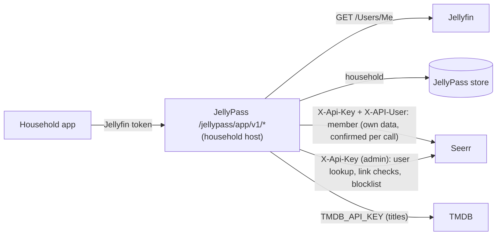

# Household app: design

## Status

Step 1a of 4 (read API). Step 0 added the acting-user Seerr client (`SeerrMemberClient` in `src/seerr.ts`), the
Jellyfin-to-Seerr user map (`SeerrUserMap` in `src/seerr-users.ts`), recorded-shape Seerr fixtures with canaries, and a
real-Seerr test. Step 1a serves the read-only app API (`HouseholdApp` in `src/app-api.ts`, see "App API (step 1a)"):
who the caller is, search, discover, and movie, series and season details, each title with its household state. Titles
come from TMDB (`TmdbClient` in `src/tmdb.ts`, `TMDB_API_KEY`; see "Catalogue source"), which replaced step 0's Seerr
catalogue client and its `SEERR_CATALOGUE_USER_ID` before either was released. The app API is off unless
`HOUSEHOLD_APP_ENABLED` is true. There is no app page yet (step 1b). This document is the contract the later steps are
built and reviewed against.

## Goal

JellyPass becomes the backend of a household web app (a PWA first; native apps later, using the same API) served on
each `jelly-<household>` host. It replaces the Seerr website for regular users: once the app is ready (step 4), the
Seerr website is for administrators only.

Household records are about privacy, not control. The app never shows one household what another has, has asked
for, or is waiting on.

## Architecture

- The app API lives under `/jellypass/app/v1/*` on household hosts only, next to the existing household gateway.
- JellyPass calls Seerr and TMDB server-side. The app never talks to either and never receives one of their objects.
- Responses are built by **allowlist shaping**: each DTO field is copied from a TMDB or Jellyfin field chosen for it,
  and anything not chosen is never read into the response. Upstream objects are never relayed, filtered or stripped.

## Identity chain

Identity comes only from Jellyfin, never from anything the client says about itself.

1. The app sends the user's Jellyfin access token to the household host.
2. JellyPass verifies it with Jellyfin's `GET /Users/Me` (as the household gateway does today) and caches the answer
   for at most 5 minutes, keyed by a hash of the token. A disabled user is rejected. A Jellyfin that cannot be reached,
   or answers 5xx, fails the call (`unavailable`) rather than signing the caller out.
3. The household comes from the JellyPass store, and the caller must be a member of the household whose host they
   called. Anyone not in that household is refused.
4. The caller's own Seerr data (requests, quota, watchlist) is read and written through `SeerrUserMap.member(id)`, a
   `SeerrMemberClient` that holds the caller's **Jellyfin** user, never a Seerr user. Before every call it confirms
   which Seerr user Seerr links to that Jellyfin user (see "Stale mappings"), and sends that user in `X-API-User`.
5. Titles (search, discover, details) are read from TMDB with JellyPass's own key, never from Seerr and never as the
   caller (see "Catalogue source").

### Stale mappings

An administrator can relink a Seerr user to another Jellyfin user, or delete it, at any time; a mapping remembered
from before would then act as someone else, or as nobody. Jellyfin IDs are compared normalized (32 lowercase hex
digits, dashes removed), whatever format Seerr or Jellyfin gives them in.

- **There is no way to keep a Seerr user to act as.** `SeerrClient` no longer makes a client fixed to a Seerr user
  (`asUser` is gone) and `SeerrUserMap` hands out none (`clientFor` and `verifiedClientFor` are gone);
  `test/types/seerr-user-client.ts` checks both. A `SeerrMemberClient` holds a Jellyfin user and may be kept for as
  long as the caller likes.
- **Every member call is confirmed immediately before it is sent.** Inside each call, the client takes a candidate
  Seerr user from `SeerrUserMap` (cached for 1 minute, at most 1000 entries, least recently used forgotten first;
  failed lookups are not cached; concurrent lookups share one call; found with the admin key and
  `GET /api/v1/user/jellyfin/:jellyfinUserId`, used only if Seerr's `jellyfinUserId` matches), asks Seerr with the
  admin key and `GET /api/v1/user/:id` whether that Seerr user is still linked to the caller, and only then sends the
  call. Nothing is awaited between the confirmation and the send. A mismatch, or a deleted Seerr user, forgets the
  candidate and tries once more with a fresh lookup; a second failure fails closed (`SeerrUnmappedUserError`).
- **Invalidation reaches calls in flight.** `invalidate(jellyfinUserId)` forgets one caller and `clear()` everyone;
  a call whose confirmation was in flight when either ran is confirmed again before it is sent. A lookup in flight
  answers only the callers already waiting on it: it never fills the cache and is never joined afterwards. The check
  compares a per-user version taken before the confirmation with one taken after; versions come from one counter that
  only grows, and a stamp forgotten by `clear()` or by eviction (at most 1000 are kept) becomes the floor every
  unstamped user reads as, so a user's version never goes down and grows on each of their invalidations: an
  evicted stamp can never make an invalidated call look unchanged.
- A 401, 403 or 404 from Seerr on a member call forgets that caller's mapping.
- The candidate source cannot widen this: `SeerrMemberClient` confirms whatever its resolver proposes, so even a
  forged resolver can only make a call fail closed.

The cost is one admin call (a local `GET /api/v1/user/:id`) per member call. What remains: confirmation and call are
two requests, so a relink landing between them is not caught; that window is one round trip, the call acts as the user
Seerr confirmed a moment before, and it never spans a cache lifetime or a kept client.

### Catalogue source

Titles come from TMDB, not Seerr. Seerr's title answers (search, discover, movie, series) carry each title's Seerr
media record, `mediaInfo`, with every household's requests, watchlist entries, issues and download state in it.
JellyPass never returned any of it, but it still had to receive it: Codex measured, end to end through JellyPass, that
1 MB of other households' records on a title slowed household A's answers from 5.1 to 8.4 ms (median), and that 4.3 MB
of them turned A's answer into a `502` (the 4 MiB cap on Seerr bodies). Neither a size cap nor a faster parser closes
that: the records have to stay off the path. Seerr also shapes those answers with the acting user's region, language
and watchlist (step 0's reason for a dedicated catalogue user).

So `TmdbClient` (`src/tmdb.ts`) reads TMDB's v3 API directly, with JellyPass's own credential:

- **Endpoints**, one method each, no pass-through: `GET /3/search/multi` (`include_adult=false`);
  `GET /3/trending/all/day` (trending); `GET /3/discover/movie` and `GET /3/discover/tv` by `popularity.desc`
  (popular movies and series); `GET /3/discover/movie` by `popularity.desc` with `primary_release_date.gte` today in
  UTC (upcoming); `GET /3/movie/:id`; `GET /3/tv/:id`; `GET /3/tv/:id/season/:n`. The discover lists are built the way
  Seerr 3.5.1 builds its own (`server/routes/discover.ts` and `server/api/themoviedb`), so the lists match what
  members saw in Seerr, minus per-user region and language.
- **The same for everyone.** Every call carries `language=en-US` and nothing about the caller: no region, no user, no
  household, no Jellyfin session. TMDB knows nothing of JellyPass's households or Seerr's records, so nothing another
  household holds, asked for or waits on can change what TMDB returns, how large it is or how long it takes.
- **The credential.** `TMDB_API_KEY` is a v3 API key (32 hexadecimal characters, sent as `api_key`) or a v4 API read
  access token (sent as `Authorization: Bearer`). It is required when `HOUSEHOLD_APP_ENABLED` is true; a malformed
  value stops startup without being quoted; JellyPass checks it with `GET /3/authentication` at startup and stops if
  TMDB refuses it (`401` or `403`), and only logs a warning if TMDB cannot be reached (the app answers `unavailable`
  until it can). The key lives in a module-private `WeakMap`, never on the client object, and is never logged: errors
  carry the route template and status only (`TMDB GET /3/movie/:id returned 404`), and a failed `fetch` (whose own
  message would quote the URL, and with it a v3 key) is reported as `TMDB GET <route> failed`.
- **Guards**, as for Seerr: redirects are never followed (the key would go with them), bodies are read up to 4 MiB,
  counted in bytes, and errors never carry TMDB's body. A title TMDB does not know (`404`) is `not_found`; any other
  failure is `unavailable`.
- **Cache.** Each answer is kept for 10 minutes, keyed only by the request's own parameters (endpoint, query, page,
  TMDB ID, season). Each household has its own partition of at most 500 answers (least recently used forgotten first),
  so whether household A's answer comes from the cache never depends on what household B looked at, and B's volume
  never evicts A's entries. Concurrent calls for the same key in one household share one TMDB call; a failed call is
  not kept.
- **Images** are TMDB's own `poster_path` and `backdrop_path` through the existing allowlisted image URLs
  (`https://image.tmdb.org/t/p/{w342,w780}` plus a file name matching `^/[A-Za-z0-9_-]{1,100}\.(jpg|jpeg|png|webp)$`).
- **Attribution.** TMDB's API terms require attribution: the README carries TMDB's notice ("This product uses the TMDB
  API but is not endorsed or certified by TMDB"), and the app (step 1b) must show it, with TMDB's logo, on an about
  screen. JellyPass makes no more than a few TMDB calls per answer, well inside TMDB's rate limits, and caches as above.

From Seerr the app now reads only three things, none of which carries another household's records:

- **The blocklist**, `GET /api/v1/blocklist` with the admin key (Seerr's API key runs as its owner, who has
  `MANAGE_BLOCKLIST`), 100 entries per page, at most 50 pages (the newest 5000 entries), reused by each household for a
  minute (again one partition per household). The blocklist is kept by administrators (`MANAGE_BLOCKLIST`, which
  household members do not have) and is the same for every household. Seerr 3.5.1 (`server/routes/blocklist.ts`)
  joins only the administrator who added an entry (`leftJoinAndSelect('blocklist.user')`), never its media record or
  any request, so its size and timing depend only on the blocklist itself; the real-Seerr test checks the keys of a
  real entry. Only each entry's `mediaType` and `tmdbId` are read. Seerr's media `status` is no longer read at all.
- **The caller's own request permission**, as the caller (see "Per-title states").
- **Household members' own requests**, each as that member, only for members of this household alone (see "Requested
  and households").

### Unmapped users

A Jellyfin user Seerr has no confirmed user for may request nothing, so every title they cannot already play is
`unavailable`: the app decides this from a member call, `SeerrMemberClient.ownUser()` (`GET /api/v1/auth/me` as the
caller), which fails with `SeerrUnmappedUserError` for them. Nothing falls back to the admin client, and the map does
not import users: Seerr users are still created by the existing admin import (`importToJellyseerr` when a user is
created).

### The `X-API-User` hazard

Seerr 3.5.1 runs a call carrying its API key as the user named in `X-API-User`, but a **missing or empty**
`X-API-User` runs it as the owner, user 1 (`server/middleware/auth.ts`, `checkUser`). An unknown ID is refused (403).
So the clients make a missing user impossible:

- `SeerrUserId` is a branded number. Only `seerrUserId(value)` makes one, and it throws unless `value` is a positive
  safe integer; a plain number does not type-check as one.
- `SeerrMemberClient` acts only as a Seerr user Seerr has just confirmed. It is made from a real `SeerrClient`, whose
  connection details are private to `src/seerr.ts`.
- Every call builds `X-API-User` from a `SeerrUserId`, re-checking it, so it is always a non-empty decimal string.
- Paths that name a user (`/user/:id/requests`, `/user/:id/quota`) always use the confirmed acting user's ID.
- `createRequest` sends only `mediaType`, `mediaId`, `seasons` and `is4k: false`: never `userId` (which would let a
  manager request for someone else) or server, profile or folder overrides.
- Redirects are never followed: a 3xx is a failure, so the key and acting user never go anywhere else.
- Errors carry the status and the route template (`Seerr GET /api/v1/tv/:id returned 404`), never Seerr's body or the
  IDs asked for.
- Bodies are read up to 4 MiB, counted in bytes as they stream in; reading stops as soon as a body passes the limit.

`SeerrClient` stays the admin-key client. It never sends `X-API-User`, and it is used only for JellyPass's own
administrative work (webhook and backfill lookups, recent-request cards, user import, and the user lookups and checks
above) and for the administrator blocklist, which is the same for every household; never to read anything that belongs
to a member. Its household-app calls, `findUserByJellyfinId`, `jellyfinUserIdOf` and `blocklist`, have the same
redirect, error and size guards as the acting-user calls; its older methods keep their existing behaviour.

## Per-title states

Each title the app shows has exactly one household state, decided in this order:

| State | Meaning | What the app gets |
|---|---|---|
| `in_library` | Playable by the caller in Jellyfin through their household. Decided first: it needs no request permission. | The only state with a Jellyfin item ID and a Play link to the household host. |
| `unavailable` | Not playable by the caller, and blocklisted or the caller may not request it (including an unmapped caller). | Title only, no actions. |
| `requested` | This household has a request for it, or has registered interest. | Coarse status. |
| `get_this` | Everything else: not in Seerr, held privately by another household, downloading for someone else, requested by someone else. | A "Get this" action. |

A title another household holds is indistinguishable from one nobody has.

As implemented in step 1a, every state is decided by one function, `titleState` in `src/app-api.ts`, in this order:
`in_library`, then `unavailable`, then `requested`, then `get_this`. `in_library` comes first because it comes from the
caller's own Jellyfin view: playing an item the caller can already see needs no Seerr request permission, and it says
nothing about another household. `unavailable` covers only titles the caller cannot play. The inputs depend on nothing
another household does, and are all read for each answer:

- **Library**: the movies and series the caller's own Jellyfin view holds, by TMDB ID, from one paged
  `GET /Items?userId=<caller>&hasTmdbId=true&fields=ProviderIds` made with the caller's own token, so Jellyfin applies
  their blocked tags, library access and parental limits. Seerr's `jellyfinMediaId` is never used. It is reused for up
  to a minute per caller (one lookup per results page or less).
- **Blocklist**: Seerr's administrator blocklist (see "Catalogue source"), the same for every household. A movie and a
  series with the same TMDB ID are different titles.
- **Eligibility**: the caller's own Seerr user, read as them (`ownUser()`). The caller may request movies with Seerr's
  `ADMIN`, `REQUEST` or `REQUEST_MOVIE` permission and series with `ADMIN`, `REQUEST` or `REQUEST_TV` (Seerr 3.5.1
  `MediaRequest.request`). A title the caller cannot play is `unavailable` when it is blocklisted, when the caller has
  no such permission, or when Seerr has no user for them.
- **Requested**: the titles household members have a pending or approved (Seerr request status 1 or 2) HD request
  for, read as described in "Requested and households". Declined, failed, completed and 4K requests do not count.

A series' seasons are `in_library` when the caller's view has episodes of them
(`GET /Shows/:id/Episodes?userId=<caller>&isMissing=false`, read only when the series is `in_library`); otherwise
`unavailable` when the series could not be requested (blocklisted, or no permission), otherwise `get_this`. So a caller
without series permission sees the seasons they have as `in_library` and the rest as `unavailable`.

### Requested and households

Seerr records who made a request, not which household it was for, and a Jellyfin user can belong to several
households (administrators often do). Counting such a person's requests in every household they belong to would show
household A what was asked for in household B (Codex's repro: Bob in Farmhouse and Mill with a pending request; Alice
in Farmhouse saw it as `requested`). Until requests carry their household, step 1a fails closed:

- Only members who belong to **exactly one household**, this one, count. Their requests can only be this household's.
- A member of several households, administrators included, is ambiguous: their requests are **not read at all** (no
  Seerr call is made for them), so neither the answer nor the calls made reflect their request history. Their
  requests show as `get_this` everywhere, including to themselves. A user in no household cannot use the app, and
  their requests count nowhere.
- Each counted member's own requests are read as that member (`ownRequests`, 100 per page, newest first, at most 5
  pages: their newest 500 requests), each call confirmed as usual. The number of calls depends only on that member's
  own history, which is this household's own data. An active request older than the newest 500 shows as `get_this`
  (the cost is bounded rather than exact; "Get this" in step 2 handles a title already requested).
- Membership is read from the JellyPass store on every answer, so moving someone between households changes this at
  once. What remains: a single-household member's requests made while they belonged to another household (or before
  joining) count for their current household; and whether a member is shared with another household changes which
  calls A makes (an administrator's configuration, not anything a household holds or asked for).

**Step 2 attribution record.** "Get this" will record, for every Seerr request it makes, `{seerrRequestId, householdId,
jellyfinUserId, mediaType, tmdbId, seasons, createdAt}` in the JellyPass store at the moment of the request (the
household is the host it was made on). `requested` then comes from these records (for this household only, whoever
made them) joined with each request's current status read as its requester, and requests made outside the app (no
record) count only for single-household requesters, as now. Interest and join branches already record the household
(see "Get this"). The record is written before the request is answered and is never shown to another household.

## App API (step 1a)

Served by `HouseholdApp` (`src/app-api.ts`) through the household gateway, only on household hosts and only with
`HOUSEHOLD_APP_ENABLED=true` (which requires `HOUSEHOLD_DOMAIN`, Seerr and `TMDB_API_KEY`). Without it, every
`/jellypass/app` path answers a fixed `404 {"error":"not_found"}` on household hosts and is never proxied to Jellyfin.
On the administrator host the paths do not exist (the admin API's own `401`/`404`).

| Endpoint | Answer |
|---|---|
| `GET /jellypass/app/v1/me` | `{name, household}` (no Seerr call) |
| `GET /jellypass/app/v1/search?q=&page=` | `Page` (`q` 1 to 100 characters, `page` 1 to 500) |
| `GET /jellypass/app/v1/discover/{trending,popular-movies,popular-tv,upcoming}?page=` | `Page` (`upcoming` is upcoming movies) |
| `GET /jellypass/app/v1/movie/:tmdbId` | `Movie` |
| `GET /jellypass/app/v1/tv/:tmdbId` | `Series` |
| `GET /jellypass/app/v1/tv/:tmdbId/season/:n` | `Season` |

DTOs (every key always present; missing values `null`, or `""` for text):

- `Card`: `mediaType`, `tmdbId`, `title`, `year`, `overview`, `posterUrl`, `backdropUrl`, `rating` (TMDB vote average,
  `null` when 0), `state`, `play` (`{itemId, url}` only for `in_library`, the URL
  `https://<household host>/web/#/details?id=<itemId>`). Images are `https://image.tmdb.org/t/p/{w342,w780}` plus a
  path matching `^/[A-Za-z0-9_-]{1,100}\.(jpg|jpeg|png|webp)$`.
- `Page`: `page`, `nextPage` (`page + 1` only when TMDB returned a full page of 20 results, up to 500), `results`
  (cards for movies and series; people and collections dropped).
- `Movie`: the card's keys plus `genres` (names) and `runtime` (minutes). `Series`: also `seasons`
  (`{seasonNumber, name, episodeCount, state}`), with `runtime` the first episode run time.
- `Season`: `tmdbId`, `seasonNumber`, `name`, `overview`, `episodes` (`{episodeNumber, name, overview}`), `state`.

Every DTO is built by copying named TMDB fields (`title`/`name`, `release_date`/`first_air_date`, `overview`,
`poster_path`, `backdrop_path`, `vote_average`, `genres[].name`, `runtime`, `episode_run_time[0]`,
`seasons[].{season_number,name,episode_count}`, `episodes[].{episode_number,name,overview}`), each type-checked and
length-capped, through an own-property reader; no TMDB, Seerr or Jellyfin object is spread, relayed or stripped.

Errors are fixed and the same for every endpoint and title: `400 invalid_request`, `401 unauthorized` (missing,
invalid or disabled token, or a caller from another household, all identical), `404 not_found` (unknown path, or a
title TMDB does not know), `429 too_many_requests`, `502 unavailable` (Jellyfin, Seerr or TMDB failed; logged with the
route and status only). Every answer has `Cache-Control: no-store`, `X-Content-Type-Options:
nosniff` and `Referrer-Policy: no-referrer`.

Budgets: 300 calls per client address and 200 per user in each 5-minute window (fixed windows, `AttemptCounter`); the
address budget is counted before any credential is checked. Both answer the same `429`. Metrics:
`jfa_app_requests_total{endpoint, outcome}`, with no title label.

### Leak channels in step 1a

| Channel | How step 1a closes it |
|---|---|
| Fields | Allowlist DTOs only (above), copied from TMDB, which holds no household data. Canary tests run every endpoint over the canary-laden TMDB and Seerr fixtures in every test world and pass status, headers and body to `assertNoCanaries`. |
| Counts | No count is returned; a page holds exactly the titles returned. |
| Paging | `nextPage` comes from the number of results TMDB returned; `total_pages` and `total_results` are never read. |
| Error text | Fixed bodies; TMDB, Seerr and Jellyfin errors are logged by route and status. |
| Status codes | Fixed per outcome; nothing about another household changes an outcome. Seerr title answers, whose size other households' records set (Codex: +4.3 MB made a `502`), are no longer read. |
| Sequential IDs | Only TMDB IDs, and the caller's own playable Jellyfin item ID. |
| Item IDs | Only from the caller's own Jellyfin view, and only for `in_library`. |
| Requests of shared members | A member of several households could have asked for any of them, so their requests are not read (see "Requested and households"). |
| Timing | Titles come from TMDB, which has no household data, so other households' Seerr records cannot change their size or latency (tested with 5 MB of them). The calls made are the same whatever other households hold or asked for, including a shared member's request history (tested). Per-answer work is bounded: one TMDB read (cached per household), one blocklist read per household per minute (at most 50 pages, set by administrators), one permission read, at most 5 request pages per single-household member, a cached library read, one episode read for a series in the caller's library. Caches are partitioned per household, so another household's browsing never decides whether A's answer is cached. Residual: TMDB's own CDN may answer a URL faster after anyone (on any TMDB client) asked for it; that is outside JellyPass, shared with the whole internet, and says nothing about households. Whether a member is shared with another household changes which Seerr calls A makes (administrator configuration only). |
| Caching | `Cache-Control: no-store` on every answer. |
| Volume | Per-address and per-user budgets with one `429`. |
| Identity, Preferences | Titles from TMDB with no user at all; member data only through `SeerrUserMap.member()`, each call confirmed (tested on every endpoint). |
| Quota, Late requests | Not reachable: step 1a makes no requests. |

## "Get this" (step 2)

"Get this" always answers the same way, at once, whatever the title's real situation; the work happens in the
background, as the existing household "Add to my library" does:

- held by another household: the household joins the existing grant, as library joins do today;
- already requested or downloading for someone else: the household's interest is recorded, so it is granted when the
  title becomes available;
- otherwise: a real HD Seerr request is made as the caller (`SeerrMemberClient.createRequest`).

The answer never depends on which of these happened, on Seerr's result, or on timing.

### Quota before branching

Only the request branch would meet Seerr's quota, so without a rule an exhausted caller could tell the branches
apart: "Get this" would work for a title another household holds and not for one nobody has. So quota is decided
for the caller before any branch is chosen, and every branch is charged and refunded exactly as Seerr would charge
and refund the caller's own request for that title.

1. **Eligibility first.** Before choosing a branch, JellyPass checks the caller's own eligibility for the title's
   media type: the caller has Seerr's request permission for it, and their *combined* usage (below) plus the units
   this action needs is within their Seerr quota limit. Nothing about the title or other households is consulted. If
   the caller is not eligible, **no branch runs**: no join, no interest, no request, and the immediate answer is the
   same whichever branch would have run.
2. **Virtual requests.** Each join or interest is recorded for the caller as a *virtual request* in a JellyPass-side
   tally: the units, creation time and status the caller's own Seerr request would have had. Seerr's quota rule
   (`User.getQuota` in Seerr 3.5.1) is then applied to real and virtual requests alike: the same per-user limit and
   window (`quotaLimit` per `quotaDays`, the user's own or Seerr's default, counted from creation time), one unit per
   movie and one per season for a series, every status counted **except declined**, nothing counted once deleted,
   and no count when the caller can bypass quotas (Seerr's `MANAGE_USERS`). Combined usage is Seerr's own `used`
   (the caller's real requests) plus the virtual requests inside the window. A request branch is counted by Seerr
   itself, so it is not added to the tally.
3. **Every outcome, every branch, the same count.** A virtual request's status follows what Seerr would have done to
   the caller's own request, never what happened to someone else's:

   | Event | Request branch (Seerr) | Interest branch (virtual) | Join branch (virtual) |
   |---|---|---|---|
   | Accepted | Pending or approved: counted | Pending: counted | Completed at once (the title is already playable): counted |
   | Declined (by an administrator, or by Seerr's scanner for an orphaned approved request) | Freed | Underlying request declined: freed | Cannot happen |
   | Failed | Still counted (Seerr counts failed requests) | Underlying request failed: still counted | Cannot happen |
   | Failed, then retried | Approved: counted | Follows the underlying request: counted | Cannot happen |
   | Completed | Counted | Counted | Counted |
   | Underlying request deleted by its owner or an administrator, title not yet available | n/a: no one else's request is involved | Becomes failed: still counted (the caller's own request would not have been deleted); the outcome shows `We couldn't get this` | n/a |
   | The title's Seerr media record deleted (cascades to every request on it) | Deleted: freed | Deleted: freed | Deleted: freed |
   | Cancelled by the caller (later; not in v1) | Deleted: freed | Deleted: freed | Allowed in exactly the same states as the request branch, and freed alike |
   | Refused before anything is recorded (permission, or a race) | Not counted | Not recorded | Not recorded |
   | Window ends | No longer counted | No longer counted | No longer counted |

   Declined and failed both show as `We couldn't get this`, but only a decline frees the unit, in every branch, as in
   Seerr. Neither the unit nor the visible outcome depends on which branch ran.
4. **Series are charged per season, whatever serves each season.** Seerr charges a series request only for seasons not
   already requested or available, so a request overlapping someone else's would cost less and show it. "Get this"
   for a series charges one unit per season asked for: seasons already held or requested elsewhere go through the
   join or interest branch (virtual, one unit each) and the rest through one real request (charged by Seerr), so the
   total never depends on other households. A request branch whose title became requested or available in the
   meantime (Seerr refuses it) falls through to the interest or join branch; it does not fail.
5. **Never stricter than Seerr, never looser.** Because combined usage includes Seerr's own `used`, a request JellyPass
   finds eligible always passes Seerr's own check; Seerr's check never runs for a virtual request, so the tally
   alone enforces the limit there.
6. **Serialized.** Eligibility and the count are checked and recorded under a per-user lock, so concurrent "Get this"
   calls cannot overrun the limit through one branch and not another.
7. **No numbers shown.** v1 displays no quota counts. The app shows a single title-independent state, "You've reached
   your request limit", derived solely from the caller's own combined usage, before the action is offered; the
   action's answer itself never mentions quota.

Residual leak: none between households. What a caller can learn from the count is how many units their own past
"Get this" calls used and whether each ended declined (freed) or otherwise, which is theirs to know and the same
whichever branch served them. Seerr requests made outside the app (the Seerr website before step 4, or by an
administrator on the caller's behalf) count towards Seerr's `used` but were the caller's own or an administrator's
doing; requests an administrator makes with `ignoreQuota` are not counted, as in Seerr. The live server currently has
no quotas configured, so today every caller is eligible unless they lack request permission.

### Late requests (closed by design)

History: PR #30 tried to fix this in the webhook; it was closed in favour of closing the hole through the app.

**The hole.** Seerr 3.5.x accepts `POST /api/v1/request` for a title that is already available. For a user with
auto-approve, JellyPass's webhook and backfill then treat that late request as a genuine one, which can make a
public title private, re-add access an administrator removed, or extend a manual-only grant.

**Why not classify after the fact.** Telling a late request from a genuine one afterwards needs to know whether the
title was in Jellyfin when the request was made, and nothing proves that. Jellyfin's `DateCreated` is the file's
modification time (it left 3 of 19 real genuine requests public). A periodic availability journal cannot prove
absence at request time either: there are gaps between observations, deletions and re-downloads, HD/4K inferred from
`MediaSourceCount`, item IDs that change without a TMDB link, and TV file counts that do not show episode coverage.

**The rules that close it.**

- "Get this" **must never** create a Seerr request for a title Jellyfin already has. Jellyfin's own answer is a
  decision input, checked before branching: a title Jellyfin has goes to the join branch, never the request branch.
- The app API offers no other request path.
- Step 4 (the Seerr website restricted to administrators) is **required**, not optional: it is what closes the hole
  for direct use of Seerr. Until step 4, the risk remains for users who send requests to Seerr's API or website
  directly.

## Coarse statuses

The app shows only three request statuses: `Requested`, `Ready to watch`, `We couldn't get this`. Seerr's pending,
approved, processing and partially available states all show as `Requested`; declined and failed requests as `We
couldn't get this`. No notifications yet.

## Privacy model

Lessons from the removed JellyQuest relay (`src/request-bridge.ts`, PRs #1, #6 and #7): scrubbing Seerr objects of
other users' data never converged, because leaks kept arriving through new fields and side channels. The app API
closes each channel by construction:

| Channel | How it leaked | Rule |
|---|---|---|
| Fields | `mediaInfo.requests[].requestedBy`, `modifiedBy`, issues, watchlists, download status, emails, avatars | Allowlist DTOs only; Seerr JSON is `unknown` to callers and must be parsed field by field. |
| Counts | `pageInfo.results`, `totalResults`, `requestCount` | Counts only from data the caller can see: the DTOs actually returned. |
| Paging | Page sizes and offsets revealing filtered-out entries | Page over caller-visible results; never relay Seerr paging. |
| Error text | Seerr messages, stack traces | Fixed error codes and bodies; Seerr errors are logged, never returned. |
| Status codes | 403 vs 404 vs 409 for another household's title | Fixed status codes per endpoint, independent of other households. |
| Sequential IDs | Seerr request, media and user IDs | Opaque IDs only (TMDB IDs for titles; anything else is a JellyPass-issued opaque token). |
| Item IDs | `jellyfinMediaId` of a title held privately elsewhere | A Jellyfin item ID only for `in_library`. |
| Timing | Slower answers when Seerr or the store had work to do | Uniform answers: background work is never awaited (as for library joins), and per-title work is bounded. |
| Caching | Responses kept by browsers or proxies | `Cache-Control: no-store` on every response. |
| Volume | Enumeration by repeated calls | Per-client and per-user budgets, as for household logins and library joins. |
| Quota | Only the request branch of "Get this" meeting Seerr's quota, or refunding differently, so an exhausted user sees which titles another household holds | Eligibility decided before any branch; joins and interest recorded as virtual requests counted and freed exactly as Seerr counts the caller's own (declined frees, failed does not); series charged per season asked for; no counts shown (see "Quota before branching"). |
| Identity | A cached Seerr user acting for a Jellyfin user after a relink or deletion | No client holds a Seerr user; every member call is confirmed with Seerr immediately before it is sent; invalidation reaches calls in flight (see "Stale mappings"). |
| Preferences | Seerr shaping title results with the acting user's region, language and watchlist, so results follow whoever the caller is mapped to | Titles read from TMDB with one fixed language and no user; title DTOs copy no per-user field (see "Catalogue source"). |
| Attribution | Seerr not recording which household a request was for, so a member of several households leaked requests across them | Only single-household members' requests count until step 2 records the household with each request (see "Requested and households"). |
| Late requests | A request for an already-available title granted as if genuine | "Get this" checks Jellyfin first and joins; no other request path; Seerr website admin-only at step 4 (see "Late requests"). |

## Seerr function inventory

Only the v1 endpoints are reachable for a household member, each through its own `SeerrMemberClient` or `SeerrClient`
method; there is no generic pass-through. Titles come from TMDB (`TmdbClient`), never from Seerr.

| Group | Endpoints | Where |
|---|---|---|
| v1, as the member (confirmed per call) | `POST /request`; `GET /user/:self/requests`; `GET /user/:self/quota`; `GET /auth/me` (own permissions); `GET /discover/watchlist` | `SeerrMemberClient` |
| v1, admin key | `GET /user/jellyfin/:jellyfinUserId` (user lookup); `GET /user/:id` (link check, its `id` and `jellyfinUserId`); `GET /blocklist` (each entry's `mediaType` and `tmdbId`) | `SeerrClient.findUserByJellyfinId`, `SeerrClient.jellyfinUserIdOf`, `SeerrClient.blocklist` |
| TMDB v3 (not Seerr) | `GET /search/multi`; `GET /trending/all/day`; `GET /discover/{movie,tv}`; `GET /movie/:id`; `GET /tv/:id`; `GET /tv/:id/season/:n`; `GET /authentication` (startup) | `TmdbClient` |
| Later | Request cancellation by its owner, recommendations and similar titles, genre and keyword discovery, watchlist writes | Not yet |
| Admin-only | Approving, declining and deleting requests, issues, users, settings, blocklist management | Seerr website, administrators |
| Never for a member | `GET /user`, `GET /user/:id` (as the member), `GET /request/count`, `GET /media`, `GET /request` (all requests), and every Seerr title endpoint (`/search`, `/discover/*`, `/movie/:id`, `/tv/:id`), whose answers carry other households' records | Not exposed |

## Phased plan

0. **Foundation**: member client, user map, fixtures with canaries, real-Seerr test, this document.
1. **Read API**: (1a, done) identity chain, search, discover, title details with household states, as allowlist DTOs
   tested with `assertNoCanaries` and byte-for-byte indistinguishability tests; (1b) the PWA's read-only screens over
   it. Endpoints for the caller's own requests and quota are not in 1a; they come with step 2, which needs them.
2. **"Get this"**: the uniform background action above, with the household attribution record (see "Requested and
   households").
3. **PWA**: the household app itself, served on household hosts.
4. **Cut-over**: the Seerr website restricted to administrators. Required: it closes late requests made directly to
   Seerr (see "Late requests").

## Decisions

- PWA first; native apps later on the same API.
- The Seerr website is restricted to administrators once the app is ready (step 4).
- Coarse statuses only; no notifications yet.
- HD only in v1 (`is4k` is always false).
- No watchlist-star shortcut.

## Test strategy

- **Header guard.** `test/seerr-user-client.test.mjs` calls every public `SeerrMemberClient` method and asserts each
  is preceded by an admin link check and sends `X-API-User` with the confirmed user, and calls every public
  `SeerrClient` method (the blocklist included) and asserts none sends one. A test fails if either class gains a
  method the tables do not cover. Invalid Jellyfin IDs, admin clients and blocklist paging are refused before any
  call. `test/types/seerr-user-client.ts` (run by `pnpm check`) asserts with `@ts-expect-error` that no client fixed
  to a household member's Seerr user can be obtained (`asUser`, `clientFor`, `verifiedClientFor` are gone; a member
  client takes a Jellyfin user and exposes no Seerr user), that the Seerr catalogue client is gone, that a member
  client reads no titles, and that the TMDB client reads no one's own data, takes no user and relays no route.
- **TMDB client.** `test/tmdb-client.test.mjs` checks the credential formats (malformed values refused without being
  quoted), that the key is not on the instance, the exact URL of every method and discover list (fixed `en-US`,
  `include_adult=false`, upcoming from today in UTC), a v3 key sent as `api_key` and a v4 token as a bearer token never
  in the URL, input validation before any call, errors by route and status only (no body, IDs or key, including a
  failed `fetch` that quotes the URL), the byte size limit and invalid JSON, and, against a real local server that
  redirects to a second one, that the redirect is never followed.
- **User map.** `test/seerr-users.test.mjs` runs against a fake Seerr behind `fetch` and covers TTLs, the size cap,
  uncached failures, shared lookups, the closed failure for unmapped users, and stale mappings: a client kept across a
  relink acting as the new user on every call (Codex's repro), a kept client acting as nobody once unlinked,
  concurrent calls during a relink each sent as the user Seerr confirmed for it, `invalidate()` and `clear()` landing
  during a confirmation (confirmed again; failing closed if it keeps happening; not fooled by another user's
  invalidation, and not fooled by an evicted stamp: Codex's repro with one stamp kept, many invalidations, evictions
  and clears during one confirmation, and a randomized check that versions never go down), deletion failing closed,
  401/403/404 forgetting the mapping, a forged candidate never acting, `clear()` and `invalidate()` while a lookup is
  pending, and Jellyfin IDs with or without dashes and in either case.
- **Guards.** `test/seerr-user-client.test.mjs` runs every guarded call (the admin lookups, link check and blocklist
  and every member method) against a real local server that redirects to a second one: the redirect is never
  followed, so the second server sees nothing, and the error carries neither body text nor the IDs. It also checks
  route-only errors, the byte (not character) size limit with multi-byte bodies, that reading stops once a streamed
  body passes the limit, and that the older admin methods are unchanged.
- **Fixtures and canaries.** `test/seerr-fixtures/3.5.1/` holds synthetic responses for search, movie, TV, season,
  own requests, quota and watchlist, generated by `generate.mjs` with the key structure of a real Seerr 3.5.1. Every
  user-ish field holds a canary: `canary` text, `c0ffee00c0ffee00…` GUIDs, numbers from 7300001 to 7399999,
  timestamps in 2001 (`test/seerr-fixtures.test.mjs` checks every such field). `test/tmdb-fixtures/3/` holds synthetic
  TMDB v3 search, movie, series and season answers (from its `generate.mjs`) whose every field the app does not copy
  (original titles, taglines, companies, credits, homepages, counts, paging totals) holds a canary. Step 1's DTO tests
  serve these fixtures as TMDB and Seerr and pass each serialized response to `assertNoCanaries` from
  `test/support/seerr-fixtures.mjs`; a test of `in_library` uses its own non-canary item ID.
- **Real Seerr.** `pnpm test:seerr` starts a throwaway `ghcr.io/seerr-team/seerr:v3.5.1` container, seeds an owner and
  a member with no permissions, and checks that a missing or empty `X-API-User` acts as the owner, that every member
  call is preceded by a link check and carries the member's ID (the member's request is refused where the owner's
  would not be), that a member client fails closed when Seerr links the user to someone else, that an unknown user ID
  is refused, that the user lookup works and fails closed, that `GET /user/:id` gives the link check its Jellyfin ID,
  and that a real blocklist entry, read with the admin key, carries only its own columns and the administrator who
  added it (no media record or request). Nothing in it needs TMDB. CI runs it as `seerr-integration`.
- **Mutation checks.** Removing or emptying the header, skipping the constructor check, accepting 0, adding the header
  to admin calls, forwarding `userId`, putting Seerr's body in errors, trusting a mismatched lookup, falling back to the
  owner for unmapped users, or loosening the constructor's type each fail at least one test; so do following
  redirects in the guarded lookups, skipping the per-call link check (or doing it only once per client), ignoring an
  invalidation during a confirmation, dropping an evicted stamp without raising the floor, letting a pending lookup
  fill the cache after `clear()`, or counting the size limit in characters.
- **App API.** `test/app-api.test.mjs` runs the app through the household gateway against a fake TMDB serving the
  TMDB fixtures (it refuses calls without JellyPass's key), a fake Seerr that enforces `X-API-User`, serves the
  blocklist and counts any title read as a violation (built from the Seerr fixtures), and a fake Jellyfin that applies
  each user's blocked tags, library access and parental limit (`test/support/household-app.mjs`). It covers: exact
  DTOs for every endpoint; every endpoint canary-free in every world, and on TMDB errors; **indistinguishability**:
  household A's answers (status, every header, body) from every endpoint, for two members, are byte-for-byte the same
  in the baseline world and in each world where household B holds or asked for the title through a private grant, a
  pending request, a manual grant, a public title outside A's libraries, or 5 MB of other households' Seerr records on
  the title plus a 2000-request history (Seerr status, requests, watchlists, media IDs, JellyPass grants and Jellyfin
  items all differ), and where a member A shares with B asked for it; the TMDB, Seerr and Jellyfin calls made are the
  same in all of them (a shared member's long history included), and no Seerr title endpoint is ever called; each
  state rule (household requests, 4K, declined, failed and completed ignored, other households ignored, paging
  through requests and the 500-request cap, Codex's repro of a member of two households, an administrator in two
  households, a user in no household, per-media-type permission, unmapped caller, the blocklist by media type and
  paged, `in_library` before `unavailable` and `requested`, seasons of an in-library series without permission,
  blocked tags, libraries and parental limits, per-season states); identity (member routes only as that member with
  that member's ID in the path, each call matched to its own preceding confirmation, never another household's
  member; TMDB calls identical whoever asks, with JellyPass's key, `en-US` and nothing about the caller); caches (a
  TMDB answer reused within a household for 10 minutes and never across households, keyed by parameters, failures not
  kept; the blocklist reused per household for a minute); sessions (missing, invalid and disabled tokens and other
  households' members refused identically, the three token forms, the 5-minute cache with membership checked every
  call, Jellyfin down or unreachable failing closed, the admin host, an unknown household and the app switched off
  answering `404` without proxying, none of them reaching Seerr or TMDB); input validation; both budgets; and metrics
  without titles.
- **App mutation checks.** Each of these fails at least one app or client test: spreading the TMDB movie into a DTO;
  paging from `total_pages`; counting requests of members of several households (or of any household); putting
  `unavailable` or `requested` before `in_library`; ignoring the blocklist or request permission; matching the
  blocklist without its media type; leaving seasons `get_this` when the series cannot be requested; sharing the title
  or blocklist cache across households; keeping a failed TMDB answer; reading more than 5 request pages; following
  TMDB redirects; dropping the fixed language; putting the URL (and with it the key) in TMDB errors. Earlier checks
  still hold: skipping the disabled or household-membership check, dropping `Cache-Control`, counting 4K or declined,
  failed and completed requests, reading another household's member, trusting a token for 10 minutes, dropping either
  budget.
- **Real Jellyfin and Seerr for the app.** `pnpm test:real` serves the app from a real Jellyfin 10.11.3 (titles from
  the fake TMDB): the caller's title is `in_library` with its Play link until a blocked tag or a parental rating above
  their limit hides it, stays `in_library` once the caller loses request permission and the title is blocklisted, and
  is then `unavailable` when hidden. `pnpm test:seerr` seeds, in a real Seerr 3.5.1, a member who may request (with a
  pending request), another household's member (with one), a member of both households (with one) and a blocklisted
  title, and checks that `ownUser()` is read as the member, that the household's request shows as `requested`, the
  other household's as `get_this`, the shared member's as `get_this` in both households, the blocklisted title as
  `unavailable`, that a member without permission gets `unavailable`, that no user data reaches an answer, and that
  Seerr is asked for no title and nothing as the shared member.
- **TODO (step 2): quota before branching.** With a Seerr quota of 1 movie and the tally mirroring it: after one
  "Get this" through each of the join, interest and request branches, the next "Get this" runs no branch (no join,
  interest or request recorded) and answers byte-for-byte the same whichever branch it would have taken; the "request
  limit" state appears identically after each. For every row of the outcome table, the request branch (driven
  through real Seerr) and the interest branch (underlying request driven the same way) leave the caller with the same
  eligibility: a decline frees the unit in both, a failure frees it in neither (the bug a "We couldn't get this"
  refund would have), a retried failure stays counted, deleting the underlying request leaves the interest counted,
  and deleting the title's media frees all three branches. A series asked for in full when another household
  requested some of its seasons costs one unit per season asked for. A caller without request permission gets the
  same answer and no branch runs; concurrent calls at the limit run at most one branch; and the real-Seerr test checks
  the tally's window, units and decline/failure rules against Seerr's own `quota` for the same user.
- **TODO (step 2): late requests.** "Get this" for a title Jellyfin already has (movie, and series with every
  requested season present) joins and never reaches Seerr's request endpoint: the test's Seerr fails if
  `POST /api/v1/request` is called, for every combination of household holdings and request state.
