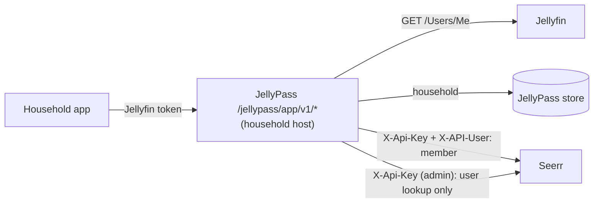

# Household app: design

## Status

Step 0 of 4 (foundation). Nothing here is user-facing yet: no `/jellypass/app/v1/*` endpoint is served. Step 0 adds
the acting-user Seerr client (`SeerrUserClient` in `src/seerr.ts`), the Jellyfin-to-Seerr user map
(`SeerrUserMap` in `src/seerr-users.ts`), recorded-shape Seerr fixtures with canaries, and a real-Seerr test. This
document is the contract the later steps are built and reviewed against.

## Goal

JellyPass becomes the backend of a household web app (a PWA first; native apps later, using the same API) served on
each `jelly-<household>` host. It replaces the Seerr website for regular users: once the app is ready (step 4), the
Seerr website is for administrators only.

Household records are about privacy, not control. The app never shows one household what another has, has asked
for, or is waiting on.

## Architecture

- The app API lives under `/jellypass/app/v1/*` on household hosts only, next to the existing household gateway.
- JellyPass calls Seerr server-side. The app never talks to Seerr and never receives a Seerr object.
- Responses are built by **allowlist shaping**: each DTO field is copied from a Seerr field chosen for it, and
  anything not chosen is never read into the response. Seerr objects are never relayed, filtered or stripped.

## Identity chain

Identity comes only from Jellyfin, never from anything the client says about itself.

1. The app sends the user's Jellyfin access token to the household host.
2. JellyPass verifies it with Jellyfin's `GET /Users/Me` (as the household gateway does today) and caches the answer
   for at most 5 minutes, keyed by a hash of the token. A disabled user is rejected.
3. The household comes from the JellyPass store, and the caller must be a member of the household whose host they
   called. Anyone not in that household is refused.
4. The caller's Seerr user comes from `SeerrUserMap`, which looks it up with the admin key via Seerr's
   `GET /api/v1/user/jellyfin/:jellyfinUserId`. The answer is used only if Seerr's `jellyfinUserId` matches the one
   asked for. Found and missing users are cached for 1 minute, at most 1000 entries (least recently used forgotten
   first); failed lookups are not cached, and concurrent lookups share one call. See "Stale mappings" below for which
   calls may use the cache.
5. Every Seerr call made for the caller goes through the returned `SeerrUserClient`, which sends `X-API-User`.

### Stale mappings

An administrator can relink a Seerr user to another Jellyfin user, or delete it, at any time; a cached mapping would
then act as someone else, or as nobody. Jellyfin IDs are compared normalized (32 lowercase hex digits, dashes
removed), whatever format Seerr or Jellyfin gives them in.

- **State-changing or user-scoped calls** (`createRequest`, `ownRequests`, `quota`, `watchlist`, and anything later
  that writes or reads the caller's own data) use `SeerrUserMap.verifiedClientFor`. Before each use it checks, with
  the admin key and `GET /api/v1/user/:id`, that the Seerr user is still linked to the caller. On a mismatch, or if
  that Seerr user no longer exists, it forgets the mapping and looks the caller up again, once; if that cannot be
  confirmed either, the caller is treated as unmapped (fail closed).
- **Read-only title calls** (`search`, `discover`, `movie`, `tv`, `season`) use `SeerrUserMap.clientFor`, which trusts
  the cache for up to 1 minute.
- A 401, 403 or 404 from Seerr on any call made through either client forgets that caller's mapping, so a deleted
  Seerr user (which Seerr refuses with 403) fails closed on the next use.
- `invalidate(jellyfinUserId)` forgets one caller and `clear()` everyone. A lookup still in flight when either is
  called answers only the callers already waiting on it: it never fills the cache and is never joined afterwards.

The trade-off: one extra admin call (a local `GET /api/v1/user/:id`) per verified use, so nothing the caller owns is
ever read or written as a stale user; in exchange, read-only title calls skip it. Their residual exposure is at most
1 minute after a relink (or until Seerr refuses the old user) during which title calls run with the old Seerr user's
permissions. Step 1's title DTOs therefore copy no per-user field from title responses (for example
`onUserWatchlist`); per-user facts come only from verified calls. The check and the call are two requests, so a relink
landing between them is not caught; that window is one round trip, not a cache lifetime.

**Unmapped users fail closed.** A Jellyfin user Seerr has no user for gets `unavailable` for everything. Nothing falls
back to the admin client, and the map does not import users: Seerr users are still created by the existing admin
import (`importToJellyseerr` when a user is created).

### The `X-API-User` hazard

Seerr 3.5.1 runs a call carrying its API key as the user named in `X-API-User`, but a **missing or empty**
`X-API-User` runs it as the owner, user 1 (`server/middleware/auth.ts`, `checkUser`). An unknown ID is refused (403).
So the client makes a missing user impossible:

- `SeerrUserId` is a branded number. Only `seerrUserId(value)` makes one, and it throws unless `value` is a positive
  safe integer; a plain number does not type-check as one.
- `SeerrUserClient`'s constructor (and `SeerrClient.asUser`) requires a `SeerrUserId`, checks it again at runtime, and
  fixes it for the client's lifetime.
- Every call builds `X-API-User` from that ID, re-checking it, so it is always a non-empty decimal string.
- Paths that name a user (`/user/:id/requests`, `/user/:id/quota`) always use the client's own ID.
- `createRequest` sends only `mediaType`, `mediaId`, `seasons` and `is4k: false`: never `userId` (which would let a
  manager request for someone else) or server, profile or folder overrides.
- Redirects are never followed: a 3xx is a failure, so the key and acting user never go anywhere else.
- Errors carry the status and the route template (`Seerr GET /api/v1/tv/:id returned 404`), never Seerr's body or the
  IDs asked for.
- Bodies are read up to 4 MiB, counted in bytes as they stream in; reading stops as soon as a body passes the limit.

`SeerrClient` stays the admin-key client. It never sends `X-API-User`, and it is used only for JellyPass's own
administrative work (webhook and backfill lookups, recent-request cards, user import, and the user lookups above),
never to answer a household member. Its two household-app lookups, `findUserByJellyfinId` and `jellyfinUserIdOf`, have
the same redirect, error and size guards as `SeerrUserClient`; its older methods keep their existing behaviour.

## Per-title states

Each title the app shows has exactly one household state, decided in this order:

| State | Meaning | What the app gets |
|---|---|---|
| `unavailable` | Blocklisted, or the caller may not see or request it (including an unmapped caller). Decided before any other branching. | Title only, no actions. |
| `in_library` | Playable by the caller in Jellyfin through their household. | The only state with a Jellyfin item ID and a Play link to the household host. |
| `requested` | This household has a request for it, or has registered interest. | Coarse status. |
| `get_this` | Everything else: not in Seerr, held privately by another household, downloading for someone else, requested by someone else. | A "Get this" action. |

A title another household holds is indistinguishable from one nobody has.

## "Get this" (step 2)

"Get this" always answers the same way, at once, whatever the title's real situation; the work happens in the
background, as the existing household "Add to my library" does:

- held by another household: the household joins the existing grant, as library joins do today;
- already requested or downloading for someone else: the household's interest is recorded, so it is granted when the
  title becomes available;
- otherwise: a real HD Seerr request is made as the caller (`SeerrUserClient.createRequest`).

The answer never depends on which of these happened, on Seerr's result, or on timing.

### Quota before branching

Only the request branch would meet Seerr's quota, so without a rule an exhausted caller could tell the branches
apart: "Get this" would work for a title another household holds and not for one nobody has. So quota is decided
for the caller before any branch is chosen, and every branch costs the same:

1. **Eligibility first.** Before choosing a branch, JellyPass checks the caller's own eligibility for the title's
   media type: the caller has Seerr's request permission for it, and their *combined* usage (below) is under their
   Seerr quota limit. Nothing about the title or other households is consulted. If the caller is not eligible, **no
   branch runs**: no join, no interest, no request, and the immediate answer is the same whichever branch would have
   run.
2. **One count for every branch.** Joins and interest are counted for the caller in a JellyPass-side per-user tally
   that mirrors Seerr's quota rules (from `User.getQuota` in Seerr 3.5.1): the same per-user limit and window
   (`quotaLimit` per `quotaDays`, the user's own or Seerr's default), one unit per movie and one per season for a
   series, and no count when the caller can bypass quotas (Seerr's `MANAGE_USERS`). Combined usage is Seerr's `used`
   (the caller's own non-declined requests) plus the tally entries inside the window. A request branch is counted by
   Seerr itself, so it is not added to the tally.
3. **Refunds alike.** Seerr stops counting a request once it is declined; the tally stops counting an entry once that
   household's outcome for the title becomes `We couldn't get this`, so the same outcome changes the count the same
   way.
4. **Serialized.** Eligibility and the count are checked and recorded under a per-user lock, so concurrent "Get this"
   calls cannot overrun the limit through one branch and not another.
5. **No numbers shown.** v1 displays no quota counts. The app shows a single title-independent state, "You've reached
   your request limit", derived solely from the caller's own combined usage, before the action is offered; the
   action's answer itself never mentions quota.

Residual leak: none between households. What a caller can learn from the count is how many units their own past
"Get this" calls used, which is theirs to know. Seerr requests made outside the app (the Seerr website before step 4,
or by an administrator on the caller's behalf) count towards Seerr's `used` but were the caller's own or an
administrator's doing. The live server currently has no quotas configured, so today every caller is eligible unless
they lack request permission.

## Coarse statuses

The app shows only three request statuses: `Requested`, `Ready to watch`, `We couldn't get this`. Seerr's pending,
approved, processing and partially available states all show as `Requested`; declined and failed requests as `We
couldn't get this`. No notifications yet.

## Privacy model

Lessons from the removed JellyQuest relay (`src/request-bridge.ts`, PRs #1, #6 and #7): scrubbing Seerr objects of
other users' data never converged, because leaks kept arriving through new fields and side channels. The app API
closes each channel by construction:

| Channel | How it leaked | Rule |
|---|---|---|
| Fields | `mediaInfo.requests[].requestedBy`, `modifiedBy`, issues, watchlists, download status, emails, avatars | Allowlist DTOs only; Seerr JSON is `unknown` to callers and must be parsed field by field. |
| Counts | `pageInfo.results`, `totalResults`, `requestCount` | Counts only from data the caller can see: the DTOs actually returned. |
| Paging | Page sizes and offsets revealing filtered-out entries | Page over caller-visible results; never relay Seerr paging. |
| Error text | Seerr messages, stack traces | Fixed error codes and bodies; Seerr errors are logged, never returned. |
| Status codes | 403 vs 404 vs 409 for another household's title | Fixed status codes per endpoint, independent of other households. |
| Sequential IDs | Seerr request, media and user IDs | Opaque IDs only (TMDB IDs for titles; anything else is a JellyPass-issued opaque token). |
| Item IDs | `jellyfinMediaId` of a title held privately elsewhere | A Jellyfin item ID only for `in_library`. |
| Timing | Slower answers when Seerr or the store had work to do | Uniform answers: background work is never awaited (as for library joins), and per-title work is bounded. |
| Caching | Responses kept by browsers or proxies | `Cache-Control: no-store` on every response. |
| Volume | Enumeration by repeated calls | Per-client and per-user budgets, as for household logins and library joins. |
| Quota | Only the request branch of "Get this" meeting Seerr's quota, so an exhausted user sees which titles another household holds | Eligibility decided before any branch; joins and interest counted in a tally mirroring Seerr's quota; no counts shown (see "Quota before branching"). |
| Identity | A cached Seerr user acting for a Jellyfin user after a relink or deletion | Verified mapping before every state-changing or user-scoped call; invalidation on 401/403/404 (see "Stale mappings"). |

## Seerr function inventory

Only the v1 endpoints are reachable for a household member, each through its own `SeerrUserClient` method; there is
no generic pass-through.

| Group | Endpoints | Where |
|---|---|---|
| v1, as the member | `GET /search`; `GET /discover/{trending,movies,movies/upcoming,tv,tv/upcoming}`; `GET /movie/:id`; `GET /tv/:id`; `GET /tv/:id/season/:n`; `POST /request`; `GET /user/:self/requests`; `GET /user/:self/quota`; `GET /discover/watchlist` | `SeerrUserClient` |
| v1, admin key | `GET /user/jellyfin/:jellyfinUserId` (user lookup); `GET /user/:id` (link check, its `id` and `jellyfinUserId` only) | `SeerrClient.findUserByJellyfinId`, `SeerrClient.jellyfinUserIdOf` |
| Later | Request cancellation by its owner, recommendations and similar titles, genre and keyword discovery, watchlist writes | Not yet |
| Admin-only | Approving, declining and deleting requests, issues, users, settings, blocklist management | Seerr website, administrators |
| Never for a member | `GET /user`, `GET /user/:id` (as the member), `GET /request/count`, `GET /media`, `GET /request` (all requests) | Not exposed |

## Phased plan

0. **Foundation** (this step): acting-user client, user map, fixtures with canaries, real-Seerr test, this document.
1. **Read API**: identity chain, search, discover, title details with household states, own requests and quota, as
   allowlist DTOs tested with `assertNoCanaries`.
2. **"Get this"**: the uniform background action above.
3. **PWA**: the household app itself, served on household hosts.
4. **Cut-over**: the Seerr website restricted to administrators.

## Decisions

- PWA first; native apps later on the same API.
- The Seerr website is restricted to administrators once the app is ready (step 4).
- Coarse statuses only; no notifications yet.
- HD only in v1 (`is4k` is always false).
- No watchlist-star shortcut.

## Test strategy

- **Header guard.** `test/seerr-user-client.test.mjs` calls every public `SeerrUserClient` method and asserts each sends
  `X-API-User` with the acting user, and calls every public `SeerrClient` method and asserts none sends one; a test
  fails if either class gains a method the table does not cover. Invalid user IDs are refused at construction.
  `test/types/seerr-user-client.ts` (run by `pnpm check`) asserts with `@ts-expect-error` that a client cannot be
  made without a validated `SeerrUserId`.
- **User map.** `test/seerr-users.test.mjs` covers TTLs, the size cap, uncached failures, shared lookups, the
  closed failure for unmapped users, and stale mappings: a relink followed at once by verified use, deletion failing
  closed, 401/403/404 forgetting the mapping, `clear()` and `invalidate()` while a lookup is pending, concurrent
  callers, and Jellyfin IDs with or without dashes and in either case.
- **Guards.** `test/seerr-user-client.test.mjs` runs every guarded call (both admin lookups and every
  `SeerrUserClient` method) against a real local server that redirects to a second one: the redirect is never
  followed, so the second server sees nothing, and the error carries neither body text nor the IDs. It also checks
  route-only errors, the byte (not character) size limit with multi-byte bodies, that reading stops once a streamed
  body passes the limit, and that the older admin methods are unchanged.
- **Fixtures and canaries.** `test/seerr-fixtures/3.5.1/` holds synthetic responses for search, movie, TV, season,
  own requests, quota and watchlist, generated by `generate.mjs` with the key structure of a real Seerr 3.5.1. Every
  user-ish field holds a canary: `canary` text, `c0ffee00c0ffee00…` GUIDs, numbers from 7300001 to 7399999,
  timestamps in 2001 (`test/seerr-fixtures.test.mjs` checks every such field). Step 1's DTO tests serve these fixtures
  as Seerr and pass each serialized response to `assertNoCanaries` from `test/support/seerr-fixtures.mjs`; a test of
  `in_library` uses its own non-canary item ID.
- **Real Seerr.** `pnpm test:seerr` starts a throwaway `ghcr.io/seerr-team/seerr:v3.5.1` container, seeds an owner and
  a member with no permissions, and checks that a missing or empty `X-API-User` acts as the owner, that every
  acting-user call carries the member's ID (the member's request is refused where the owner's would not be), that an
  unknown user ID is refused, that the user lookup works and fails closed, and that `GET /user/:id` gives the link
  check its Jellyfin ID. CI runs it as `seerr-integration`.
- **Mutation checks.** Removing or emptying the header, skipping the constructor check, accepting 0, adding the header
  to admin calls, forwarding `userId`, putting Seerr's body in errors, trusting a mismatched lookup, falling back to the
  owner for unmapped users, or loosening the constructor's type each fail at least one test; so do following
  redirects in the guarded lookups, skipping the link check, letting a pending lookup fill the cache after `clear()`,
  or counting the size limit in characters.
- **TODO (step 2): quota before branching.** With a Seerr quota of 1 movie and the tally mirroring it: after one
  "Get this" through each of the join, interest and request branches, the next "Get this" runs no branch (no join,
  interest or request recorded) and answers byte-for-byte the same whichever branch it would have taken; the "request
  limit" state appears identically after each; a declined request and a `We couldn't get this` interest both free one
  unit; a caller without request permission gets the same answer and no branch runs; concurrent calls at the limit
  run at most one branch; and the real-Seerr test checks the tally's window and units against Seerr's own `quota`
  for the same user.
