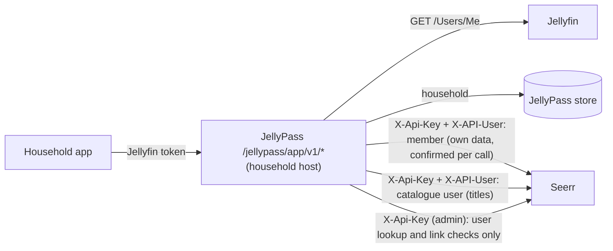

# Household app: design

## Status

Step 0 of 4 (foundation). Nothing here is user-facing yet: no `/jellypass/app/v1/*` endpoint is served. Step 0 adds
the acting-user Seerr clients (`SeerrMemberClient` and `SeerrCatalogueClient` in `src/seerr.ts`), the
Jellyfin-to-Seerr user map (`SeerrUserMap` in `src/seerr-users.ts`), the `SEERR_CATALOGUE_USER_ID` setting,
recorded-shape Seerr fixtures with canaries, and a real-Seerr test. This document is the contract the later steps are
built and reviewed against.

## Goal

JellyPass becomes the backend of a household web app (a PWA first; native apps later, using the same API) served on
each `jelly-<household>` host. It replaces the Seerr website for regular users: once the app is ready (step 4), the
Seerr website is for administrators only.

Household records are about privacy, not control. The app never shows one household what another has, has asked
for, or is waiting on.

## Architecture

- The app API lives under `/jellypass/app/v1/*` on household hosts only, next to the existing household gateway.
- JellyPass calls Seerr server-side. The app never talks to Seerr and never receives a Seerr object.
- Responses are built by **allowlist shaping**: each DTO field is copied from a Seerr field chosen for it, and
  anything not chosen is never read into the response. Seerr objects are never relayed, filtered or stripped.

## Identity chain

Identity comes only from Jellyfin, never from anything the client says about itself.

1. The app sends the user's Jellyfin access token to the household host.
2. JellyPass verifies it with Jellyfin's `GET /Users/Me` (as the household gateway does today) and caches the answer
   for at most 5 minutes, keyed by a hash of the token. A disabled user is rejected.
3. The household comes from the JellyPass store, and the caller must be a member of the household whose host they
   called. Anyone not in that household is refused.
4. The caller's own Seerr data (requests, quota, watchlist) is read and written through `SeerrUserMap.member(id)`, a
   `SeerrMemberClient` that holds the caller's **Jellyfin** user, never a Seerr user. Before every call it confirms
   which Seerr user Seerr links to that Jellyfin user (see "Stale mappings"), and sends that user in `X-API-User`.
5. Titles (search, discover, details) are read through one `SeerrCatalogueClient`, as the dedicated catalogue user,
   never as the caller (see "Catalogue identity").

### Stale mappings

An administrator can relink a Seerr user to another Jellyfin user, or delete it, at any time; a mapping remembered
from before would then act as someone else, or as nobody. Jellyfin IDs are compared normalized (32 lowercase hex
digits, dashes removed), whatever format Seerr or Jellyfin gives them in.

- **There is no way to keep a Seerr user to act as.** `SeerrClient` no longer makes a client fixed to a Seerr user
  (`asUser` is gone) and `SeerrUserMap` hands out none (`clientFor` and `verifiedClientFor` are gone);
  `test/types/seerr-user-client.ts` checks both. A `SeerrMemberClient` holds a Jellyfin user and may be kept for as
  long as the caller likes.
- **Every member call is confirmed immediately before it is sent.** Inside each call, the client takes a candidate
  Seerr user from `SeerrUserMap` (cached for 1 minute, at most 1000 entries, least recently used forgotten first;
  failed lookups are not cached; concurrent lookups share one call; found with the admin key and
  `GET /api/v1/user/jellyfin/:jellyfinUserId`, used only if Seerr's `jellyfinUserId` matches), asks Seerr with the
  admin key and `GET /api/v1/user/:id` whether that Seerr user is still linked to the caller, and only then sends the
  call. Nothing is awaited between the confirmation and the send. A mismatch, or a deleted Seerr user, forgets the
  candidate and tries once more with a fresh lookup; a second failure fails closed (`SeerrUnmappedUserError`).
- **Invalidation reaches calls in flight.** `invalidate(jellyfinUserId)` forgets one caller and `clear()` everyone;
  a call whose confirmation was in flight when either ran is confirmed again before it is sent. A lookup in flight
  answers only the callers already waiting on it: it never fills the cache and is never joined afterwards.
- A 401, 403 or 404 from Seerr on a member call forgets that caller's mapping.
- The candidate source cannot widen this: `SeerrMemberClient` confirms whatever its resolver proposes, so even a
  forged resolver can only make a call fail closed.

The cost is one admin call (a local `GET /api/v1/user/:id`) per member call. What remains: confirmation and call are
two requests, so a relink landing between them is not caught; that window is one round trip, the call acts as the user
Seerr confirmed a moment before, and it never spans a cache lifetime or a kept client.

### Catalogue identity

Seerr shapes title answers with the acting user's own settings. In Seerr 3.5.1, `createTmdbWithRegionLanguage`
(`server/routes/discover.ts`) takes the discover region from the user's `streamingRegion` and the original-language
filter from their `originalLanguage`; `checkUser` (`server/middleware/auth.ts`) sets the display language from their
`locale`; and title details join the user's own watchlist (`onUserWatchlist`). Reading titles as the caller would make
results depend on whichever Seerr user the caller was mapped to, and so on another member's preferences after a
relink. Query parameters cannot pin this: there is no region parameter, and on `/discover/movies` and `/discover/tv`
Seerr prefers the user's locale to `language` and reads `language` as an original-language filter.

So titles are never read as a household member:

- **One catalogue user for everyone.** `SEERR_CATALOGUE_USER_ID` names a Seerr user created for JellyPass alone: a
  local user with **no permissions** and **no Jellyfin link**, never the owner (user 1). Its discover region, original
  language and display language are Seerr's defaults unless an administrator sets them on that user, and they are the
  same for every caller. Seerr lets a user with no permissions read search, discover and title details
  (`isAuthenticated()` with no permission), and an unknown or empty `X-API-User` can never be sent (see below).
- **Checked before use.** `SeerrClient.catalogueUserProblem` reads the user with the admin key and refuses one that is
  missing, the owner, has any permission, or is linked to a Jellyfin user (so no member can ever be mapped to it).
  JellyPass checks it at startup (a misconfigured user stops startup; an unreachable Seerr is logged and retried),
  and `SeerrCatalogueClient` checks it again before its first call, at least once a minute after, and at once after
  Seerr refuses it. A failed check fails every catalogue call (`SeerrCatalogueUserError`); nothing falls back to the
  caller or the admin.
- **Per-user facts never come from title answers.** Title DTOs copy no field that depends on the acting user
  (`onUserWatchlist`, `mediaInfo.requests`, `mediaInfo.watchlists`, and anything per-user Seerr adds later). Whether
  the caller may request, has requested or has quota left comes only from member calls.
- The real-Seerr test gives the member a Japanese-originals-only preference and shows that Seerr applies it to the
  member's own `/discover/movies` while the catalogue client's answer is unaffected.

Step 1 makes `SEERR_CATALOGUE_USER_ID` required for the app API.

**Unmapped users fail closed.** A Jellyfin user Seerr has no confirmed user for gets `unavailable` for everything,
even though titles are read as the catalogue user: step 1 decides this from a member call. Nothing falls
back to the admin client, and the map does not import users: Seerr users are still created by the existing admin
import (`importToJellyseerr` when a user is created).

### The `X-API-User` hazard

Seerr 3.5.1 runs a call carrying its API key as the user named in `X-API-User`, but a **missing or empty**
`X-API-User` runs it as the owner, user 1 (`server/middleware/auth.ts`, `checkUser`). An unknown ID is refused (403).
So the clients make a missing user impossible:

- `SeerrUserId` is a branded number. Only `seerrUserId(value)` makes one, and it throws unless `value` is a positive
  safe integer; a plain number does not type-check as one.
- `SeerrCatalogueClient` requires a `SeerrUserId`, checks it again at runtime, and fixes it for the client's lifetime;
  `SeerrMemberClient` acts only as a Seerr user Seerr has just confirmed. Both are made from a real `SeerrClient`,
  whose connection details are private to `src/seerr.ts`.
- Every call builds `X-API-User` from a `SeerrUserId`, re-checking it, so it is always a non-empty decimal string.
- Paths that name a user (`/user/:id/requests`, `/user/:id/quota`) always use the confirmed acting user's ID.
- `createRequest` sends only `mediaType`, `mediaId`, `seasons` and `is4k: false`: never `userId` (which would let a
  manager request for someone else) or server, profile or folder overrides.
- Redirects are never followed: a 3xx is a failure, so the key and acting user never go anywhere else.
- Errors carry the status and the route template (`Seerr GET /api/v1/tv/:id returned 404`), never Seerr's body or the
  IDs asked for.
- Bodies are read up to 4 MiB, counted in bytes as they stream in; reading stops as soon as a body passes the limit.

`SeerrClient` stays the admin-key client. It never sends `X-API-User`, and it is used only for JellyPass's own
administrative work (webhook and backfill lookups, recent-request cards, user import, and the user lookups and checks
above), never to answer a household member. Its household-app lookups, `findUserByJellyfinId`, `jellyfinUserIdOf` and
`catalogueUserProblem`, have the same redirect, error and size guards as the acting-user calls; its older methods keep
their existing behaviour.

## Per-title states

Each title the app shows has exactly one household state, decided in this order:

| State | Meaning | What the app gets |
|---|---|---|
| `unavailable` | Blocklisted, or the caller may not see or request it (including an unmapped caller). Decided before any other branching. | Title only, no actions. |
| `in_library` | Playable by the caller in Jellyfin through their household. | The only state with a Jellyfin item ID and a Play link to the household host. |
| `requested` | This household has a request for it, or has registered interest. | Coarse status. |
| `get_this` | Everything else: not in Seerr, held privately by another household, downloading for someone else, requested by someone else. | A "Get this" action. |

A title another household holds is indistinguishable from one nobody has.

## "Get this" (step 2)

"Get this" always answers the same way, at once, whatever the title's real situation; the work happens in the
background, as the existing household "Add to my library" does:

- held by another household: the household joins the existing grant, as library joins do today;
- already requested or downloading for someone else: the household's interest is recorded, so it is granted when the
  title becomes available;
- otherwise: a real HD Seerr request is made as the caller (`SeerrMemberClient.createRequest`).

The answer never depends on which of these happened, on Seerr's result, or on timing.

### Quota before branching

Only the request branch would meet Seerr's quota, so without a rule an exhausted caller could tell the branches
apart: "Get this" would work for a title another household holds and not for one nobody has. So quota is decided
for the caller before any branch is chosen, and every branch is charged and refunded exactly as Seerr would charge
and refund the caller's own request for that title.

1. **Eligibility first.** Before choosing a branch, JellyPass checks the caller's own eligibility for the title's
   media type: the caller has Seerr's request permission for it, and their *combined* usage (below) plus the units
   this action needs is within their Seerr quota limit. Nothing about the title or other households is consulted. If
   the caller is not eligible, **no branch runs**: no join, no interest, no request, and the immediate answer is the
   same whichever branch would have run.
2. **Virtual requests.** Each join or interest is recorded for the caller as a *virtual request* in a JellyPass-side
   tally: the units, creation time and status the caller's own Seerr request would have had. Seerr's quota rule
   (`User.getQuota` in Seerr 3.5.1) is then applied to real and virtual requests alike: the same per-user limit and
   window (`quotaLimit` per `quotaDays`, the user's own or Seerr's default, counted from creation time), one unit per
   movie and one per season for a series, every status counted **except declined**, nothing counted once deleted,
   and no count when the caller can bypass quotas (Seerr's `MANAGE_USERS`). Combined usage is Seerr's own `used`
   (the caller's real requests) plus the virtual requests inside the window. A request branch is counted by Seerr
   itself, so it is not added to the tally.
3. **Every outcome, every branch, the same count.** A virtual request's status follows what Seerr would have done to
   the caller's own request, never what happened to someone else's:

   | Event | Request branch (Seerr) | Interest branch (virtual) | Join branch (virtual) |
   |---|---|---|---|
   | Accepted | Pending or approved: counted | Pending: counted | Completed at once (the title is already playable): counted |
   | Declined (by an administrator, or by Seerr's scanner for an orphaned approved request) | Freed | Underlying request declined: freed | Cannot happen |
   | Failed | Still counted (Seerr counts failed requests) | Underlying request failed: still counted | Cannot happen |
   | Failed, then retried | Approved: counted | Follows the underlying request: counted | Cannot happen |
   | Completed | Counted | Counted | Counted |
   | Underlying request deleted by its owner or an administrator, title not yet available | n/a: no one else's request is involved | Becomes failed: still counted (the caller's own request would not have been deleted); the outcome shows `We couldn't get this` | n/a |
   | The title's Seerr media record deleted (cascades to every request on it) | Deleted: freed | Deleted: freed | Deleted: freed |
   | Cancelled by the caller (later; not in v1) | Deleted: freed | Deleted: freed | Allowed in exactly the same states as the request branch, and freed alike |
   | Refused before anything is recorded (permission, or a race) | Not counted | Not recorded | Not recorded |
   | Window ends | No longer counted | No longer counted | No longer counted |

   Declined and failed both show as `We couldn't get this`, but only a decline frees the unit, in every branch, as in
   Seerr. Neither the unit nor the visible outcome depends on which branch ran.
4. **Series are charged per season, whatever serves each season.** Seerr charges a series request only for seasons not
   already requested or available, so a request overlapping someone else's would cost less and show it. "Get this"
   for a series charges one unit per season asked for: seasons already held or requested elsewhere go through the
   join or interest branch (virtual, one unit each) and the rest through one real request (charged by Seerr), so the
   total never depends on other households. A request branch whose title became requested or available in the
   meantime (Seerr refuses it) falls through to the interest or join branch; it does not fail.
5. **Never stricter than Seerr, never looser.** Because combined usage includes Seerr's own `used`, a request JellyPass
   finds eligible always passes Seerr's own check; Seerr's check never runs for a virtual request, so the tally
   alone enforces the limit there.
6. **Serialized.** Eligibility and the count are checked and recorded under a per-user lock, so concurrent "Get this"
   calls cannot overrun the limit through one branch and not another.
7. **No numbers shown.** v1 displays no quota counts. The app shows a single title-independent state, "You've reached
   your request limit", derived solely from the caller's own combined usage, before the action is offered; the
   action's answer itself never mentions quota.

Residual leak: none between households. What a caller can learn from the count is how many units their own past
"Get this" calls used and whether each ended declined (freed) or otherwise, which is theirs to know and the same
whichever branch served them. Seerr requests made outside the app (the Seerr website before step 4, or by an
administrator on the caller's behalf) count towards Seerr's `used` but were the caller's own or an administrator's
doing; requests an administrator makes with `ignoreQuota` are not counted, as in Seerr. The live server currently has
no quotas configured, so today every caller is eligible unless they lack request permission.

### Late requests (closed by design)

History: PR #30 tried to fix this in the webhook; it was closed in favour of closing the hole through the app.

**The hole.** Seerr 3.5.x accepts `POST /api/v1/request` for a title that is already available. For a user with
auto-approve, JellyPass's webhook and backfill then treat that late request as a genuine one, which can make a
public title private, re-add access an administrator removed, or extend a manual-only grant.

**Why not classify after the fact.** Telling a late request from a genuine one afterwards needs to know whether the
title was in Jellyfin when the request was made, and nothing proves that. Jellyfin's `DateCreated` is the file's
modification time (it left 3 of 19 real genuine requests public). A periodic availability journal cannot prove
absence at request time either: there are gaps between observations, deletions and re-downloads, HD/4K inferred from
`MediaSourceCount`, item IDs that change without a TMDB link, and TV file counts that do not show episode coverage.

**The rules that close it.**

- "Get this" **must never** create a Seerr request for a title Jellyfin already has. Jellyfin's own answer is a
  decision input, checked before branching: a title Jellyfin has goes to the join branch, never the request branch.
- The app API offers no other request path.
- Step 4 (the Seerr website restricted to administrators) is **required**, not optional: it is what closes the hole
  for direct use of Seerr. Until step 4, the risk remains for users who send requests to Seerr's API or website
  directly.

## Coarse statuses

The app shows only three request statuses: `Requested`, `Ready to watch`, `We couldn't get this`. Seerr's pending,
approved, processing and partially available states all show as `Requested`; declined and failed requests as `We
couldn't get this`. No notifications yet.

## Privacy model

Lessons from the removed JellyQuest relay (`src/request-bridge.ts`, PRs #1, #6 and #7): scrubbing Seerr objects of
other users' data never converged, because leaks kept arriving through new fields and side channels. The app API
closes each channel by construction:

| Channel | How it leaked | Rule |
|---|---|---|
| Fields | `mediaInfo.requests[].requestedBy`, `modifiedBy`, issues, watchlists, download status, emails, avatars | Allowlist DTOs only; Seerr JSON is `unknown` to callers and must be parsed field by field. |
| Counts | `pageInfo.results`, `totalResults`, `requestCount` | Counts only from data the caller can see: the DTOs actually returned. |
| Paging | Page sizes and offsets revealing filtered-out entries | Page over caller-visible results; never relay Seerr paging. |
| Error text | Seerr messages, stack traces | Fixed error codes and bodies; Seerr errors are logged, never returned. |
| Status codes | 403 vs 404 vs 409 for another household's title | Fixed status codes per endpoint, independent of other households. |
| Sequential IDs | Seerr request, media and user IDs | Opaque IDs only (TMDB IDs for titles; anything else is a JellyPass-issued opaque token). |
| Item IDs | `jellyfinMediaId` of a title held privately elsewhere | A Jellyfin item ID only for `in_library`. |
| Timing | Slower answers when Seerr or the store had work to do | Uniform answers: background work is never awaited (as for library joins), and per-title work is bounded. |
| Caching | Responses kept by browsers or proxies | `Cache-Control: no-store` on every response. |
| Volume | Enumeration by repeated calls | Per-client and per-user budgets, as for household logins and library joins. |
| Quota | Only the request branch of "Get this" meeting Seerr's quota, or refunding differently, so an exhausted user sees which titles another household holds | Eligibility decided before any branch; joins and interest recorded as virtual requests counted and freed exactly as Seerr counts the caller's own (declined frees, failed does not); series charged per season asked for; no counts shown (see "Quota before branching"). |
| Identity | A cached Seerr user acting for a Jellyfin user after a relink or deletion | No client holds a Seerr user; every member call is confirmed with Seerr immediately before it is sent; invalidation reaches calls in flight (see "Stale mappings"). |
| Preferences | Seerr shaping title results with the acting user's region, language and watchlist, so results follow whoever the caller is mapped to | Titles read only as the dedicated catalogue user; title DTOs copy no per-user field (see "Catalogue identity"). |
| Late requests | A request for an already-available title granted as if genuine | "Get this" checks Jellyfin first and joins; no other request path; Seerr website admin-only at step 4 (see "Late requests"). |

## Seerr function inventory

Only the v1 endpoints are reachable for a household member, each through its own `SeerrMemberClient` or
`SeerrCatalogueClient` method; there is no generic pass-through.

| Group | Endpoints | Where |
|---|---|---|
| v1, as the member (confirmed per call) | `POST /request`; `GET /user/:self/requests`; `GET /user/:self/quota`; `GET /discover/watchlist` | `SeerrMemberClient` |
| v1, as the catalogue user | `GET /search`; `GET /discover/{trending,movies,movies/upcoming,tv,tv/upcoming}`; `GET /movie/:id`; `GET /tv/:id`; `GET /tv/:id/season/:n` | `SeerrCatalogueClient` |
| v1, admin key | `GET /user/jellyfin/:jellyfinUserId` (user lookup); `GET /user/:id` (link check, its `id` and `jellyfinUserId`; catalogue-user check, also `permissions`) | `SeerrClient.findUserByJellyfinId`, `SeerrClient.jellyfinUserIdOf`, `SeerrClient.catalogueUserProblem` |
| Later | Request cancellation by its owner, recommendations and similar titles, genre and keyword discovery, watchlist writes | Not yet |
| Admin-only | Approving, declining and deleting requests, issues, users, settings, blocklist management | Seerr website, administrators |
| Never for a member | `GET /user`, `GET /user/:id` (as the member), `GET /request/count`, `GET /media`, `GET /request` (all requests) | Not exposed |

## Phased plan

0. **Foundation** (this step): member and catalogue clients, user map, fixtures with canaries, real-Seerr test, this
   document.
1. **Read API**: identity chain, search, discover, title details with household states, own requests and quota, as
   allowlist DTOs tested with `assertNoCanaries`.
2. **"Get this"**: the uniform background action above.
3. **PWA**: the household app itself, served on household hosts.
4. **Cut-over**: the Seerr website restricted to administrators. Required: it closes late requests made directly to
   Seerr (see "Late requests").

## Decisions

- PWA first; native apps later on the same API.
- The Seerr website is restricted to administrators once the app is ready (step 4).
- Coarse statuses only; no notifications yet.
- HD only in v1 (`is4k` is always false).
- No watchlist-star shortcut.

## Test strategy

- **Header guard.** `test/seerr-user-client.test.mjs` calls every public `SeerrMemberClient` method and asserts each is
  preceded by an admin link check and sends `X-API-User` with the confirmed user; calls every `SeerrCatalogueClient`
  method and asserts each sends the catalogue user, after a catalogue-user check; and calls every public `SeerrClient`
  method and asserts none sends one. A test fails if any class gains a method the tables do not cover. Invalid user
  IDs, Jellyfin IDs and admin clients are refused at construction; a catalogue user that is missing, the owner, has
  permissions or is linked to Jellyfin is refused before any call. `test/types/seerr-user-client.ts` (run by
  `pnpm check`) asserts with `@ts-expect-error` that no client fixed to a household member's Seerr user can be
  obtained (`asUser`, `clientFor`, `verifiedClientFor` are gone; a member client takes a Jellyfin user and exposes no
  Seerr user), that member and catalogue methods do not cross, and that a catalogue client needs a validated
  `SeerrUserId`.
- **User map.** `test/seerr-users.test.mjs` runs against a fake Seerr behind `fetch` and covers TTLs, the size cap,
  uncached failures, shared lookups, the closed failure for unmapped users, and stale mappings: a client kept across
  a relink acting as the new user on every call (Codex's repro), a kept client acting as nobody once unlinked,
  concurrent calls during a relink each sent as the user Seerr confirmed for it, `invalidate()` and `clear()` landing
  during a confirmation (confirmed again; failing closed if it keeps happening; not fooled by another user's
  invalidation or an evicted stamp), deletion failing closed, 401/403/404 forgetting the mapping, a forged candidate
  never acting, `clear()` and `invalidate()` while a lookup is pending, and Jellyfin IDs with or without dashes and in
  either case.
- **Guards.** `test/seerr-user-client.test.mjs` runs every guarded call (the admin lookups and checks and every member
  and catalogue method) against a real local server that redirects to a second one: the redirect is never
  followed, so the second server sees nothing, and the error carries neither body text nor the IDs. It also checks
  route-only errors, the byte (not character) size limit with multi-byte bodies, that reading stops once a streamed
  body passes the limit, and that the older admin methods are unchanged.
- **Fixtures and canaries.** `test/seerr-fixtures/3.5.1/` holds synthetic responses for search, movie, TV, season,
  own requests, quota and watchlist, generated by `generate.mjs` with the key structure of a real Seerr 3.5.1. Every
  user-ish field holds a canary: `canary` text, `c0ffee00c0ffee00…` GUIDs, numbers from 7300001 to 7399999,
  timestamps in 2001 (`test/seerr-fixtures.test.mjs` checks every such field). Step 1's DTO tests serve these fixtures
  as Seerr and pass each serialized response to `assertNoCanaries` from `test/support/seerr-fixtures.mjs`; a test of
  `in_library` uses its own non-canary item ID.
- **Real Seerr.** `pnpm test:seerr` starts a throwaway `ghcr.io/seerr-team/seerr:v3.5.1` container, seeds an owner, a
  member with no permissions and a Japanese-originals preference, and a catalogue user, and checks that a missing or
  empty `X-API-User` acts as the owner, that every member call is preceded by a link check and carries the member's
  ID (the member's request is refused where the owner's would not be), that a member client fails closed when Seerr
  links the user to someone else, that an unknown user ID is refused, that the user lookup works and fails closed,
  that `GET /user/:id` gives the link check its Jellyfin ID, that only a permissionless, unlinked, non-owner user is
  accepted as the catalogue user, and that Seerr applies the member's preference to the member's own discover results
  but not to the catalogue client's (skipped only if Seerr cannot reach TMDB). CI runs it as `seerr-integration`.
- **Mutation checks.** Removing or emptying the header, skipping the constructor check, accepting 0, adding the header
  to admin calls, forwarding `userId`, putting Seerr's body in errors, trusting a mismatched lookup, falling back to the
  owner for unmapped users, or loosening the constructor's type each fail at least one test; so do following
  redirects in the guarded lookups, skipping the per-call link check (or doing it only once per client), ignoring an
  invalidation during a confirmation, letting a pending lookup fill the cache after `clear()`, accepting a catalogue
  user with permissions or a Jellyfin link, reading the catalogue as the member, or counting the size limit in
  characters.
- **TODO (step 2): quota before branching.** With a Seerr quota of 1 movie and the tally mirroring it: after one
  "Get this" through each of the join, interest and request branches, the next "Get this" runs no branch (no join,
  interest or request recorded) and answers byte-for-byte the same whichever branch it would have taken; the "request
  limit" state appears identically after each. For every row of the outcome table, the request branch (driven
  through real Seerr) and the interest branch (underlying request driven the same way) leave the caller with the same
  eligibility: a decline frees the unit in both, a failure frees it in neither (the bug a "We couldn't get this"
  refund would have), a retried failure stays counted, deleting the underlying request leaves the interest counted,
  and deleting the title's media frees all three branches. A series asked for in full when another household
  requested some of its seasons costs one unit per season asked for. A caller without request permission gets the
  same answer and no branch runs; concurrent calls at the limit run at most one branch; and the real-Seerr test checks
  the tally's window, units and decline/failure rules against Seerr's own `quota` for the same user.
- **TODO (step 2): late requests.** "Get this" for a title Jellyfin already has (movie, and series with every
  requested season present) joins and never reaches Seerr's request endpoint: the test's Seerr fails if
  `POST /api/v1/request` is called, for every combination of household holdings and request state.
