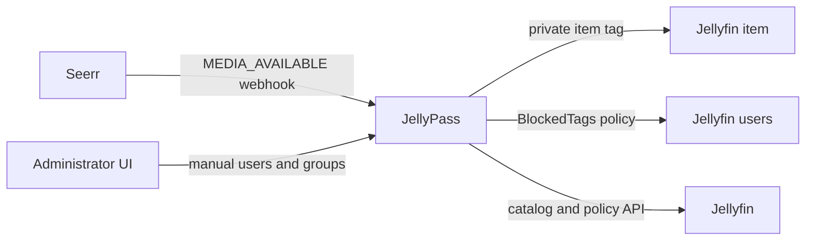

# JellyPass server reference

The full reference for running a JellyPass server: how access is enforced, every
setting, Seerr, the administrator UI, operations and upgrades, troubleshooting,
the administrator API, security, limitations and development. It moved here from the README;
the website's [documentation](https://jellypass.app/docs/) is the shorter guide.
Household hostnames and the household app are in
[Household hostnames and the household app](household-hosts.md).

## What it does

- Converts Seerr `MEDIA_AVAILABLE` webhooks into durable access grants.
- Protects movies, complete series, and locally associated trailers.
- Preserves unrelated Jellyfin tags and blocked tags.
- Lets administrators assign users or reusable groups to existing library
  items, individually or in batches of up to 500.
- Reconciles tags and policies after transient failures or user changes.
- Maintains a searchable Jellyfin catalog without automatically making every
  catalog item private.
- Provides household URLs whose login picker exposes only that household's
  public users, signs passwordless members in with one tap, and preserves the
  password prompt for everyone else.
- Proxies household media requests, byte ranges, HLS requests, and WebSockets.
- Lets household members add a title another household requested to their own
  library, without learning who requested it.
- Exposes health and Prometheus metrics endpoints.

JellyPass does **not** replace Jellyfin authentication, manage downloads, or
decide whether a Seerr request should be approved. Seerr remains the
request and acquisition authority; Jellyfin remains the playback authorization
authority.

## How access enforcement works



For each protected title, JellyPass:

1. Creates one stable tag derived from the Jellyfin item ID, such as
   `jfa:private:8f...`.
2. Adds that tag to the movie or series and its known local trailers.
3. Adds the tag to `BlockedTags` for every non-administrator Jellyfin user except
   the request owner, manually assigned users, and members of assigned groups.
   A request grant is assigned to the requester's household automatically (see
   [Household-scoped request grants](#household-scoped-request-grants)).
4. Persists the desired grant in `grants.json` and periodically reconciles it.

Administrator accounts are never blocked. Existing, unmanaged media remains
public to users whose normal Jellyfin policy allows it.

### Catalog items are not grants

The **Library** tab is an inventory of movies and series discovered during a
Jellyfin catalog sync. The **Grants** tab contains only titles that JellyPass is
actively protecting.

A newly downloaded or newly scanned item does not become a grant merely because
it appears in the catalog. A grant is created by one of these events:

- JellyPass receives Seerr's `MEDIA_AVAILABLE` webhook for a request.
- The optional request backfill finds an available request created after
  `REQUEST_BACKFILL_SINCE` that the webhook missed.
- An administrator assigns access from the Library tab or API.

Library upgrades, replacements, manual downloads, and titles that Seerr
already considered available before JellyPass was installed may not produce a
new webhook. Assign those items from the Library tab if they should be private.

### Household-scoped request grants

When a request produces a grant, whether through the webhook or the request
backfill, JellyPass records the requester and also assigns every group
(household) the requester belongs to at that moment. Everyone in the
requester's household can see the title; members of other households cannot.

- A requester who belongs to no group gets a user-only grant, as before.
- A requester who belongs to several groups shares the title with all of them.
- Groups and users already on the grant, including ones an administrator
  assigned manually, are always kept; requests only add groups.
- Revoking a request does not remove the households it added, so the title
  stays visible to those households instead of becoming public. To make it
  public, clear the grant's groups (UI or `PUT /v1/grants/{itemId}/groups`).
  The title becomes public only once no other requests or manual users remain
  on the grant.
- Joining a household later does not change older grants. Add the group to
  those grants, or add the user to a household that is already assigned.
- A member of another household can add the title to their own library with
  **Get this**, which adds the household whose address they used to the grant.

## Requirements

- Jellyfin 12.x (current) or 10.11.x (previous). See
  [Supported Jellyfin versions](#supported-jellyfin-versions).
- Seerr with webhook support and Jellyfin-linked users. See
  [Configure Seerr](#configure-seerr).
- A Jellyfin administrator API key.
- Docker with Compose v2 for the recommended installation, or Node.js 22+ and
  pnpm for a source installation.
- A persistent, private location for `grants.json`.

Seerr lookup is optional only if every webhook includes the Jellyfin media and
user IDs and recent-request cards, the request backfill, and Seerr user import
are not needed.

### Supported Jellyfin versions

JellyPass supports the current Jellyfin release and the one before it, and
tests both in CI against a real Jellyfin before every release: today
**Jellyfin 12.x** (tested with 12.4.0) and **Jellyfin 10.11.x** (tested with
10.11.11). Jellyfin 12's minor releases (12.1, 12.2, ...) are its bug-fix
releases, so every 12.x is supported, as is every 10.11.x. The pinned test
images are listed in `scripts/jellyfin-versions.json`.

JellyPass reads Jellyfin's version (`/System/Info/Public`) at startup and every
five minutes. On a supported version nothing changes. Any other version is
**unconfirmed** until an administrator confirms it: an older 10.x, a future
release JellyPass has not been tested with yet, and **any build whose version
has a suffix**, whether a pre-release (`12.5.0-rc1`), build metadata
(`12.4.0+abc`) or any other non-numeric part, even when its numbers are a
supported release's. On an unconfirmed version:

- JellyPass logs a warning naming the version, once for each version it
  reads, and the admin site shows it with an **Allow Jellyfin X** button.
  `GET /v1/jellyfin/version` (`confirmation: "unconfirmed"`) and the
  `jfa_jellyfin_version_info` metric (`confirmed="false"`) report it too.
- **Household addresses refuse to serve** (`enforcement: "refuse"`, from
  JellyPass 4.0.0; 3.x only warned): every request and WebSocket there gets a
  fixed `503` with a plain-text message, with nothing relayed to Jellyfin,
  until that exact version is confirmed. `jfa_household_hosts_refusing` is `1`
  meanwhile. The household privacy checks were written against the supported
  versions, so confirm a version only once you are satisfied they hold on it.
- The admin listener (admin site, API, webhooks, health), grants and
  reconciliation keep working.
- An administrator confirms one **exact** version, either in the admin site
  (stored in the state file) or by setting `JELLYFIN_UNTESTED_VERSION_OK` to it.
  A confirmed version is logged once, when it is confirmed or first read, and
  not on later reads. A later upgrade to another untested version is
  unconfirmed again until it is confirmed in turn; the confirmation can be
  withdrawn in the admin site, which warns again. A confirmation made in
  3.10.0 is kept by the upgrade to 4.0.0, so household addresses keep serving
  on that version.

While the version is not known (Jellyfin unreachable when JellyPass starts, or
its last read failed), JellyPass does not wait for it: it starts as usual, the
admin site shows that the version cannot be read, and household addresses
answer `503` until it is read. A household request reads it again (at most
every five seconds, waiting up to five), and so does a retry every 30
seconds.

## Quick start with Docker Compose

Create a directory and download the public deployment files:

```sh
mkdir jellypass && cd jellypass
curl -LO https://raw.githubusercontent.com/nicklongmore86/jellypass/main/compose.yaml
curl -Lo .env https://raw.githubusercontent.com/nicklongmore86/jellypass/main/.env.example
mkdir -m 700 data
sudo chown 1000:1000 data   # the container runs as UID 1000
```

Edit `.env` and replace every placeholder. Generate two different secrets, for
example:

```sh
openssl rand -hex 32
openssl rand -hex 32
```

Start JellyPass:

```sh
docker compose up -d
docker compose ps
curl http://127.0.0.1:8788/health
```

JellyPass has two listeners (see [Listeners](#listeners)): the **admin
listener** on port `8788` (admin site and API, metrics, the Seerr webhook and
health) and the **member listener** on port `8787` (household addresses only).
The default Compose file publishes both only on `127.0.0.1`. Keep that default
when a reverse proxy runs on the same machine. Change a published address
deliberately if a reverse proxy must reach the member port over a private
network, and publish the admin port only on a private address, never route a
public hostname to it.

The container image is published from `main` as `latest` and from release tags
as semantic-version tags. For predictable production upgrades, set
`JELLYPASS_IMAGE` in `.env` to a versioned image such as:

```dotenv
JELLYPASS_IMAGE=ghcr.io/nicklongmore86/jellypass:4.0.0
```

Each release is published as a semantic-version image tag, such as `4.0.0`,
plus floating `4.0` and `4` tags that move to the newest release in that minor
or major line; see [CHANGELOG.md](../CHANGELOG.md) for what each one contains. `latest` is rebuilt on
every push to `main` and may include unreleased changes, so use it, or build
from source, only to test ahead of a release.

### Build locally instead

Clone the repository, create `.env`, and use the source-build example:

```sh
git clone https://github.com/nicklongmore86/jellypass.git
cd jellypass
cp .env.example .env
# Edit .env.
docker compose -f compose.example.yaml up --build -d
```

## Configuration

JellyPass reads configuration from environment variables at startup.

| Variable | Required | Default | Description |
| --- | --- | --- | --- |
| `JELLYFIN_URL` | Yes | — | Base URL reachable from JellyPass, without a trailing slash. |
| `JELLYFIN_API_KEY` | Yes | — | Jellyfin administrator API key used for catalog, tag, and policy operations. |
| `WEBHOOK_TOKEN` | Yes | — | Secret accepted by `/webhooks/seerr`. Use a long random value. |
| `ADMIN_TOKEN` | Recommended | `WEBHOOK_TOKEN` | Separate bearer token for administrative APIs and metrics. |
| `SEERR_URL` | Conditional | — | Seerr base URL reachable from JellyPass. Configure with `SEERR_API_KEY`. |
| `SEERR_API_KEY` | Conditional | — | Seerr API key. Configure with `SEERR_URL`. |
| `TMDB_API_KEY` | Conditional | — | TMDB API key (v3, 32 hexadecimal characters) or API read access token (v4) the [household app API](household-hosts.md#household-app-api) reads search, discover and title details with, straight from TMDB. Required when `HOUSEHOLD_APP_ENABLED` is true. Get one from your TMDB account's API settings. Startup stops if it is malformed or TMDB refuses it; it is never logged. See [docs/app-design.md](app-design.md#catalogue-source). |
| `STATE_FILE` | No | `./data/grants.json` | Durable state-file path. The container uses `/app/data/grants.json`. |
| `HOST` | No | `0.0.0.0` | Member listener address (household addresses only). |
| `PORT` | No | `8787` | Member listener port. It starts only with the household gateway on. |
| `ADMIN_HOST` | No | `127.0.0.1` (`0.0.0.0` in the container image, published on `127.0.0.1` by Compose) | Admin listener address: the admin site and API, `/metrics`, `/webhooks/seerr` and `/health`. Keep it private. See [Listeners](#listeners). |
| `ADMIN_PORT` | No | `8788` | Admin listener port. Must differ from `PORT` while the household gateway is on. |
| `RECONCILE_INTERVAL_SECONDS` | No | `300` | Retry/reconciliation interval; `0` disables scheduling. Maximum `86400`. |
| `CATALOG_SYNC_INTERVAL_SECONDS` | No | `3600` | Jellyfin catalog refresh interval; `0` disables scheduling. Maximum `604800`. |
| `HOUSEHOLD_GATEWAY_ENABLED` | No | `true` when `HOUSEHOLD_DOMAIN` is set, otherwise `false` | Starts the member listener, which serves each household at the addresses mapped to it (see [Household addresses](household-hosts.md#household-addresses)). Requires `TRUSTED_PROXIES`. |
| `HOUSEHOLD_DOMAIN` | No | — | Legacy addresses, kept for installs from before 4.0.0: every household also gets `https://<HOUSEHOLD_HOST_PREFIX><household>.<HOUSEHOLD_DOMAIN>`, alongside its mapped addresses. Turns the household gateway on. Leave it empty on a new install. |
| `HOUSEHOLD_HOST_PREFIX` | No | `jelly-` | The legacy addresses' prefix (only with `HOUSEHOLD_DOMAIN`). |
| `LEGACY_WEBHOOK_ON_MEMBER_PORT` | No | `false` | Upgrade aid: the member listener also answers `POST /webhooks/seerr` for a `Host` that is no household's, so a Seerr webhook URL from before 4.0.0 (on `PORT`) keeps working, with the same `Authorization: Bearer` check. Logs a warning at startup. Point Seerr at the admin listener and turn it off. |
| `HOUSEHOLD_PLUGIN_ROUTES` | No | — | Comma-separated exact lowercase plugin paths added to the household relay allow-list. No wildcards; existing security refusals remain. Audit plugin privacy before using this option. |
| `JELLYFIN_PUBLIC_URLS` | No | — | Comma-separated public Jellyfin URLs for the admin self-check's anonymous direct-origin probes. |
| `SEERR_PUBLIC_URL` | No | — | Public Seerr URL for the admin self-check. Seerr must be admin-only. |
| `HOUSEHOLD_APP_ENABLED` | No | `false` | Serves the [household app API](household-hosts.md#household-app-api) (titles, "Get this" and the household's requests) at `/jellypass/app/v1/*`, and the [app](household-hosts.md#household-app-pwa) at `/jellypass/app/`, on household addresses. Requires the household gateway, Seerr configuration and `TMDB_API_KEY`; startup stops if any is missing. While `false`, those paths answer `404` and are never proxied to Jellyfin. |
| `TV_ADDON_ENABLED` | No | `false` | Adds the [TV add-on](tv-addon.md) (a JellyPass row on Jellyfin web's Home) to Jellyfin web's page on household addresses whose stored TV switch is on, and serves its files at `/jellypass/tv/` there. Requires `HOUSEHOLD_APP_ENABLED`. While `false`, nothing on any host changes. |
| `TV_ADDON_HOUSEHOLDS` | Deprecated | — | Used only during state v7/v8 to v9 migration: comma-separated household IDs or `*` seed TV switches. Remove after upgrade. Stored admin switches are authoritative thereafter; presence logs one warning per process. |
| `REQUEST_BACKFILL_SINCE` | No | — | `YYYY-MM-DD` (UTC midnight) or an ISO 8601 date-time with `Z` or an offset, such as `2026-10-15T08:00:00+02:00`. Impossible dates are rejected. Requests created before it are never imported by the backfill. |
| `REQUEST_BACKFILL_ENABLED` | No | `true` when `REQUEST_BACKFILL_SINCE` is set, otherwise `false` | Grants available Seerr requests that the webhook missed. Requires Seerr configuration and `REQUEST_BACKFILL_SINCE`. |
| `WS_IDLE_TIMEOUT_MS` | No | `300000` | Closes a proxied household WebSocket after this many milliseconds with no bytes in either direction; `0` disables. Jellyfin drops sockets after 60 s without a client KeepAlive (clients send one every 30 s), so values at or below `60000` log a startup warning. Maximum `86400000`. |
| `WS_UPSTREAM_IDLE_TIMEOUT_MS` | No | `180000` | Closes a proxied household WebSocket after this many milliseconds with no bytes from Jellyfin, even while the client keeps sending; `0` disables. Jellyfin answers every client KeepAlive and pings quiet sockets, so a healthy server is never silent for much more than 60 s; values at or below `60000` log a startup warning. Maximum `86400000`. |
| `LOG_LEVEL` | No | `info` | One of `debug`, `info`, `warn`, `error` (case-insensitive; aliases such as `trace`/`verbose`, `information`, and `warning` are accepted). Only `debug` changes output today: it also logs routine client disconnects (`ECONNRESET`, `EPIPE`, aborted streams, keepalive timeouts) and idle WebSocket closes on the household proxy. `info`, `warn`, and `error` are accepted but behave identically. Jellyfin-side resets and other unexpected proxy errors are always logged as warnings. An unrecognised value logs a startup warning and falls back to `info`. |
| `JELLYFIN_UNTESTED_VERSION_OK` | No | — | One exact Jellyfin version outside the [supported releases](#supported-jellyfin-versions), such as `13.0.0` or `12.5.0-rc1`, that counts as confirmed without confirming it in the admin site. Any other untested version stays unconfirmed. Must be a single version string; an invalid value stops startup. |
| `TRUSTED_PROXIES` | With the household gateway | — | Comma-separated IP addresses and CIDR ranges (IPv4 or IPv6) of reverse proxies in front of JellyPass, such as `192.0.2.10, 2001:db8::/64`. When the connecting peer is listed, JellyPass reads the client address from `X-Forwarded-For` for login rate limits; otherwise it uses the peer and ignores the header. Required while the household gateway is on: startup stops without it. Otherwise empty trusts no proxy. An invalid entry stops startup. It never decides which household a request is for: only `Host` does. See [Running behind a reverse proxy](#running-behind-a-reverse-proxy). |
| `JELLYPASS_IMAGE` | Compose only | `ghcr.io/nicklongmore86/jellypass:latest` | Container tag used by `compose.yaml`. |
| `JELLYPASS_ENV_FILE` | Compose only | `.env` | Alternate environment-file path used by either Compose file. |

`SEERR_URL` and `SEERR_API_KEY` must be set together. `ADMIN_TOKEN` falls back
to `WEBHOOK_TOKEN` for backward compatibility, but using different values limits
the impact of a leaked webhook URL or notification configuration.

### Request backfill

The `MEDIA_AVAILABLE` webhook is the fast path, but some Seerr releases fail to
deliver it or do not expose webhook settings at all. With the request backfill
enabled, JellyPass runs it once about five seconds after startup and then before
every reconciliation cycle (`RECONCILE_INTERVAL_SECONDS`; with `0` it runs only
at startup). It pages `GET /api/v1/request` and records each request that:

- was created at or after `REQUEST_BACKFILL_SINCE`,
- was approved or completed in Seerr (pending, declined and failed requests
  are skipped, even when the media is available through another request),
- has media that is available or partially available,
- has a Jellyfin media ID and a requester linked to an existing Jellyfin user,
- targets a Jellyfin item that still exists, and
- has not already been recorded by a webhook or an earlier backfill run.

If the item has no grant, the request creates a household-scoped one. If the
item already has a grant that came from other requests, for example another
household requesting a different season, the request is added to it along with
the requester's households. Nothing already on the grant is removed. Items with
a manual-only grant (no requests) are left exactly as the administrator set
them.

For 4K requests, the backfill uses the 4K availability status and
`jellyfinMediaId4k` only. A 4K request without a 4K item is skipped rather than
falling back to the HD item, so it cannot privatize an HD title that was public
before the cutoff. The webhook applies the same rule: a 4K request whose 4K item
Seerr does not know yet is rejected as an error and not recorded, so the backfill
grants it once the 4K item exists (when the request backfill is enabled).

The cutoff exists so that titles that were already public before JellyPass
managed them stay public. Set it to the date you start relying on JellyPass,
never to an early date that would make a whole back catalogue private.

The backfill is idempotent. Every request recorded on a grant is remembered,
including requests on grants that existed before this feature (seeded when the
state file loads), so a grant an administrator later revokes or clears is not
recreated. Each request is counted as exactly one outcome:

- **granted** (`jfa_request_backfill_total{result="granted"}`): the grant was
  stored and applied to Jellyfin.
- **error** (`{result="error"}`): the lookup failed, or the grant was stored but
  could not be applied yet. Such a grant stays in an error state and the regular
  reconciliation retries it; it is not also counted as granted.
- **skipped** (not exported): not approved, not available, before the cutoff,
  already recorded, unresolvable, or the Jellyfin item was deleted. A deleted
  item is logged once at `debug`, not as an error on every cycle.

A failure on one request never stops the rest of the run.

### Network addresses

Container-local `localhost` refers to the JellyPass container itself. Use a
shared Docker network and service names such as `http://jellyfin:8096`, a private
LAN address, or `host.docker.internal` where your Docker setup supports it.

JellyPass must be able to reach Jellyfin and, when configured, Seerr. Those
services need to reach JellyPass only as follows:

- Seerr needs `/webhooks/seerr` on the admin listener, for example
  `http://jellypass:8788/webhooks/seerr` on a shared Docker network.
- Administrators need `/admin/` and the administrative API on the admin
  listener.
- Household clients need their household's address, routed by the reverse
  proxy to the member listener.

### Listeners

| Listener | Setting | Default | Serves | Who reaches it |
| --- | --- | --- | --- | --- |
| Admin | `ADMIN_HOST`:`ADMIN_PORT` | `127.0.0.1:8788` | `/admin/`, `/auth/*`, the `/v1/*` administrative API, `/metrics`, `/webhooks/seerr`, `/health` | Administrators, Seerr and container health checks, over this machine or a private network |
| Member | `HOST`:`PORT` | `0.0.0.0:8787` | Household addresses only (Jellyfin through the gateway, the household app, the TV add-on) | The reverse proxy, for the household hostnames |

The admin listener answers for any `Host` and never proxies to Jellyfin. The
member listener selects a household from `Host` alone (exact match, case and
default ports aside; `X-Forwarded-Host` is never read) and answers a `Host`
that is no household's with a fixed `421` (`{"error":"unknown_host"}`) on
every path, WebSocket upgrades dropped: it never falls back to the admin site.
The member listener starts only while the household gateway is on. Both
listeners refuse a request that does not name exactly one host (two `Host`
headers, a `Host` with userinfo, whitespace or other characters, or an
absolute-form target whose authority is not the `Host`) with a fixed `400`
(`{"error":"invalid_host"}`), before anything else is read.

Keep the admin listener private: publish it on `127.0.0.1` or a LAN address,
and if you want it behind your reverse proxy (for HTTPS), use a host of its own
that only your LAN, VPN or an identity-aware gate (such as Cloudflare Access)
can reach. Never give the admin port a public household-style proxy rule.

### Running behind a reverse proxy

Behind a reverse proxy every request reaches JellyPass from the proxy's
address. Set `TRUSTED_PROXIES` to that address (or its subnet) so the household
and administrator login rate limits apply per client instead of putting every
client behind the proxy in one bucket:

```dotenv
TRUSTED_PROXIES=192.0.2.10
```

JellyPass walks `X-Forwarded-For` from right to left, skips trusted proxies, and
uses the first address that is not trusted. A request from an address that is
not listed is attributed to that address, and its `X-Forwarded-For` is ignored,
so clients cannot choose their own address. List only proxies you control, and
make sure they append to `X-Forwarded-For` rather than pass through whatever
the client sent.

Addresses are compared in canonical form: IPv4-mapped IPv6 addresses (such as
`::ffff:192.0.2.1`, in any spelling) count as the IPv4 address, IPv6 is compared
regardless of case or zero compression, and IPv6 zone IDs (`%eth0`) are
ignored. A `TRUSTED_PROXIES` entry must not include a port or brackets.
`X-Forwarded-For` entries may carry a port (`192.0.2.1:4711`,
`[2001:db8::1]:4711`). An entry that is not a valid address or has an invalid
port ends the walk at the trusted proxy that wrote it, so that request is
attributed to the proxy.

#### Chains of proxies and CDNs

Every hop between the client and JellyPass must be accounted for. JellyPass
stops at the first address it does not trust, so with a CDN in front of your
reverse proxy (for example Cloudflare → reverse proxy → JellyPass) the
reverse proxy's peer is a CDN edge server. Pick one of these, and configure
Jellyfin's known proxies to match (see [Forwarding to Jellyfin](#forwarding-to-jellyfin)):

- **The reverse proxy restores the real client address.** It uses the CDN's
  client-address header and published address ranges (for nginx, the
  `real_ip` module with `set_real_ip_from` for each CDN range and
  `real_ip_header CF-Connecting-IP`), so the `X-Forwarded-For` it sends ends
  with the real client. `TRUSTED_PROXIES` lists the reverse proxy, and
  Jellyfin's known proxies list JellyPass and the reverse proxy.
- **JellyPass and Jellyfin walk past the CDN.** The reverse proxy appends the
  CDN edge address to `X-Forwarded-For` as usual. `TRUSTED_PROXIES` lists the
  reverse proxy and the CDN's published address ranges, and Jellyfin's known
  proxies list JellyPass, the reverse proxy, and the same CDN ranges. Keep
  both lists current when the CDN publishes changes.

Otherwise every client is attributed to a CDN edge address: the per-client
login limits are shared again, and Jellyfin sees the CDN as the client.

#### CDNs and HTML pages

Some CDNs change the HTML pages they pass on: Cloudflare Web Analytics'
automatic setup, for example, adds a `static.cloudflareinsights.com` script to
every page. JellyPass promises no analytics, so every HTML page it serves or
relays (the household app at `/jellypass/app/`, Jellyfin web under `/web/`
with or without the TV add-on, any other HTML Jellyfin sends, and the admin
site) carries `no-transform` in its `Cache-Control`.
JellyPass adds it to the directives already there (`no-store, no-transform`,
`no-cache, no-transform`), or sends `no-transform` alone, so caching is
unchanged. A CDN that honours it adds nothing to the page.

Such a CDN also stops compressing those pages, so JellyPass compresses them
itself: with br or gzip, whichever the client prefers, plus
`Vary: Accept-Encoding`. A page Jellyfin has already encoded is passed
through as it is. A page JellyPass compresses carries Jellyfin's `ETag` made
weak (`W/"…"`); JellyPass revalidates it with Jellyfin by the strong tag, so
the browser still gets a `304`. A client that accepts no coding at all, not
even unencoded (`Accept-Encoding: *;q=0`), gets a `406`. Nothing else is touched: scripts, styles, images, JSON,
video and HLS keep their headers, and the CDN compresses them as before. On a
reverse proxy in front of JellyPass, don't strip `no-transform` from
`Cache-Control`; it may compress the pages again only if it leaves
`Content-Encoding` responses alone (nginx's `gzip` does).

#### Login lockouts are best-effort

The household and administrator login limits each track at most 10,000 client
addresses and evict the oldest first. A flood of logins from that many
genuinely distinct source addresses, such as an attacker with a routed IPv6
range, can therefore evict an active lockout before its five minutes are up.
A spoofed `X-Forwarded-For` cannot do this: from an untrusted peer it is
ignored, and every request counts against the peer's own address.

#### Forwarding to Jellyfin

The household gateway forwards to Jellyfin like any other proxy hop: it appends
the address it received the request from to `X-Forwarded-For`, keeping existing
entries, and sets `X-Forwarded-Proto` when it is missing. For Jellyfin to log
and apply its own policies to the real client address, add every hop that it
must walk past to Jellyfin's known proxies
(**Dashboard → Networking → Known proxies**): JellyPass and the reverse proxy
in front of it and, if `TRUSTED_PROXIES` also lists CDN ranges instead of the
reverse proxy restoring the client address, those CDN ranges too (see
[Chains of proxies and CDNs](#chains-of-proxies-and-cdns)).

JellyPass also sets `X-Real-IP` to the client address it resolved, but only
when the request does not already carry one. An existing `X-Real-IP` is passed
through unchanged, even from an untrusted client, and Jellyfin does not read
`X-Real-IP`, so do not rely on it downstream. Use `X-Forwarded-For`.

## Configure Seerr

Seerr is the successor to Jellyseerr and Overseerr, which merged into one
project. Existing Jellyseerr installations keep working: JellyPass uses the
same webhook agent and the same `/api/v1` endpoints (`/api/v1/request`,
`/api/v1/user/import-from-jellyfin`, `/api/v1/movie/{id}`, `/api/v1/tv/{id}`)
with an `X-Api-Key` header, which Jellyseerr and Seerr both provide, so no
settings change when you upgrade from Jellyseerr to Seerr. Overseerr on its own
supports only Plex, so it cannot link requests to Jellyfin users and does not
work with JellyPass.

The requesting Seerr account must be imported from or linked to Jellyfin.
A local-only account without a Jellyfin user ID cannot receive a Jellyfin grant.

In **Settings → Notifications → Webhook**:

1. Enable the webhook agent.
2. Select only **Request Available**.
3. Set the URL to `http://jellypass:8788/webhooks/seerr` for a shared Docker
   network: the **admin listener** (`ADMIN_PORT`), adjusting the host for your
   installation. Never point it at a household address. Upgrading from 3.x,
   where it was `:8787`? See [Upgrade](#upgrade).
4. Set the authorization header to `Bearer YOUR_WEBHOOK_TOKEN`. 4.0 reads the
   token from this header only: a URL with `?token=` is refused.
5. Use the payload below.

```json
{
  "notificationType": "{{notification_type}}",
  "event": "{{event}}",
  "media": {
    "jellyfinMediaId": "{{media_jellyfinMediaId}}",
    "mediaType": "{{media_type}}"
  },
  "request": {
    "id": "{{request_id}}",
    "requestedBy": {
      "jellyfinUserId": "{{requestedBy_jellyfinUserId}}",
      "username": "{{requestedBy_username}}"
    }
  }
}
```

JellyPass trusts the payload's media and user IDs only when both are present
and `event` identifies an HD request. Seerr sends `Movie Request Now Available`
or `Series Request Now Available` when a request becomes available, and `Movie
Now Available` or `Series Now Available` when a request is approved for media
that is already available. For a 4K request the same texts start with `4K `.
Seerr fills `{{media_jellyfinMediaId}}` with the HD item even for a 4K request,
and no template variable carries the 4K item. So when `event` names a 4K
request, or the payload has no recognizable `event`, JellyPass asks Seerr for
the request and grants the 4K item. Without `SEERR_URL` and `SEERR_API_KEY`,
JellyPass can only use the payload IDs, so it does so only for a recognized HD
`event`. A 4K event, or a payload whose `event` is empty, unfilled
(`{{event}}`) or unrecognized, is rejected with `502` and counted as an error
rather than granted on what may be the HD item. A payload without both Jellyfin
IDs still returns `400` ("missing Jellyfin IDs"). A repeated webhook for a
request JellyPass has already handled skips this check, because it only
reapplies the recorded grant or is ignored (see below). Keep
`"event": "{{event}}"` in the payload. The full structure above is required,
including `event`, `media` and `request.requestedBy`; reduced templates return
`400 webhook_payload_removed_use_current_seerr_template`. Empty Jellyfin ID
strings remain valid when Seerr API lookup is configured.

Seerr may deliver the same webhook more than once. A request is handled once
its grant has been stored, and a handled request is never granted again. If a
grant still records the request, a repeated webhook only reapplies that grant
as it stands, so household groups an administrator removed stay removed. If an
administrator revoked the request, the webhook returns `202` with
`{"status":"ignored"}` and counts as `jfa_webhooks_total{result="ignored"}`. A
webhook that failed before its grant was stored, for example because Seerr was
unreachable, is handled normally when it is retried.

After configuration, use Seerr's test function if available. Every event
other than `MEDIA_AVAILABLE`, including Seerr's `TEST_NOTIFICATION`, returns
`202` with `{"status":"ignored"}` once the token and full Test template are accepted, even though Seerr
sends an empty request ID for test events. The `notificationType` itself must
still be a real value made of uppercase letters and underscores; an unfilled
`{{notification_type}}` returns `400` and is counted as invalid. A `202` therefore proves that
JellyPass is reachable, the token is correct and the Test template is valid. It
does not prove that an availability event can grant access:
`MEDIA_AVAILABLE` events are validated strictly, and a missing, empty, or
unfilled `{{...}}` ID returns `400` and is counted as
`jfa_webhooks_total{result="invalid"}`.

> [!WARNING]
> Enter the payload in Seerr's own webhook form and let Seerr save it. Seerr
> stores `jsonPayload` in its own encoding; a value hand-written into
> `settings.json` (for example, base64 of the raw JSON) is not decoded the way
> Seerr expects, and webhooks then arrive malformed or not at all. Check
> `jfa_last_webhook_received_timestamp_seconds` and
> `jfa_webhooks_total{result="invalid"}` in `/metrics` after a test, and enable
> the [request backfill](#request-backfill) so a broken webhook is not fatal.

## Administrator UI

Open `http://127.0.0.1:8788/admin/` (the admin listener) or the protected
HTTPS URL your reverse proxy gives it on a private network. Sign in with an
enabled Jellyfin administrator account.

JellyPass sends credentials directly to Jellyfin, immediately closes the
temporary Jellyfin session, and stores only an in-memory JellyPass session for
12 hours. Restarting JellyPass signs browser sessions out. Every five minutes
the session's administrator is read again from Jellyfin, so deleting, demoting
or disabling them ends their session within five minutes.

Every refused sign-in gets the same `401 invalid_credentials` answer after at
least one second. The exception is the rate limit, a fixed
`429 too_many_login_attempts` after the same second, reached per client address
(eight failures in five minutes) or per name from one address (ten in 15
minutes). Both count whether or not the account exists and are keyed by the
caller's address, so a `429` reveals no account and only the address that
caused it sees it. Failures for a name from anywhere never lock it out: past
five in 15 minutes its sign-ins wait longer (up to five seconds) before
Jellyfin is asked, and the right password still signs in.

Browser-session requests that change anything must come from the admin page
itself (`Sec-Fetch-Site: same-origin`, or an `Origin` naming the admin host),
and request bodies must be `Content-Type: application/json`. One from anywhere
else is `403 cross_origin_request_refused`, before the session is checked. The
admin host is read from `Host` only, never `X-Forwarded-Host`, so a reverse
proxy in front of the admin URL must pass the browser's `Host` on unchanged
(Nginx Proxy Manager does). Proxies that pass a client's own `X-Forwarded-Host` through
cannot widen the accepted origins, but you may also overwrite that header at
the proxy (in Nginx, `proxy_set_header X-Forwarded-Host $host;`). Scripts
should use `ADMIN_TOKEN` as a bearer token instead of a session cookie; bearer
requests are not origin-checked. Over HTTPS the session cookie is
`__Host-jellypass_session`; on plain HTTP it is `jellypass_session`.

The UI contains five views:

- **Dashboard** — grant counts, synchronization health, and up to 12 recent
  Seerr requests linked to the synchronized catalog.
- **Requests** — with the household app enabled, every household's requests
  from the app, filtered by household, status, type, title or requester, with
  **Approve**, **Decline** and **Cancel request** (for every household
  following it; for a movie Jellyfin does not have, optionally **Also remove
  from Radarr** through Seerr), and the **Held titles** a cancel left with
  nobody, which **Release** gives to chosen households. See
  [`docs/app-design.md`](app-design.md), "Administrators' Requests tab".
- **Library** — catalog search, filters, sorting, pagination, and bulk access
  assignment for up to 500 selected items.
- **Grants** — active automated and manual grants, owners, groups, sync status,
  dry-run plans, revocation, and **Move** (remap a grant to another Jellyfin
  item; see [A re-imported title is public](#a-re-imported-title-is-public-or-a-grant-is-orphaned)).
- **Groups** — reusable audiences, each household's addresses, and optional
  Jellyfin user creation/import.

Run a catalog sync after first installation. Assigning access from the Library
tab creates a manual grant; catalog synchronization alone does not.

## Operations

### Health and logs

```sh
curl http://127.0.0.1:8788/health
docker compose logs --tail=100 jellypass
```

`/health` (on the admin listener only) reports process liveness. It does not guarantee that Jellyfin or
Seerr is reachable; use the UI synchronization status and logs for that.

### Administrative API examples

All examples except health require `Authorization: Bearer $ADMIN_TOKEN`.

```sh
# Inspect grants.
curl -H "Authorization: Bearer $ADMIN_TOKEN" \
  http://127.0.0.1:8788/v1/grants

# What household app "Get this" still protects or has in flight (check before a rollback).
curl -H "Authorization: Bearer $ADMIN_TOKEN" \
  http://127.0.0.1:8788/v1/app/outstanding

# Preview reconciliation without changing Jellyfin.
curl -X POST -H "Authorization: Bearer $ADMIN_TOKEN" \
  'http://127.0.0.1:8788/v1/reconcile?dryRun=true'

# Reapply desired tags and policies.
curl -X POST -H "Authorization: Bearer $ADMIN_TOKEN" \
  http://127.0.0.1:8788/v1/reconcile

# Prometheus metrics.
curl -H "Authorization: Bearer $ADMIN_TOKEN" \
  http://127.0.0.1:8788/metrics
```

The removed-form counter, `jfa_webhooks_total{result="removed_form"}`, counts
refused query-token calls only when the token matches, and authenticated
reduced templates. Inspect `GET /v1/webhooks/status` for the admin warning.

### Deployment self-check and plugin routes

After signing in to `/admin/`, choose **Run self-check**. It checks direct Jellyfin bypass risks, Quick Connect, household proxy headers, public Seerr access, Jellyfin version-gate support, and TMDB key validity. The authenticated API is `POST /v1/self-check`; cookie requests must come from the admin origin. Runs are limited to one per minute, with four-second probe timeouts and no redirect following.

Set `JELLYFIN_PUBLIC_URLS=https://origin.example.com` (comma-separated if there are several) and `SEERR_PUBLIC_URL=https://requests.example.com` to probe those public URLs without sending service API keys. Household addresses are self-requested through the public proxy; configure `TRUSTED_PROXIES` correctly. A direct Jellyfin answer is a bypass risk; public Seerr access is a warning because Seerr must be admin-only. A server-side probe cannot prove what outside users can reach: repeat access checks from a member network. See [household access](household-access.md#admin-deployment-self-check) for the limits.

Household hosts are for non-admin members. Manage Jellyfin through its own separate administrator address. Elevated and startup APIs are refused, so the Jellyfin dashboard will not work on household hosts.

Household hosts now refuse routes outside the explicit Jellyfin core and vetted-plugin allow-list in `src/gateway-route-policy.ts`. To expose a reviewed additional plugin endpoint, set, for example:

```dotenv
HOUSEHOLD_PLUGIN_ROUTES=/exampleplugin/status,/exampleplugin/config
```

Only exact lowercase paths are accepted, without wildcards, query strings, encodings, dot segments or legacy prefixes. Restart after changing configuration. Existing explicit gateway refusals and household scope checks still apply. Elevated/admin namespaces and historically refused plugin endpoints cannot be re-enabled by this option. Added paths are logged as a warning at startup. **Warning:** plugin endpoints can disclose other households' names, requests, media or API keys. Audit each response and its authorization before exposing it; allowing a plugin route accepts responsibility for its privacy behavior. Prefer adding a reviewed, tested entry to the table for wider support. Jellyfin Enhanced's existing `public-config` remains byte-identical.

### Backup and restore

The state file is the only JellyPass application data that must persist. It
contains grants, access groups, synchronization status, Jellyfin user
IDs, and a catalog containing media names and IDs. Protect it as private data.

For a consistent filesystem backup:

```sh
docker compose stop jellypass
cp -p data/grants.json data/grants.json.backup
docker compose start jellypass
```

Also back up Jellyfin independently. JellyPass can reconcile its desired state,
but it is not a backup of Jellyfin users, metadata, or policies.

To restore, stop JellyPass, replace `data/grants.json` with the backup, ensure
the container user can read and write it, start JellyPass, preview a global
reconciliation, and then apply it.

### Upgrade

For the prebuilt image:

```sh
docker compose pull
docker compose up -d
curl http://127.0.0.1:8788/health
```

Current builds migrate state v7/v8 to v9 for the [household switches](household-access.md#household-app-and-tv-switches).
Back up state first; older builds cannot read v9. `TV_ADDON_HOUSEHOLDS` seeds TV switches only during migration.

Back up the state file first. **4.0.0 is a breaking release:** the admin site,
API, metrics, health and the Seerr webhook move to their own listener
(`ADMIN_PORT`, default `8788`), `TRUSTED_PROXIES` becomes required with the
household gateway on, household hostnames refuse an untested Jellyfin version
until it is confirmed, and the state file moves to schema 8. Upgrade to 4.0.0
from 3.9.x or later 3.x, following the [4.0.0 upgrade steps](../CHANGELOG.md#400---2026-10-31) in the
changelog (Seerr webhook, admin port, health check, reverse
proxy, rollback). Read the changelog before changing between versioned tags.
For 4.0, the Seerr webhook authenticates with the
`Authorization: Bearer YOUR_WEBHOOK_TOKEN` header only: remove any `?token=`
from its URL, point it at the admin listener (for example
`http://jellypass:8788/webhooks/seerr`) and use the full template above. Use
**Get this** in the household app to add a title.
Upgrade from 2.x (or older) via 3.9.x first. 1.x state (schema v1–v6) is refused;
3.x schema v7 is migrated to schema 8 on the first start, keeping every field
(a Jellyfin version confirmation among them). Schema v7 was also used by 2.x
and has no release marker, so the server cannot detect that source version. Rollback to 2.x is
unsupported; restore a backup made with the release you intend to run.

Pin the desired image before upgrading or rolling back:

```sh
JELLYPASS_IMAGE=ghcr.io/nicklongmore86/jellypass:PREVIOUS_VERSION docker compose up -d
```

Rollback requires the pre-upgrade backup. See the [3.0.0 notes](../CHANGELOG.md#300---2026-10-26)
for administrator sign-in and API changes.

Upgrading from 3.0.0 to 3.0.1 changes neither the state file nor any setting;
admin requests to routes that read no body are now `415` if they carry a
non-JSON body; see the 3.0.1 notes.
Upgrading from 3.0.1 to 3.1.0 changes neither the state file nor any setting,
and needs no CDN purge; only the household app's look changes; see the 3.1.0
notes.
Upgrading from 3.1.0 to 3.1.1 changes neither the state file nor any setting;
administrators sign in again after the restart; see the 3.1.1 notes.
Upgrading from 3.1.1 to 3.2.0 changes neither the state file nor any setting,
and is strongly recommended: it closes household-hostname security issues.
Household hostnames refuse more requests (Quick Connect, oddly encoded paths,
any user but the caller), embedded subtitle fonts no longer load there, and
some household requests wait for one more check with Jellyfin; see the 3.2.0
notes.
Upgrading from 3.2.0 to 3.2.1 changes neither the state file nor any setting,
and needs no CDN purge; only the household app changes; see the 3.2.1 notes.
Upgrading from 3.2.1 to 3.2.2 changes neither the state file nor any setting,
and needs no CDN purge; only the household app changes; see the 3.2.2 notes.
Upgrading from 3.2.2 to 3.2.3 changes neither the state file nor any setting,
and needs no CDN purge; only the household app changes; see the 3.2.3 notes.
Upgrading from 3.2.3 to 3.2.4 changes neither the state file nor any setting,
and needs no CDN purge; household hostnames refuse more of the Jellyfin
Enhanced plugin's routes; see the 3.2.4 notes.
Upgrading from 3.2.4 to 3.3.0 changes neither the state file nor any existing
setting, and changes nothing unless the new `TV_ADDON_ENABLED` is set; see the
3.3.0 notes.
Upgrading from 3.3.0 to 3.3.1 changes neither the state file nor any setting,
and needs no CDN purge; household hostnames list only their own members and
accept only their own members' tokens; see the 3.3.1 notes.
Upgrading from 3.3.1 to 3.4.0 changes neither the state file nor any setting,
and changes nothing unless `TV_ADDON_ENABLED` is set; the TV add-on's row is
now "Discover" and its title view a Jellyfin web page; see the 3.4.0 notes.
Upgrading from 3.4.0 to 3.5.0 changes no setting and needs no migration or CDN
purge: the state file stays at schema v7 and gains optional fields with the
first cancel or decline; members can cancel their requests, administrators
gain a Requests tab, and roll back to 3.4.0 only after draining withdrawals;
see the 3.5.0 notes.
Upgrading from 3.5.0 to 3.6.0 changes neither the state file nor any setting,
needs no CDN purge, and changes nothing unless `TV_ADDON_ENABLED` is set; the
TV add-on gains a My requests page; see the 3.6.0 notes.
Upgrading from 3.6.0 to 3.6.1 changes neither the state file nor any setting,
needs no CDN purge, and changes nothing unless `TV_ADDON_ENABLED` is set; the
TV add-on's cards show a focus ring; see the 3.6.1 notes.
Upgrading from 3.6.1 to 3.7.0 changes neither the state file nor any setting,
needs no CDN purge, and changes nothing unless `TV_ADDON_ENABLED` is set; the
TV add-on gains a Discover page, opened only from a compass button in
Jellyfin's header; see the 3.7.0 notes.
Upgrading from 3.7.0 to 3.8.0 changes neither the state file nor any setting,
needs no CDN purge, and changes nothing unless `TV_ADDON_ENABLED` is set; the
TV add-on gains service and studio pages, Hide what I have is on by default,
and its cards are Jellyfin web's size; see the 3.8.0 notes.
Upgrading from 3.8.0 to 3.8.1 changes neither the state file nor any setting,
needs no CDN purge, and changes nothing unless `TV_ADDON_ENABLED` is set; the
TV add-on's Hide what I have toggle is now called New only; see the 3.8.1 notes.
Upgrading from 3.8.1 to 3.9.0 changes neither the state file nor any setting,
needs no CDN purge, and changes nothing unless `TV_ADDON_ENABLED` is set; the
TV add-on gains See all pages for the Discover rows and, in the desktop layout,
a Back button on its pages; see the 3.9.0 notes.
Upgrading from 3.9.0 to 3.10.0 keeps the state file at schema v7, changes no
existing setting, and needs nothing configured on Jellyfin 12.x or 10.11.x; on
any other Jellyfin version JellyPass warns, and household hostnames keep
serving, until an administrator confirms it (4.0.0 will refuse them instead;
see [Supported Jellyfin versions](#supported-jellyfin-versions)).
Requests naming more or fewer than one host, and household paths with empty
segments, are refused, and HTML pages are marked `no-transform` and
compressed by JellyPass; see the 3.10.0 notes.
Upgrading from 3.10.0 (or 3.9.x) to 4.0.0 is breaking: it moves the admin
site, API, metrics, health and the Seerr webhook to the admin listener
(`8788`), requires `TRUSTED_PROXIES`, migrates the state file to schema 8 (3.x
cannot read it), takes the Seerr webhook token from the `Authorization: Bearer`
header only, and refuses household requests on an unconfirmed Jellyfin
version; follow the [4.0.0 upgrade steps](../CHANGELOG.md#400---2026-10-31).
If you build from source with `compose.example.yaml`, its service is now named
`jellypass` instead of `access-bridge`: run
`docker compose -f compose.example.yaml up --build -d --remove-orphans` once
after updating, so the old `access-bridge` container is removed and frees port
8787.
Request cancelling keeps the state file at schema v7, adding `appWithdrawals`
and a `withdrawn` mark on cancelled records. Before rolling back to 3.4.0 or
earlier, `GET /v1/app/outstanding` must show no `withdrawals` either: those
versions grant a cancelled request to its requester's households, and give a
requester who cancelled access to a title they cancelled that has arrived
(held or followed); see
[Cancelling](app-design.md#cancelling-step-2c) for how to clear them.
For a source build, fast-forward the repository and rebuild:

```sh
git pull --ff-only
docker compose -f compose.example.yaml up --build -d
```

## Troubleshooting

### A new download appears in Library but not Grants

This is expected when no grant-creating event occurred. Common causes are:

- The file was downloaded manually or outside Seerr.
- It replaced or upgraded media Seerr already considered available.
- The request became available before JellyPass or its webhook was configured.
- The Seerr account is not linked to a Jellyfin user.
- The webhook is disabled, uses the wrong event type, cannot reach JellyPass, or
  has the wrong token.

Catalog sync does not backfill grants from historical requests. The
[request backfill](#request-backfill) picks up requests the webhook missed, but
only those created at or after `REQUEST_BACKFILL_SINCE`. Assign anything older from
Library for immediate protection.

### Webhooks never arrive

If `jfa_last_webhook_received_timestamp_seconds` is absent from `/metrics`, no
authenticated webhook has reached JellyPass since it started. If
`jfa_webhooks_total{result="invalid"}` grows, webhooks arrive but their body is
malformed; re-save the payload through Seerr's webhook form. If
`jfa_webhooks_total{result="error"}` grows, the body was valid but JellyPass
could not resolve, store or apply the grant; the error is logged. In any case,
`jfa_request_backfill_total{result="granted"}` shows requests the backfill
applied instead, and `{result="error"}` counts requests it could not process.

Authenticated removed forms increment `jfa_webhooks_total{result="removed_form"}`.
Query-token refusals do not update the last-received timestamp; authenticated
reduced templates do, once. The admin warning lasts up to
24 hours, clears when a later authenticated webhook is accepted, and is held
in memory, so restarting JellyPass clears it.

### Webhook returns `401`

The bearer authorization header does not exactly match `WEBHOOK_TOKEN`.
Confirm that whitespace was not copied into the value. Query tokens return
`400 webhook_query_token_removed_use_authorization_header`; remove `?token=`
and configure the authorization header instead.

### Webhook reports missing Jellyfin IDs

Configure `SEERR_URL` and `SEERR_API_KEY` and use the full current Seerr
template above, including `request.requestedBy`. Empty Jellyfin ID strings
can then resolve through the Seerr API.
Also confirm that the requester was imported from Jellyfin.

### Library is empty or stale

Check Jellyfin reachability and API-key privileges, then run **Sync library** in
the UI. Confirm that `CATALOG_SYNC_INTERVAL_SECONDS` is not `0` if automatic
refreshes are expected.

### A household address returns `421` or `404`

`421 {"error":"unknown_host"}` comes from the member listener: the `Host` it
received is no household's address. Check the household's addresses
(`GET /v1/groups/<id>/addresses` on the admin listener) against the exact
hostname and port in the browser, and that the reverse proxy passes the
original `Host` on unchanged (with no port added, unless the address has that
port). `404 household_not_found` means a legacy address
(`HOUSEHOLD_DOMAIN`/`HOUSEHOLD_HOST_PREFIX`) whose group does not exist.

### The admin site or the webhook is unreachable after upgrading to 4.0.0

They moved to the admin listener (`ADMIN_PORT`, default `8788`); the member
port answers them with `421`. Open `http://127.0.0.1:8788/admin/`, point
Seerr's webhook at `http://<jellypass>:8788/webhooks/seerr` (or set
`LEGACY_WEBHOOK_ON_MEMBER_PORT=true` while you change it), and move any
container health check to port `8788`.

### JellyPass stops at startup with `TRUSTED_PROXIES is required`

With the household gateway on, set `TRUSTED_PROXIES` to the address (or CIDR
range) your reverse proxy connects to JellyPass from.

### A re-imported title is public or a grant is orphaned

When Jellyfin deletes and re-imports a title, the new copy gets a new item ID
and the grant still points at the old one. Reconciliation recovers on its own:
when Jellyfin answers `404` for a grant's item, JellyPass asks Seerr which item
each of the grant's requests now resolves to (the 4K item for a 4K request and
the HD item for an HD request, never the other) and moves the grant there,
merging into any grant already on the new item, including a manual one, so
nobody loses access. Who moves where follows one rule, so nobody gains access
to an item they did not have:

- **Every request resolves to the same item** (the usual re-import): the whole
  grant moves there, manual users and groups included. This applies only when
  the original grant moves in one go: a grant left over from an earlier partial
  move records that (`remap.splitTo` in `GET /v1/grants`), and later recoveries
  move only its newly resolved requests and their requesters' households, so
  its manual users and groups stay orphaned until you assign them yourself.
- **Requests resolve to several items:** each item gets only its own requests
  and those requesters' households (the groups a webhook would assign, limited
  to groups the grant already had). Manual users and groups that cannot be
  attributed to one of them stay on the old grant, marked `orphaned`.
- **A request resolves to no existing item:** it is never assigned to another
  item; it stays on the old grant, marked `orphaned`, with any manual users and
  groups (they are not attributable either).

The new grants are stored and applied first; only then is the old grant
removed (or reduced to what stays, orphaned) and the deleted item's tag removed
from user policies, so a restart partway through converges on the next run. If
the old item exists in Jellyfin again by then, nothing is removed: the old grant
is kept intact with its restrictions, shown with a `source reappeared` status in
Grants (`remap.sourceReappeared` in `GET /v1/grants`), logged as
`grant source reappeared` and counted as `result="source_reappeared"`; the new
grants stay applied. Revoke whichever grant is no longer needed.
Requests stay handled, so the backfill does not import them again.

Until a move finishes (for example when applying the new item failed), a
request can be on both the old and the new grant. Revoking it in **Requests**
revokes it from that item only, and is remembered: no later recovery or
**Move** adds that request to that item again, so a copy left on the old
grant cannot restore it (the copy is dropped instead). A new Seerr request for
the title has its own ID and is granted as usual. Seerr re-sending
`MEDIA_AVAILABLE` for the request triggers the same recovery. Only a definite
`404` counts as deleted: network failures and `5xx` responses from Jellyfin or
Seerr are retried with the usual backoff.

Removing a manual user or a group works like revoking a request. Removing one
from an item (in **Grants**, a bulk change, `PUT /v1/grants/{itemId}/manual`
or `PUT /v1/grants/{itemId}/groups`) is remembered for that item only, in the
same per-item removal record household library joins use (`removedAccess` in
the state file, `removed` in `GET /v1/grants`; see
**Get this**), together with each user the change
took access from: no later recovery or **Move**, previews included, adds that
user or group to that item again, so a copy left on the old grant cannot
restore it. Removing one from the old grant does not take it off the new one.
Assigning the user or group to the item again as an administrator (or adding a
household the user belongs to) clears the record, and deleting a group clears
it everywhere.

When a grant moves to another item, what an administrator removed from the old
item follows it: its removal marks and revoked requests are recorded for the
new item too, so nobody removed before the move can add themselves back with
**Get this**, and no later move restores them. Marks only restrict:
they never give anyone access. A user, group or request the new item's grant
already had on its own (for example from an unfinished earlier move) keeps its
access there. The old grant's library joins (an audit trail) move with the
households they added.

If no request resolves to an existing item (Seerr still names the deleted item,
the request was deleted, the grant is manual-only, or Seerr lookup is not
configured), or part of a grant stays behind as above, it is marked `orphaned`: it is kept, logged once as
`grant orphaned`, shown with an `orphaned` status in Grants and
`sync.state: "orphaned"` in `GET /v1/grants`, and counted by the
`jfa_orphaned_grants` gauge rather than `jfa_sync_errors`. Scheduled
reconciliation no longer retries it; a full reconcile (`POST /v1/reconcile`)
tries again. Move it yourself with **Move** in Grants, or:

```sh
# Preview, then apply. The target item must exist; the old one must be gone.
curl -fsS -X POST -H "Authorization: Bearer $ADMIN_TOKEN" -H 'Content-Type: application/json' \
  -d '{"toItemId":"NEW_ITEM_ID"}' 'http://127.0.0.1:8788/v1/grants/OLD_ITEM_ID/remap?dryRun=true'
curl -fsS -X POST -H "Authorization: Bearer $ADMIN_TOKEN" -H 'Content-Type: application/json' \
  -d '{"toItemId":"NEW_ITEM_ID"}' http://127.0.0.1:8788/v1/grants/OLD_ITEM_ID/remap
```

A move merges the grant's whole audience into the target, as an explicit
administrator decision. It is refused with `409` if the old item still exists
in Jellyfin (`code: "source_item_exists"`): moving its grant would make it
visible to every household, so revoke it explicitly instead. It is also refused
with `409` if Seerr says a request is for the other quality's item of the title
(a 4K request onto the HD item or the reverse, `code: "quality_mismatch"`). The
old grant is removed only after the target has been applied; if applying fails,
it is kept and the move can be repeated. If the old item reappears meanwhile,
the target stays applied, the old grant is kept as above, and the move answers
`409` (`code: "source_reappeared"`). `jfa_grant_remaps_total` counts moves
(`result="remapped"`), new orphans (`result="orphaned"`) and reappeared source
items (`result="source_reappeared"`) by `trigger`
(`auto` or `admin`).

### Changes do not reach every user

Open Grants, preview reconciliation, inspect the reported changes, and apply
them. Check logs for a failed Jellyfin policy update. Adding a new Jellyfin user
requires reconciliation so existing private tags are added to that user's
blocked-tag policy.

## API reference

Everything in this table is served by the admin listener only (`ADMIN_PORT`).

| Method | Path | Purpose |
| --- | --- | --- |
| `GET` | `/health` | Process liveness, without credentials. |
| `POST` | `/webhooks/seerr` | Authenticated Seerr availability webhook. |
| `GET` | `/v1/webhooks/status` | Admin-only removed-form warning status: `lastRemovedFormAt` is Unix milliseconds or `null`; cleared by an accepted webhook or restart. |
| `GET` | `/v1/app/outstanding` | What household app "Get this" still protects or has in flight: safety markers, request intents, deferred webhooks and cancels that still decide a grant (`withdrawals`), with `"clear": true` once all are 0. Check it before rolling back. |
| `GET` | `/v1/app/held` | Titles a household app cancel left held for no household (private to everyone but Jellyfin administrators) until an administrator gives them to someone. Read-only. |
| `GET` | `/v1/app/requests` | Every household's app requests by Seerr request, with Seerr's status, followers and the actions offered, and the held titles (the admin UI's Requests tab). |
| `POST` | `/v1/app/requests/{requestId}/approve` | Approve a pending request in Seerr. |
| `POST` | `/v1/app/requests/{requestId}/decline` | Decline a pending request in Seerr; every household following it sees "We couldn't get this". |
| `POST` | `/v1/app/requests/{requestId}/cancel` | Send every household following it back to "Get this", hold the title should it arrive, then delete the request in Seerr; `{"removeFromRadarr": true}` also removes a movie Jellyfin does not have from Radarr. |
| `POST` | `/v1/app/held/{requestId}/release` | Give a held title to `{"householdIds": [...]}`. |
| `GET` | `/v1/jellyfin/version` | The Jellyfin version last read, whether it is supported, any confirmation (`confirmation`: `not_needed`, `confirmed`, `unconfirmed`, or `null` while the version is not known), what an unconfirmed version does (`enforcement`: `warn` in 3.x, `refuse` from 4.0.0), and whether household hostnames serve (`householdHosts`: `serving`, `refused` or `waiting`; always `serving` in 3.x). |
| `PUT` | `/v1/groups/{id}/features` | Save both boolean household switches: `appEnabled` and `tvAddonEnabled`. Admin authentication required. New households default app on, TV off. |
| `PUT` | `/v1/jellyfin/version/confirmation` | Allow the untested version Jellyfin runs now: `{"version": "..."}`, exactly as `GET /v1/jellyfin/version` reports it (`409 jellyfin_version_changed` otherwise). |
| `DELETE` | `/v1/jellyfin/version/confirmation` | Withdraw that confirmation. |
| `GET` | `/v1/grants` | List grants and synchronization state. |
| `GET` | `/v1/grants/{itemId}/plan` | Preview changes for one grant. |
| `DELETE` | `/v1/grants/{itemId}/requests/{requestId}` | Revoke one request owner; supports `?dryRun=true`. |
| `PUT` | `/v1/grants/{itemId}/groups` | Replace assigned groups; supports `?dryRun=true`. |
| `PUT` | `/v1/grants/{itemId}/manual` | Set manual users/groups; supports `?dryRun=true`. |
| `POST` | `/v1/grants/{itemId}/remap` | Move a grant to another Jellyfin item (`{"toItemId": "..."}`), merging with any grant already there; supports `?dryRun=true`. |
| `GET` | `/v1/groups` | List groups with each household's canonical address (`householdUrl`) and every address that selects it (`householdAddresses`, canonical first, the legacy one last), while the household gateway is on. |
| `GET` | `/v1/groups/{groupId}/addresses` | A household's mapped `origin` and `aliases`, its `legacy` address if any, and `householdUrl`. |
| `PUT` | `/v1/groups/{groupId}/addresses` | Set a household's addresses: `{"origin": "https://media.example.com", "aliases": [...]}`. `409 address_conflict` for an address another household (or the legacy rule) has, `400 address_invalid` for one that is not an origin. Takes effect at once. |
| `DELETE` | `/v1/groups/{groupId}/addresses` | Remove a household's mapped addresses (its legacy one stays). |
| `PUT` | `/v1/groups/{groupId}` | Create or replace a group. With the household app enabled, creating a 101st is refused with `400`. |
| `DELETE` | `/v1/groups/{groupId}` | Delete a group and reconcile affected grants. |
| `GET` | `/v1/users` | List Jellyfin users. |
| `POST` | `/v1/users` | Create a non-administrator Jellyfin user and assign a group. |
| `PUT` | `/v1/users/{userId}/sign-in` | Mark a non-administrator user passwordless (`{"passwordless": true}`) for one-tap household sign-in. |
| `GET` | `/v1/requests/recent` | List recent Seerr requests linked to the catalog. |
| `GET` | `/v1/requests/poster` | Authenticated Seerr poster proxy. |
| `GET` | `/v1/library` | Read the synchronized catalog. |
| `POST` | `/v1/library/sync` | Refresh the catalog from Jellyfin. |
| `GET` | `/v1/library/search?q=...` | Search Jellyfin directly. |
| `GET` | `/v1/library/poster?itemId=...` | Authenticated Jellyfin poster proxy. |
| `PUT` | `/v1/library/access` | Assign one audience to up to 500 items; supports `?dryRun=true`. |
| `POST` | `/v1/reconcile` | Reconcile all grants; supports `?dryRun=true`. |
| `GET` | `/metrics` | Prometheus metrics. |

With `HOUSEHOLD_APP_ENABLED=true`, household addresses also serve the
[household app API](household-hosts.md#household-app-api) under `/jellypass/app/v1/`.

Administrative routes accept `ADMIN_TOKEN` bearer authentication or a valid
administrator browser session. Request bodies are limited to 64 KiB and must be
`Content-Type: application/json` (`415` otherwise). A state-changing request
made with the browser session, and every `POST /auth/login`, must come from the
admin origin (`403 cross_origin_request_refused` otherwise). The Seerr webhook
uses its own token and is not origin- or type-checked.

## Security and privacy

- Keep Jellyfin, Seerr and TMDB API keys out of Git, logs, screenshots, and
  support requests.
- Use different random webhook and administrator tokens.
- Put browser, household, and remote webhook traffic behind TLS.
- Expose only the routes each network needs; the admin bearer token grants full
  administrative API access.
- **The admin site is private by default.** It is served only on the admin
  listener (`ADMIN_HOST`:`ADMIN_PORT`, `127.0.0.1:8788` by default), never on
  the member listener your reverse proxy routes households to; an unknown
  `Host` there gets a fixed `421`. Anyone who can reach the admin listener can
  try to sign in with a Jellyfin administrator's name and password, and the
  administrative API answers anyone holding `ADMIN_TOKEN`. Keep it on this
  machine or the LAN; if you proxy it, give it a host of its own behind an
  identity-aware gate (Cloudflare Access, a VPN or an IP allowlist), never a
  household host or Seerr's.
- Preserve `Host` only through a reverse proxy you control. Household routing
  relies on the HTTP host authority and the exact address map; JellyPass never
  reads `X-Forwarded-Host` to choose a household.
- Restrict state-file and backup permissions; they contain media names and
  Jellyfin user identifiers.
- Maintain a separate Jellyfin administrator recovery origin.
- Review [SECURITY.md](../SECURITY.md) and report vulnerabilities privately through
  GitHub Security Advisories.

JellyPass stores no Jellyfin passwords, supplied new-user passwords, Jellyfin
access tokens, or Seerr API responses containing credentials. Browser
sessions are held in memory and disappear on restart.

## Limitations

- Jellyfin exposes no transaction spanning item tags and multiple user policies.
  A partial failure can temporarily leave an item visible until reconciliation
  succeeds.
- There is a small fail-open window between Jellyfin discovering media and
  JellyPass processing the availability webhook.
- Series access applies to the complete series, not individual seasons.
- Direct filesystem, DLNA, administrator, and other out-of-band access is
  outside JellyPass's scope.
- Seerr does not currently emit a deletion event containing everything
  JellyPass needs for automatic revocation; use the UI or API.
- Concurrent policy edits in another administrator interface can race with a
  JellyPass update. Reconciliation restores JellyPass-owned blocked tags.
- Seerr requests created before `REQUEST_BACKFILL_SINCE`, or all of them
  when the backfill is disabled, are not automatically imported as grants.
- Household profile filtering is not passwordless SSO. See
  [docs/household-access.md](household-access.md) for the design boundary.

## Development

```sh
corepack enable
pnpm install --frozen-lockfile
pnpm check
pnpm test
pnpm build
```

The runtime uses only Node.js standard-library modules. TypeScript and Node type
definitions are development dependencies.

CI performs type checking, unit and HTTP integration tests, a production
container build, an integration test against each
[supported Jellyfin release](#supported-jellyfin-versions) (Jellyfin 12.4.0 and
10.11.11), and one against Seerr 3.5.1 (`pnpm test:seerr`, which starts its own
container). `pnpm test:real` starts each pinned Jellyfin image in turn with
Docker. To run the real-Jellyfin test against a Jellyfin of your own instead,
start a fresh one with `test/fixtures` mounted at `/media`, then run:

```sh
JELLYFIN_REAL_URL=http://127.0.0.1:18096 pnpm test:real
```

See [CONTRIBUTING.md](../CONTRIBUTING.md) before opening a pull request.

## Releases and free distribution

JellyPass is free and open-source software under the [MIT License](../LICENSE). You
may use, copy, modify, and redistribute it subject to that license.

Every push to `main` publishes a multi-architecture `latest` container to GitHub
Container Registry. A tag such as `v0.3.0` publishes `0.3.0`, `0.3`, `0`, and
`latest` container tags and creates a GitHub Release with generated notes.
Images target `linux/amd64` and `linux/arm64`.

Maintainers must make the GHCR package public after its first publication:
**GitHub profile → Packages → jellypass → Package settings → Change visibility
→ Public**. Public GHCR images can then be pulled without authentication.
