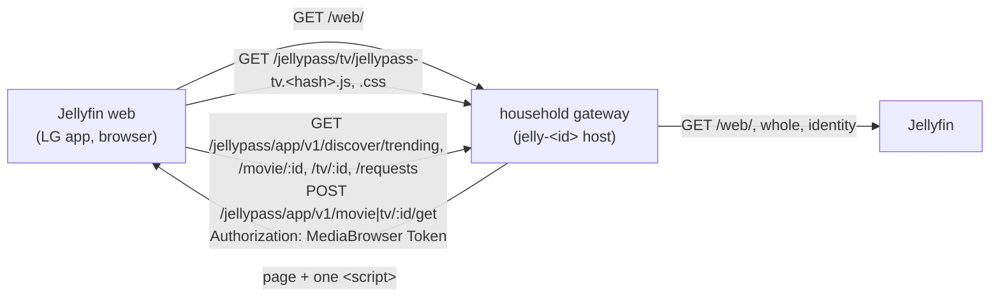
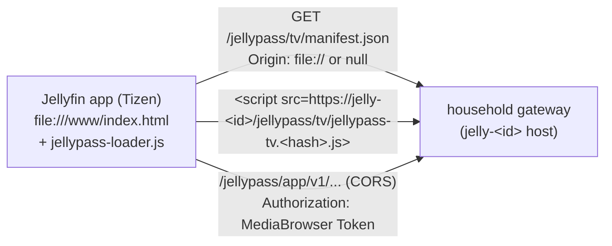

# TV add-on: design and rollout

## Status

Steps 1 and 2 of 5 are done, and so are the first three steps of the redesign (direction A of the 2026-10-27 study): the
Discover **row** (below, "The row"), the **page host** ("The page host") and the **title page** ("The title page"). Behind
`TV_ADDON_ENABLED`, off by default, the household gateway adds one script to Jellyfin web's page on the households listed
in `TV_ADDON_HOUSEHOLDS`, and that script adds one **Discover** row to Jellyfin web's Home. Choosing a card opens a
JellyPass title page, a page of Jellyfin web's own at `#/jellypass/title/<movie|tv>/<tmdbId>`, with **Play** or **Get
this**. The **Samsung app** (step 5) is built: a JellyPass build of Jellyfin's Tizen app whose loader adds the same
script from the household host, and the household host's cross-origin rules for it (see "The Samsung app"); it has not
been installed on a TV. Search and **My requests** come in later steps (see "Rollout"). Nothing has been run on a real TV
yet (see "What must be checked on a real TV").

The architecture study behind this design is the 2026-10-27 TV study (route 1, "a JellyPass TV module in jellyfin-web").
The owner's decisions for it:

1. **Cross-origin calls** are allowed later, so the Samsung app can call the app API from its own origin with the token
   only (no cookies). Not in step 1, but the add-on already calls the API the way that needs (see "API use").
2. **A build step for TV code only** is allowed: esbuild, targeting ES2017 for Chromium 63. The rest of the repository
   keeps its no-bundler rule (`docs/app-design.md`, "Source and build").
3. **Placement:** a Home row inside Jellyfin web's Home screen, with no menu entry.
4. **Samsung:** a JellyPass build of the Jellyfin app replaces the existing Jellyfin app (later steps, and operations).
5. **JellyQuest** is removed from the TVs (operations).

## How it is delivered



- **Settings.** `TV_ADDON_ENABLED` (default `false`) and `TV_ADDON_HOUSEHOLDS`, a comma-separated list of household
  (group) IDs or `*` for every household. The list is required when the add-on is on, so it is switched on for one
  household first. It needs `HOUSEHOLD_APP_ENABLED=true`, because the row reads the app API. Startup stops on an
  invalid value. With the add-on off, or on a household not listed, every path on every host is decided and answered
  exactly as before (`src/household-gateway.ts`: no route decision changes unless the add-on is on for that household).
- **The page.** On a listed household's host only, a `GET` or `HEAD` of Jellyfin web's page (`/web/`,
  `/web/index.html`, in every spelling Jellyfin routes, the `/emby` prefix included) is asked of Jellyfin as a `GET`,
  with `Accept-Encoding: identity` and without `Range`, `If-Range` or any conditional header, so it comes back whole
  and unencoded, and a browser holding an older copy can't be told `304`. A `200` `text/html` answer of at most 1 MiB
  that has a `</head>` gets `<script defer src="/jellypass/tv/jellypass-tv.<hash>.js" data-jellypass-tv></script>`
  just before it.
  - **Never twice:** a page that already has a `data-jellypass-tv` tag is sent as it is.
  - **Headers:** Jellyfin's own (`Content-Type`, any `Content-Security-Policy`, `X-Frame-Options`, `Vary`, …) are kept
    as Jellyfin sent them. `Content-Length` is the new length. `ETag`, `Last-Modified`, `Accept-Ranges`, `Expires`,
    `Age`, `Pragma` and Jellyfin's `Cache-Control` are dropped, because they described the page without the tag. The
    page is sent `Cache-Control`, `CDN-Cache-Control` and `Cloudflare-CDN-Cache-Control: no-store` (as the PWA's page
    is), so neither a browser nor Cloudflare stores the page from now on. These headers can't remove a copy
    cached *before* the gateway started sending them (an older Jellyfin web page a browser or Cloudflare already
    holds). On rollout, check that the household host's page comes back with the tag and `no-store`, or purge
    Cloudflare's cache for that host's `/web/` page once, before testing on a TV.
  - **Anything else is relayed exactly as Jellyfin sent it:** another status (a `302`, a `500`), another type, an
    encoding Jellyfin used anyway, a page with no `</head>`, a larger page, every other file of Jellyfin web (its HTML
    included), every other path. A `HEAD` gets the `GET`'s headers and no body.
  - **CSP:** Jellyfin sends none for its web client today (none reaches the household host). If one is sent, it is
    relayed unchanged. The script is same-origin, so `script-src 'self'` allows it. A policy that refuses `'self'`
    means the add-on doesn't run, which is the safe outcome.
- **Its files.** `/jellypass/tv/jellypass-tv.<hash>.js` and `.css`, at their exact paths, sent `public,
  max-age=31536000, immutable` with an `ETag` (and a `304` to a matching `If-None-Match`) and `nosniff`. Any other
  `/jellypass/tv` path or method on a listed household's host is a fixed `404 {"error":"not_found"}` that never
  reaches Jellyfin, apart from the Samsung app's manifest, `/jellypass/tv/manifest.json` (see "The Samsung app"). Unlisted households still relay `/jellypass/tv` to Jellyfin, as before. The script adds the
  stylesheet itself, by its address next to the script's, so the page needs one tag and a later loader needs to add
  only the script.
- **Not on the admin host.** The administrator host never relays to Jellyfin and never serves the add-on. The LAN
  Jellyfin address is untouched too: only household hosts go through the gateway.
- **Why the gateway, not a plugin.** File Transformation or a JavaScript injector plugin would apply to every host,
  the LAN one and the administrator's included, and isn't under JellyPass's tests. The gateway is (study decision D8).

### Tested against

- **The gateway's injection:** the Jellyfin web page that **Jellyfin 10.11.3** serves (`jellyfin/jellyfin:10.11.3`, the
  CI image; `test/real-jellyfin.test.mjs`), as `/web/` and `/web/index.html`, with and without compression asked for.
  Also a simulated page with every header and answer case (`test/tv-addon.test.mjs`).
- **The add-on's use of Jellyfin web:** checked by reading **Jellyfin web 10.11.11**'s built bundle (the one
  jellyfin-tizen 10.11 builds and JellyQuest used: `35c0793`). It covers the Home template, the Home tab's section
  loading, `window.ApiClient`, the focus manager, the scroll manager and `viewshow`. Then it was run in a simulated
  Jellyfin web DOM in the tests.
- **Jellyfin web 12.3 (what production runs), the page host and the title page:** the source of tag `v12.3` (identical
  to 12.4 for every file used) for the fallback route, the header, the item details page's markup and styles, and the
  theme; and a **real `jellyfin/jellyfin:12.3.0` container**, in the TV layout and the desktop (modern) layout, with a
  browser (Chromium; the household API and TMDB's images answered by the script, since the container has no gateway):
  choosing a card, the title page of a movie and of a series, Get this, and Back. That check found and fixed the row's
  `itemsContainer` class (see "The row"). The scripts and screenshots are kept with the redesign study
  (`/opt/dev/design-ref/jellypass-tv-redesign/step3/`), not in this repository.
- **Not yet checked:** any real TV (see below), and Jellyfin web 10.11 (the Tizen builds) beyond the row. Where Jellyfin
  web's structure differs the add-on draws nothing (safe), but a changed focus model could leave a row or a page that
  can't be navigated: check the row, the title page and D-pad navigation (Back included) on each Jellyfin web version in
  use.

## The add-on

`tv/src/*.ts` and `tv/static/tv.css`, built by `scripts/build-tv.mjs` (part of `pnpm build`) into `dist/tv`.

- **Build.** esbuild bundles `tv/src/main.ts` into one classic script (an IIFE: no modules, no `import`), downlevelled to
  **ES2017**. That is what Chromium 63 parses (Samsung 2019, Tizen 5.0, the oldest measured TV): no `?.`, `??`,
  optional catch binding, object spread or class private syntax. Both files are named `jellypass-tv.<12 hex digits of
  sha256>.<ext>`; the stylesheet is hashed first and its name built into the script. `tsconfig.tv.json` type-checks
  the source with only the ES2017 library, so a later library API (`Object.fromEntries`, `Array.prototype.flat`, …)
  doesn't compile. esbuild is a dev dependency used only here, and its install script is not run
  (`pnpm-workspace.yaml`); its platform package carries the binary.
- **Gates** (`test/tv-addon.test.mjs`):
  - the built script parses with acorn as `ecmaVersion: 2017`, `sourceType: 'script'`;
  - it names no browser API Chromium 63 lacks (`replaceChildren`, `AbortController`, `ResizeObserver`, `queueMicrotask`,
    `structuredClone`, `.flat()`, `.at()`, `focus({preventScroll})`, …). None is polyfilled, because none is used;
  - it uses no `console`, storage, cookies or HTML parsing;
  - the stylesheet uses no flex or grid `gap` (it measures 0 px on M63, which caused JellyQuest's skipping bug), no
    `:focus-visible` (the whole rule would be dropped), `aspect-ratio`, `inset`, logical properties, `:has()` or
    `min()`/`max()`/`clamp()`. Spacing is margins, a poster is a `padding-top: 150%` box, and focus is `:focus`.
- **Jellyfin web coupling** is all in `tv/src/jellyfin-web.ts`, which is the file to check on a Jellyfin web upgrade:
  - `window.ApiClient` (`accessToken()`, `serverAddress()`, `getCurrentUserId()`);
  - Home as `#indexPage` (with `hide` while it is not shown) › `#homeTab` › `.sections.homeSectionsContainer` and its
    `.verticalSection.section0` placeholder, which Jellyfin web writes for every section at once when it loads them;
  - the `viewshow` event that each page dispatches (and which bubbles) as it is shown;
  - the class names the row borrows: `verticalSection` and the section heading's classes, so it lines up with Home's
    own rows, `focuscontainer-x`, and its card markup as `cardBuilder` writes it (`card overflowPortraitCard
    card-hoverable`, `cardBox`, `cardScalable`, `cardPadder-overflowPortrait`, `cardImageContainer`, `cardText`; on a TV
    also `show-focus show-animation`), so Jellyfin web's own CSS sizes, sets the type of and focuses the cards;
  - that Jellyfin web's Home **calls `.pause()` on every `.itemsContainer` in its sections** when Home is left (a method
    of its own custom element), so the row's list is **not** an `itemsContainer` (it has a class of its own and the
    few rules that class gave): a plain `div` with that class made Home fail with a `TypeError` as soon as the member left it
    in the desktop layout;
  - for the title page, the item details page's own classes, so its CSS applies: `nameContainer` and `itemName`,
    `itemMiscInfo itemMiscInfo-primary` and `mediaInfoItem`, `mainDetailButtons` (a `focuscontainer-x`), the buttons'
    `emby-button raised` (and `button-submit` for the primary one, `show-focus` on a TV), `overview`, `itemDetailsGroup`
    with `detailsGroupItem` and `label`, `padded-left` and `padded-right`, and the theme's `--jf-palette-*` colours (with
    the stock theme's as the fallback); and that `.libraryPage` (the fallback page has the class) pads a page below the header;
  - the hash route of Jellyfin web's details page, `#/details?id=<item>` (the address the API's `play.url` names).

  If any of it is missing or shaped otherwise, the add-on draws nothing. Every entry point is wrapped so a surprise is
  swallowed, never thrown into Jellyfin web. Nothing is logged, because a message could carry what the page holds.
- **The row.** Once Home is laid out and shown, and Jellyfin web is signed in to **the same origin the script came
  from**, the row is one Home section inserted after Home's first (on a default Home, after **My Media**):
  - the heading **Discover**;
  - the cards of the first page of `GET /discover/trending` (up to 20) that are **Available to get**, and no others.
    A title whose state is `in_library` ("Ready to watch") is left out, because Jellyfin web's own rows show it; a
    **Requested** title is left out too (it will live in My requests, a later step); "Can't request" is not offered. So
    the row has **no badge**: every card in it can be asked for. Each card is a `<button type="button">` in Jellyfin
    web's card markup (see "Jellyfin web coupling") with the poster (only a URL on the API's `w342` TMDB pattern), the
    title and the year. Its accessible name says the status in the app's words ("Available to get"). An unknown state is
    "Can't request", as the contract says, and so is not in the row.
  - **A title the member asks for** (the title page's **Get this**, shown as Requested for up to two minutes, see "The
    title page") leaves the row at once, in place, with no call; when the two minutes run out and the server still says
    Available to get, it is back. **Back from the title page** returns to Home with focus on the title's card, or on the
    row's first card if the title's own has left. Jellyfin web redraws Home's sections after showing it (and
    auto-focuses), so the row gives the card focus each time it is drawn for four seconds after Home is shown again,
    and stops at the member's first key or press.
  - **When nothing is left** (every trending title is in the library, Requested or not offered, or the answer failed)
    the row is **not drawn**: no heading, no empty strip. A second page is deliberately not fetched when few titles
    survive the filter: the row stays one call (below), the same for every device on a household's one per-address
    budget, and a short row is still right. The filter reads only the caller's own `state` in their own answer, never
    anything of another household.

  Everything is set with `textContent`; nothing is parsed as HTML. Jellyfin web redraws Home's sections when its home
  settings change, and a `MutationObserver` (changes gathered for 50 ms) puts the row back. There is never more than one.
- **Remote control.** The add-on runs **no navigation system of its own**. Jellyfin web's focus manager (TV layout)
  moves between focusable elements (any `<button>`) by their place on the screen within the nearest focus container.
  The row's list is a `focuscontainer-x`, so Left and Right stay in the row and Up and Down leave it, as in Home's own
  rows. Jellyfin web's scroll manager scrolls the focused card into view (it listens to `focusin` on a TV). The
  add-on handles no keys: it has no layer of its own, so Back is Jellyfin web's. The focus ring and zoom are Jellyfin
  web's own (`.card:focus`, with `show-focus show-animation` added when the page is in TV layout, as `cardBuilder` does),
  and so are the card widths, in TV and desktop layout alike. The row adds only its scrolling strip, the poster inside
  Jellyfin's image box, in Jellyfin web's own look (nothing of its own palette).
- **Choosing a card** opens the title page (below): the add-on sets `location.hash` to
  `#/jellypass/title/<movie|tv>/<tmdbId>`, a history entry, and only while Jellyfin web is signed in to this origin. A card's state is read through the "Get this" overlay, so a title
  the member just asked for is no longer Available to get and leaves the row (above).

### The page host

`tv/src/page-host.ts`: a host inside Jellyfin web for JellyPass pages at `#/jellypass/...`. Jellyfin web has no route
extension point, but its route table ends in a "page not found" route (`components/router/FallbackRoute.tsx`, the
same in the TV and the desktop layout): a real Jellyfin page, `<div id="fallbackPage" data-role="page" class="page
mainAnimatedPage libraryPage">`, under Jellyfin's own header. An unknown hash such as `#/jellypass/about` lands on it.
The host puts a JellyPass page in it, so Jellyfin's header, its Back and Home buttons, its history, its focus manager
and its scrolling all apply, and the add-on handles no key: Back (the remote's, the LG's, the browser's) is Jellyfin
web's history, and leaves the page as it leaves any other.

- **The router API** (for pages): `host.register('/jellypass/title/:mediaType/:tmdbId', render)`. `render({ document,
  container, params, setTitle, focus })` draws into `container` only (an empty box inside Jellyfin's page) and returns
  `{ title, cleanup?, focus? }`. The host sets Jellyfin's header title (a page that learns its title later calls
  `setTitle`, ignored once the page is left), calls `cleanup` when the page is left (the address changes, or Jellyfin web
  removes its page) and removes the container. Focus: a page marks elements `data-jellypass-tv-focus="<key>"`; the host
  remembers (in memory only, for the last 20 pages) the one that had focus, and when Back returns it focuses that
  element again, else `focus`. A page that draws after a read calls `focus(element)` once it has drawn: the remembered
  element wins, else `element`, and nothing is taken from a member who has pressed a key or the pointer on that page.
  Jellyfin web auto-focuses a page on a TV on its `pageshow`; the host puts focus right once more just after it.
- **Listeners.** Every document listener the add-on adds (`viewshow`, `focusin`, `pageshow`, and `keydown`,
  `pointerdown`, `mousedown`, `touchstart` to notice that the member has pressed something) is explicitly
  `{ capture: true, passive: true }`: it can only watch, and nothing in the bundle prevents or stops an event (tested).
- **No flash.** When the address is a registered JellyPass page, the host sets a class on `<html>` at once (on
  `hashchange`, before Jellyfin web has drawn anything), and a rule in the stylesheet hides the children of
  `#fallbackPage` that are not the host's. Jellyfin's "Page not found" is hidden, not removed (React owns it), so it
  is shown again if the page is left for another unknown address.
- **The title.** `data-title` on Jellyfin's page (read by `scripts/libraryMenu.js` on `pageshow`), the header's
  `.skinHeader .pageTitle` (as `libraryMenu.setTitle` sets it) and `document.title`. In the **desktop** (modern) layout
  Jellyfin web hides that header and has its own toolbar with no page title and no Back button, so there the title is
  the browser tab's and Back is the browser's history.
- **Fails safe.** If `#fallbackPage` is not there, is not a `[data-role=page].page`, or is `hide`, or the address has
  no registered page, nothing is drawn, the class is not set (the rule also checks the page's shape), and Jellyfin's
  page is untouched. A page whose `render` throws is removed, not retried at that address, and Jellyfin's page shows.
- **Pages.** `#/jellypass/title/<movie|tv>/<tmdbId>` ("The title page"), and `#/jellypass/about` (`tv/src/about.ts`), a
  placeholder: a heading, one line and a link home. Nothing links to the placeholder and it makes no call.
- **Coupling** (checked against Jellyfin web 12.3, whose files this uses are identical in 12.4): `FallbackRoute.tsx`
  (`#fallbackPage`), `components/Page.tsx` (`data-role`, `data-title`, the `pageshow` it dispatches),
  `scripts/libraryMenu.js` (`.pageTitle`), `components/autoFocuser.js`. Not checked: other Jellyfin web
  versions (10.11, which the Tizen builds use, among them); where the page is not as above, the add-on draws nothing.

### The title page

`tv/src/title.ts`: the household app's title page, a page of Jellyfin web's on the page host at
`#/jellypass/title/<movie|tv>/<tmdbId>` (the address a card opens, and one that works opened directly: a reload or a
bookmark). It replaces the overlay of step 2: nothing is fixed over Home, no key is handled, and no `z-index` is set.

- **Where.** In Jellyfin web's fallback page (see "The page host"), under its real header: in the TV layout the legacy
  header with its **Back** and **Home** buttons and the page's title (the title's name, once read), in the desktop layout
  its toolbar. Choosing a card is a history entry, so **Back** is Jellyfin web's: it returns to Home with the card
  focused (see "The row"), and to the title page from Jellyfin's own details page after **Play**. A title that is not a
  title (`movie` or `tv` and an id of digits with no leading zero) says "Not found" and calls nothing.
- **Layout**, as Jellyfin web 12.3's own item details page (`apps/legacy/controllers/itemDetails/index.html` and
  `styles/librarybrowser.scss`): the poster on the left (25vw, a 2:3 box, from 3.3% in), the text column from 32.45vw: the
  name (`itemName`), the facts line (`mediaInfoItem`: year, runtime or "N seasons", "★ 7.5 TMDB", then the status in the
  app's coarse words), the buttons (`mainDetailButtons`, Jellyfin's `emby-button raised`, the primary one in its
  `button-submit` colour), the note for the status, the overview (`overview`) and "Genres" (`itemDetailsGroup`). A
  series lists its seasons below, with their episode counts and statuses. Colours are Jellyfin's theme
  (`--jf-palette-*`), apart from the status colours, which are the add-on's own and the same as before. The statuses are
  "Ready to watch", "Available to get", "Requested", "Can't request", and "We couldn't get this" for a title or season the
  household asked for that failed (read from `GET /requests`).
- **Backdrop, always.** The title's backdrop (the API's `w780` TMDB image) is drawn across the whole screen, behind the
  page and under Jellyfin's header (a `position: fixed` box, darkened, with no `z-index`), **whatever Jellyfin web's
  per-browser Backdrops setting says**: the add-on does not read that setting (the profiles have it off, and these titles
  have little else to show). Without a backdrop image the dark ground is still drawn.
- **One action**, as on the app's title page:
  - **Play** when the title is in the library and the API's `play.url` is exactly
    `https://<this origin>/web/#/details?id=<play.itemId>`: it sets `location.hash` to `#/details?id=<itemId>`, so Jellyfin web
    opens its own details page for the item, with its own player. Nothing new plays anything. Any other `play` is no Play.
  - **Get this** when the household can ask for it. For a series, the seasons it can ask for (specials aside) are
    toggle buttons (`aria-pressed`) with **Select all** when there is more than one; **Get this** stays disabled with
    "Choose the seasons you want below." until one is chosen, and sends exactly the seasons chosen (HD only: the API
    asks for nothing else). A series partly in the library keeps **Play** as its primary, with **Get this** beside it.
  - "Requested", "Can't request" and "We couldn't get this" have no button, only their note. The TV has no My requests
    yet, so "Requested" says "Check My requests in the JellyPass app to follow it."
- **Focus.** Jellyfin's focus manager moves the d-pad within the page and the header. Once the title is read, focus goes
  to Play, else Get this, else the first season to choose, else Try again; what had focus when the page was last left
  (coming back from Play) wins, and nothing is taken from a member who has already pressed a key on the page. A change the
  member makes (a retry, an accepted **Get this**) puts focus on what is new (the confirmation, the button again after a
  failure). Jellyfin web scrolls the focused element into view and the page scrolls natively.
- **"Get this"** is the app's identical-outcome flow (docs/app-design.md, '"Get this"'):
  - while its one call is out the button says "Sending…" and is disabled, and so are the season toggles; a second
    press sends nothing;
  - any `2xx` is accepted, and its body is not read. The page shows the one fixed confirmation, "Thanks — we'll get
    this for your household.", at once, marks the title (and the seasons) in the overlay, and reads the page again;
    the seasons asked for are not offered again while it is open. If that read fails, the confirmation stays, with
    "Something went wrong. Try again in a moment." and a **Try again** that only reads;
  - a failure says its fixed words: `429` "Too many tries, try again in a few minutes.", no network "You're offline.
    Check your connection, then try again.", anything else "We couldn't send that just now. Try again in a moment.",
    and the button is offered again. A `401` shows "Sign in to continue". Nothing is ever sent again by itself, and no
    answer's text is ever shown.
- **Errors reading the title** are the app's fixed states ("Can't load this right now", "Too many requests", "Not
  found", "You're offline", "Sign in to continue"), with a **Try again** that only reads (none for a refused token).
- **The overlay** (`tv/src/asked.ts`, the app's `app/src/asked.ts`): an accepted "Get this" shows the title (and its
  seasons) as **Requested** on the page (and out of the row) for up to **two minutes**, while the server records it, and is
  dropped as soon as the server says anything but `get_this` for it. As in the app it runs on both clocks: it ends when
  the monotonic clock has run two minutes or the wall clock has moved forward by that much (a TV asleep), and a wall
  clock set back never stretches it. On a page or row left alone it ends by a timer (at most 15 seconds between looks
  at the clocks) that draws the statuses again from what is held, with no call; a page whose read after an accepted
  "Get this" failed is drawn again from the answer it showed before that call, keeping the confirmation and its
  **Try again**, and offering nothing that sends. It is kept in memory for the member
  signed in: another member signing in, signing out, or a refused token (`401`, on the title read or the requests
  read, each judged on its own) forgets all of it, and the page is emptied (Jellyfin web takes the member to its own
  sign-in or Home) or says sign in.
- **Same origin only.** Every call is made as the row's are (below), with the token read from `ApiClient` for that one
  call. A card chosen while Jellyfin web is signed in elsewhere opens nothing, and an address opened then draws nothing and
  calls nothing; if it signs in elsewhere (or someone else signs in) while the page is open, the page is emptied and its
  late answers are dropped. Leaving the page drops what is in flight.
- **Text.** Everything shown is a fixed string or a DTO field set with `textContent`; images are only the API's TMDB URLs
  (`w342` posters, `w780` backdrops), set with `referrerpolicy="no-referrer"`.

### API use

- **Where.** Only `https://<the origin the add-on's script came from>/jellypass/app/v1/...`, and only while Jellyfin
  web's `ApiClient.serverAddress()` is that same origin. So a token Jellyfin web holds for one server is only ever sent
  to that server. On LG and in browsers the origin is the household host the page came from. In the later Samsung app
  it is the household host the loader fetched the script from, the same one the member signed in to.
- **How.** `Authorization: MediaBrowser Token="<token>"` and `Accept: application/json`, `credentials: 'omit'`, no
  cookie, no token in a URL, no other header. That is the native-client contract, and it is what a CORS request from
  another origin needs: the Samsung app's page is another origin (`file://`), and the household host allows exactly
  that origin, `Authorization` and `Content-Type`, with no credentials (see "The Samsung app").
- **The token** is read from `ApiClient.accessToken()` for each request and passed only to that request's header. It is
  never kept in a variable past the call, written to storage, logged or put in the page (tested: no storage use, no
  console call, and the token isn't in the page).
- **Answers.** Read leniently (unknown fields ignored, unknown state as `unavailable`, bad image URLs as no image). Any
  failure (`401`, `404`, `429`, `502`, no network, a body it can't read) or an empty list draws no row. The failure is
  kept like an answer (below), so it is not asked again at once.

### Privacy

The same as the app's. The row shows only Card DTO fields from the allowlist-shaped v1 API, and the server's
guarantees are the server's. A test draws the row in every "other household" world of the app tests (a private grant,
a pending request, a manual grant, a public title outside the household's libraries, large Seerr records) and checks
the row is byte-for-byte the same as with no other household. It also checks the row for the Seerr fixtures' canaries.
Another opens the title page and presses **Get this** in each of those worlds and checks that the calls made (address,
method, body, headers), the page after the confirmation and the row are byte-for-byte the same as with no other
household, and that the page holds no canary. As in the app's test, every read of the title after the accepted call
gets the same answer there: what the server says afterwards is the server's matter, tested against the API.

As the study noted, Jellyfin web has no CSP of its own and already runs other plugins' scripts on the same origin,
which can read the same token. The add-on adds code to an origin already shared, not a new trust class. It is kept
small, dependency-free and at an exact fingerprinted path.

### Fetch budget

`tv-home-row` in `docs/app-api/fetch-budget.json`: **one call**, `GET /discover/trending`, when Home is first laid out
(unchanged by the filter: it is applied to that one answer, and no second page is asked for).
The answer (or failure) is kept in memory for the signed-in member:

- Jellyfin web redrawing Home or showing it again **within a minute** asks nothing;
- **staying on Home** asks nothing, however the page changes (no polling);
- **showing Home again after a minute** asks once more, and the old row stays until the new answer replaces it;
- **another member** signing in drops the row at once and asks with their token.

The title page is `tv-movie` and `tv-series` there: **two calls** each time it is opened (a card chosen, or Back from
Jellyfin's own details page after Play; the address is the same, so the budget file is unchanged), the title
(`GET /movie/{tmdbId}` or `GET /tv/{tmdbId}`) and `GET /requests`, which are the app's title page's calls without
`/me` (the TV shows no member name). Nothing is kept between openings, as in the app. `getThis` is what one accepted
"Get this" makes: the `POST`, then the page read again (those two calls). A failed one is the `POST` alone. Choosing
seasons, Select all, Back and Play call nothing.

`test/tv-addon.test.mjs` pins all of this against the budget file.

## The Samsung app

The compatibility targets are Samsung sets on Tizen 5.0 (Chromium 63, e.g. 2019 models) and Tizen 5.5 (Chromium 69,
e.g. 2020 models) running Jellyfin's Tizen app sideloaded, which
**bundles its own Jellyfin web**: the gateway's tag never reaches it. The JellyPass build of that app (`tv/samsung/`) is the stock app plus one small loader, which adds the same add-on script from the
household host the member signed in to. It keeps the app id `AprZAARz4r.Jellyfin`, so it **replaces** the Jellyfin app
rather than sitting beside it.



### The app's origin and the household host's rules

- **The origin.** The app is a packaged web app: its page is `file:///www/index.html` (read with the inspector on both
  sets). Chromium M63/M69 sends a `file:` page's origin as **`file://`** when the
  runtime lets the page read local files, as Tizen does for a packaged app (a packaged app's `fetch` of its own
  files works), and as **`null`** when it does not. Samsung documents neither, and reports disagree (some see `null`,
  some no `Origin` at all), so the rules accept exactly those two values. A request with no `Origin` needs no CORS and
  is answered as always. If a set sends something else, the manifest can't be read and the add-on simply doesn't
  appear (see "Check on each Samsung").
- **Where.** Only on a household host the add-on is on for (`TV_ADDON_ENABLED` and `TV_ADDON_HOUSEHOLDS`), and only for
  `/jellypass/app/v1/*` (the app API) and `/jellypass/tv/*` (the add-on's files and manifest). The household app's own
  pages (`/jellypass/app/` and its files), every other path, every other household and the administrator host answer
  exactly as before, and so does any other origin (every web page has an `https://` origin) apart from `Vary: Origin`
  on those two paths (see "Caches"; `src/tv-cors.ts`, tested).
- **Preflight.** An `OPTIONS` from that origin asking for an allowed method and allowed headers is answered `204` at
  once, before any token is looked at, with `Access-Control-Allow-Origin: <that origin>`, `-Allow-Methods` (`GET, POST`
  for the API; `GET, HEAD` for the files), `-Allow-Headers: Authorization, Content-Type` (the API only; the files need
  none), `-Max-Age: 600`, `Vary: Origin` and `no-store`. A preflight asking for anything else (another method, another
  header, a cookie) gets the old answer (`401` for the API, `404` for the files), with no CORS header.
- **Answers.** Every other answer to that origin, a refusal (`401`, `404`, `429`) included, carries
  `Access-Control-Allow-Origin: <that origin>`, so the add-on can tell a refused token from no network.
- **Caches.** Every answer on those paths there carries `Vary: Origin`, whatever `Origin` (or none) was sent, the add-on's
  fingerprinted files (kept for good by browsers and the CDN) included, so a cache that honours it never gives a copy
  made for one origin to another. No cache can be poisoned either way: only `Access-Control-Allow-Origin` depends on
  `Origin`, and its value is one of the two fixed ones, never copied from a request; the body never depends on it. The
  manifest, the API and preflights are never stored. So a cache that ignores `Vary` can at worst give a file's copy that
  allows the app's origin to a web page (which reads nothing it couldn't: the files are public and the same for
  everyone) or a copy without the header to the app (which loads the files with `<script>` and `<link>`, needing no
  CORS).
- **Never credentials.** `Access-Control-Allow-Credentials` is never sent. The API reads only the `Authorization`
  header and sets and reads no cookie, so a page with the app's origin can do only what a token it already holds lets it
  do. A sandboxed frame on any site also has the origin `null`: it gains nothing for the same reason.

### The manifest

`GET` or `HEAD /jellypass/tv/manifest.json`, on a household host the add-on is on for: `200 {"script":"jellypass-tv.<12
hex>.js"}`, the current script's name, `no-store` (browser and CDN), `nosniff`, no token needed (the name is in Jellyfin
web's page for anyone anyway). Only at that exact path; another spelling or method is the fixed `404`.

### The loader

`tv/samsung/loader.ts`, built by `tv/samsung/build-loader.mjs` to ES2017 (as the add-on) into
`www/jellypass-loader.js`, added to Jellyfin web's page as one `<script defer>` before `</head>`.

- **Which host.** Once a second it reads `ApiClient.serverAddress()` (no call is made). It acts only when that is
  **HTTPS on the default port, with no user name, on a host the build lists** (`JELLYPASS_TV_HOSTS`, exact names or one
  `*` for letters, digits and hyphens in the first label; for example `jelly-*.example.org`). So a server
  named by its LAN address, the main host or any other server is left alone, and the loader never runs code from a host
  the build doesn't trust.
- **What it asks.** `GET https://<host>/jellypass/tv/manifest.json` with `Accept` only: no token, no cookie
  (`credentials: 'omit'`), no referrer, a redirect is a failure. Ten seconds at most.
- **What it adds.** If the answer is a script name of the add-on's shape, and Jellyfin web is still connected to that
  host, `<script src="https://<host>/jellypass/tv/<name>" data-jellypass-tv>` in the head, one at a time. The add-on is
  loaded only when that script's `load` fires. If it fires `error` instead (a release deployed between the manifest and
  the script, so the name is gone; no network), the tag is removed and the manifest is asked again later, as after any
  failure below; while the tag is loading nothing else is asked. The add-on then runs as
  it does on LG and in browsers: it finds its own origin from that script, and calls the API only while
  `ApiClient.serverAddress()` is that origin.
- **Fails safe.** Anything else (a `404` where the add-on is off, no network, a timeout, a body it can't read, another
  name, a script that fails to load) leaves no tag, and Jellyfin web runs as the stock app. It asks that host again
  after 30 seconds, then 60, 120…, at most every 30 minutes; a different host is asked at once. Once the add-on's
  script has loaded it stops. It logs, stores
  and shows nothing. Switching to another server after the add-on has loaded leaves the add-on idle (it is the first
  host's); restarting the app loads the new host's. A script download that never finishes (neither `load` nor `error`)
  leaves the add-on waiting until the app restarts: there is deliberately no timeout, because a script removed while still
  downloading can still run, and a retry could then load the add-on twice.
- **Tests** (`test/tv-samsung.test.mjs`): the built loader parses as ES2017, uses no API Chromium 63 lacks and no
  console, storage, HTML parsing or token; it is run with a fake clock and page for each host case, each failure, a
  script that fails to load (a deploy race), the backoff and a server change; and against the gateway with a browser-like `fetch` that refuses an answer without the
  right `Access-Control-Allow-Origin`.

### The build

`tv/samsung/build-wgt.sh`, with every input pinned in `tv/samsung/pins.env`:

- **Jellyfin web `v12.3`** (`c06cb17`), the server's version (Jellyfin 12.3.0). Its `browserslist` includes Chrome 63, it
  needs Node 24 and npm 11. Built `USE_SYSTEM_FONTS=1 npm run build:production`, as jellyfin-tizen's README says.
- **jellyfin-tizen** (`31408c1`, master): `config.xml` (app id `AprZAARz4r.Jellyfin`, `<access origin="*">`), `tizen.js`
  and its gulp step, which copies Jellyfin web into `www/` and adds its CSP meta (`default-src *`, so a script and a
  `fetch` from the household host are allowed) and `tizen.js`. jeppevinkel/jellyfin-tizen-builds packages the same
  wrapper (its `Jellyfin-12.z.wgt`).
- Both npm builds run in **`node:24-bookworm`** pinned by digest; the loader is built with the repository's esbuild.
- Packaged with `tizen build-web` (jellyfin-tizen's README excludes) and `tizen package -t wgt -s dev`, offline, in
  **`ghcr.io/georift/install-jellyfin-tizen@sha256:d872a8b7…`** (never `:latest`), signed with that image's built-in
  `dev` profile: author certificate `CN=developer` (sha256 `57a48d46…72cd`), Tizen's developer distributor.
- The script checks the app id, that the package has the loader and exactly one tag for it, and writes
  `dist/samsung/Jellyfin.wgt` and `dist/samsung/build-info.txt` (the package's and the loader's sha256, the author
  certificate, every pin, the hosts and the JellyPass commit). `dist/` is not committed. The inputs are pinned; the
  `.wgt` itself is not byte-for-byte reproducible (the zip and signature carry build times).

```sh
pnpm install --frozen-lockfile
JELLYPASS_TV_HOSTS='jelly-*.example.org' tv/samsung/build-wgt.sh   # a few minutes; needs docker and network
```

A **new Jellyfin web** (a server upgrade) means changing the pin, checking the add-on's coupling on it (see "Jellyfin
web coupling"), rebuilding and reinstalling. A **JellyPass release** needs nothing on the TV.

### Install runbook

The procedure, with example values: a deployment keeps its own (its household domain, the TVs' and the build machine's
LAN addresses) in its operations notes, not in this repository. Here the household hosts are
`jelly-<household>.example.org`, the machine running sdb is `192.0.2.10` and the TV is `192.0.2.20`. sdb talks to the
TV over TCP 26101, unencrypted: LAN only.

**Before.** On the TV: Apps, enter `12345`, Developer Mode on, host IP the sdb machine's address, restart the TV. Make
sure the add-on is on for the household whose host the TV will use (`TV_ADDON_HOUSEHOLDS`), and that
`https://jelly-<household>.example.org/jellypass/tv/manifest.json` answers `200`.

**Sign-in is lost.** The image's default run (how the stock app is usually put on) downloads
jeppevinkel/jellyfin-tizen-builds' `.wgt` and installs it **as published**: it re-signs only with a certificate passed
to it, never with its `dev` profile. That `.wgt` is **signed by another author** (`CN=Jellyfin`, sha256
`6ea90a25…9a83`, checked on release `2026-10-27-2002`) than this build (`CN=developer`). Tizen refuses to replace an app
with one signed by a different author, so the stock app must be uninstalled first, and uninstalling clears its data:
the server list and every sign-in. (The runbook tries the install first, so a set whose app happens to have the same
author keeps its data.) Afterwards add the server as `https://jelly-<household>.example.org` (not the LAN address or the
main host, or the add-on won't load) and sign in again.

```sh
IMAGE=ghcr.io/georift/install-jellyfin-tizen@sha256:d872a8b7fdb8f9c52e8181a76d3f320fda585c0e059d65d800d2aadad27f0a66
TV=192.0.2.20   # the TV's LAN address; repeat for each set
# The stock app, kept for the rollback (same release as checked above).
mkdir -p dist/samsung/stock
gh release download 2026-10-27-2002 -R jeppevinkel/jellyfin-tizen-builds -p Jellyfin.wgt -D dist/samsung/stock --clobber
sha256sum dist/samsung/Jellyfin.wgt dist/samsung/stock/Jellyfin.wgt
docker run --rm -it --network host -e TV="$TV" -v "$PWD/dist/samsung:/wgt:ro" --entrypoint /bin/bash "$IMAGE"
```

Inside the container:

```sh
S="$TV:26101"; APP=AprZAARz4r.Jellyfin; TMP=/home/owner/share/tmp/sdk_tools/tmp/Jellyfin.wgt
sdb connect "$TV" && sdb devices                      # "$S  device  <model>"
sdb -s "$S" shell 0 vd_applist | grep -B2 -A8 "$APP"  # note what is installed
sdb -s "$S" push /wgt/Jellyfin.wgt "$TMP"
sdb -s "$S" shell 0 vd_appinstall "$APP" "$TMP"       # expected to fail on the certificate (above); if it says
                                                      # "app_id[AprZAARz4r.Jellyfin] install completed", skip the next two
sdb -s "$S" shell 0 vd_appuninstall "$APP"            # "uninstall completed": the sign-ins are gone from here
sdb -s "$S" shell 0 vd_appinstall "$APP" "$TMP"       # "app_id[AprZAARz4r.Jellyfin] install completed"
sdb -s "$S" shell 0 vd_applist | grep -A8 "$APP"
sdb -s "$S" shell 0 execute "$APP"
```

**Rollback** (the stock Jellyfin app): the same, with the stock file, uninstalling first (the authors differ again):

```sh
sdb -s "$S" shell 0 vd_appuninstall "$APP"
sdb -s "$S" push /wgt/stock/Jellyfin.wgt "$TMP"
sdb -s "$S" shell 0 vd_appinstall "$APP" "$TMP"
```

or the image's own default run, which downloads and installs a release's stock `.wgt`:
`docker run --rm --network host "$IMAGE" "$TV" Jellyfin https://github.com/jeppevinkel/jellyfin-tizen-builds/releases/tag/2026-10-27-2002`
(after the uninstall). Switching the add-on off for the household (`TV_ADDON_ENABLED=false`) is a lighter rollback: the
manifest is gone, so the JellyPass build runs as the stock app.

### Check on each Samsung

With the add-on on for the household and the app signed in to its host:

1. **It loads**: the Discover row appears on Home (within a few seconds of Home showing). If not, look at the manifest
   request in the Web Inspector: the `Origin` it sent (record it here) and whether the answer has
   `Access-Control-Allow-Origin`. The inspector needs the app launched in debug mode from Tizen Studio or Samsung's
   Tizen TV VS Code extension; a plain `sdb` launch has no inspector target.
2. **The API works cross-origin**: the row's `GET /discover/trending` and a title page's reads are `200`; **Get this**
   (a `POST` with `Content-Type`, so it is preflighted) is accepted.
3. Then "What must be checked on a real TV" above, items 3 to 12, with Tizen's Back (`10009`).
4. **Playback and Jellyfin's own features** are as with the stock app (the build changes nothing else).
5. **Chromium 63** (the 2019 set): as below.

## Rollout

Each step is its own pull request, behind the same settings:

1. **Foundation (done).** Settings, gateway injection, the build, the Home row (Trending). **Row redesigned (done):**
   it is headed **Discover**, shows only titles Available to get (not in the member's library, not Requested), in Jellyfin web's own card markup (study: direction A).
2. **Title pages and "Get this" (done).** Choosing a card opens a JellyPass title page: first an overlay on Home, now (the
   redesign's step 3) a page of Jellyfin web's own at `#/jellypass/title/<movie|tv>/<tmdbId>` on the page host, so
   Jellyfin's header, its Back (Tizen `10009`, webOS `461`, as Jellyfin web maps them), its history and its focus
   manager apply and the add-on handles no key. It shows the title's household state and **Play** (to Jellyfin web's own
   `#/details?id=<play.itemId>`, so Jellyfin's TV player plays it), and **Get this** with a season picker for a series.
   It uses the same identical-outcome flow and fixed wording as the PWA, and the PWA's title-page calls (without
   `/me`). See "The title page".
3. **Search.** A JellyPass search screen reusing Jellyfin web's search field and the TV's own keyboard, with no custom
   keyboard; one call per pause, as the PWA does.
4. **My requests.** The household's requests with their coarse statuses, named ten at a time, as the PWA does.
5. **Samsung loader app (Tizen) (built; not installed).** See "The Samsung app".
   - CORS on `/jellypass/app/v1/*` and `/jellypass/tv/*` for the app's origin only (`file://` or `null`, not `*`), no
     credentials; preflight `204` before any token check; the native-client contract updated, since it makes the one
     exception to "CORS stays off". (`Cross-Origin-Resource-Policy` is not needed: the add-on's files are sent without
     one, which a `<script>` from any page may load.)
   - `tv/samsung/`: the build of Jellyfin's Tizen app (jellyfin-tizen)
     whose only change to Jellyfin web is the loader. Once Jellyfin web has its server address, the loader asks that
     household host's `/jellypass/tv/manifest.json` for the current name and adds
     `<script src="https://<that host>/jellypass/tv/<current name>">`, so a JellyPass change needs no resideload.
   - It replaces the stock Jellyfin app on the TVs (operations: the deployment's own runbook, following "Install
     runbook" in "The Samsung app").

Before switching it on for a household, the owner checks steps 1 and 2 on a real LG TV (below) with one household
listed.

## What must be checked on a real TV

On an **LG** (webOS; Jellyfin's LG app loads Jellyfin web from the server inside an iframe), with the add-on on for
that household:

1. **It loads.** The tag is in the page the LG app's iframe loads, the script runs (the row appears), and its
   stylesheet loads. Expected, since other plugins' scripts already run there, but check on the households' webOS
   versions.
2. **Token and API.** The row's one call to `/jellypass/app/v1/discover/trending` returns 200 (same-origin) with
   `ApiClient`'s token.
3. **D-pad.** From **My Media**, Down reaches the row, and Left and Right move one card at a time with no double moves
   and no skipped cards. Down leaves the row to the next Home section and Up returns to it. The focused card's ring is
   visible and the row scrolls to keep it on screen. Back on Home does what it did before.
4. **Choosing a card** (OK) opens the title page: Jellyfin web's own header stays at the top with its Back and Home
   buttons (Up from the page reaches them), the backdrop is behind the whole page, and focus is on Play, Get this or the
   first season (a ring visible). The d-pad moves between the page's buttons, and the page scrolls to keep the focused
   button, or a season of a long series, on screen. It is the same with Jellyfin's Backdrops setting off.
5. **Back.** The remote's Back (it is Jellyfin web's history, not the add-on's) returns to Home and focus is on the
   card it came from (not the first thing on Home). Pressed again on Home, Back does what it did before. Check the LG
   wrapper delivers Back to the page as `keyCode` 461 (with its "back history" setting as the households have it).
6. **Play** opens Jellyfin web's own details page for the title, and playing from there uses Jellyfin's player as
   usual; Back from there returns to Home with the row.
7. **Get this**, on a test title: "Sending…", then the confirmation; the status and the row's card say Requested; for
   a series, choosing seasons with OK and Select all work by d-pad, and Get this only becomes reachable once a season is
   chosen. Look the title up later in the phone app's My requests.
8. **Overlay and members.** Requested lasts until the server says so or two minutes pass. Switching profile leaves the
   title page and shows the new member's statuses.
9. **Playback and keys after the page.** Playback, the media keys and Back are unaffected, in general and right after
   leaving the row or the title page.
10. **Look.** Cards, poster frames and spacing are right: no zero gaps, no collapsed posters, text legible from the
   sofa at 1080p; on the title page the poster, the text column, the buttons and the season list line up (flex with
   margins, no `gap`) and the whole overview shows.
11. **Redraws.** Leaving Home and coming back (after playing something, say) keeps one row, and it re-reads after a
   minute. Switching profile shows the new member's row. Leaving Home from the row (to a title page, then to a library) and coming
   back shows Home as Jellyfin web draws it, with no error page.
12. **Caching.** After the setting is switched off and the app restarted, the row is gone (the page is `no-store`).

On a **Samsung**, nothing appears with the stock Jellyfin app, because it bundles its own Jellyfin web. With the
JellyPass build installed (see "The Samsung app"), the same checks apply, plus those listed there under "Check on each
Samsung". In a desktop browser on the household host, the same row appears in Jellyfin web, which is the easiest first
check.

For Chromium 63 itself (Samsung 2019): check that the bundle runs (the ES2017 gate covers syntax, not behaviour), focus
is visible, the cards' and the title page's layout measures right by geometry (as JellyQuest measured its own), and
Tizen's Back (`10009`) returns from the title page to Home.
