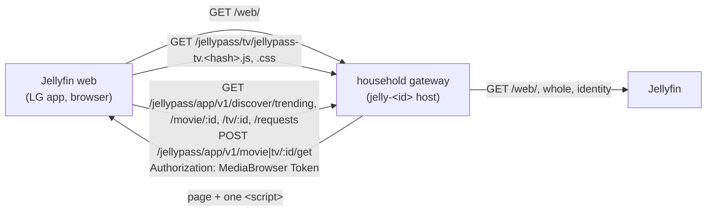

# TV add-on: design and rollout

## Status

Steps 1 and 2 of 5 are done: behind `TV_ADDON_ENABLED`, off by default, the household gateway adds one script to
Jellyfin web's page on the households listed in `TV_ADDON_HOUSEHOLDS`, and that script adds one **JellyPass: Trending**
row to Jellyfin web's Home (step 1). Choosing a card opens a JellyPass title view over Home, with **Play** or **Get
this** (step 2, "The title view"). Search, **My requests** and the Samsung loader app come in later steps (see
"Rollout"). Nothing has been run on a real TV yet (see "What must be checked on a real TV").

The architecture study behind this design is the 2026-10-27 TV study (route 1, "a JellyPass TV module in jellyfin-web").
The owner's decisions for it:

1. **Cross-origin calls** are allowed later, so the Samsung app can call the app API from its own origin with the token
   only (no cookies). Not in step 1, but the add-on already calls the API the way that needs (see "API use").
2. **A build step for TV code only** is allowed: esbuild, targeting ES2017 for Chromium 63. The rest of the repository
   keeps its no-bundler rule (`docs/app-design.md`, "Source and build").
3. **Placement:** a Home row inside Jellyfin web's Home screen, with no menu entry.
4. **Samsung:** a JellyPass build of the Jellyfin app replaces the existing Jellyfin app (later steps, and operations).
5. **JellyQuest** is removed from the TVs (operations).

## How it is delivered

- **Settings.** `TV_ADDON_ENABLED` (default `false`) and `TV_ADDON_HOUSEHOLDS`, a comma-separated list of household
  (group) IDs or `*` for every household. The list is required when the add-on is on, so it is switched on for one
  household first. It needs `HOUSEHOLD_APP_ENABLED=true`, because the row reads the app API. Startup stops on an
  invalid value. With the add-on off, or on a household not listed, every path on every host is decided and answered
  exactly as before (`src/household-gateway.ts`: no route decision changes unless the add-on is on for that household).
- **The page.** On a listed household's host only, a `GET` or `HEAD` of Jellyfin web's page (`/web/`,
  `/web/index.html`, in every spelling Jellyfin routes, the `/emby` prefix included) is asked of Jellyfin as a `GET`,
  with `Accept-Encoding: identity` and without `Range`, `If-Range` or any conditional header, so it comes back whole
  and unencoded, and a browser holding an older copy can't be told `304`. A `200` `text/html` answer of at most 1 MiB
  that has a `</head>` gets ``
  just before it.
  - **Never twice:** a page that already has a `data-jellypass-tv` tag is sent as it is.
  - **Headers:** Jellyfin's own (`Content-Type`, any `Content-Security-Policy`, `X-Frame-Options`, `Vary`, …) are kept
    as Jellyfin sent them. `Content-Length` is the new length. `ETag`, `Last-Modified`, `Accept-Ranges`, `Expires`,
    `Age`, `Pragma` and Jellyfin's `Cache-Control` are dropped, because they described the page without the tag. The
    page is sent `Cache-Control`, `CDN-Cache-Control` and `Cloudflare-CDN-Cache-Control: no-store` (as the PWA's page
    is), so neither a browser nor Cloudflare stores the page from now on. These headers can't remove a copy
    cached *before* the gateway started sending them (an older Jellyfin web page a browser or Cloudflare already
    holds). On rollout, check that the household host's page comes back with the tag and `no-store`, or purge
    Cloudflare's cache for that host's `/web/` page once, before testing on a TV.
  - **Anything else is relayed exactly as Jellyfin sent it:** another status (a `302`, a `500`), another type, an
    encoding Jellyfin used anyway, a page with no `</head>`, a larger page, every other file of Jellyfin web (its HTML
    included), every other path. A `HEAD` gets the `GET`'s headers and no body.
  - **CSP:** Jellyfin sends none for its web client today (none reaches the household host). If one is sent, it is
    relayed unchanged. The script is same-origin, so `script-src 'self'` allows it. A policy that refuses `'self'`
    means the add-on doesn't run, which is the safe outcome.
- **Its files.** `/jellypass/tv/jellypass-tv.<hash>.js` and `.css`, at their exact paths, sent `public,
  max-age=31536000, immutable` with an `ETag` (and a `304` to a matching `If-None-Match`) and `nosniff`. Any other
  `/jellypass/tv` path or method on a listed household's host is a fixed `404 {"error":"not_found"}` that never
  reaches Jellyfin. Unlisted households still relay `/jellypass/tv` to Jellyfin, as before. The script adds the
  stylesheet itself, by its address next to the script's, so the page needs one tag and a later loader needs to add
  only the script.
- **Not on the admin host.** The administrator host never relays to Jellyfin and never serves the add-on. The LAN
  Jellyfin address is untouched too: only household hosts go through the gateway.
- **Why the gateway, not a plugin.** File Transformation or a JavaScript injector plugin would apply to every host,
  the LAN one and the administrator's included, and isn't under JellyPass's tests. The gateway is (study decision D8).

### Tested against

- **The gateway's injection:** the Jellyfin web page that **Jellyfin 10.11.3** serves (`jellyfin/jellyfin:10.11.3`, the
  CI image; `test/real-jellyfin.test.mjs`), as `/web/` and `/web/index.html`, with and without compression asked for.
  Also a simulated page with every header and answer case (`test/tv-addon.test.mjs`).
- **The add-on's use of Jellyfin web:** checked by reading **Jellyfin web 10.11.11**'s built bundle (the one
  jellyfin-tizen 10.11 builds and JellyQuest used: `35c0793`). It covers the Home template, the Home tab's section
  loading, `window.ApiClient`, the focus manager, the scroll manager and `viewshow`. Then it was run in a simulated
  Jellyfin web DOM in the tests. For the title view (step 2), the same release's source at that commit:
  `scripts/keyboardNavigation.js` (the Back keys, the `window` handler that skips a prevented event),
  `scripts/inputManager.js` (`back` is the router's Back, or exit), `components/focusManager.js` (`focuscontainer`,
  the `offsetParent` check) and the dialog and header `z-index`es.
- **Not yet checked:** Jellyfin web 12.x (the production server runs 12.3.0), and any real TV (see below).
  Before switching it on for the first household, check the row, the title view and D-pad navigation (Back included)
  in a desktop browser on that household's host against production 12.x, in TV layout: if Home's structure differs the
  row simply doesn't appear (safe), but a changed focus model could leave a row or a view that can't be navigated, and
  a changed Back handler could leave Back to Jellyfin web while the view is open (the view would then close as Jellyfin
  web leaves Home).

## The add-on

`tv/src/*.ts` and `tv/static/tv.css`, built by `scripts/build-tv.mjs` (part of `pnpm build`) into `dist/tv`.

- **Build.** esbuild bundles `tv/src/main.ts` into one classic script (an IIFE: no modules, no `import`), downlevelled to
  **ES2017**. That is what Chromium 63 parses (Samsung 2019, Tizen 5.0, the oldest measured TV): no `?.`, `??`,
  optional catch binding, object spread or class private syntax. Both files are named `jellypass-tv.<12 hex digits of
  sha256>.<ext>`; the stylesheet is hashed first and its name built into the script. `tsconfig.tv.json` type-checks
  the source with only the ES2017 library, so a later library API (`Object.fromEntries`, `Array.prototype.flat`, …)
  doesn't compile. esbuild is a dev dependency used only here, and its install script is not run
  (`pnpm-workspace.yaml`); its platform package carries the binary.
- **Gates** (`test/tv-addon.test.mjs`):
  - the built script parses with acorn as `ecmaVersion: 2017`, `sourceType: 'script'`;
  - it names no browser API Chromium 63 lacks (`replaceChildren`, `AbortController`, `ResizeObserver`, `queueMicrotask`,
    `structuredClone`, `.flat()`, `.at()`, `focus({preventScroll})`, …). None is polyfilled, because none is used;
  - it uses no `console`, storage, cookies or HTML parsing;
  - the stylesheet uses no flex or grid `gap` (it measures 0 px on M63, which caused JellyQuest's skipping bug), no
    `:focus-visible` (the whole rule would be dropped), `aspect-ratio`, `inset`, logical properties, `:has()` or
    `min()`/`max()`/`clamp()`. Spacing is margins, a poster is a `padding-top: 150%` box, and focus is `:focus`.
- **Jellyfin web coupling** is all in `tv/src/jellyfin-web.ts`, which is the file to check on a Jellyfin web upgrade:
  - `window.ApiClient` (`accessToken()`, `serverAddress()`, `getCurrentUserId()`);
  - Home as `#indexPage` (with `hide` while it is not shown) › `#homeTab` › `.sections.homeSectionsContainer` and its
    `.verticalSection.section0` placeholder, which Jellyfin web writes for every section at once when it loads them;
  - the `viewshow` event that each page dispatches (and which bubbles) as it is shown;
  - the class names the row borrows: `verticalSection` and the section heading's classes, so it lines up with Home's
    own rows, and `focuscontainer-x`;
  - for the title view: `focuscontainer` (the focus manager's scope, as for its dialogs), that the focus manager skips
    an element whose `offsetParent` is null (so the view's buttons are never `position: fixed` themselves), its
    header's `z-index` (999) and its dialogs' (999998 and up);
  - the keys Jellyfin web's keyboard navigation turns into `back` (`keyCode` 461 on webOS and 10009 on Tizen, `Back`,
    Escape, Backspace), and that its `keydown` handler is on `window` and skips an event whose default was prevented;
  - the hash route of Jellyfin web's details page, `#/details?id=<item>` (the address the API's `play.url` names).

  If any of it is missing or shaped otherwise, the add-on draws nothing. Every entry point is wrapped so a surprise is
  swallowed, never thrown into Jellyfin web. Nothing is logged, because a message could carry what the page holds.
- **The row.** Once Home is laid out and shown, and Jellyfin web is signed in to **the same origin the script came
  from**, the row is one Home section inserted after Home's first (on a default Home, after **My Media**):
  - the heading **JellyPass: Trending**;
  - up to 20 cards from the first page of `GET /discover/trending`, each a `<button type="button">` with the poster
    (only a URL on the API's `w342` TMDB pattern), the title, the year and the **coarse status** in the app's words:
    "Ready to watch", "Available to get", "Requested", "Can't request". An unknown state is "Can't request", as the
    contract says.

  Everything is set with `textContent`; nothing is parsed as HTML. Jellyfin web redraws Home's sections when its home
  settings change, and a `MutationObserver` (changes gathered for 50 ms) puts the row back. There is never more than one.
- **Remote control.** The add-on runs **no navigation system of its own**. Jellyfin web's focus manager (TV layout)
  moves between focusable elements (any `<button>`) by their place on the screen within the nearest focus container.
  The row's list is a `focuscontainer-x`, so Left and Right stay in the row and Up and Down leave it, as in Home's own
  rows. Jellyfin web's scroll manager scrolls the focused card into view (it listens to `focusin` on a TV). The
  add-on handles no keys: it has no layer of its own, so Back is Jellyfin web's. The focused card gets a 0.3 em
  Jellyfin-cyan ring and a slight scale, drawn with `:focus`. In TV layout (`.layout-tv`) cards are 12.5 em wide.
- **Choosing a card** opens the title view (below). A card's status is drawn through the "Get this" overlay, so a title
  the member just asked for says **Requested** on the row too; it is updated in place, so focus stays on the card.

### The title view

`tv/src/title.ts`: the household app's title page for a ten-foot screen, opened over Home when a card is chosen.

- **Where.** One `
` added to the page's `<body>` (never inside Jellyfin web's own pages), fixed over the whole
  screen above Jellyfin web's header and under its dialogs, `role="dialog"`, named by its heading. It is a
  `focuscontainer`, so Jellyfin web's focus manager moves the d-pad between its buttons and nothing behind it, as in
  Jellyfin web's own dialogs, and its scroll manager scrolls the focused button into view. If Jellyfin web refocuses
  Home behind it (a redraw), focus is given back to the view; focus in anything else (a Jellyfin web dialog) is left
  alone. There is never more than one.
- **What.** A backdrop (faded), the poster, the title, a facts line (year, runtime or "N seasons", "★ 7.5 TMDB"),
  genres, the status in the app's coarse words ("Ready to watch", "Available to get", "Requested", "Can't request", and
  "We couldn't get this" for a title or season the household asked for that failed, read from `GET /requests`), the
  app's fixed note for each, and the overview. A series lists its seasons with their episode counts and statuses.
- **One action**, as on the app's title page:
  - **Play** when the title is in the library and the API's `play.url` is exactly
    `https://<this origin>/web/#/details?id=<play.itemId>`: it closes the view and sets `location.hash` to
    `#/details?id=<itemId>`, so Jellyfin web opens its own details page for the item in the same page, with its own
    player. Nothing new plays anything. Any other `play` is no Play.
  - **Get this** when the household can ask for it. For a series, the seasons it can ask for (specials aside) are
    toggle buttons (`aria-pressed`) with **Select all** when there is more than one; **Get this** stays disabled with
    "Choose the seasons you want below." until one is chosen, and sends exactly the seasons chosen (HD only: the API
    asks for nothing else). A series partly in the library keeps **Play** as its primary, with **Get this** beside it.
  - "Requested", "Can't request" and "We couldn't get this" have no button, only their note. The TV has no My requests
    yet, so "Requested" says "Check My requests in the JellyPass app to follow it."
- **Focus.** On opening, the Back button, then, once read, Play, else Get this, else the first season to choose, else
  Back. **Back** (each remote's key, Escape, Backspace, or the on-screen **Back** button) closes the view and puts focus
  back on the card it was opened from. The add-on takes those keys only while the view is open: a capturing `keydown`
  listener prevents them before Jellyfin web's own handler, which then skips them. Every other key, and Back with the
  view closed, is Jellyfin web's. If Jellyfin web shows another page while the view is open (a menu, the browser's own
  Back), the view closes with Home.
- **"Get this"** is the app's identical-outcome flow (docs/app-design.md, '"Get this"'):
  - while its one call is out the button says "Sending…" and is disabled, and so are the season toggles; a second
    press sends nothing;
  - any `2xx` is accepted, and its body is not read. The view shows the one fixed confirmation, "Thanks — we'll get
    this for your household.", at once, marks the title (and the seasons) in the overlay, and reads the view again;
    the seasons asked for are not offered again while it is open. If that read fails, the confirmation stays, with
    "Something went wrong. Try again in a moment." and a **Try again** that only reads;
  - a failure says its fixed words: `429` "Too many tries, try again in a few minutes.", no network "You're offline.
    Check your connection, then try again.", anything else "We couldn't send that just now. Try again in a moment.",
    and the button is offered again. A `401` shows "Sign in to continue". Nothing is ever sent again by itself, and no
    answer's text is ever shown.
- **Errors reading the title** are the app's fixed states ("Can't load this right now", "Too many requests", "Not
  found", "You're offline", "Sign in to continue"), with a **Try again** that only reads (none for a refused token).
- **The overlay** (`tv/src/asked.ts`, the app's `app/src/asked.ts`): an accepted "Get this" shows the title (and its
  seasons) as **Requested** on the view and the row for up to **two minutes**, while the server records it, and is
  dropped as soon as the server says anything but `get_this` for it. As in the app it runs on both clocks: it ends when
  the monotonic clock has run two minutes or the wall clock has moved forward by that much (a TV asleep), and a wall
  clock set back never stretches it. On a view or row left alone it ends by a timer (at most 15 seconds between looks
  at the clocks) that draws the statuses again from what is held, with no call; a view whose read after an accepted
  "Get this" failed is drawn again from the answer it showed before that call, keeping the confirmation and its
  **Try again**, and offering nothing that sends. It is kept in memory for the member
  signed in: another member signing in, signing out, or a refused token (`401`, on the title read or the requests
  read, each judged on its own) forgets all of it, and the view closes or says sign in. Nothing is stored or sent.
- **Same origin only.** Every call is made as the row's are (below), with the token read from `ApiClient` for that one
  call. A card chosen while Jellyfin web is signed in elsewhere opens nothing; if it signs in elsewhere (or someone else
  signs in) while the view is open, the view closes and its late answers are dropped.

### API use

- **Where.** Only `https://<the origin the add-on's script came from>/jellypass/app/v1/...`, and only while Jellyfin
  web's `ApiClient.serverAddress()` is that same origin. So a token Jellyfin web holds for one server is only ever sent
  to that server. On LG and in browsers the origin is the household host the page came from. In the later Samsung app
  it is the household host the loader fetched the script from, the same one the member signed in to.
- **How.** `Authorization: MediaBrowser Token="<token>"` and `Accept: application/json`, `credentials: 'omit'`, no
  cookie, no token in a URL, no other header. That is the native-client contract, and it is what a CORS request from
  another origin needs: a later `Access-Control-Allow-Origin: *` plus `Allow-Headers: Authorization` is enough, with no
  credentials mode.
- **The token** is read from `ApiClient.accessToken()` for each request and passed only to that request's header. It is
  never kept in a variable past the call, written to storage, logged or put in the page (tested: no storage use, no
  console call, and the token isn't in the page).
- **Answers.** Read leniently (unknown fields ignored, unknown state as `unavailable`, bad image URLs as no image). Any
  failure (`401`, `404`, `429`, `502`, no network, a body it can't read) or an empty list draws no row. The failure is
  kept like an answer (below), so it is not asked again at once.

### Privacy

The same as the app's. The row shows only Card DTO fields from the allowlist-shaped v1 API, and the server's
guarantees are the server's. A test draws the row in every "other household" world of the app tests (a private grant,
a pending request, a manual grant, a public title outside the household's libraries, large Seerr records) and checks
the row is byte-for-byte the same as with no other household. It also checks the row for the Seerr fixtures' canaries.
Another opens the title view and presses **Get this** in each of those worlds and checks that the calls made (address,
method, body, headers), the view after the confirmation and the row are byte-for-byte the same as with no other
household, and that the view holds no canary. As in the app's test, every read of the title after the accepted call
gets the same answer there: what the server says afterwards is the server's matter, tested against the API.

As the study noted, Jellyfin web has no CSP of its own and already runs other plugins' scripts on the same origin,
which can read the same token. The add-on adds code to an origin already shared, not a new trust class. It is kept
small, dependency-free and at an exact fingerprinted path.

### Fetch budget

`tv-home-row` in `docs/app-api/fetch-budget.json`: **one call**, `GET /discover/trending`, when Home is first laid out.
The answer (or failure) is kept in memory for the signed-in member:

- Jellyfin web redrawing Home or showing it again **within a minute** asks nothing;
- **staying on Home** asks nothing, however the page changes (no polling);
- **showing Home again after a minute** asks once more, and the old row stays until the new answer replaces it;
- **another member** signing in drops the row at once and asks with their token.

The title view is `tv-movie` and `tv-series` there: **two calls** each time a card is chosen, the title
(`GET /movie/{tmdbId}` or `GET /tv/{tmdbId}`) and `GET /requests`, which are the app's title page's calls without
`/me` (the TV shows no member name). Nothing is kept between openings, as in the app. `getThis` is what one accepted
"Get this" makes: the `POST`, then the view read again (those two calls). A failed one is the `POST` alone. Choosing
seasons, Select all, Back and Play call nothing.

`test/tv-addon.test.mjs` pins all of this against the budget file.

## Rollout

Each step is its own pull request, behind the same settings:

1. **Foundation (done).** Settings, gateway injection, the build, the Home row (Trending).
2. **Title pages and "Get this" (done).** Choosing a card opens a JellyPass title view over Home: a dialog container
   Jellyfin web's focus manager scopes to, with Back closing it (Tizen `10009`, webOS `461`, as Jellyfin web maps
   them). It shows the title's household state and **Play** (to Jellyfin web's own `#/details?id=<play.itemId>`, so
   Jellyfin's TV player plays it), and **Get this** with a season picker for a series. It uses the same
   identical-outcome flow and fixed wording as the PWA, and the PWA's title-page calls (without `/me`). See "The title
   view".
3. **Search.** A JellyPass search screen reusing Jellyfin web's search field and the TV's own keyboard, with no custom
   keyboard; one call per pause, as the PWA does.
4. **My requests.** The household's requests with their coarse statuses, named ten at a time, as the PWA does.
5. **Samsung loader app (Tizen).**
   - CORS on `/jellypass/app/v1/*` (`*`, no credentials, `Allow-Headers: Authorization`; preflight `204` before any
     token check), with the native-client contract updated, since it reverses "CORS stays off".
   - The add-on's files sent `Cross-Origin-Resource-Policy: cross-origin`, which they may be: they carry nothing
     user-specific.
   - A `jellypass-tizen` build (from `jellyquest-tizen`'s packaging, the overlay dropped) whose only change to
     jellyfin-web is a loader. Once Jellyfin web has its server address, the loader adds
     `<script src="https://<that host>/jellypass/tv/<current name>">`; the current name comes from the household
     host's page, so a JellyPass change needs no resideload.
   - It replaces the Jellyfin app on the households' Samsungs, and JellyQuest is removed from the TVs (operations).

Before switching it on for a household, the owner checks steps 1 and 2 on a real LG TV (below) with one household
listed.

## What must be checked on a real TV

On an **LG** (webOS; Jellyfin's LG app loads Jellyfin web from the server inside an iframe), with the add-on on for
that household:

1. **It loads.** The tag is in the page the LG app's iframe loads, the script runs (the row appears), and its
   stylesheet loads. Expected, since other plugins' scripts already run there, but check on the households' webOS
   versions.
2. **Token and API.** The row's one call to `/jellypass/app/v1/discover/trending` returns 200 (same-origin) with
   `ApiClient`'s token.
3. **D-pad.** From **My Media**, Down reaches the row, and Left and Right move one card at a time with no double moves
   and no skipped cards. Down leaves the row to the next Home section and Up returns to it. The focused card's ring is
   visible and the row scrolls to keep it on screen. Back on Home does what it did before.
4. **Choosing a card** (OK) opens the title view over the whole screen, Jellyfin web's header hidden behind it, with
   focus on Play, Get this or the first season (a ring visible). Up, Down, Left and Right move only between the view's
   buttons, never to Home behind it, and the focused button scrolls into view on a long series.
5. **Back.** The remote's Back closes the view (and only the view: Jellyfin web stays on Home, the app doesn't exit)
   and focus is on the card it came from. Pressed again on Home, Back does what it did before. Check the LG wrapper
   delivers Back to the page as `keyCode` 461 (with its "back history" setting as the households have it).
6. **Play** opens Jellyfin web's own details page for the title, and playing from there uses Jellyfin's player as
   usual; Back from there returns to Home with the row.
7. **Get this**, on a test title: "Sending…", then the confirmation; the status and the row's card say Requested; for
   a series, choosing seasons with OK and Select all work by d-pad, and Get this only becomes reachable once a season is
   chosen. Look the title up later in the phone app's My requests.
8. **Overlay and members.** Requested lasts until the server says so or two minutes pass. Switching profile closes an
   open view and shows the new member's statuses.
9. **Playback and keys after the view.** Playback, the media keys and Back are unaffected, in general and right after
   leaving the row or the view.
10. **Look.** Cards, poster frames and spacing are right: no zero gaps, no collapsed posters, text legible from the
   sofa at 1080p; in the view the poster, the text column, the buttons and the season list line up (flex with
   margins, no `gap`), and the overview is clipped to six lines.
11. **Redraws.** Leaving Home and coming back (after playing something, say) keeps one row, and it re-reads after a
   minute. Switching profile shows the new member's row. Home redrawn while the view is open keeps focus in the view.
12. **Caching.** After the setting is switched off and the app restarted, the row is gone (the page is `no-store`).

On a **Samsung**, nothing appears until step 5, because the sideloaded app bundles its own Jellyfin web. Checking that
nothing changed there is enough for now. In a desktop browser on the household host, the same row appears in Jellyfin
web, which is the easiest first check.

For Chromium 63 itself (Samsung 2019): once step 5 exists, check that the bundle runs (the ES2017 gate covers syntax,
not behaviour), focus is visible, the cards' and the title view's layout measures right by geometry (as JellyQuest
measured its own), and Tizen's Back (`10009`) closes the view.
